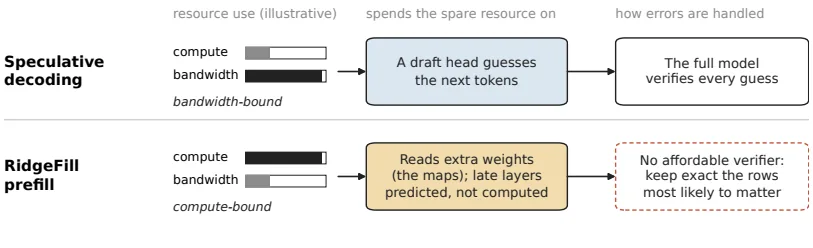
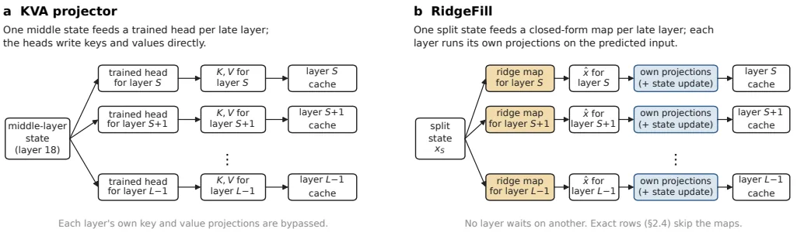
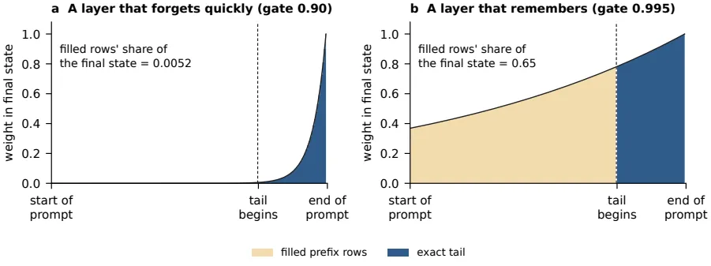
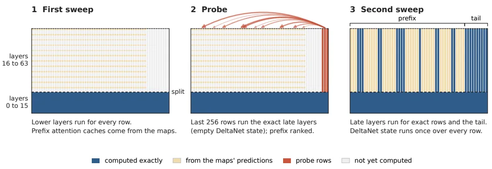
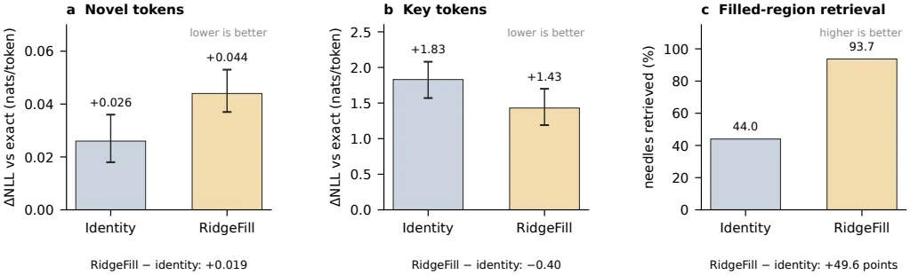

[논문 링크](https://arxiv.org/abs/2611.09709v1)
## 도입: 답이 나오기 전의 대기 시간

긴 프롬프트를 넣으면 첫 토큰이 나올 때까지 모델이 그 문서를 끝까지 통과시켜야 하고, 그만큼 사용자가 아무것도 보지 못한 채 기다린다. RidgeFill은 이 대기 시간을 줄이려고, 일부 층의 계산을 건너뛰고 그 층이 만들어야 할 캐시를 근사해 미리 채운다. 학습은 필요 없고, 꼬리와 일부 선택된 행, 그리고 모든 디코딩 단계는 정확히 계산한다.

## 배경: 프리필은 왜 느리고, 어디에 여유가 있는가

<strong>프리필(prefill)</strong>은 프롬프트를 모델에 한꺼번에 넣어 첫 응답 토큰이 나올 때까지 계산하는 구간이다. 이 구간이 끝나야 화면에 텍스트가 나타나므로, 문서가 길수록 사용자가 보는 것은 대기뿐이다.

왜 오래 걸리는지 보려면, 디코딩과 프리필이 전혀 다른 상황에서 돌아간다는 사실을 먼저 알아야 한다. 디코딩은 한 번에 토큰 하나씩 내놓으므로, 매 스텝마다 가중치를 읽어 오는 메모리 대역폭에 묶이고 연산에는 여유가 남는다. 그래서 speculative decoding은 남는 연산으로 다음 토큰을 미리 추측해 두고, 전체 모델이 그 추측을 한 번에 검증한다.

프리필은 반대다. 가중치를 한 번 읽으면 그 값을 수백 개 프롬프트 행이 함께 쓴다. 즉 대역폭에는 여유가 남고 GPU는 산술 연산에 묶인다. RidgeFill은 이 남는 대역폭을 써서 층마다 맵(map) 하나씩을 추가로 읽고, 그 대가로 윗층의 산술 대부분을 생략한다.

원문 Fig. 1. 왼쪽의 speculative decoding과 오른쪽의 RidgeFill 프리필은 '남는 자원'을 서로 반대 방향으로 쓴다. 디코딩은 대역폭에 묶여 있으니 남는 연산으로 다음 토큰을 추측하고 전체 모델이 검증한다. 프리필은 산술에 묶여 있으니 남는 대역폭으로 맵을 읽고 윗층의 산술을 생략한다. 오른쪽 아래 칸이 말하는 차이는 검증이다. 채워진 캐시에는 값싼 검증기가 없으므로, 중요한 행을 정확히 남기는 쪽으로 문제를 바꾼다.

speculative decoding은 추측을 전체 모델로 검증하지만, RidgeFill이 채워 놓은 캐시는 검증할 방법이 없다. 채워진 캐시를 확인하려면 전체 모델을 다시 돌려야 하는데, 그것은 정확 프리필을 정확 프리필 비용으로 하는 일이다. 전체 모델로 매 행을 검증하는 시도도 해봤고 동작은 했다. 다만 싼 검사들은 어디를 봐야 하는지만 알려줄 뿐이었다. 매 디코딩 스텝마다 모든 채워진 행을 점수화하면 디코딩 시간이 8~18% 늘었고, 몇 스텝마다 검사하는 방식은 수리가 필요한 행을 15~98%의 스텝에서 놓쳤다(Appendix I.4). 그래서 목표가 뒤집힌다. 채움을 최대한 자주 맞추기가 아니라, 가장 크게 틀리는 행을 찾아 그 행만 정확히 계산하는 쪽이다.

## 이 글에서 쓰는 용어

| 용어 | 뜻 | 왜 필요한가 |
|---|---|---|
| KV 캐시 | 어텐션 층이 각 토큰에 대해 기록해 두는 키(key)와 값(value). 나중에 생성되는 토큰이 이 키·값을 읽어 앞 문맥의 정보를 가져온다 | 프리필이 무엇을 만들어 내는지 알아야 채우는 대상이 보인다 |
| 행(row) | 프롬프트의 한 토큰 위치. 한 토큰이 여러 층의 캐시에 남긴 항목 묶음을 이 글에서는 행이라고 부른다 | "어느 토큰을 정확히 계산할지"를 말할 때 단위가 필요하다 |
| 분할 층 $S$, 꼬리 길이 $T$ | 건너뛸 범위를 정하는 두 숫자 | 배포가 고르는 두 값 |
| 접두부(prefix) / 꼬리(tail) | 꼬리를 제외한 나머지 프롬프트 토큰 / 프롬프트 마지막 $T$개 토큰 | 접두부는 근사로, 꼬리는 정확히 계산한다 |
| 채워진 행(filled) / 정확한 행(exact) | 윗층에서 근사로 계산한 행 / 모든 층을 정상적으로 계산한 행 | 시간을 아끼는 곳이 채워진 행이고, 비용은 정확한 행이 낸다 |
| 맵(map) | 층마다 하나씩 있는 행렬 $A_\ell$과 벡터 $b_\ell$. 분할 층의 은닉 상태를 그 층의 입력으로 바꾸는 역할 | 학습 없이 근사를 만드는 유일한 장치다 |

## 작은 예시: 한 행이 캐시에 남는 과정

아래는 원문의 정의를 (§2.1) 손으로 옮겨 놓은 설명용 구성이며, 실험 결과가 아니다.

8개 층(0~7)짜리 모델에 12토큰 프롬프트가 들어왔다고 하자. "The vault code is 4 8 2 7, repeat it again now." 이 중 앞 9토큰이 접두부이고 뒤 3토큰이 꼬리다. 건너뛸 범위를 정하는 두 숫자로 분할 층 $S=4$, 꼬리 길이 $T=3$을 골랐다. 접두부 중간에는 정확히 복사해야 할 숫자 "4827"이 들어 있다.

| 행 | 아래층(0–3) | 윗층(4–7) | 생략되는 계산 | 캐시에 남는 것 | 나중에 읽힐 때 |
|---|---|---|---|---|---|
| 접두부의 일반 토큰 | 4개 층을 정상 계산 | 맵으로 입력 $\hat{x}_\ell$을 예측해 그 층의 키·값만 계산 | 윗층의 어텐션 출력과 MLP | 근사한 키·값 | 꼬리와 생성 토큰이 읽으면 근삿값이 나온다 |
| 접두부의 숫자 토큰 "4827" | 동일 | 근사로 채우면 값이 흐려진다. 선택기가 지정한 숫자 행은 근사 대신 정확 계산 | 선택을 받으면 생략 없음 | 정확한 키·값 | 숫자가 그대로 복사된다 |
| 꼬리(뒤 3토큰) | 정상 계산 | 정상 계산 | 없음 | 정확한 키·값 | 접두부의 근삿값을 읽으므로 꼬리 출력도 정확 계산과 달라질 수 있다 |
| 생성 토큰(답) | 정상 계산 | 정상 계산 | 없음 | 정확한 키·값 | 답이 토큰마다 만들어진다 |

버려지는 것은 접두부 윗층의 어텐션 출력과 MLP 계산이고, 유지되는 것은 아래층의 상태와 꼬리·정확한 행의 정확한 캐시다. 마지막 열에서 중요한 점이 하나 드러난다. 꼬리 자체는 정확히 계산하지만, 꼬리가 접두부의 근삿값을 읽으므로 꼬리의 출력까지 정확 계산과 달라질 수 있다.

같은 접두부를 다루는 방법은 네 가지다. 방식의 정의는 원문 Table 3에, 아래 수치는 primary split의 Table 18과 Appendix A에 해당한다.

| 방식 | 접두부 행에 대해 윗층이 쓰는 입력 | 접두부 캐시 | 참조 모델의 채움 영역 검색 |
|---|---|---|---|
| 정확(exact) | 실제 입력 $x_\ell$ | 정확한 키·값 | 98.7~99.9 |
| 채우지 않음(no fill) | 아무것도 쓰지 않음 | 비어 있음 | 0.0 |
| 항등(identity, POP의 채움) | 분할 층 상태 $x_S$를 그대로 복사 | 층마다 같은 근사 | 9.7~78.1 |
| RidgeFill | $A_\ell x_S + b_\ell$ | 층마다 다른 근사 | 49.4~93.7 |

### 숫자 니들이 알려준 것

저자들은 개발 단계에서 접두부에 숨긴 7자리 숫자 니들을 찾아봤다. 채움 상태에서는 52개 중 33개를 찾아냈고, 틀린 17개 숫자 중 13개는 마지막 자릿수만 달랐다. 숫자 토큰이 든 행만 정확히 계산하도록 바꾸니 36개 중 36개를 찾아냈지만, 적어도 같은 수의 행(블록 단위로 올림해 3~10배)을 꼬리에 붙이는 방법으로는 36개 중 28개에 그쳤다. 이때 숫자가 아닌 이름이나 문장을 찾는 니들도 여전히 실패했지만, 숫자 행의 정확한 계산은 그런 니들에 거의 도움이 되지 않았다.

| 모델과 니들 종류 | 숫자 행을 정확히 계산 | 어텐션으로 고른 5% 행을 정확히 계산 |
|---|---|---|
| Llama-3.1-8B, 숫자 다중 키 | +25포인트 | +22포인트 |
| Llama-3.1-8B, 텍스트 | +2포인트 | +15포인트 |
| Qwen3.5-9B, 숫자 다중 키 | +26포인트 | +21포인트 |
| Qwen3.5-9B, 텍스트 | 0포인트 | +16포인트 |

그래서 출시된 선택기는 숫자가 아니라 어텐션과 토큰 부류로 행을 고른다(Appendix I.2).

## 방법: 늦은 층의 입력을 예측해 캐시를 채운다

### 두 숫자로 건너뛸 범위를 정한다

배포는 두 값을 고른다. 분할 층 $S$는 어디서부터 건너뛸지를, 꼬리 길이 $T$는 마지막 몇 토큰을 절대 건너뛰지 않을지를 정한다. 층 $0$부터 $S-1$까지는 모든 행에 대해 정상적으로 돌고, 마지막 $T$개 토큰과 모든 생성 토큰도 모든 층을 정상적으로 돈다. 나머지 $N-T$개 토큰이 접두부다.

윗층에서 접두부의 한 행은 정확한 행이거나 채워진 행이다. 정확한 행은 꼬리처럼 모든 층을 정상적으로 돌고, 채워진 행이 시간을 아끼는 곳이다. 정상적인 순전파에서는 어떤 층의 입력이 곧 이전 층의 출력이므로, 27B의 분할 16에서 40번째 층에 도달하려면 16~39번째 층을 먼저 돌아야 한다. RidgeFill은 채워진 행에 한해 이 사슬을 끊고, 분할 층 상태 $x_S$ 하나에서 각 윗층의 입력 $\hat{x}_\ell$을 직접 예측한다.

세 가지 배포의 설정은 이렇게 다르다.

| | 참조 연구 | Qwen3.8-27B | Qwen3.8-Flash-Next |
|---|---|---|---|
| 모델 | Llama-3.1-8B, Qwen3.5-9B, Qwen3-8B | Qwen3.8-27B | Qwen3.8-Flash-Next |
| 분할 $S$ / 층 $L$ | 12/32, 12/32, 13/36 | 16/64 | 24/48 |
| 꼬리 $T$ | 4,096 | 4,096 | 2,048 |
| 정확한 접두부 행 | 기본 없음, '+행' 팔에서 어텐션 선택 10% | 프로브, 특수 토큰, 어휘 네트 | 기본 없음, 품질 모드에서 보호 토큰 |
| 벌점 $\lambda$ | 0.03, 0.03, 0.01 | 0.03 | 0.03 |
| 값 재조정 | 끔 | 켬, $c=512$ | 끔 |
| 종단 상태 교정 | 끔 | 끔 | 품질 모드만 |

### 릿지 맵: 입력을 예측하면 원래 투영이 그대로 돈다

예측은 층마다 하나씩 있는 행렬 $A_\ell$과 벡터 $b_\ell$로 이뤄진다.

$$\hat{x}_\ell = A_\ell\, x_S + b_\ell$$

여기서 $x_S$와 $x_\ell$은 길이 $d$짜리 벡터이고(참조 모델은 $d=4096$, 27B는 $5120$), $A_\ell$은 $d\times d$ 행렬이다. 이 맵은 학습이 아니라 캘리브레이션 텍스트 위에서 한 번에 맞춘다. 원본 모델을 한 번 돌리면서 분할 층 상태 $x_S$와 각 윗층의 실제 입력 $x_\ell$을 기록해 두고, 예측 오차의 제곱합에 행렬 크기를 억제하는 패널티를 더한 목적을 최소화한다.

$$\min_{A_\ell, b_\ell}\; \sum_t \lVert x_{\ell,t} - (A_\ell x_{S,t} + b_\ell)\rVert^2 + \alpha\lVert A_\ell\rVert_F^2$$

이 문제는 반복 학습 없이 풀 수 있는 닫힌 형태의 해를 가진다. 각 벡터에서 평균($\mu_S$, $\mu_\ell$)을 뺀 뒤, $X$는 분할 층 상태들을, $Y_\ell$는 층 $\ell$의 입력들을 행으로 쌓은 행렬이고, $\alpha$가 패널티 세기다.

$$A_\ell = Y_\ell^\top X\,(X^\top X + \alpha I)^{-1}, \qquad b_\ell = \mu_\ell - A_\ell\,\mu_S$$

패널티는 $\alpha = \lambda\,\mathrm{tr}(X^\top X)/d_{in}$으로 두어 입력 크기에 묶이므로, 같은 $\lambda$가 모델마다 같은 뜻을 갖는다. 참조 모델과 27B에서는 $\lambda$를 $10^{-4}$에서 1까지의 격자에서 문서 5개를 홀드아웃해 골랐고, Llama-3.1-8B·Qwen3.5-9B·27B는 0.03, Qwen3-8B는 0.01(분할 18에서는 0.003)이 나왔다. Flash-Next는 0.001에서 0.3까지 여섯 값 중에서 홀드아웃 캡처 10개로 골라 0.03이었다. 캘리브레이션은 원본 모델을 한 번 통과시키면서 $X^\top X$, $X^\top Y_\ell$과 두 평균만 누적해 두면 되므로, 새 $\lambda$는 다시 읽지 않고 다시 푸는 것만으로 충분하다. 새 분할을 쓰려면 통과를 한 번 더 해야 한다. 27B에서 분할 16·24·32의 캘리브레이션과 푸기를 한 번에 끝내는 데는 RTX 5090 한 장으로 26분이 걸렸다.

예측된 입력은 실제 입력처럼 그 층 자체의 정규화와 투영을 그대로 통과한다. 이것이 kishida의 KVA 프로젝터와의 첫 번째 차이다. KVA 프로젝터는 학습된 헤드로 각 윗층의 키·값을 직접 써 넣지만, RidgeFill은 입력을 예측하기 때문에 그 층의 원래 키·값 투영이 그대로 돌고, 하이브리드 모델에서는 순환 상태 갱신도 그대로 돈다.

원문 Fig. 2. 두 경로가 갈라지는 지점은 '무엇을 예측하느냐'다. (a)는 층 18의 상태에서 각 윗층의 키·값을 직접 예측해 그 층의 투영을 우회한다. (b)는 각 윗층의 입력을 예측해 그 층이 자기 투영을 스스로 돌리게 하므로 가중치를 전혀 바꾸지 않는다. 상태의 흐름으로 보면, 분할 상태 하나가 층마다 하나의 맵을 지나 예측된 입력이 되고, 그 입력이 그 층의 정규화와 투영을 거쳐 캐시 항목으로 저장된다. 어느 층도 다른 층을 기다리지 않는다. 정확한 행은 맵을 건너뛰고 자기 정확한 입력으로 그 층을 돈다.

맵의 크기가 비용으로 이어진다. 참조 모델(은닉 4096)에서는 층당 32 MiB(bfloat16 기준)이고, 27B(은닉 5120)에서는 48개 윗층 전체를 int8로 담아 1.2 GiB다. Flash-Next는 Gated Residual이라 잔여 스트림이 폭 2,560인 네 개 병렬 스트림이고 각 층이 이를 게이트로 섞어 읽으므로, 맵의 입력 폭은 10,240이고 출력 폭은 2,560이다. 24개 맵을 int8로 담아 0.60 GiB다. 맵은 GPU 메모리에 상주시키거나 호스트 메모리에서 한 층씩 스트리밍한다.

### 하이브리드 층과 두 교정

다섯 모델 중 셋(Qwen3.5-9B, Qwen3.8-27B, Qwen3.8-Flash-Next)은 어텐션 층과 Gated DeltaNet 층이 섞인 하이브리드다. Gated DeltaNet 층은 키·값 캐시 대신 순환 상태 하나를 유지하고, 매 토큰마다 그 상태에 0과 1 사이의 게이트를 곱한 뒤 새 토큰의 갱신을 더한다. 게이트가 1보다 작으므로 오래된 토큰은 서서히 희미해진다.

이 차이가 채움 오차가 어디로 가는지를 정한다. 어텐션 층에서는 채워진 행의 오차가 그 행의 키·값 안에만 남는다. Gated DeltaNet 층에서는 채워진 행마다 공유 상태가 갱신되므로, 모든 행의 오차가 꼬리가 물려받는 상태에 접힌다. 그래서 채워진 캐시를 정확한 쪽으로 되돌리는 교정 두 가지를 얹는다. 둘 다 평균적인 오류를 대상으로 하고 학습되지 않았다.

첫째는 값 재조정(value rescale)이다. 각 윗층 어텐션 층에서 꼬리의 처음 $c$개 행을 그 층의 값 투영에 두 번 통과시킨다. 한 번은 정확한 입력으로, 한 번은 맵의 예측으로. 키·값 헤드별로 정확한 값의 크기를 예측한 값의 크기로 나눈 비율을 그 $c$행에 걸쳐 평균하면 배율이 나오고, 이 배율을 채워진 값들에 곱한다. 배율은 요청마다 그 요청의 토큰으로 측정한다. 이 교정이 값을 겨냥하는 이유는, Qwen 모델들이 키를 정규화해 각 키의 크기가 고정되므로 키의 크기를 되돌릴 게 거의 없기 때문이다(값에는 그런 정규화가 없다). 세 배포 중 27B만 이 교정을 쓴다($c=512$).

둘째는 종단 상태 교정(terminal-state correction)으로, Flash-Next의 품질 모드에서만 쓴다. 접두부 끝에서 각 채워진 Gated DeltaNet 층의 상태에 $\rho_\ell\,\Delta M_\ell$을 한 번 더한다. $\Delta M_\ell$은 정확한 상태와 채워진 상태의 평균 차이(층·값 헤드별)이고, 맵 캘리브레이션과 평가 세트에서 분리한 13개 프롬프트에서 2,048토큰마다(층당 62개 상태) 측정한다. $\rho_\ell$은 접두부가 끝나는 시점에서 채워진 행의 가중치가 전체 행 가중치에서 차지하는 비중이며, 채움 과정이 계산하는 게이트에서 요청마다 읽는다.

원문 Fig. 4. 가로축은 프롬프트의 위치, 세로축은 그 위치의 행이 최종 상태에 남기는 가중치다. 갈색은 채워진 접두부, 파란색은 정확한 꼬리다. 행의 가중치는 그 뒤에 오는 게이트들의 곱이므로, 게이트가 0.90이면 접두부 행들은 꼬리가 끝날 무렵 이미 거의 희미해져 최종 상태의 약 0.005만 차지하고, 게이트가 0.995면 약 0.65를 차지한다. 이 값은 꼬리가 끝난 뒤 최종 상태에서 채워진 접두부가 차지하는 비중이지, 접두부 끝 시점의 $\rho_\ell$과 다르다. 따라서 종단 상태 교정은 게이트가 1에 가까워 기억하는 층에서만 의미가 있다. 이 그림은 200행, 마지막 50행 정확이라는 예시 수치이며 실험 결과가 아니다.

### 어떤 행을 정확히 계산할지

채워진 캐시는 싸게 검증할 방법이 없으므로 목표가 뒤집힌다. 채움을 최대한 자주 맞추기가 아니라, 가장 크게 틀리는 곳을 찾아 그 행만 정확히 계산하는 것이다. 논문은 배포마다 다른 선택기 세 개를 쓴다.

- **어텐션 선택(참조 연구)**: 마지막 64개 토큰으로부터 가장 많은 어텐션을 받는 프롬프트 토큰의 10%를 정확히 돈다. 어텐션은 분할 아래 어텐션 층(층 3, 7, 11, 15 중 해당하는 것)의 모든 헤드에서 합산한다. 질문이 프롬프트 끝에 있을 때 이 행들이 곧 질문이 주목하는 행이다.
- **보호 토큰(Flash-Next 품질 모드)**: 질문을 읽지 않고, 대문자 단어 시작·대문자 단어 조각·소문자 단어 조각·혼합 토큰 네 부류 중 캘리브레이션 문서의 애드원 유니그램 빈도로 가장 희귀한 25%를 정확히 돈다. Flash-Next 실행에서는 접두부 위치의 3~10%에 해당했다.
- **27B 프로브**: 마지막 256개 행이 채워진 캐시 위에서 정확한 윗층을 한 번 돌고, 이 256행이 접두부 각 행에 주는 어텐션으로 순위를 매겨 상위 행을 고른다. 여기에 특수 토큰은 예산 외로 더하고, 어휘 네트(lexical-net) 행은 예산 안에서 최대 5%까지 예약한다. 어휘 네트는 프롬프트 마지막 64개 내용 토큰과 4단어 이상을 공유하고 그 안에 접두부 전체에서 두 번 이하로 나온 단어를 포함하는 문장을 후보로 삼는다(문장당 첫 80행까지).

어텐션 선택의 근거는 소프트맥스 어텐션의 성질 하나다. 어떤 행의 값이 $\delta$만큼 틀리면, 그 행을 읽는 질의의 출력은 그 질의가 그 행에 주는 어텐션 $a_{ij}$에 정확히 비례해 $\delta$만큼 변한다. 점수(로짓)가 $\varepsilon$만큼 변하면 출력은 최대 $2V a_{ij}(e^{|\varepsilon|}-1)$만큼 변하는데, 여기서 $V$는 그 질의가 보는 행 중 가장 큰 값 벡터의 크기다. 두 상한 모두 $a_{ij}$에 비례하므로, 오차 크기가 모든 행에서 같다면 어텐션을 많이 받는 행을 정확히 두는 것이 총 오차 상한을 최소화한다. 실제 오차는 행마다 크기가 다르므로, 나머지 두 선택기는 토큰 종류로도 행을 보호한다.

### 27B: 두 번 스윕

27B의 프리필은 두 번의 스윕으로 돈다.

원문 Fig. 5. (1) 첫 스윕은 모든 행에 대해 층 0~15를 돌고 접두부의 윗층 어텐션 캐시를 맵의 예측으로 써 넣는다. 꼬리와 윗층 Gated DeltaNet 상태는 아직 계산되지 않는다. (2) 프로브는 마지막 256행을 채워진 캐시 위에서 정확한 윗층으로 통과시키며(DeltaNet 상태는 빈 상태에서 시작), 이 256행이 접두부에 주는 어텐션으로 접두부 전체를 순위 매긴다. (3) 둘째 스윕이 선택된 행과 꼬리에 대해 윗층을 돌고, Gated DeltaNet 상태는 접두부 전체를 한 번 순서대로 통과시킨다. 채워진 채 남는 행은 자신의 근사 캐시를 그대로 유지한다.

프로브가 남기는 행 수는 비율이 아니라 개수로 정해진다. 기본 규칙(보호 부류 일치의 절반, 모든 숫자 토큰, 아래층 질문 어텐션 상위 20%)의 합집합 크기에 예산 계수 1.0을 곱한 값이며, 타이밍 프롬프트에서 접두부의 28~31%였다. 숫자 토큰은 예산 크기를 정할 뿐 프로브 순위가 높지 않으면 정확히 계산되지 않는다. 프로브 자체 비용은 256행을 윗층에 통과시키는 것과 그 행들이 접두부에 거는 어텐션으로, 16K 프롬프트의 윗층 행 수의 약 1.6%다.

## 측정: 평균 손실은 오차를 숨긴다

논문의 저자들은 "작업의 대부분은 측정이었다"고 쓴다(초록). 그 이유가 분명한 예가 하나 있다. Qwen3-8B에서 RidgeFill과 단순한 항등 채움은 새 토큰 손실에서 0.019 nat밖에 차이 나지 않아, 아무것도 아닌 수치로 읽힌다. 그런데 같은 실행에서 채움 영역에 숨긴 니들을 찾는 검색은 항등 채움이 44.0%, 맵 채움이 93.7%를 맞힌다.

원문 Fig. 8. 세 패널이 같은 실행의 세 지표다. (a) 90개 문서(핵심 토큰은 63개)의 새 토큰 손실, (b) 핵심 토큰 손실, (c) 138개 RULER 표본의 채움 영역 검색. 새 토큰 손실에서는 RidgeFill이 항등 채움보다 살짝 나빠 보이지만, 접두부에 의존하는 토큰과 검색에서는 훨씬 낫다. 평균 손실이 오해를 부르는 이유는 대부분의 점수 토큰이 접두부에 의존하지 않아, 채움 오차가 영향을 받지 않는 토큰에 희석되기 때문이다.

그래서 이 논문은 오차를 숨기지 않는 지표를 골라 쓴다. 채움 영역 검색은 니들이 정확한 꼬리가 아니라 접두부에 있는 표본만 센다. '핵심 토큰' 손실은 문맥을 마지막 4,096토큰으로 잘랐을 때 정확한 손실이 2 nat 넘게 오르는 토큰, 즉 접두부가 실제로 기여하는 토큰만 센다. '새 토큰' 손실은 프롬프트 앞부분에 이미 나타난 8토큰 연속 구간에 속하지 않는 토큰이다. 스플라이스 검사는 채워진 키 또는 값을 정확한 것으로 바꿔 보고 남는 손실을 재서 오차가 어느 성분에 있는지 짚어낸다. 꼬리가 두꺼운 평균은 중앙값과 나란히 보고, 27B의 32K에서 평균 KL이 다섯 개의 복사-heavy 문서에 끌려 올라간 것도 중앙값 0.004와 함께 적었다.

벤치마크가 보여 준 문제를 고치는 일과 벤치마크에 맞추는 일 사이의 선은 얇다. 저자들은 그 선을 세 곳에서 그었다. 고치는 방식은 특정 패턴이 아니라 규칙이어야 했다(토큰 부류, 받은 어텐션, 희귀도). 평가에 쓰는 스위트는 저자가 만들지 않은 공식 벤치마크이고, 정확한 행을 고르는 실험마다 같은 수의 무작위 행을 나란히 두었다. 자기 니들 스위트가 RULER의 다중 키 과제에서 실패한 설정을 통과한 뒤로는, 그 스위트로 어떤 결정도 내리지 않았다(Appendix I.5).

## 결과: 속도

### 연산 상한과 실측값은 다르다

먼저 질문을 나누자. "프리필이 얼마나 빨라지는가"와 "얼마나 빨라질 수 있는가"는 다른 질문이다. 모든 층이 토큰당 같은 비용이고 맵이 공짜라고 가정하면, 남는 연산 비율은 분할과 꼬리만으로 계산된다.

$$r = \frac{S(N-T) + LT}{LN} = \frac{S}{L} + \left(1 - \frac{S}{L}\right)\frac{T}{N}$$

접두부 토큰은 $S$개 층만 돌고 꼬리 토큰은 $L$개 층을 돌므로, 속도 상한은 $1/r$이다. 이 계산은 층 통과 횟수만 세므로 문맥에 대한 어텐션 비용을 무시한다. 그래서 27B에서는 다른 상한과 비교한다. 어텐션, Gated DeltaNet 상태 갱신, 맵, 프로브, 값 재조정까지 센 곱셈·덧셈 기준으로 건너뛴 비율이 16K에서 30%, 120K에서 42%이고, 이 비율로부터의 상한은 각각 1.43배, 1.72배다(§4.2, §4.4). 이 상한은 층별 비용 차이를 반영하지 않는다.

### Qwen3.8-27B (llama.cpp 포크, A100 한 장)

분할 16/64, 꼬리 4,096. TTFT는 서버 측 웜 프롬프트 시간으로 3회 요청의 중앙값이다(§4.4, Table 8). 기준 stock은 채움을 끈 fork가 원판 빌드와 바이트 단위로 동일함이 확인된 상대다(§4.3).

| 프롬프트 토큰 | stock(초) | RidgeFill 상주(초) | 배속 | 스트리밍(초) | 배속 | stock 대비 추가 VRAM(상주/스트리밍) |
|---|---|---|---|---|---|---|
| 16,384 | 12.97 | 10.38 | 1.25× | 10.88 | 1.19× | +1,592 / +268 MiB |
| 32,768 | 27.49 | 21.11 | 1.30× | 21.69 | 1.27× | +1,802 / +478 MiB |
| 65,536 | 60.50 | 46.28 | 1.31× | 46.55 | 1.30× | +2,270 / +944 MiB |
| 120,000 | 128.10 | 100.01 | 1.28× | 99.06 | 1.29× | +3,014 / +1,732 MiB |

실측 배속은 연산 상한보다 낮다. 16K에서 상한 1.43배인데 측정 1.25배, 120K에서 상한 1.72배인데 측정 1.28배다. 저자들은 세 가지를 가능한 원인으로 드는데, 어디에 얼마나 배분되는지는 프로파일하지 않았다. 정확한 행과 꼬리가 윗층 12개 어텐션 층에서 여전히 전체 문맥에 어텐션을 걸어 프롬프트 길이의 제곱에 비례해 자란다는 점, 흩어진 정확한 행이 무게 읽기 비용은 전액 치르고 일은 일부만 한다는 점, 프로브가 256행을 미리 돌린다는 점이다. 32K를 넘어서면 건너뛴 비율이 계속 오르는데도 배속은 1.3배 부근에 머문다.

추가 메모리는 상주하면 1.6~2.9 GiB, 호스트 메모리에서 스트리밍하면 0.3~1.7 GiB다(§8). 스트리밍은 16K에서 0.5초를 더 쓰고 1.3 GiB를 아낀다. 캐시 메모리 자체는 줄지 않는다. 모든 접두부 행이 캐시 항목을 그대로 유지하기 때문이다.

### Qwen3.8-Flash-Next (vLLM 포크, R9700 두 장)

48층 하이브리드 MoE, 분할 24/48, 꼬리 2,048. TTFT는 클라이언트 측에서 5회 중앙값이고, 같은 서버 시작 안에서 정확과 교대로 쟀다. 64K 열은 프리필+짧은 답의 전체 요청 중앙값으로, 서버 시작이 다른 측정이다. 기준은 원판과 대조 검증된 적 없는 fork 자체의 정확 경로라 'stock'이 아닌 'exact'로 불린다. 속도 수치에는 구간이 없다(§5.3, Table 16).

| 구성 | TTFT 9K | TTFT 16K | TTFT 32K | 64K 요청(전체) |
|---|---|---|---|---|
| 정확한 프리필 | 1.00× | 1.00× | 1.00× | 1.00× (82.6초) |
| RidgeFill | 1.50× | 1.54× | 1.60× | 1.74× (47.5초) |
| 품질 모드 | 1.25× | 1.22× | 1.27× | 1.49× (55.6초) |

측정값은 연산 상한의 85~92%다(1.50× 대 1.64×, 1.54× 대 1.78×, 1.60× 대 1.88×). Flash-Next의 상한 자체가 27B의 상한 1.43~1.72배보다 높고, 꼬리도 2,048토큰으로 더 짧으며 정확한 접두부 행이 없다. 두 배포의 설정이 달라 실측 배속을 직접 나란히 비교하지는 않는다. 다만 이 배포는 라우팅 전문가 가중치의 약 2/3를 호스트 메모리에 두고 PCIe로 읽으므로, 채움이 줄인 '연산'과 'PCIe 전송'을 분리해 낼 수 없다. 연산에 묶인 프리필과 PCIe에 묶인 프리필은 같은 상한을 예측하기 때문에, 상한의 85~92%에 도달했다는 사실만으로는 구분이 안 된다. 프리필이 연산에 묶였다는 전제의 근거는 가중치가 전부 GPU 메모리에 있는 27B다(§5.3, §8).

### 여러 사용자를 동시에 처리할 때

27B에서 새 요청이 다른 사용자들이 디코딩하는 중에 들어올 때, RidgeFill은 그 요청의 첫 토큰 시간을 12~16% 줄이고 다른 사용자들의 처리량을 3~10% 올린다. 프리필이 짧아져 다른 사용자들을 막는 시간이 줄기 때문이다(§4.8). 단, 다른 사용자의 99분위 지연은 2인 구간에서는 짧아지지만 4·8인 구간에서는 오히려 길어졌다. 두 스윕 프리필이 더 작은 단계로 양보하기 때문이다. stock 쪽 4인 구간의 값은 두 번 반복에서 나온 값이라 주의해서 읽어야 한다.

## 결과: 품질

### 8~9B 참조 모델: 채움 자체의 효과

핵심 비교는 "학습 없이 만든 맵이, 같은 분할·꼬리 조건의 항등 채움보다 얼마나 나은가"다. 이 비교는 정확한 접두부 행 없이 진행됐다(§6.2, Table 18).

| 지표 | Llama-3.1-8B | Qwen3.5-9B | Qwen3-8B |
|---|---|---|---|
| 채움 영역 검색, 항등 채움 | 9.7 | 78.1 | 44.0 |
| 채움 영역 검색, RidgeFill | 49.4 | 81.4 | 93.7 |
| 차이(포인트, 95% 구간) | +39.7 [+32.6, +46.5] | +3.3 [−1.3, +7.8] | +49.6 [+43.3, +56.2] |
| 새 토큰 손실 차이(nat) | +0.501 [+0.307, +0.748] | +0.001 [−0.003, +0.005] | +0.019 [+0.012, +0.025] |
| 핵심 토큰 손실 차이(nat) | +1.047 [+0.521, +1.666] | −0.347 [−0.523, −0.196] | −0.400 [−0.634, −0.159] |
| 디코딩 일치율 차이(포인트) | +6.3 [+4.6, +8.5] | +0.5 [+0.1, +1.0] | +1.2 [+0.6, +2.0] |

두 밀집 모델에서 검색 차이가 크고, 두 Qwen 모델은 핵심 토큰 손실에서도 항등 채움보다 낫다. 반면 Llama은 이 분할에서 손해를 본다. Llama의 채움 영역 검색은 8K~64K 기준 49.4이며, Qwen3-8B가 도달하는 8K~32K 구간만 보면 항등 채움과의 차이는 49.1포인트다.

같은 비용을 다른 데 쓴 제어 실험도 있다. 채움 없이 꼬리를 채움과 같은 비용이 되도록 늘리면 세 모델의 검색은 13.2, 26.3, 25.4에 그친다. 새 토큰 손실에서 RidgeFill − 제어 차이는 Llama −0.413 nat[−0.690, −0.075], Qwen3.5 +0.013 nat, Qwen3-8B −0.086 nat이다(음수가 RidgeFill 우세). Llama의 8개 LongBench 과제도 방향이 같은데, RidgeFill 46.4, 항등 채움 44.0, 정확한 계산 49.7, 채움 안 함 21.3, POP 42.8, 항등 채움+행 48.1, RidgeFill+행 49.1이다.

### 분할 깊이가 결과를 바꾼다

Llama은 깊이에 따라 뒤집힌다(§6.1, Table 17).

| 모델 | 깊이 | RidgeFill | 항등 채움 | 채우지 않음 |
|---|---|---|---|---|
| Llama-3.1-8B | 1/4 (S=8) | +0.804 | +0.409 | +1.983 |
| Llama-3.1-8B | 3/8 (S=12) | +1.006 | +0.505 | +1.591 |
| Llama-3.1-8B | 1/2 (S=16) | +0.085 | +0.563 | +1.471 |
| Llama-3.1-8B | 5/8 (S=20) | +0.030 | +0.406 | +1.225 |
| Llama-3.1-8B | POP 설정 (S=22) | +0.373 | — | — |
| Qwen3.5-9B | 1/4 ~ 5/8 | +0.033 → +0.008 | +0.032 → +0.006 | +0.056 → +0.026 |
| Qwen3-8B | 1/4 ~ 5/8 | +0.042 → +0.023 | −0.004 → +0.019 | +0.655 → +0.155 |

수치는 정확한 계산 대비 새 토큰 손실(nat/토큰)이며 낮을수록 좋다. 화살표는 1/4에서 5/8까지의 변화다. 두 Qwen 모델은 모든 깊이에서 정확한 계산과 0.05 nat 안에 머문다. Llama은 얕은 분할에서 실패하고 반 깊이에서 뒤집힌다. 새 문서 30개로 만든 재현 실험에서도 이 순서가 그대로 재현돼, 반 깊이에서 −0.533 nat[−0.658, −0.431], 5/8에서 −0.382 nat[−0.484, −0.312]로 항등 채움과 비교해 RidgeFill의 손실이 낮았다(§6.7).

### 오차가 어디에 있는가: 스플라이스

스플라이스는 채워진 키, 채워진 값, 둘 다를 모든 채워진 어텐션 층에서 한꺼번에 정확한 것으로 바꾸고, RidgeFill의 새 토큰 손실이 얼마나 줄었는지를 잰다(§6.6, Table 23).

| 모델 | 스플라이스 | 새 토큰 손실 | 손실이 사라진 비율 | 검색 격차 해소 |
|---|---|---|---|---|
| Llama-3.1-8B | RidgeFill만 | +1.006 | — | — |
| | 정확한 키 | +0.031 | 97.0% | 98.6% |
| | 정확한 값 | +0.120 | 88.1% | 48.6% |
| | 정확한 키와 값 | 0.000 | 100.0% | — |
| | 키 크기만 꼬리에서 보정 | +0.502 | 50.1% | — |
| Qwen3.5-9B | RidgeFill만 | +0.024 | — | 미실시 |
| | 정확한 키 | +0.018 | 25.8% | 미실시 |
| | 정확한 값 | +0.012 | 52.0% | 미실시 |
| | 정확한 키와 값 | +0.002 | 91.5% | 미실시 |
| Qwen3-8B | RidgeFill만 | +0.044 | — | — |
| | 정확한 키 | +0.143 | −222.4% | 10.7% |
| | 정확한 값 | +0.046 | −4.7% | −221.4% |
| | 정확한 키와 값 | +0.001 | 98.8% | — |

Qwen3.5의 스플라이스는 상위 어텐션 5개 층에만 적용되고, 15개 Gated DeltaNet 층은 '정확한 키와 값' 행에서도 채워진 채 남는다. Llama의 오차는 키에 있고 그 절반은 키의 크기에 있다. 크기 보정만으로도 손실이 절반으로 줄고, 값의 크기 보정은 오히려 손실을 키운다. Qwen3.5는 값이 52%, 키가 26%를 맡고 나머지는 Gated DeltaNet 상태다. Qwen3-8B는 키와 값이 함께 맞아야 한다. 키만 정확한 것으로 바꾸면 손실이 세 배로 뛰고, 둘 다 바꾸면 99% 사라진다. 즉 채워진 키와 값은 각각은 틀렸지만 둘 사이의 관계는 일관되어 있다. 키 정규화가 이 패턴을 설명한다. QK 정규화가 있으면 정규화가 각 키의 크기를 고정하므로 키 크기 보정으로 고칠 게 Qwen3.5에서 0.4%, Qwen3-8B에서 11.9%에 그칠 뿐이고, 정규화가 없는 Llama에서는 키의 크기가 어텐션 점수에 직접 들어가 오차가 커진다.

### 학습한 방식과 비교: SwiftKV

SwiftKV는 같은 아이디어의 학습 버전이다. 저자들은 Llama-3.1-8B용 릴리스 체크포인트를 쓰고, 그 증류에는 약 6억 8천만 토큰이 들었다(§6.3, Table 19·20).

| 팔 | 새 토큰 손실 | 핵심 토큰 손실 |
|---|---|---|
| SwiftKV 출시 설정(꼬리 1토큰) | +0.095 | +0.568 |
| SwiftKV의 투영 + RidgeFill의 꼬리 4,096 | +0.061 | +0.115 |
| RidgeFill(꼬리 4,096) | +0.085 | +0.339 |

각자 출시 설정대로 비교하면 SwiftKV의 손실이 RidgeFill보다 0.010 nat 높고(구간이 0을 포함해 비긴다), 같은 꼬리를 씌우면 SwiftKV의 학습된 투영이 0.024 nat 앞서고 핵심 토큰에서는 0.224 nat 앞선다. 이것이 그 모델에서, 우리 꼬리를 씌웠을 때 학습이 사다 주는 전부다.

POP과는 두 분할에서 비교했다(§6.4). 5/8 깊이에서 RidgeFill은 POP보다 더 많은 층을 건너뛰면서도 채움 영역 검색에서 3포인트 마진으로 비열등하다. Llama 8K~32K에서 RidgeFill 98.7, POP 94.1, 정확한 계산 99.8, 항등 채움 95.0이고, Qwen3-8B에서는 RidgeFill 99.1, POP 98.7, 정확한 계산 98.7이다. 다만 이 깊이에서는 RidgeFill이 곱셈·덧셈 수를 더 쓴다. 꼬리가 4,096이고 맵 비용이 붙으므로, Llama에서 약 46K, Qwen3-8B에서 약 59K를 넘어야 POP보다 싸진다. 주 분할에서는 혼합적인 그림이다. Qwen3-8B의 S=13은 새 토큰 손실이 POP과 같고(차이 +0.001 nat), 32K에서 곱셈·덧셈은 24% 적지만 검색은 93.7로 98.7에 못 미친다. Qwen3.5에서는 새 토큰 손실에서 POP이 0.008 nat, Llama에서는 0.63 nat 앞선다.

### 서빙 모델의 공식 벤치마크

27B는 RULER 13개 과제를 16K와 32K에서, LongBench v2 전체 503문항을 공식 CoT 프로토콜로 돌렸다(§4.5, §4.6).

| 벤치마크 | n | stock | RidgeFill | 차이(포인트) | 95% 구간 |
|---|---|---|---|---|---|
| RULER 16K | 260 | 85.69 | 84.51 | −1.19 | [−3.13, +0.79] |
| RULER 32K | 260 | 87.85 | 86.42 | −1.42 | [−3.21, +0.35] |
| LongBench v2 전체 | 503 | 38.57 | 37.18 | −1.39 | [−4.97, +2.19] |
| LongBench v2 장문 그룹 | 108 | 26.85 | 25.93 | −0.93 | [−7.41, +6.48] |

구간은 모두 0을 포함하지만 몇 포인트 손실도 배제하지 못한다. 가장 크게 떨어진 과제는 common-word extraction으로, 16K에서 −10.0포인트[−32.0, +12.0], 32K에서 −13.5포인트[−36.0, +9.0]이고 과제당 표본은 20개뿐이다. 이 과제의 RidgeFill 답은 정답 길이 상한에 더 자주 걸렸다(16K 12대 8, 32K 7대 4). variable tracking은 두 팔 모두 0점인데, RULER의 답 접두부 프리필을 하지 않는 프로토콜이라 답이 공식 30토큰 예산을 다 쓰고 값에 닿지 못하기 때문이다. 이 칸은 정보가 없고, 13개 과제 평균이 공식 과제 목록을 덮기 위해 남겨 둔 것이다. LongBench v2는 이 모델에서 한계에 걸려 있었다. 첫 번째 패스가 1,024토큰 상한에 닿은 문항은 stock 301개, RidgeFill 302개였고, 추출 가능한 답이 없던 문항은 각각 189개와 181개였다. 양팔이 같은 문항에서 같은 한계에 닿았으므로 비교는 공정하지만 여유가 크지 않다.

정확한 모델과의 일치도는 27B에서 별도로 측정했다(§4.7). 16K에서 top-1 일치율은 94.64%, 32K에서 93.60%이고, 중앙 KL은 각각 0.0040과 0.0042인 반면 평균 KL은 0.0894와 0.2656이었다. 32K의 평균 KL은 복사 비중 0.5 이상인 다섯 문서가 끌어올렸다. 복사 비율이 0.5 이상인 32K 문서 5개에서 RidgeFill의 손실은 stock보다 4.18 nat 낮았다. 그건 RidgeFill이 더 옳아서가 아니라 모델에서 벗어났다는 뜻이다. 32K에서 두 팔이 가장 크게 갈린 문서 25개를 골라(full-precision BF16 모델로) 확인한 결과, 25개 중 22개에서 Q4 stock가 BF16에 더 가까웠다. 복사를 그대로 되풀이하는 코드 저장소 한 항목에서 stock의 손실은 14.37 nat, BF16는 15.87 nat, RidgeFill은 0.005 nat이었다. stock과 BF16의 손실은 248,320개 어휘에 대한 균일 추측의 12.4 nat보다도 나쁘고, 모델 자체가 그 자리에서 확신을 갖고 복사에 실패한 것이다. RidgeFill만 복사한 셈이다.

Flash-Next의 품질은 다음과 같다(§5.3, Table 15). RULER 니들 과제에서 정확 100.0, RidgeFill 99.8, 품질 모드 99.9이며, 채움 영역 221개 표본 중 RidgeFill은 두 개에서 exact에 못 미쳤다(둘 다 32K multivalue로 네 값 중 세 값만 반환). 새 토큰 perplexity는 +2.65%[−0.02%, +4.93%]로, 0과 구별되지 않으면서 5% 가까운 상승도 허용한다. 품질 모드는 이 차이를 +1.60%[−0.83%, +4.32%]까지 낮추지만, 일반 모드와의 짝 비교가 −1.02%[−2.87%, +0.80%]로 개선이 확정되지 않는다. 대신 속도 이득의 절반을 포기한다(1.22~1.27배 대 1.50~1.60배). 종단 상태 교정은 층당 한 번 더하는 계산이라 비용은 보호된 행일 가능성이 크고, 마지막 실행은 둘을 분리하지 않았다. 보호된 행이 프롬프트 전체에 흩어져 있어 거의 모든 2,048토큰 구간이 윗층 전문가 가중치를 대부분 읽고, 그중 2/3는 PCIe로 읽기 때문이다. 그래서 품질 모드는 선택 사항으로 남았다.

## 한계와 적용 판단

### 저자가 인정한 한계

- **QK 정규화가 없는 모델의 얕은 분할.** Llama-3.1-8B는 기본 분할(3/8 깊이)에서 항등 채움보다 손실이 크다. 64K 이상 36개 문서 중 32개에서는 채우지 않는 것보다도 나쁘고, 90개 짧은 문서에서는 그렇지 않다. 최악은 128K 토큰의 소스 코드로, RidgeFill의 손실이 정확한 계산 대비 +8.19 nat인 반면 채우지 않으면 +0.74 nat이다. 반 깊이 이상으로 내려가면 순서가 뒤집힌다. 저자는 QK 정규화가 없는 모델에는 반 깊이 이상, 또는 어텐션 선택 행을 권장한다.
- **핵심 토큰 손실.** 접두부가 실제로 기여하는 토큰에서 RidgeFill 단독은 정확 계산보다 1.2~3.3 nat 높고, 어텐션 선택 행을 더하면 0.4~0.7 nat로 내려간다. 행을 넣은 뒤에도 Llama와 Qwen3.5의 채움 영역 검색은 99.5와 99.9로 정확한 계산과 대등하지만, 핵심 토큰 손실은 여전히 0.41과 0.43 nat 높다. 니들 점수 100 근처는 이 비용을 숨긴다.
- **행 선택기는 배포마다 다르고 질문에 의존한다.** 어텐션 선택 행은 질문을 가리면 Llama와 Qwen3.5의 채움 영역 검색이 각각 16점과 14점 떨어진다. 27B의 프로브는 마지막 256개 프롬프트 행이 주는 어텐션으로 순위를 매기는데 그 256행에 보통 질문이 들어 있으며, 질문을 숨긴 상태로 실행된 적이 없다. Qwen3-8B에서는 선택된 행이 검색을 93.7에서 89.9로 떨어뜨리는데, 같은 수의 무작위 행은 93.8까지 간다. 이유는 확립되지 않았다.
- **한 캐시를 여러 질문에 재사용하는 경우 미검증.** Appendix D는 첫 질문에 대해 채우고 선택한 캐시에 두 번째 질문을 한다. 선택된 행이 두 번째 니들의 토큰을 이미 중위값으로 Llama와 Qwen3.5에서는 85~86%, Qwen3-8B에서는 54% 덮고 있어서, 형제 니들을 묻는 약한 검사다. 근거가 있는 선택은 행 없이 깊은 분할을 쓰는 것이다(Llama에서 반 깊이면 8K~32K 검색 96.1).
- **검증되지 않은 범위.** 캘리브레이션 문서는 최장 약 30K 토큰이라 그보다 긴 위치에서 맵을 맞춘 적이 없다. Llama의 채움 영역 검색 하락(8K 79.8 → 64K 30.3)을 더 긴 캘리브레이션으로 좁힐 수 있는지는 검증하지 않았다. 27B의 품질 증거는 32K에서 멈추고, 그 위로는 LongBench v2 장문 그룹(108문항, −0.9포인트, 구간 [−7.4, +6.5])이 유일한 근거다. Flash-Next는 연산 절감과 PCIe 절감을 분리하지 못했고, 일반 모드의 서버는 채움을 끄면 정확과 일치하는지 검사하지 않았다(품질 모드 서버는 6개 문서에서 바이트 단위로 일치했다).
- **메모리는 줄지 않는다.** 모든 접두부 행이 캐시 항목을 유지하므로 캐시 메모리는 그대로고 맵이 VRAM을 추가로 쓴다. 토큰을 버리는 방식과 달리 메모리 절감은 없다. 토큰을 버리는 방식들은 속도와 메모리를 함께 보고하지만, 이 논문은 동등한 예산으로 그들과 비교하지 않는다.

### 리뷰어의 판단

이 방법이 잘 맞는 환경은, 프리필이 연산에 묶여 있고 가중치가 GPU 메모리에 올라가 있는 긴 프롬프트 서빙이다. 측정된 구간은 27B의 16K~120K, Flash-Next의 9K~32K다. QK 정규화가 있는 모델은 얕은 분할로도 손실이 0.05 nat 안에 머물며, 이득은 검색과 핵심 토큰 손실에서 드러난다. 반대로 캐시를 한 번 채워 여러 무관한 질문에 재사용해야 하거나, 프롬프트가 캘리브레이션 길이를 크게 넘어가는 경우, 그리고 정확한 니들 복사가 중요한 태스크라면 핵심 토큰 손실을 먼저 재야 한다. 출시 전에 저자가 권하는 순서는 이렇다. 채움을 끈 엔진이 정확한 모델과 바이트 단위로 같은지 확인하고, 채움 영역 니들 검색과 핵심 토큰 손실 두 지표를 함께 본다. 정확한 행을 추가한다면 같은 수의 무작위 행과 비교하고, 캐시가 여러 질문에 쓰일 것이라면 질문 없이도 돌아가는 선택기를 검토한다. 이 순서는 평균 손실이 오차를 숨긴다는 이 논문의 핵심 발견과 직결된다.

<!-- verbatim-tables -->

논문 원문의 표

> arXiv e-print 의 LaTeX 원본에서 기계적으로 옮긴 표입니다. 숫자는 논문의 값이며 모델을 거치지 않았습니다.

**표 1. Methods that skip late layers for prompt tokens, grouped by what they do with a skipped token's cache and whether they train. The reference study compares within the top-left cell (fitted fill against identity fill at the same split and tail) and down the left column (the ridge map against SwiftKV's trained projections).**

|  | Fill (every token keeps a cache entry) | Drop (pruned tokens leave the cache) |
|---|---|---|
| Training-free | **RidgeFill** (closed-form map); POP (identity) | FastKV, GemFilter, LazyLLM, Speculative Prefill |
| Trained | SwiftKV (distilled projections); KV Prediction (trained auxiliary model); KVA projector (trained heads); YOCO and DeepSeek-V4.1-Flash (pretrained in) | TokenGate (learned gate + LoRA); SPEED (fine-tuned) |

**표 2. Notation.**

| Symbol | Meaning |
|---|---|
| $L$, $N$ | number of layers; number of prompt tokens |
| $S$, $T$ | split layer; tail length in tokens |
| $\ell$, $t$ | a layer; a token |
| $d$ | hidden size |
| $x_\ell$, $\hat{x}_\ell$ | true and predicted input to layer $\ell$ |
| $A_\ell$, $b_\ell$ | the map's matrix and offset for layer $\ell$ |
| $d_\text{in}$, $d_\text{out}$ | width of a map's input and output (both $d$ except on Flash-Next) |
| $\alpha$, $\lambda$ | ridge penalty; its scale-free setting |
| $c$ | tail rows used by the value rescale |
| $\Delta M_\ell$, $\rho_\ell$ | terminal-state offset; filled rows' share of the state at the end of the prefix |
| $a_{ij}$, $V$ | attention from query $i$ to row $j$; largest value norm among the rows query $i$ attends to |
| $r$ | share of exact prefill compute that remains |

**표 3. The four arms. $A_\ell$ and $b_\ell$ are a matrix and a vector fitted for each late layer (\S).**

| Arm | Input to layer $\ell \ge S$ for prefix rows |
|---|---|
| Exact | the true $x_\ell$; nothing is skipped |
| No fill | none; the late layers write nothing for the prefix, so there the tail attends only to itself |
| Identity | $\hat{x}_\ell = x_S$ (POP's fill) |
| RidgeFill | $\hat{x}_\ell = A_\ell x_S + b_\ell$ |

**표 4. The three deployments.**

|  | Reference study | Qwen3.8-27B | Qwen3.8-Flash-Next |
|---|---|---|---|
| Models | Llama-3.1-8B, Qwen3.5-9B, Qwen3-8B | Qwen3.8-27B | Qwen3.8-Flash-Next |
| Split $S$ / layers $L$ | 12/32, 12/32, 13/36 | 16/64 | 24/48 |
| Tail $T$ | 4,096 | 4,096 | 2,048 |
| Exact prefix rows | none; attention-selected 10 % in ``+ rows'' arms | probe, special tokens, lexical net | none; protected tokens in quality mode |
| $\lambda$ | 0.03, 0.03, 0.01 | 0.03 | 0.03 |
| Value rescale | off | on, $c = 512$ | off |
| Terminal-state correction | off | off | quality mode only |

**표 5. Evaluation sets in the reference study.**

|  | Llama-3.1-8B | Qwen3.5-9B | Qwen3-8B |
|---|---|---|---|
| RULER lengths | 8K--64K | 8K--64K | 8K--32K |
| Filled-region samples, all lengths | 216 | 219 | 138 |
| Filled-region samples, 8K--32K | 136 | 139 | 138 |
| Long documents | 126 | 126 | 90 |
| Scored tokens per document | 431--539 | 512 | 454--523 |
| Key tokens (documents) | 467 (80) | 605 (76) | 344 (63) |

**표 6. Baselines and controls in the reference study.**

| Arm | Definition |
|---|---|
| POP native | identity fill at POP's own split, $L - \lfloor L/3 \rfloor$, with a one-token tail |
| SwiftKV as released | the released Llama-3.1-8B-Instruct SwiftKV checkpoint (Snowflake, 2024) at its split 16, with its own one-token tail |
| SwiftKV maps + exact tail | SwiftKV's trained projections with our 4,096-token tail |
| + rows | attention-selected exact rows (\S) |
| + random rows | the same number of rows, chosen uniformly from the prefix with a per-sample seed; the identity and RidgeFill random arms use the same rows |
| + longer tail | the same number of rows added to the exact tail instead |
| No fill + longer tail | no fill, with the tail lengthened until it costs as much as the fill would |
| Question-blind rows | rows chosen by the attention they receive from the 64 tokens before the tail, which never include the question |

**표 7. Interval methods.**

| Deployment | Measure | Interval |
|---|---|---|
| Reference study, Flash-Next | all | bias-corrected and accelerated bootstrap (Efron, 1987), 5,000 resamples within task or domain |
| Qwen3.8-27B | RULER | paired item bootstrap, 10,000 resamples within task |
| Qwen3.8-27B | LongBench v2 | paired percentile bootstrap over items, 10,000 resamples, computed by our report script (data repository); sign test on discordant items |
| Qwen3.8-27B | agreement (\S) | bootstrap over documents |

**표 8. Qwen3.8-27B time to first token and peak VRAM over stock, one A100 PCIe 40 GB.**

| tabular[b]@l@Prompt |
|---|
| tokens |

> 이 글의 그림은 arXiv:2611.09709 원본에서 가져왔습니다 (CC BY 4.0). 크기와 형식만 바꿨습니다.
