[Paper](https://arxiv.org/abs/2611.12304v1)
## Introduction

Agent-based services do not end with a single request. Because they wait on tools, summarize context, and spin up sub-tasks in parallel, the same prefix ends up being recomputed multiple times. Evolving Infra reduces this repeated computation by adjusting node role assignments in real time to match the agent workload composition, and KV eviction and routing to match the agent's context management signals.

## 1. Terminology: The Minimum You Need to Read This Paper

### 1.1 A Single Request Passes Through Two Phases

In LLM serving, a request is processed in two phases. **Prefill** computes all input tokens at once and materializes the key–value (KV) state for each token, while **decode** reads that KV and produces output tokens one at a time. The two phases have different bottlenecks. Prefill is compute-heavy and therefore compute-bound, while decode is dominated by the memory bandwidth of reading model weights.

This distinction matters because of the **KV cache**. If a subsequent request reuses the same prefix, the KV for that prefix does not have to be recomputed. How well it is reused directly determines throughput and the time to first token (TTFT).

### 1.2 Why Prefill–Decode (PD) Disaggregation

If two phases with different bottlenecks are crammed onto the same GPU, they end up waiting on each other. That is why many serving systems split GPUs into two groups and assign prefill and decode separately. This is called prefill–decode (PD) disaggregation; if 4 of 9 nodes handle prefill and 5 handle decode, it is written as **4P5D**. Deciding how many nodes to assign to prefill and how many to decode is itself called a **split**.

### 1.3 Agents Rewrite Their Own Context

An agent goes through multiple steps managed by a harness (the orchestrator that coordinates requests). The harness appends tool results to the end of the context, forks the context when necessary to create new **branches**, launches sub-agents, and compresses the growing history into a summary (compaction). A branch is a unit of context that carries its own context and request sequence and stays alive until it finishes.

Here, "when was the cache last used" and "who still needs that cache" diverge. An agent sits idle for a long stretch while waiting on a tool or sub-agent, but when it resumes, it reuses the same prefix. Conversely, the history replaced by compaction was just accessed but will never be used again.

## 2. The Problem: Existing Systems Cannot Keep Up with Agents

The paper profiles a PD-disaggregated serving system under agent workloads and confirms three inefficiencies with numbers (§3, Fig. 3). The measurement setup serves GLM-5.2 with TP4 on 9 nodes (each 4×GB300 GPUs), replaying a Claude Code trace (90 concurrent agents) for 1 hour after a 30-minute warmup.

### 2.1 Transition Cost: Changing a Node's Role Stalls Time

Changing the prefill:decode ratio requires changing node roles. Dynamo restarts workers every time it does this. In the §3 profiling, each transition took 681 seconds on average, during which the node cannot process requests. Arrow, which changes roles in place without restarts, avoids the restart latency, but the KV left on the switched node becomes unusable. Across 34 transitions, Arrow loses 55.5% of possible KV reuse, while Dynamo loses 5.1%. On the same metric, Evolving Infra took 0.7 seconds per transition with 0.3% loss.

### 2.2 Misreading Demand: Mismeasuring How Much Compute Is Needed

Dynamo's planner looks at queue depth and KV utilization on decode nodes, while Arrow sets the prefill:decode ratio based on total input length. Both planners achieved throughput 49% and 65% lower, respectively, than the optimal fixed split (4.9 requests per second on SGLang PD for Claude Code) (Fig. 3b). The final splits were 2P7D for Dynamo and 8P1D for Arrow, both far from optimal.

The two signals go wrong in opposite directions. Arrow predicts prefill time from total input length, so it counts the already-cached prefix as if it were newly computed. When this is compounded by short bursts of sub-agents starting simultaneously, a momentary queue increase alone pushes Arrow to move the split from 6P3D to 8P1D, causing 34 transitions. Dynamo is the opposite. Long agent contexts keep KV utilization on decode nodes persistently high, and the planner overshoots the optimal 4P5D, sliding all the way to 2P7D.

### 2.3 Misreading KV Reuse: Wrong Decisions About Where to Keep and What to Evict

On the **routing** side, it misses in two directions. SGLang Model Gateway's cache-affinity and fixed-session routing funnels requests from the same branch onto the few prefill nodes that hold that prefix, pushing P95 TTFT up to 27 seconds and 34 seconds. The Dynamo KV router, which spreads load evenly, forces prefix recomputation, pushing P95 TTFT up to 65 seconds. Attaching a shared memory pool avoids recomputation, but the pool loads KV to the GPU only when the request starts prefill, so that time adds to prefill and P95 TTFT becomes 95 seconds. Average E2E latency under the same conditions were 13 and 16 seconds, 34 seconds, and 38 seconds, respectively (Fig. 3c).

On the **eviction** side, LRU (evicting the least recently used first) is the wrong policy. LRU discards first the KV of branches waiting on tools, while keeping histories replaced by compaction and finished sub-agents' contexts because they were recently used. In Claude Code, this eviction accounts for 34–46% of the KV reuse Dynamo loses (at concurrency 90, 108, 126), while routing accounts for 22, 17, 15% (§3.3, Appendix C.1).

### 2.4 Common Root Causes

Two factors are intertwined. First, **compute assignment and KV management are coupled**. Because each engine indexes KV in its own local state, changing a node's role either discards KV or renders it unusable. A shared KV pool unties this coupling, but in exchange it freezes the split or requires node restarts to change it.

Second, **the planner, router, and memory pool rely only on coarse signals**. Signals such as request latency, input length, and access history tell you the cluster's momentary load, but not which task that load came from or why. Agent context management holds exactly that information.

## 3. A Small Example: What Happens to KV Over the Lifetime of One Branch

Suppose the context of a hypothetical coding agent branch `agent-A` builds up in the order `system prompt → user request → assistant diff → test execution results`. Depending on which signals the harness sends for this branch, KV persists or disappears as follows.

| Timing | Signal the harness passes | KV state that remains | What changes · is skipped · is refused | How it is processed next |
|---|---|---|---|---|
| Request following a tool execution | Same branch ID, tool result tokens appended after the prior context | Prefix KV intact, KV for new tokens not yet present | **Recomputation of the prefix is skipped** | Only the new tokens are prefilled, so output starts quickly |
| Compaction | Same branch ID, context rewritten as a summary (version +1) | New context retains only the summary block | The replaced detailed history is **referenced by no branch** | Blocks with reference count 0 are evicted first to reclaim capacity |
| Fork | New branch ID, parent context reused | Parent and child share the same blocks | **Reference count +1** on shared blocks | Since both branches share the same KV, when one finishes the other still has it |
| Sub-agent | New branch ID, starts with a new context | Only new blocks added, parent blocks untouched | The new branch is not made to reference parent blocks (**refused**) | Only the sub-agent computes anew, while the parent branch keeps using its own KV |
| Resume after waiting a long time on the sub-agent (359 seconds) | Same branch ID, new tokens added | KV left untouched for 359 seconds | Nothing changes | Reused as is |

The compaction row and the last row are the crux of the problem. In measurements, 97.9% of the prompt of the next request from a sub-agent that had waited 359 seconds overlapped with existing KV, but immediately after compaction 12 seconds later, the overlap was only 14.3% (Fig. 2c). LRU evicts first the KV that slept for 359 seconds, while holding onto the entire pre-summary history accessed 12 seconds ago. In other words, **a policy based only on access recency discards what is needed and keeps what is unnecessary**.

(This table is a schematic for understanding, not a measurement from the paper. However, the 97.9% and 14.3% are measured values from Fig. 2c.)

## 4. Method: Separate Assignment from Management, Then Drive Them with Agent Signals

Evolving Infra proceeds in two steps. First, it separates compute assignment from KV management in the infrastructure (§4.1), and on top of that it drives assignment and eviction/routing respectively with agent signals (§4.2–4.4).

### 4.1 Data Plane: Decoupling Node Roles from KV Storage

**Symmetric engines.** vLLM and SGLang fix the engine's role at launch time in PD disaggregation mode. The prefill engine enqueues requests and sends KV to the decode engine, while the decode engine reserves KV slots, receives KV, and captures decode CUDA graphs. Changing the role requires relaunching the engine with a new configuration, and the cache is emptied in the process.

Evolving Infra extends SGLang to **handle both phases with a single scheduling loop**, and adds a transfer protocol that can move KV between any two nodes. This protocol reuses Mooncake's RDMA transfer path and keeps working even after a node changes roles. Since every node runs this engine, when the planner reassigns a node's role the router only changes the **type of requests** it sends to that node. No restarts, no discarding KV.

**Shared host-memory KV pool.** The host memory (L2) of all nodes is pooled into a single KV pool. Each node caches KV in GPU memory (L1) while also writing to L2 (both phases). Prefill nodes locate reusable KV via the directory and **read it directly from a peer's L2 over RDMA**. There is no detour through a separate storage tier as in SGLang's storage layer (Appendix A.2).

Decode nodes only write to the pool. That is because reading from the host would slow down decoding. Instead, decode nodes receive each request's KV from prefill nodes over faster GPU-to-GPU transfers, and leave the KV they generate in L2 for the next request.

Storing only one copy of KV also matters. To ensure the 4 GPUs within a node do not each hold the same KV, host memory stores only one copy per node, and at read time it is broadcast to all of the node's GPUs. As a result, host memory holds 4x the number of KV tokens that GPU memory holds. The host memory of a GB300 node is roughly 1 TB, which after deduplication holds about 20 million tokens of KV for GLM-5.2 (§6.1, Appendix A.5).

**Asynchronous KV fetch.** The existing approach loads KV to the GPU when a request starts prefill, so that time is added directly to prefill time. Evolving Infra **finishes the fetch while the request waits in the queue**. It copies from a peer's L2 to its own L2, uploads to GPU memory, and broadcasts to all of the node's GPUs — only then does prefill start. The copy time hides under the queue wait time. In practice, the median fetch of the 92% under 16K tokens was 7 milliseconds, and the median queue wait on prefill nodes was 0.7–2.2 seconds (Appendix D.6).

**Agent-aware KV directory.** This is where agent signals come in. The directory is a prefix tree, like Dynamo's KV index, recording which memory tier of which node each KV block resides on. On top of that, it attaches one more field per block: **"the number of active branches referencing that block."**

This count is updated using two identifiers. One is the **branch ID** the harness attaches to each request, and the other is the **branch's version number**, which increases when the context is rewritten. The update rules map exactly onto the table in §3.

- Forks and sub-agents: when a new branch ID arrives, +1 on the blocks that branch reuses. Since a sub-agent starts with a new context, only the new blocks get +1 and the parent blocks are left untouched.
- Successive requests: if a new request merely appends tokens after the previous context, +1 only on the newly added blocks. Reused blocks are already counted, so they are not counted twice.
- Compaction: bump the version, −1 on blocks the new context dropped, +1 on blocks newly included.
- Branch termination: −1 on all blocks of that branch.
- KV movement: intra-phase movement (P2P, D2D) transfers the count to the destination node and −1 on the source. Cross-phase movement (P2D, D2P) leaves the count **on both sides**, since the next phase also uses that copy.
- A node switched from decode→prefill resets the count to 0 and empties its memory, while a node switched from prefill→decode keeps the counts and preserves KV.

As a result, each active branch holds a reference count on at most one copy of KV per phase.

```mermaid
flowchart TD
    subgraph PATH["The path a single request takes (branch β, node P1 → D1)"]
        direction LR
        A1["Request from branch β arrives<br/>prefix block X is in P1's host memory"] --> A2["Router reads prefix placement from the directory<br/>and selects prefill node P1 with the smallest predicted TTFT"]
        A2 --> A3["While waiting, P1 fetches KV: peer L2 → its own L2 → the node's 4 GPUs"]
        A3 --> A4["Prefill only the new tokens<br/>block X is reused"]
        A4 --> A5["Send new KV to decode node D1, then generate output"]
    end
    subgraph COUNT["Moments when the 'active branch reference count' of the same block X changes"]
        direction LR
        B1["Successive request<br/>only new block Y gets +1<br/>X stays at 1"] --> B2["Fork<br/>a new branch reuses X<br/>X: 1 → 2"] --> B3["Compaction<br/>one branch leaves X<br/>X: 2 → 1"] --> B4["When other branches also leave X<br/>X: 1 → 0<br/>top eviction priority"]
    end
```

On the upper path, prefill happens only for the new tokens, and the prefix KV is uploaded in advance during the queue wait. On the lower path, the directory receives context management events such as forks and compaction, updates per-block reference counts, and treats blocks whose count reaches 0 as eviction candidates. The router consults the same directory when choosing which node to send to. This figure is a schematic for understanding, not an experimental measurement.

### 4.2 Learning the Execution Time Model Online

If we know how long a node holds onto a single request, we can decide how many nodes to assign to prefill and decode. Evolving Infra learns this directly at serving time, without offline profiling.

A request's workload is expressed with four numbers: the number of uncached input tokens $t_{uc}$, the number of cached prefix tokens $t_c$, the number of output tokens $t_{out}$, and the average number of tokens accepted per decode iteration $t_{acc}$. The router sets $t_c$ from the longest cached prefix found in the directory, and the remainder becomes $t_{uc}$.

**Prefill iteration time (Eq. 1)** consists of a fixed cost + a term proportional to the number of uncached tokens + a term proportional to the number of query-key pairs attention computes + a term proportional to the number of tokens restored from the host.

$$T^{P,n}_{iter} = c_{n,0} + c_{n,1}\sum t_{uc} + c_{n,2}\sum A + c_{n,3}\sum t_{rst}$$

Here $A$ is the number of query-key pairs. In causal attention, the $i$-th new token attends to the $t_c$ cached tokens together with the new tokens before itself, so the number of pairs one request computes is $A = t_{uc}t_c + t_{uc}(t_{uc}+1)/2$.

The key to this model is that it **separates cached tokens from new tokens**. The cost of linear layers is proportional only to the newly computed $t_{uc}$, and attention cost is proportional only to the actual number of query-key pairs. Unlike approaches that predict prefill time from the total input length, it predicts prefill time accurately even when context reuse is large.

**Decode iteration time (Eq. 2)** consists of a fixed cost + a term proportional to the fraction of routed experts being read + a term proportional to the number of concurrently running requests.

$$T^{D,n}_{iter}(B) = d_{n,0} + d_{n,1}\varphi(B) + d_{n,2}B, \qquad \varphi(B) = 1-(1-k/E)^{t_{fwd}B}$$

In a mixture-of-experts (MoE) model, each token picks $k$ out of $E$ routed experts. If $B$ requests are running on the node and each request feeds $t_{fwd}$ tokens (more than 1 with speculative decoding), the expected fraction of routed experts that iteration actually reads becomes $\varphi(B)$. Because decode has few tokens per iteration, selections overlap, so this term varies with $B$. The last term is the per-running-request cost of sampling and writing speculative tokens.

The context-length term was deliberately left out. Both models use compressed KV representations like MLA, and with 8 or more running requests, context length changes decode iteration time by only 2–7% (Fig. 5d). Even extending by another million tokens increases GLM-5.2's decode iteration by only about 1 millisecond, negligible compared to iteration times of 17–45 milliseconds at 8–64 running requests (Appendix B.4).

**How are the coefficients fit?** During warmup, each node runs both roles simultaneously (collocated). Evolving Infra records the prefill and decode workload each node performed in fixed time windows, fits the coefficients via **non-negative least squares**, and then fixes them. Afterwards, only values that vary with workload composition (new tokens per iteration per node, the cached fraction restored from the host) are re-measured. Even in unfavorable configurations, the mean error of iteration time prediction was under 7% (single request 4.2%, batch 6.3%, Fig. 5).

### 4.3 Planner: Switch Only When Confident

The planner divides a 600-second planning window into 10 slices (60 seconds each) and, at the end of each window, compares the predicted throughput of candidate splits. The cluster's throughput is determined by whichever of the two phases is slower, since every request passes through both (Eq. 5).

$$\Theta(P,D;\bar{w},\bar{q}) = \min\left(\sum_{n\in P}\mu_{P,n},\ \sum_{n\in D}\mu_{D,n}\right)$$

Here $\bar{w}$ is the **average workload** demanded by a single request during the window, and $\bar{q}$ is the average number of requests in the decode queue. Unlike queue depth, $\bar{w}$ points to the workload itself. Even if several sub-agents start at once and momentarily inflate the queue, the average workload per request barely changes.

For each candidate split it computes the per-slice gain (Eq. 6), and switches **only when the average gain exceeds twice the standard error**. Among candidates that pass, it picks the one with the largest gain. This threshold prevents reacting to short bursts and triggering expensive transitions. In addition, the planner does not make a new transition for 120 seconds right after a transition (Appendix E.3).

### 4.4 Eviction and Routing: Follow the Context Management Signals

**Eviction.** Each node evicts host-memory blocks in the order of (1[whether the reference count is 0], last access time). That is, blocks with reference count 0 are evicted first in LRU order, and blocks with remaining references are evicted after them. Histories replaced by compaction or finished sub-agents' contexts disappear before the KV of branches waiting on tools.

**Routing.** Thanks to asynchronous fetching, moving KV has become cheap, so requests are sent to "the node with the shortest predicted TTFT" rather than "the node holding the prefix" (Eq. 7).

$$\hat{T}_n(w) = T^{rem}_n + \sum_{j\in Q_n}T^{req}_{P,n}(w_j) + T^{req}_{P,n}(w)$$

That is, "remaining time of the batch already running + service time of the requests standing in that node's queue + service time of this request." On top of that, it adds the portion of fetch time that exceeds the wait time and the cost of duplicate copies the fetch leaves behind (Appendix E.3). It avoids concentrating requests on nodes holding popular prefixes while also factoring the amount of KV to fetch into the prediction, weighing locality and load balance together.

When the split changes, data is not discarded either. The router moves the pending requests of the switching node to other nodes in the same phase, and lets already-running requests finish in place. The switched node's KV remains in the pool, readable by all nodes (§4.2).

## 5. Results

### 5.1 Measurement Setup

It covers three agents: coding (Claude Code, CC), math (PutnamBench, Putnam), and computer use (OSWorld 2.0). Putnam is a decode-heavy workload running a single branch per problem, while OSWorld is a prefill-heavy multimodal, multi-agent workload that attaches a screenshot to the context at every step. CC reproduces real user traces, with sub-agents, compaction, and long waits being the most frequent.

GLM-5.2 is used for Putnam and CC, and Kimi K2.6 for OSWorld and the workload-composition change experiments. Each model is quantized to NVFP4 and uses an FP8 KV cache, with speculative decoding via multi-token prediction (MTP). They run with TP4 on 9 nodes (each 4×GB300). The planning window is 600 seconds with 10 slices, and the model is learned online. Static load experiments, excluding a 30-minute warmup, served one workload at a fixed concurrency for 1 hour (finished agents replaced with new agents). Concurrency was 224, 256, 288 for Putnam, 90, 108, 126 for CC, and 128, 144, 160 for OSWorld.

The baselines are Dynamo v1.5.1 and the optimal fixed split of SGLang PD disaggregation mode. Both systems start from a prefill-skewed 6P3D. All baselines use SGLang Model Gateway's cache-affinity prefill routing and round-robin decode routing, and each node runs HiCache with LRU eviction. SGLang's runtime role switching was excluded because it rejects speculative decoding, and Llumnix could not run on GB300's Arm CPUs, so it was compared only on H200 (§6.1, Appendix A.1).

### 5.2 Static Load: Ahead on All Three Workloads

The values below are listed from lowest concurrency, and lost KV reuse is the fraction that would have to be recomputed, taking as 100% the hit rate when all nodes share KV without limit and no transitions occur.

| Workload (model) | Concurrency | Avg E2E latency Dynamo → Ours (s) | Reduction | Lost KV reuse Dynamo → Ours (%) | Split Ours settles on |
|---|---|---|---|---|---|
| Putnam (GLM-5.2) | 224 / 256 / 288 | 19.1 / 20.4 / 21.7 → 15.5 / 17.8 / 18.6 | 1.15–1.23x | 2.47 / 2.48 / 2.63 → 0.48 / 0.17 / 0.46 | 1P8D–2P7D |
| Claude Code (GLM-5.2) | 90 / 108 / 126 | 32.2 / 37.7 / 54.4 → 7.87 / 9.91 / 13.2 | 3.80–4.12x | 5.13 / 4.89 / 7.78 → 0.32 / 0.48 / 1.01 | 3P6D → 4P5D |
| OSWorld (Kimi K2.6) | 128 / 144 / 160 | 57.4 / 66.3 / 84.4 → 24.5 / 28.1 / 31.4 | 2.34–2.69x | 4.00 / 1.85 / 3.24 → 0.21 / 0.19 / 0.17 | 8P1D |

Across all 9 configurations, throughput was 1.10–2.73x that of Dynamo, and lost KV reuse fell by 81–95%. P95 TTFT fell 3.25–13.92x on CC and OSWorld. The largest ratio was 142 seconds → 10.2 seconds (13.92x) for CC with 90 agents, and the largest absolute reduction was 228 seconds → 21.4 seconds for CC with 126 agents (§6.2, Fig. 6).

**Transition cost.** The average time summed over all transitions in the 9 configurations was 6.2 seconds, more than 100x shorter than Dynamo's restarts (754 seconds average across runs, §6.2). This 6.2 seconds also includes the time to finish the requests that node was running. Even during transitions, that node's KV remains in the pool and is reused. Evolving Infra transitions only 2.0 times per run on average, whereas the Dynamo planner made 3.6 transitions, and as a result Dynamo differed from each workload's optimal fixed split for 41–100% of the time (Appendix C.2).

**Load balance.** On CC, the wait time of the most loaded prefill node was 1.75–1.85x that of the average node, versus 2.29–2.61x under Dynamo's cache-affinity routing. The fraction of prompt tokens Dynamo prefills without cache was 1.29–2.99x that of Evolving Infra (§6.2, Appendix C.1, C.3).

### 5.3 Per-Component Contribution: Which Part Contributes How Much

In a run pinning CC with 126 agents to 4P5D, this is the throughput as components are stacked one at a time (Fig. 8b).

| Configuration | Throughput (req/s) | Comparison |
|---|---|---|
| Optimal fixed split (4P5D) | 4.57 | Baseline |
| + Disaggregated infrastructure, KV-reuse-aware eviction and routing (no online split adaptation) | 6.27 | 1.37x |
| + Online split adaptation | 6.25 | Adaptation cost shaves only 0.3% of throughput |

The comparison when routing is kept as in SGLang and **only the data plane** is changed is as follows (Table D.5, 4P5D fixed, same routing).

| Metric | upstream SGLang | Asynchronous KV fetch |
|---|---|---|
| Throughput (req/s) | 4.62 | 5.18 (1.12x) |
| Prefill node idle GPU time | 23.6% | 14.4% |
| TTFT avg / P95 (s) | 15.7 / 56.4 | 12.1 / 42.8 |
| E2E latency avg / P95 (s) | 20.2 / 64.5 | 16.5 / 50.7 |

That KV capacity is not the bottleneck is also confirmed in Table D.4 under the same 4P5D-fixed, CC 126-agent conditions.

| 4P5D fixed, CC 126 agents | Cache-affinity routing | ThunderAgent | Evolving Infra |
|---|---|---|---|
| Throughput (req/s) | 4.66 | 4.43 | 6.27 |
| TTFT avg / P95 (s) | 15.3 / 60.3 | 17.5 / 59.8 | 4.5 / 14.0 |
| E2E latency avg / P95 (s) | 19.7 / 66.7 | 22.0 / 67.1 | 11.2 / 32.6 |
| Lost KV reuse (%) | 2.4 | 2.6 | 0.7 |
| Cache-miss prompt tokens per request | 7,660 | 8,119 | 5,268 |
| Paused requests (%) | – | 0 | – |

ThunderAgent pauses agents to prevent KV capacity thrashing, but on GB300 the KV the agents needed was up to 86% of capacity, so there was nothing to pause. In other words, on this hardware the gain comes not from "securing capacity" but from "which KV to keep where and what to evict."

### 5.4 When the Workload Composition Changes

In an experiment where demand shifts toward prefill over three hours — math (288 agents) → mixed (144 Putnam + 72 OSWorld) → computer use (144 agents) — Evolving Infra tracks the optimal split of 10-minute windows, and during the OSWorld segment it stays at 8P1D, one more prefill node than the 10-minute-window optimal split measured on SGLang PD. Dynamo kept fewer prefill nodes than optimal for most of the segments (§6.3, Fig. 7).

| Entire 3-hour run | Dynamo | Optimal fixed 5P4D | Evolving Infra |
|---|---|---|---|
| Avg E2E latency (s) | 83.1 | 51.5 | 38.7 |
| P95 TTFT (s) | 130 | 68.4 | 36.3 |
| Throughput (req/s) | 1.94 | 3.25 | 4.16 |

Per-segment throughput was Putnam 1.57 / 3.02 / 4.05, mixed 2.21 / 3.64 / 3.99, and OSWorld 2.05 / 3.10 / 4.43 (Dynamo / 5P4D / Ours), with Evolving Infra highest in every segment.

### 5.5 Scale, Initial Values, and Offline Cost

**Less sensitive to the initial split.** Starting CC with 126 agents from four different initial splits ranging from 3P6D to 6P3D, the average E2E latency differed by at most 1.8%, and all four runs converged to 4P5D (Fig. 8a).

**Adaptation cost and learning speed.** Turning on online split adaptation even on top of the optimal split lowers throughput by only 0.3%. The iteration time model converges to low mean error within 1 minute of learning starting (Fig. 8b, c).

**It replaces offline profiling.** Finding the optimal split for a 3-hour CC trace via binary search on 256 GPUs takes 10,752 GPU-hours. That is 14x the 768 GPU-hours of serving the trace once, and 56,448 GPU-hours with exhaustive search. This search has to be redone every time the workload composition changes (Appendix D.2).

**It holds on larger clusters too.** On an actual 36→256 GB300 GPUs, the P95 TTFT of a fixed split jumps roughly 3x from 142 seconds to 418 seconds, but Evolving Infra stayed at 10.2 seconds to 13.7 seconds, with average E2E latency rising only 16% (Appendix D.2). In a 3,072-GPU simulation, the cluster was divided into 8 partitions, each with its own planner, router, and directory; even though total demand was nearly constant, the PD ratio per partition fluctuated by up to 42.4%, and the planner tracked it, raising throughput 1.42x over a static split.

**Open-loop arrival rate.** Under the condition that new agents arrive at a fixed rate, Evolving Infra sustained 1.0 per minute, 2x that of the optimal fixed split 4P5D. Dynamo missed the target at all arrival rates, with P95 TTFT at 22 seconds even at 0.5 per minute (Appendix D.3).

## 6. Limitations and Applicability Judgment

### 6.1 Limitations Reported by the Authors Themselves

First, on decode-heavy Putnam, the planner leaves only 1–2 prefill nodes in order to maximize throughput. This is a choice that trades off against throughput, and the paper states that P95 TTFT became higher than Dynamo's at concurrency 224 and 288 (§6.2).

Second, in the open-loop arrival experiment, it missed the target at 0.75 per minute. After the planner switched to 2P7D at minute 75, the P95 wait time of the prefill queue spiked to 120–275 seconds, and it had to revert prefill nodes at minute 85 (met at 1.0 per minute). This shows that a single bad transition can break the target (Appendix D.3).

Third, in the comparison with ThunderAgent, it explicitly states that it **could not separate the routing effect from the data plane effect**. Evolving Infra's higher TPOT was observed along with larger decode batches (Appendix D.5).

There are also limitations of the comparison targets. Llumnix could not run on GB300's Arm CPUs and was compared only on H200, and SGLang's runtime role switching was excluded from comparison because it rejects speculative decoding (§6.1, Appendix A.1).

### 6.2 Applicability Conditions Read from the Design and Experimental Setup

First, this design maintains reference counts only if the harness attaches a branch ID to every request and reports branch termination and context rewrites (compaction, forks, sub-agents). It is hard to apply to general-purpose serving environments where the harness does not provide these signals (§4.3, Appendix E.1).

Second, on GB300, thanks to the deduplicated host memory and NVLink-C2C between the Grace CPU and GPUs, KV capacity and reload speed were not bottlenecks. The gain comes from "which KV to keep where and what to evict." In environments with slow host reloads (e.g., PCIe attached) or models with large KV, the conclusions may differ. That ThunderAgent's agent-pausing approach yielded no gain is for the same reason (Appendix D.5).

Third, both models use compressed KV representations like MLA and sparse attention. That is why with 8 or more running requests, context length changes decode iteration time by only 2–7%. Transfer to a full multi-head attention model would require separate validation (Appendix B.4).

Fourth, a hierarchical structure of 8 partitions was used on the grounds that a single router cannot monitor all nodes in a multi-thousand-GPU cluster, but this is only simulation-validated, not confirmed on actual 3,072-GPU hardware (Appendix D.2).

### 6.3 Summary

If the harness provides branch signals, the context is frequently rewritten (coding and computer-use agents with frequent sub-agents, compaction, and long waits), and host memory reloads are fast, this design fits especially well. Conversely, on decode-heavy workloads that generate a single long chain of reasoning, the gains are small, and it is hard to apply directly to general-purpose serving without harness integration. The essence of this design is to separate the split from cache management to make transitions cheap, and then layer agent context management signals on top. On 36 GB300 GPUs, transitions averaged 6.2 seconds, more than 100x shorter than Dynamo restarts, and under static load throughput improved by up to 2.73x and average E2E latency by up to 4.12x.

<!-- verbatim-tables -->

Tables from the paper

> Tables converted mechanically from the arXiv e-print LaTeX source. The numbers are the paper's own and did not pass through a model.

**Table 1. **Phase switches and lost KV reuse on stationary workloads.****

|  | Concurrent | Dynamo | Dynamo Mean switch | Dynamo KV hit | Dynamo Lost KV | Evolving Infra | Evolving Infra Mean switch | Evolving Infra KV hit | Evolving Infra Lost KV |
|---|---|---|---|---|---|---|---|---|---|
| Workload | agents | Switches | time (s) | rate (%) | reuse (%) | Switches | time (s) | rate (%) | reuse (%) |
| Putnam | 224 | 2 | 798 | 96.59 | 2.47 | 3 | 2.3 | 98.54 | 0.48 |
|  | 256 | 2 | 798 | 96.56 | 2.48 | 2 | 3.5 | 98.85 | 0.17 |
|  | 288 | 3 | 800 | 96.42 | 2.63 | 5 | 3.4 | 98.56 | 0.46 |
| CC | 90 | 4 | 681 | 92.25 | 5.13 | 1 | 0.7 | 97.08 | 0.32 |
|  | 108 | 4 | 831 | 92.62 | 4.89 | 2 | 1.9 | 96.87 | 0.48 |
|  | 126 | 4 | 813 | 89.52 | 7.78 | 2 | 10.8 | 96.25 | 1.01 |
| OSWorld | 128 | 5 | 666 | 89.79 | 4.00 | 1 | 19.4 | 93.79 | 0.21 |
|  | 144 | 4 | 730 | 92.01 | 1.85 | 1 | 18.0 | 93.79 | 0.19 |
|  | 160 | 4 | 748 | 90.67 | 3.24 | 1 | 17.7 | 93.84 | 0.17 |

**Table 2. **Prefill queueing time and load balance on CC.****

| Concurrent | Dynamo Queueing | Dynamo Most loaded / | Evolving Infra Queueing | Evolving Infra Most loaded / |
|---|---|---|---|---|
| agents | time (s) | average | time (s) | average |
| 90 | 11.4 | 2.29 | 1.5 | 1.79 |
| 108 | 11.0 | 2.38 | 2.2 | 1.75 |
| 126 | 11.2 | 2.61 | 4.3 | 1.85 |

**Table 3. **Throughput, mean E2E latency, and pause between requests on stationary workloads.****

|  | Concurrent | Dynamo $X$ | Dynamo $\bar{T}_{\mathrm{E2E}}$ | Dynamo $\bar{T}_{\mathrm{pause}}$ | Evolving Infra $X$ | Evolving Infra $\bar{T}_{\mathrm{E2E}}$ | Evolving Infra $\bar{T}_{\mathrm{pause}}$ |
|---|---|---|---|---|---|---|---|
| Workload | agents | (req/s) | (s) | (s) | (req/s) | (s) | (s) |
| Putnam | 224 | 7.72 | 19.1 | 10.1 | 8.81 | 15.5 | 10.0 |
|  | 256 | 8.37 | 20.4 | 10.1 | 9.20 | 17.8 | 10.0 |
|  | 288 | 9.12 | 21.7 | 10.0 | 10.15 | 18.6 | 9.9 |
| CC | 90 | 2.48 | 32.2 | 15.4 | 5.40 | 7.9 | 12.9 |
|  | 108 | 2.48 | 37.7 | 17.1 | 5.78 | 9.9 | 13.5 |
|  | 126 | 2.14 | 54.4 | 18.6 | 5.85 | 13.2 | 14.1 |
| OSWorld | 128 | 1.93 | 57.4 | 1.0 | 4.30 | 24.5 | 1.4 |
|  | 144 | 1.98 | 66.3 | 1.4 | 4.33 | 28.1 | 1.4 |
|  | 160 | 1.68 | 84.4 | 1.2 | 4.38 | 31.4 | 1.3 |

**Table 4. **Throughput (req/s) under the shifting workload composition.** The number in parentheses is the number of concurrent agents, 144 Putnam and 72 OSWorld agents in the mixed period. 5P4D is the best static split.**

| Period | Dynamo | 5P4D | Evolving Infra |
|---|---|---|---|
| Putnam (288) | 1.57 | 3.02 | **4.05** |
| Mixed (144 + 72) | 2.21 | 3.64 | **3.99** |
| OSWorld (144) | 2.05 | 3.10 | **4.43** |
| Whole run | 1.94 | 3.25 | **4.16** |

**Table 5. **The best static split differs between SGLang and the symmetric engines of Evolving Infra.** Each row is one run of a system at its best static split, the split with the highest throughput, on 36 GB300 GPUs, scored from minute 30 to minute 85. The number in parentheses is the number of concurrent agents.**

| Workload | System | Best static split | Throughput (requests/s) | TTFT (s) Mean | TTFT (s) P95 | E2E latency (s) Mean | E2E latency (s) P95 |
|---|---|---|---|---|---|---|---|
| Putnam (224) | SGLang | 2P7D | 9.00 | 1.0 | 2.5 | 14.6 | 74.0 |
|  | Evolving Infra | 2P7D | **9.20** | **0.6** | **1.2** | **14.0** | **72.6** |
| CC (90) | SGLang | 4P5D | 4.97 | 4.8 | 19.5 | 9.2 | 30.7 |
|  | Evolving Infra | 3P6D | **5.44** | **3.5** | **9.7** | **7.8** | **22.2** |
| OSWorld (128) | SGLang | 6P3D | 3.12 | 35.3 | 50.8 | 35.8 | 51.3 |
|  | Evolving Infra | 8P1D | **4.33** | **21.6** | **35.6** | **24.2** | **39.2** |

**Table 6. **Evolving Infra sustains twice the agent arrival rate of static 4P5D.** Each system serves CC once at each arrival rate, and latencies are in seconds. Bold marks the runs that meet every target.**

|  | Evolving Infra |  |  | Static 4P5D |  |  | Dynamo |  |  |
|---|---|---|---|---|---|---|---|---|---|
| Arrival rate | TTFT |  | E2E | TTFT |  | E2E | TTFT |  | E2E |
| (agents/min) | P50 | P95 | P50 | P50 | P95 | P50 | P50 | P95 | P50 |
| 0.5 | **0.7** | **6.8** | **2.5** | **0.7** | **10.8** | **2.7** | 1.0 | 22.0 | 3.4 |
| 0.75 | 1.3 | 17.8 | 4.4 | 3.8 | 57.0 | 7.3 | 21.0 | 234.5 | 25.7 |
| 1.0 | **1.2** | **12.3** | **4.6** | 6.6 | 139.0 | 11.3 | 11.9 | 122.1 | 17.4 |
| 1.25 | 16.8 | 55.0 | 21.8 | 18.5 | 1,142.7 | 21.1 | 16.2 | 186.9 | 21.0 |
| 1.5 | 68.4 | 151.9 | 74.7 | 637.8 | 1,377.1 | 639.9 | 19.6 | 251.1 | 24.4 |

**Table 7. **Phase switches with TP8 prefill and ADP8 decode.** Dynamo and Evolving Infra start from 4P2D, and the best static split stays fixed. Engine-switch time sums the time of all phase switches over the two hours.**

|  | Best static | Dynamo | Evolving Infra |
|---|---|---|---|
| Final split | 2P4D | 3P3D | 2P4D |
| Mean E2E latency (s) | 15.7 | 21.9 | 15.9 |
| Engine-switch time (s) | 0 | 913 | 27 |

**Table 8. **KV capacity does not limit serving on GB300 nodes.** Each column is one run of the Claude Code trace with 126 concurrent agents on GLM-5.2, 36 GB300 GPUs, and a fixed 4P5D split, scored from minute 30 to minute 85. The ideal KV hit rate counts every prompt token whose KV an earlier request produced. Lost KV reuse is the share of these tokens that a run recomputes.**

|  | Cache-aware | ThunderAgent | Evolving Infra |
|---|---|---|---|
| Throughput (requests/s) | 4.66 | 4.43 | **6.27** |
| TTFT, mean / P95 (s) | 15.3 / 60.3 | 17.5 / 59.8 | **4.5** / **14.0** |
| E2E latency, mean / P95 (s) | 19.7 / 66.7 | 22.0 / 67.1 | **11.2** / **32.6** |
| TPOT, mean (ms) | 4.6 | 4.4 | 7.9 |
| KV hit rate, actual / ideal (%) | 94.9 / 97.2 | 94.7 / 97.2 | 96.6 / 97.3 |
| Lost KV reuse (%) | 2.4 | 2.6 | **0.7** |
| Uncached prompt tokens per request | 7,660 | 8,119 | **5,268** |
| Peak KV demand of active agents / capacity | -- | 0.86 | -- |
| Paused requests (%) | -- | 0 | -- |

