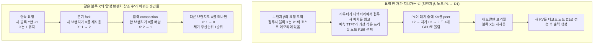

[논문 링크](https://arxiv.org/abs/2611.12304v1)
## 도입

에이전트 기반 서비스는 하나의 요청으로 끝나지 않는다. 도구를 기다리고, 문맥을 요약하고, 하위 작업을 병렬로 띄우기 때문에 같은 앞부분을 여러 번 다시 계산하게 된다. Evolving Infra는 이 반복 계산을 줄이기 위해, 노드의 역할 배정은 에이전트 워크로드 구성에, KV 제거·라우팅은 에이전트의 문맥 관리 신호에 맞춰 실시간으로 조정한다.

## 1. 용어 정리: 이 논문을 읽기 위한 최소 지식

### 1.1 한 번의 요청은 두 단계를 거친다

LLM 서빙에서 요청은 두 단계로 처리된다. <strong>프리필(prefill)</strong>은 입력 토큰 전체를 한 번에 계산해 각 토큰의 키·밸류(KV)를 만들어 놓는 단계고, <strong>디코드(decode)</strong>는 그 KV를 읽으면서 출력 토큰을 하나씩 만들어 내는 단계다. 두 단계의 병목이 다르다. 프리필은 연산량이 많아 계산에 묶여 있고, 디코드는 모델 가중치를 읽는 메모리 대역폭이 지배적이다.

이 구분이 중요한 이유는 **KV 캐시** 때문이다. 다음 요청이 앞부분을 그대로 다시 쓰면, 그 앞부분의 KV를 다시 계산하지 않아도 된다. 얼마나 잘 재사용하느냐가 곧 처리량과 첫 토큰까지 걸리는 시간(TTFT, time to first token)을 가른다.

### 1.2 프리필–디코드(PD) 분리는 왜 하는가

병목이 다른 두 단계를 같은 GPU에 몰아넣으면 서로를 기다리게 된다. 그래서 많은 서빙 시스템은 GPU를 두 묶음으로 나눠 프리필과 디코드를 따로 맡긴다. 이를 프리필–디코드(PD) 분리라고 하고, 9개 노드 중 4개가 프리필·5개가 디코드를 맡으면 **4P5D**처럼 표기한다. 노드 몇 개를 프리필에, 몇 개를 디코드에 배정하는지 그 자체를 <strong>분할(split)</strong>이라고 한다.

### 1.3 에이전트는 문맥을 스스로 바꾼다

에이전트는 하네스(harness, 요청을 조율하는 오케스트레이터)가 관리하는 여러 단계를 거친다. 하네스는 도구 결과를 문맥 뒤에 붙이고, 필요하면 문맥을 분기(fork)해 새 **브랜치**를 만들며, 하위 에이전트(sub-agent)를 띄우고, 길어진 기록을 요약으로 압축(compaction)한다. 브랜치는 자기 문맥과 요청 순서를 갖고 끝날 때까지 살아 있는 문맥 단위다.

여기서 "캐시를 언제 마지막으로 썼는가"와 "누가 아직 그 캐시를 필요로 하는가"가 어긋난다. 에이전트는 도구나 하위 에이전트를 기다리는 동안 한참을 아무것도 하지 않지만, 재개하면 같은 접두사를 다시 쓴다. 반대로 압축으로 교체된 기록은 방금 접근했는데 다시는 쓰이지 않는다.

## 2. 문제: 기존 시스템이 에이전트를 따라가지 못한다

논문은 PD 분리 서빙 시스템을 에이전트 워크로드에서 프로파일링해 세 가지 비효율을 수치로 확인한다(§3, Fig. 3). 측정 조건은 9개 노드(각 4×GB300 GPU)에서 GLM-5.2를 TP4로 서빙하고, 클로드 코드 트레이스(동시 에이전트 90명)를 30분 워밍업 뒤 1시간 재생한 것이다.

### 2.1 전환 비용: 노드의 역할을 바꾸면 시간이 끊긴다

프리필·디코드의 비율을 바꾸려면 노드의 역할을 바꿔야 한다. Dynamo는 바꿀 때마다 워커를 재시작한다. §3 프로파일링에서 전환 1회당 평균 681초가 걸리고, 그동안 그 노드는 요청을 처리하지 못한다. 재시작 없이 제자리에서 바꾸는 Arrow는 재시작 지연은 없지만, 바뀐 노드에 남아 있던 KV를 쓸 수 없게 된다. Arrow는 34번의 전환 동안 가능한 KV 재사용의 55.5%를 잃고, Dynamo는 5.1%를 잃는다. 같은 지표에서 Evolving Infra는 전환 1회당 0.7초, 손실 0.3%였다.

### 2.2 수요 오인: 계산이 얼마나 필요한지 잘못 잰다

Dynamo의 플래너는 큐 깊이와 디코드 노드의 KV 사용률을 보고, Arrow는 전체 입력 길이를 보고 프리필·디코드 비율을 정한다. 두 플래너 모두 최적 고정 분할(클로드 코드에서 SGLang PD 기준 초당 4.9요청)보다 처리량이 각각 49%, 65% 낮았다(Fig. 3b). 최종 분할은 Dynamo가 2P7D, Arrow가 8P1D로, 둘 다 최적과 멀었다.

두 신호는 서로 반대 방향으로 잘못된다. Arrow는 전체 입력 길이로 프리필 시간을 예측하므로, 이미 캐시된 앞부분까지 새로 계산할 일로 센다. 여기에 하위 에이전트가 한꺼번에 시작하는 짧은 폭주가 겹치면, 큐 대기만 잠깐 늘었는데도 Arrow는 분할을 6P3D에서 8P1D로 옮기며 34번 전환한다. Dynamo는 반대다. 긴 에이전트 문맥 때문에 디코드 노드의 KV 사용률이 계속 높게 유지되고, 플래너는 최적인 4P5D를 지나쳐 2P7D까지 밀려난다.

### 2.3 KV 재사용 오인: 어디에 두고 무엇을 지울지 잘못 판단한다

**라우팅** 쪽에서는 두 방향으로 빗나간다. SGLang Model Gateway의 캐시 친화적·고정 세션 라우팅은 같은 브랜치의 요청을 그 접두사를 가진 몇 안 되는 프리필 노드에 몰아넣어 P95 TTFT를 27초와 34초까지 끌어올린다. 부하를 고르게 나누는 Dynamo KV 라우터는 접두사를 다시 계산하게 만들어 P95 TTFT가 65초까지 오른다. 공유 메모리 풀을 붙이면 다시 계산은 피하지만, 풀이 요청이 프리필을 시작할 때야 KV를 GPU로 올리므로 그 시간이 프리필에 더해져 P95 TTFT는 95초가 된다. 같은 조건의 평균 E2E 지연은 각각 13·16초, 34초, 38초다(Fig. 3c).

**제거** 쪽에서는 LRU(가장 오래 안 쓴 것부터 지우는 방식)가 잘못된다. LRU는 도구를 기다리는 브랜치의 KV를 먼저 버리고, 압축으로 교체된 기록과 끝난 하위 에이전트의 문맥은 최근에 썼다는 이유로 남긴다. 클로드 코드에서 이 제거가 Dynamo가 잃는 KV 재사용의 34~46%(동시성 90·108·126 기준)를 차지하고, 라우팅이 원인인 비중은 22·17·15%다(§3.3, Appendix C.1).

### 2.4 공통 원인

두 가지가 얽혀 있다. 첫째, **계산 배정과 KV 관리가 묶여 있다**. 각 엔진이 자기 로컬 상태에 KV를 색인해 두므로, 노드의 역할을 바꾸면 KV를 버리거나 못 쓰게 된다. 공유 KV 풀이 이 묶음을 풀어 주지만, 대신 분할을 고정하거나 노드를 재기동하는 방식으로 바꾼다.

둘째, **플래너·라우터·메모리 풀이 거친 신호에만 의존한다**. 요청 지연, 입력 길이, 접근 이력 같은 신호는 클러스터의 순간 부하를 알려 주지만, 그 부하가 어떤 작업에서 왜 생겼는지는 알려 주지 않는다. 에이전트 문맥 관리는 바로 그 정보를 가지고 있다.

## 3. 작은 예시: 한 브랜치의 수명 동안 KV에는 무슨 일이 생기는가

가상의 코딩 에이전트 브랜치 `agent-A`의 문맥이 `시스템 프롬프트 → 사용자 요청 → 어시스턴트 diff → 테스트 실행 결과` 순서로 쌓인다고 하자. 하네스가 이 브랜치에 어떤 신호를 보내는지에 따라 KV가 어떻게 남고 어떻게 사라지는지 정리하면 다음과 같다.

| 시점 | 하네스가 넘기는 신호 | 남는 KV 상태 | 바뀌는 것 · 생략되는 것 · 거절되는 것 | 이어서 처리되는 방식 |
|---|---|---|---|---|
| 도구 실행 후 이어지는 요청 | 같은 브랜치 ID, 앞 문맥 뒤에 도구 결과 토큰 추가 | 앞부분의 KV 그대로, 새 토큰의 KV는 아직 없음 | 앞부분의 **재계산을 생략** | 새 토큰만 프리필해 출력 시작이 빠르다 |
| 압축 | 같은 브랜치 ID, 문맥이 요약으로 재작성(버전 +1) | 새 문맥에는 요약 블록만 남음 | 교체된 상세 기록은 **어떤 브랜치도 참조하지 않음** | 참조 수 0인 블록부터 지워 용량을 회수한다 |
| 분기(fork) | 새 브랜치 ID, 부모 문맥을 재사용 | 부모와 자식이 같은 블록을 공유 | 공유 블록의 **참조 수 +1** | 두 브랜치가 같은 KV를 함께 쓰므로 하나가 끝나도 다른 하나에 남는다 |
| 하위 에이전트 | 새 브랜치 ID, 새 문맥으로 시작 | 새 블록만 추가, 부모 블록은 그대로 | 새 브랜치에는 부모 블록을 참조시키지 않음(**거절**) | 하위 에이전트만 새로 계산하고, 부모 브랜치는 자기 KV를 그대로 쓴다 |
| 하위 에이전트를 오래 기다린 뒤(359초) 재개 | 같은 브랜치 ID, 새 토큰 추가 | 359초 동안 그대로 방치된 KV | 바뀌는 것 없음 | 그대로 재사용한다 |

압축 행과 마지막 행이 문제의 핵심이다. 실측하면, 359초를 기다린 하위 에이전트 다음 요청의 프롬프트 중 97.9%가 기존 KV와 겹쳤지만, 12초 뒤 압축된 직후에는 겹침이 14.3%에 그쳤다(Fig. 2c). LRU는 359초 동안 잠든 KV를 먼저 버리고, 12초 전에 접근된 요약 전 기록을 붙잡는다. 즉 **접근 최근성만 보는 방식은 필요한 것을 버리고 불필요한 것을 지킨다**.

(이 표는 이해를 위한 도식이며 원문의 실측이 아니다. 다만 97.9%와 14.3%는 Fig 2c의 실측값이다.)

## 4. 방법: 배정과 관리를 분리한 뒤, 에이전트 신호에 맞춰 돌린다

Evolving Infra는 두 단계를 나누어 진행한다. 먼저 인프라에서 계산 배정과 KV 관리를 분리하고(§4.1), 그 위에 배정과 제거·라우팅을 각각 에이전트 신호로 조종한다(§4.2~4.4).

### 4.1 데이터 평면: 노드의 역할과 KV 저장을 떼어 놓는다

**대칭 엔진.** vLLM과 SGLang은 PD 분리 모드에서 엔진의 역할을 실행 시점에 고정한다. 프리필 엔진은 요청을 큐에 넣고 KV를 디코드 엔진에 보내며, 디코드 엔진은 KV 슬롯을 예약하고 KV를 받아 디코딩용 CUDA 그래프를 캡처한다. 역할을 바꾸려면 엔진을 새 설정으로 다시 띄워야 하고, 그때 캐시도 비워진다.

Evolving Infra는 SGLang을 확장해 **하나의 스케줄링 루프로 두 단계를 모두 처리**하고, 어떤 두 노드 사이에서도 KV를 옮길 수 있는 전송 프로토콜을 추가한다. 이 프로토콜은 Mooncake의 RDMA 전송 경로를 재사용하며, 노드가 역할을 바꾼 뒤에도 계속 동작한다. 모든 노드가 이 엔진을 돌리므로, 플래너가 노드의 역할을 다시 지정할 때 라우터는 그 노드로 보내는 **요청 종류만** 바꾼다. 재시작도, KV를 버리는 일도 없다.

**공유 호스트 메모리 KV 풀.** 모든 노드의 호스트 메모리(L2)를 하나의 KV 풀로 묶는다. 각 노드는 GPU 메모리(L1)에 KV를 캐시하면서 L2에도 기록한다(두 단계 모두). 프리필 노드는 디렉터리로 재사용할 KV를 찾아 **피어의 L2에서 RDMA로 직접 읽는다**. SGLang의 저장소 계층처럼 별도 저장소를 한 번 거치는 우회도 없다(Appendix A.2).

디코드 노드는 풀에 쓰기만 한다. 호스트에서 읽으면 디코딩이 늦어지기 때문이다. 대신 디코드 노드는 각 요청의 KV를 프리필 노드에서 더 빠른 GPU 간 전송으로 받고, 자신이 만든 KV는 L2에 남겨 다음 요청을 위해 둔다.

KV를 한 벌만 저장한다는 점도 중요하다. 노드 안의 4개 GPU가 같은 KV를 각각 갖고 있지 않도록 호스트 메모리에는 노드당 한 벌만 저장하고, 읽을 때 노드의 모든 GPU에 브로드캐스트한다. 그 결과 호스트 메모리는 GPU 메모리가 담는 KV 토큰 수의 4배를 담는다. GB300 노드의 호스트 메모리는 약 1TB로, 중복을 제거하면 GLM-5.2의 KV를 약 2천만 토큰까지 담는다(§6.1, Appendix A.5).

**비동기 KV 가져오기.** 기존 방식은 요청이 프리필을 시작할 때 KV를 GPU로 올리므로, 그 시간이 프리필 시간에 그대로 더해진다. Evolving Infra는 **요청이 큐에서 기다리는 동안 가져오기를 끝낸다**. 피어의 L2에서 자기 L2로 복사하고, GPU 메모리로 올리고, 노드의 모든 GPU에 브로드캐스트한 뒤에야 프리필을 시작한다. 복사 시간이 큐 대기 시간 아래에 숨는다. 실제로 16K 토큰 미만인 fetch 92%의 중앙값은 7밀리초였고, 프리필 노드의 큐 대기 중앙값은 0.7~2.2초였다(Appendix D.6).

**에이전트 인지형 KV 디렉터리.** 여기서 에이전트의 신호가 들어온다. 디렉터리는 Dynamo의 KV 색인처럼 프리픽스 트리로, 각 KV 블록이 어느 노드의 어느 메모리 계층에 있는지를 기록한다. 여기에 블록마다 <strong>"그 블록을 참조하는 활성 브랜치 수"</strong>를 하나 더 붙인다.

이 수는 두 식별자로 갱신된다. 하나는 하네스가 각 요청에 붙이는 **브랜치 ID**이고, 다른 하나는 문맥이 다시 쓰여질 때 올라가는 **브랜치의 버전 번호**다. 갱신 규칙은 §3의 표와 정확히 대응한다.

- 분기·하위 에이전트: 새 브랜치 ID가 오면 그 브랜치가 재사용하는 블록에 +1. 하위 에이전트는 새 문맥으로 시작하므로 새 블록만 +1이고 부모 블록은 그대로 둔다.
- 연속 요청: 새 요청이 이전 문맥 뒤에 토큰만 덧붙였다면 새로 붙은 블록에만 +1. 재사용한 블록은 이미 세어져 있으므로 두 번 세지 않는다.
- 압축: 버전을 올리고, 새 문맥이 버린 블록에서 −1, 새로 포함한 블록에 +1.
- 브랜치 종료: 그 브랜치의 모든 블록에서 −1.
- KV 이동: 같은 단계 안의 이동(P2P·D2D)은 대상 노드로 수를 옮기고 원본에서 −1. 단계가 다른 이동(P2D·D2P)은 다음 단계도 그 사본을 쓰므로 **양쪽에 남긴다**.
- 디코드→프리필로 바뀐 노드는 수를 0으로 되돌려 메모리를 비우고, 프리필→디코드로 바뀐 노드는 수를 남겨 KV를 보존한다.

결과적으로 각 활성 브랜치는 단계마다 최대 한 벌의 KV에만 참조 수를 갖는다.

위쪽 경로에서 Prefill은 새 토큰에 대해서만 일어나고, 접두사 KV는 큐 대기 중에 미리 올라온다. 아래쪽에서 디렉터리는 분기·압축 같은 문맥 관리 이벤트를 받아 블록별 참조 수를 갱신하고, 그 수가 0이 된 블록부터 제거 대상으로 삼는다. 라우터는 보낼 노드를 고를 때 같은 디렉터리를 조회한다. 이 그림은 이해용 도식이며 실험 측정값이 아니다.

### 4.2 실행 시간 모델을 온라인으로 배운다

노드가 요청 하나를 얼마나 오래 붙잡고 있는지 알면, 프리필과 디코드 노드를 몇 개씩 둘지 정할 수 있다. Evolving Infra는 이를 오프라인 프로파일링 없이 서빙 시작할 때 직접 배운다.

요청의 작업량은 네 수로 표현한다. 캐시되지 않은 입력 토큰 수 $t_{uc}$, 캐시된 접두사 토큰 수 $t_c$, 출력 토큰 수 $t_{out}$, 디코드 반복 1회마다 평균적으로 받아들여지는 토큰 수 $t_{acc}$다. 라우터는 디렉터리에서 찾은 가장 긴 캐시 접두사로 $t_c$를 정하고, 나머지가 $t_{uc}$가 된다.

<strong>프리필 반복 시간(식 1)</strong>은 고정 비용 + 캐시되지 않은 토큰 수에 비례하는 항 + 어텐션이 계산하는 쿼리-키 쌍 수에 비례하는 항 + 호스트에서 복원한 토큰 수에 비례하는 항으로 구성된다.

$$T^{P,n}_{iter} = c_{n,0} + c_{n,1}\sum t_{uc} + c_{n,2}\sum A + c_{n,3}\sum t_{rst}$$

여기서 $A$는 쿼리-키 쌍 수다. 인과 어텐션에서 $i$번째 새 토큰은 캐시된 $t_c$개 토큰과 자기 앞의 새 토큰들을 함께 보므로, 요청 하나가 계산하는 쌍의 수는 $A = t_{uc}t_c + t_{uc}(t_{uc}+1)/2$가 된다.

이 모델의 핵심은 **캐시된 토큰과 새 토큰을 분리한 것**이다. 선형 층의 비용은 새로 계산하는 $t_{uc}$에만 비례하고, 어텐션 비용은 실제 쿼리-키 쌍 수에만 비례한다. 입력 전체 길이로 프리필 시간을 예측하는 방식과 달리, 문맥 재사용이 클 때에도 프리필 시간을 정확히 예측한다.

<strong>디코드 반복 시간(식 2)</strong>은 고정 비용 + 읽히는 라우팅 전문가 비율에 비례하는 항 + 동시 실행 요청 수에 비례하는 항으로 구성된다.

$$T^{D,n}_{iter}(B) = d_{n,0} + d_{n,1}\varphi(B) + d_{n,2}B, \qquad \varphi(B) = 1-(1-k/E)^{t_{fwd}B}$$

혼합 전문가(MoE) 모델에서는 각 토큰이 $E$개의 라우팅된 전문가 중 $k$개를 고른다. 노드에서 실행 중인 요청이 $B$개이고 각 요청이 $t_{fwd}$개 토큰을 넣으면(추측 디코딩은 1보다 많다), 그 반복이 실제로 읽는 라우팅 전문가의 기대 비율은 $\varphi(B)$가 된다. 디코드는 반복당 토큰 수가 적어 선택이 겹치기 때문에 이 항이 $B$에 따라 변한다. 마지막 항은 실행 중인 요청마다 샘플링과 추측 토큰 작성에 드는 비용이다.

문맥 길이 항은 일부러 뺐다. 두 모델 모두 MLA 같은 압축 KV 표현을 쓰고, 실행 중인 요청이 8개 이상이면 문맥 길이가 디코드 반복 시간을 2~7%밖에 바꾸지 않기 때문이다(Fig. 5d). 백만 토큰을 더 늘려도 GLM-5.2의 디코드 반복은 약 1밀리초만 늘고, 실행 요청 8~64개일 때 반복 시간 17~45밀리초에 비하면 미미하다(Appendix B.4).

**계수는 어떻게 맞추는가.** 워밍업 동안 각 노드가 두 역할을 동시에(collocated) 돌린다. Evolving Infra는 고정된 시간 창마다 각 노드가 수행한 프리필·디코드 작업량을 기록해 **비음수 최소제곱**으로 계수를 맞춘 뒤 고정한다. 이후에는 워크로드 구성에 따라 달라지는 값(노드당 반복당 새 토큰 수, 호스트에서 복원하는 캐시 비율)만 다시 잰다. 적합하지 않은 설정에서도 반복 시간 예측의 평균 오차는 7% 미만이었다(단일 요청 4.2%, 배치 6.3%, Fig. 5).

### 4.3 플래너: 확실할 때만 전환한다

플래너는 600초짜리 계획 창을 10개 슬라이스(각 60초)로 나눠, 창이 끝날 때마다 후보 분할의 예측 처리량을 비교한다. 클러스터의 처리량은 두 단계 중 느린 쪽이 정한다. 요청 하나가 두 단계를 모두 거치기 때문이다(식 5).

$$\Theta(P,D;\bar{w},\bar{q}) = \min\left(\sum_{n\in P}\mu_{P,n},\ \sum_{n\in D}\mu_{D,n}\right)$$

여기서 $\bar{w}$는 창 동안 요청 한 건이 요구한 **평균 작업량**, $\bar{q}$는 디코드 큐의 평균 요청 수다. 큐 깊이와 달리 $\bar{w}$는 워크로드 자체를 가리킨다. 하위 에이전트가 여럿 동시에 시작해 순간적으로 큐를 늘려도, 요청 한 건의 평균 작업량은 거의 바뀌지 않는다.

각 후보 분할에 대해 슬라이스별 이득을 계산하고(식 6), **평균 이득이 표준 오차의 두 배를 넘을 때만** 전환한다. 통과한 후보 중 이득이 가장 큰 것을 고른다. 이 문턱이 짧은 폭주에 반응해 비싼 전환을 일으키는 것을 막는다. 덧붙여 플래너는 전환 직후 120초 동안은 새로운 전환을 하지 않는다(Appendix E.3).

### 4.4 제거와 라우팅: 문맥 관리 신호를 따른다

**제거.** 각 노드는 호스트 메모리의 블록을 (1[참조 수가 0인지], 마지막 접근 시각) 순서로 지운다. 즉 참조 수가 0인 블록을 LRU 순서로 먼저 지우고, 참조 수가 남은 블록은 그 뒤에 지운다. 압축으로 교체된 기록이나 끝난 하위 에이전트의 문맥이, 도구를 기다리는 브랜치의 KV보다 먼저 사라진다.

**라우팅.** 비동기 가져오기 덕분에 KV를 옮기는 것이 싸졌으므로, 요청을 "접두사를 가진 노드"가 아니라 "예측 TTFT가 가장 짧은 노드"로 보낸다(식 7).

$$\hat{T}_n(w) = T^{rem}_n + \sum_{j\in Q_n}T^{req}_{P,n}(w_j) + T^{req}_{P,n}(w)$$

즉 "이미 돌고 있는 배치의 남은 시간 + 그 노드 큐에 서 있는 요청들의 서비스 시간 + 이 요청의 서비스 시간"이다. 여기에 대기 시간을 넘어서는 fetch 시간 부분과 fetch가 남기는 중복 사본 비용을 더한다(Appendix E.3). 인기 있는 접두사를 가진 노드에 요청이 몰리는 것을 피하면서, 가져와야 할 KV의 양도 예측에 반영해 지역성과 부하 균형을 함께 저울질한다.

분할이 바뀔 때도 데이터는 버려지지 않는다. 라우터는 전환할 노드의 대기 중인 요청을 같은 단계의 다른 노드로 옮기고, 이미 돌고 있는 요청은 제자리에서 끝나게 둔다. 전환되는 노드의 KV는 풀에 남아 모든 노드가 계속 읽을 수 있다(§4.2).

## 5. 결과

### 5.1 측정 조건

코딩(클로드 코드, CC), 수학(PutnamBench, Putnam), 컴퓨터 사용(OSWorld 2.0) 세 에이전트를 다룬다. Putnam은 문제당 브랜치 하나만 도는 디코드 중심 워크로드이고, OSWorld는 매 단계 스크린샷을 문맥에 붙이는 프리필 중심 멀티모달·멀티에이전트 워크로드다. CC는 실제 사용자 트레이스를 재현한 것으로, 하위 에이전트·압축·긴 대기가 가장 잦다.

GLM-5.2를 Putnam·CC에, Kimi K2.6를 OSWorld와 워크로드 구성 변화 실험에 쓴다. 각 모델은 NVFP4로 양자화되고 FP8 KV 캐시를 쓰며, multi-token prediction(MTP)으로 추측 디코딩을 한다. 9개 노드(각 4×GB300)에서 TP4로 실행된다. 계획 창은 600초·슬라이스 10개이며 모델은 온라인으로 배운다. 정적 부하 실험은 30분 워밍업을 제외하고 한 워크로드를 고정 동시성으로 1시간 서빙했다(종료된 에이전트를 새 에이전트로 교체). 동시성은 Putnam 224·256·288, CC 90·108·126, OSWorld 128·144·160이다.

비교 대상은 Dynamo v1.5.1과 SGLang PD 분리 모드의 최적 고정 분할이다. 두 시스템 모두 프리필 쪽으로 치우친 6P3D에서 시작한다. 모든 베이스라인은 SGLang Model Gateway의 캐시 친화적 프리필 라우팅과 라운드로빈 디코드 라우팅을 쓰고, 각 노드는 LRU 제거의 HiCache를 돌린다. SGLang의 런타임 역할 전환은 추측 디코딩을 거부해 제외했고, Llumnix는 GB300의 Arm CPU에서 돌지 못해 H200에서만 비교했다(§6.1, Appendix A.1).

### 5.2 정적 부하: 세 워크로드 모두에서 앞선다

아래 값은 동시성 낮은 순서로 나열했고, 손실 KV 재사용은 모든 노드가 KV를 무제한으로 공유하고 전환도 없을 때의 적중률을 100%로 잡았을 때 다시 계산해야 하는 비율이다.

| 워크로드 (모델) | 동시성 | 평균 E2E 지연 Dynamo → Ours (초) | 감소 | 손실 KV 재사용 Dynamo → Ours (%) | Ours가 고른 분할 |
|---|---|---|---|---|---|
| Putnam (GLM-5.2) | 224 / 256 / 288 | 19.1 / 20.4 / 21.7 → 15.5 / 17.8 / 18.6 | 1.15–1.23× | 2.47 / 2.48 / 2.63 → 0.48 / 0.17 / 0.46 | 1P8D–2P7D |
| Claude Code (GLM-5.2) | 90 / 108 / 126 | 32.2 / 37.7 / 54.4 → 7.87 / 9.91 / 13.2 | 3.80–4.12× | 5.13 / 4.89 / 7.78 → 0.32 / 0.48 / 1.01 | 3P6D → 4P5D |
| OSWorld (Kimi K2.6) | 128 / 144 / 160 | 57.4 / 66.3 / 84.4 → 24.5 / 28.1 / 31.4 | 2.34–2.69× | 4.00 / 1.85 / 3.24 → 0.21 / 0.19 / 0.17 | 8P1D |

9개 설정 전체에서 처리량은 Dynamo의 1.10~2.73배, 손실 KV 재사용은 81~95% 줄었다. P95 TTFT는 CC와 OSWorld에서 3.25~13.92배 줄었다. 최대 비율은 CC 90 에이전트의 142초→10.2초(13.92×)이고, 절대 감소가 가장 큰 경우는 CC 126 에이전트의 228초→21.4초다(§6.2, Fig. 6).

**전환 비용.** 9개 설정의 전환을 모두 합친 평균 시간은 6.2초로, Dynamo의 재시작(§6.2 실행 평균 754초)보다 100배 이상 짧다. 이 6.2초에는 해당 노드가 돌고 있던 요청을 끝내는 시간도 들어 있다. 전환 중에도 그 노드의 KV는 풀에 남아 재사용된다. Evolving Infra는 실행당 평균 2.0번만 전환하는 반면 Dynamo 플래너는 3.6번 전환했고, 그 결과 Dynamo는 각 워크로드의 최적 고정 분할과 41~100%의 시간 동안 달랐다(Appendix C.2).

**부하 균형.** CC에서 가장 몰린 프리필 노드의 대기 시간은 평균 노드의 1.75~1.85배였고, Dynamo의 캐시 친화적 라우팅에서는 2.29~2.61배였다. Dynamo가 캐시 없이 프리필하는 프롬프트 토큰의 비율은 Evolving Infra의 1.29~2.99배였다(§6.2, Appendix C.1·C.3).

### 5.3 구성요소별 기여: 어느 부분이 얼마나 기여하는가

CC 126 에이전트를 4P5D에 고정한 실행에서, 하나씩 얹어 갈 때의 처리량이다(Fig. 8b).

| 구성 | 처리량 (req/s) | 비교 |
|---|---|---|
| 최적 고정 분할(4P5D) | 4.57 | 기준 |
| + 분리 인프라·KV 재사용 인지 제거와 라우팅(온라인 분할 적응 없음) | 6.27 | 1.37× |
| + 온라인 분할 적응 | 6.25 | 적응 비용은 처리량의 0.3%만 깎음 |

라우팅을 SGLang 그대로 두고 **데이터 평면만** 바꿨을 때의 비교는 다음과 같다(Table D.5, 4P5D 고정, 같은 라우팅).

| 지표 | upstream SGLang | 비동기 KV 가져오기 |
|---|---|---|
| 처리량 (req/s) | 4.62 | 5.18 (1.12×) |
| 프리필 노드 유휴 GPU 시간 | 23.6% | 14.4% |
| TTFT 평균 / P95 (초) | 15.7 / 56.4 | 12.1 / 42.8 |
| E2E 지연 평균 / P95 (초) | 20.2 / 64.5 | 16.5 / 50.7 |

KV 용량이 병목이 아니라는 점도 같은 4P5D 고정·CC 126 에이전트 조건의 Table D.4에서 확인된다.

| 4P5D 고정, CC 126 에이전트 | 캐시 친화 라우팅 | ThunderAgent | Evolving Infra |
|---|---|---|---|
| 처리량 (req/s) | 4.66 | 4.43 | 6.27 |
| TTFT 평균 / P95 (초) | 15.3 / 60.3 | 17.5 / 59.8 | 4.5 / 14.0 |
| E2E 지연 평균 / P95 (초) | 19.7 / 66.7 | 22.0 / 67.1 | 11.2 / 32.6 |
| 손실 KV 재사용 (%) | 2.4 | 2.6 | 0.7 |
| 요청당 캐시 미사용 프롬프트 토큰 | 7,660 | 8,119 | 5,268 |
| 일시 중지한 요청 (%) | – | 0 | – |

ThunderAgent는 에이전트를 일시 중지해 KV 용량 thrashing을 막는 방식인데, GB300에서는 에이전트들이 필요로 하는 KV가 용량의 최대 86%였기에 중지할 일이 없었다. 즉 이 하드웨어에서는 이득이 "용량 확보"가 아니라 "어느 KV를 어디에 두고 무엇을 제거하는가"에서 나온다.

### 5.4 워크로드 구성이 바뀌는 경우

수학(288 에이전트) → 혼합(144 Putnam + 72 OSWorld) → 컴퓨터 사용(144 에이전트)으로 세 시간 동안 수요가 프리필 쪽으로 밀리는 실험에서, Evolving Infra는 10분 창의 최적 분할을 따라가며, OSWorld 구간에서는 SGLang PD로 측정한 10분 창 최적 분할보다 프리필 노드가 하나 많은 8P1D에 머문다. Dynamo는 구간의 대부분에서 최적보다 프리필 노드를 적게 남겼다(§6.3, Fig. 7).

| 3시간 실행 전체 | Dynamo | 최적 고정 5P4D | Evolving Infra |
|---|---|---|---|
| 평균 E2E 지연 (초) | 83.1 | 51.5 | 38.7 |
| P95 TTFT (초) | 130 | 68.4 | 36.3 |
| 처리량 (req/s) | 1.94 | 3.25 | 4.16 |

구간별 처리량은 Putnam 1.57 / 3.02 / 4.05, 혼합 2.21 / 3.64 / 3.99, OSWorld 2.05 / 3.10 / 4.43(Dynamo / 5P4D / Ours)이며, Evolving Infra가 모든 구간에서 가장 높았다.

### 5.5 규모, 초기값, 오프라인 비용

**초기 분할에 덜 민감하다.** CC 126 에이전트를 3P6D에서 6P3D까지 네 가지 초기 분할로 시작했더니 평균 E2E 지연은 최대 1.8%만 달랐고, 네 실행 모두 4P5D로 수렴했다(Fig. 8a).

**적응 비용과 학습 속도.** 온라인 분할 적응을 최적 분할 위에서 켜도 처리량은 0.3%만 떨어진다. 반복 시간 모델은 학습 시작 후 1분 안에 낮은 평균 오차로 수렴한다(Fig. 8b·c).

**오프라인 프로파일링을 대체한다.** 256 GPU에서 3시간짜리 CC 트레이스의 최적 분할을 이분 탐색으로 찾는 데 10,752 GPU시간이 든다. 이는 트레이스를 한 번 서빙하는 768 GPU시간의 14배이고, 완전 탐색이면 56,448 GPU시간이다. 워크로드 구성이 바뀔 때마다 이 탐색을 다시 해야 한다(Appendix D.2).

**큰 클러스터에서도 성립한다.** 실제 36→256 GB300 GPU에서 고정 분할의 P95 TTFT는 142초에서 418초로 약 3배 치솟지만 Evolving Infra는 10.2초에서 13.7초에 머물렀고, 평균 E2E 지연은 16%만 올랐다(Appendix D.2). 3,072 GPU 시뮬레이션에서는 클러스터를 8개 파티션으로 나눠 각 파티션이 자기 플래너·라우터·디렉터리를 갖게 했는데, 전체 수요는 거의 일정해도 파티션별로 PD 비율은 최대 42.4% 흔들렸고, 플래너가 이를 따라가 정적 분할보다 처리량을 1.42배 높였다.

**개방형 도착률.** 새 에이전트가 정해진 속도로 도착하는 조건에서 Evolving Infra는 분당 1.0건을 버텼고, 이는 최적 고정 분할 4P5D의 두 배다. Dynamo는 모든 도착률에서 목표를 놓쳤고, 0.5건/분에서도 P95 TTFT가 22초였다(Appendix D.3).

## 6. 한계와 적용 판단

### 6.1 저자가 직접 보고한 한계

첫째, 디코드 중심인 Putnam에서는 플래너가 처리량을 최대화하려고 프리필 노드를 1~2개만 남긴다. 처리량과 맞바꾸는 선택이며, 논문은 224·288 동시성에서 P95 TTFT가 Dynamo보다 높아졌다고 서술한다(§6.2).

둘째, 개방형 도착 실험에서 분당 0.75건에서는 목표를 놓쳤다. 75분에 플래너가 2P7D로 전환한 뒤 프리필 큐의 P95 대기 시간이 120~275초까지 치솟았고, 85분에 프리필 노드를 되돌려야 했다(분당 1.0건에서는 충족). 한 번의 나쁜 전환이 목표를 깨뜨릴 수 있음을 보여준다(Appendix D.3).

셋째, ThunderAgent와의 비교에서는 **라우팅 효과와 데이터 평면 효과를 분리하지 못했다**고 명시한다. Evolving Infra의 더 높은 TPOT은 더 큰 디코드 배치와 함께 관찰됐다(Appendix D.5).

여기에 비교 대상의 한계도 있다. Llumnix는 GB300의 Arm CPU에서 돌지 못해 H200에서만 비교했고, SGLang의 런타임 역할 전환은 추측 디코딩을 거부해 비교에서 제외했다(§6.1, Appendix A.1).

### 6.2 설계와 실험 조건에서 읽히는 적용 조건

첫째, 이 설계는 하네스가 모든 요청에 브랜치 ID를 붙이고, 브랜치 종료와 문맥 재작성(압축·분기·하위 에이전트)을 보고해야만 참조 수가 유지된다. 하네스가 이 신호를 제공하지 않는 범용 서빙 환경에는 적용하기 어렵다(§4.3, Appendix E.1).

둘째, GB300에서는 중복 제거된 호스트 메모리와 Grace CPU–GPU 간 NVLink-C2C 덕분에 KV 용량과 재로드 속도가 병목이 아니었다. 이득은 "어느 KV를 어디에 두고 무엇을 제거하는가"에서 나온다. 호스트 재로드가 느린 환경(예: PCIe 연결)이나 KV가 큰 모델에서는 결론이 달라질 수 있다. ThunderAgent처럼 에이전트를 일시 중지하는 방식이 이득이 없었던 것도 같은 이유다(Appendix D.5).

셋째, 두 모델 모두 MLA 같은 압축 KV 표현과 희소 어텐션을 쓴다. 그래서 실행 요청이 8개 이상이면 문맥 길이가 디코드 반복 시간을 2~7%밖에 바꾸지 못한다. 완전 다중 헤드 어텐션 모델로의 전이는 별도 검증이 필요하다(Appendix B.4).

넷째, 수천 GPU 클러스터에서 단일 라우터가 모든 노드를 감시할 수 없음을 이유로 8개 파티션의 계층 구조를 썼지만, 이는 시뮬레이션 검증일 뿐 실제 3,072 GPU 하드웨어에서의 확인은 아니다(Appendix D.2).

### 6.3 정리

하네스가 브랜치 신호를 제공하고, 문맥이 자주 재작성되며(하위 에이전트·압축·긴 대기가 잦은 코딩·컴퓨터 사용 에이전트), 호스트 메모리 재로드가 빠른 환경이라면 이 설계가 특히 잘 맞는다. 반대로 단일한 긴 추론을 쭉 생성하는 디코드 중심 워크로드에서는 이득이 작고, 하네스 통합이 안 된 범용 서빙에는 바로 적용하기 어렵다. 이 설계의 요지는 분할과 캐시 관리를 분리해 전환을 싸게 만들고, 그 위에 에이전트의 문맥 관리 신호를 올리는 것이다. 36개 GB300 GPU에서 전환은 평균 6.2초로 Dynamo 재시작의 100배 이상 짧았고, 정적 부하에서 처리량은 최대 2.73배, 평균 E2E 지연은 최대 4.12배 줄었다.

<!-- verbatim-tables -->

논문 원문의 표

> arXiv e-print 의 LaTeX 원본에서 기계적으로 옮긴 표입니다. 숫자는 논문의 값이며 모델을 거치지 않았습니다.

**표 1. **Phase switches and lost KV reuse on stationary workloads.****

|  | Concurrent | Dynamo | Dynamo Mean switch | Dynamo KV hit | Dynamo Lost KV | Evolving Infra | Evolving Infra Mean switch | Evolving Infra KV hit | Evolving Infra Lost KV |
|---|---|---|---|---|---|---|---|---|---|
| Workload | agents | Switches | time (s) | rate (%) | reuse (%) | Switches | time (s) | rate (%) | reuse (%) |
| Putnam | 224 | 2 | 798 | 96.59 | 2.47 | 3 | 2.3 | 98.54 | 0.48 |
|  | 256 | 2 | 798 | 96.56 | 2.48 | 2 | 3.5 | 98.85 | 0.17 |
|  | 288 | 3 | 800 | 96.42 | 2.63 | 5 | 3.4 | 98.56 | 0.46 |
| CC | 90 | 4 | 681 | 92.25 | 5.13 | 1 | 0.7 | 97.08 | 0.32 |
|  | 108 | 4 | 831 | 92.62 | 4.89 | 2 | 1.9 | 96.87 | 0.48 |
|  | 126 | 4 | 813 | 89.52 | 7.78 | 2 | 10.8 | 96.25 | 1.01 |
| OSWorld | 128 | 5 | 666 | 89.79 | 4.00 | 1 | 19.4 | 93.79 | 0.21 |
|  | 144 | 4 | 730 | 92.01 | 1.85 | 1 | 18.0 | 93.79 | 0.19 |
|  | 160 | 4 | 748 | 90.67 | 3.24 | 1 | 17.7 | 93.84 | 0.17 |

**표 2. **Prefill queueing time and load balance on CC.****

| Concurrent | Dynamo Queueing | Dynamo Most loaded / | Evolving Infra Queueing | Evolving Infra Most loaded / |
|---|---|---|---|---|
| agents | time (s) | average | time (s) | average |
| 90 | 11.4 | 2.29 | 1.5 | 1.79 |
| 108 | 11.0 | 2.38 | 2.2 | 1.75 |
| 126 | 11.2 | 2.61 | 4.3 | 1.85 |

**표 3. **Throughput, mean E2E latency, and pause between requests on stationary workloads.****

|  | Concurrent | Dynamo $X$ | Dynamo $\bar{T}_{\mathrm{E2E}}$ | Dynamo $\bar{T}_{\mathrm{pause}}$ | Evolving Infra $X$ | Evolving Infra $\bar{T}_{\mathrm{E2E}}$ | Evolving Infra $\bar{T}_{\mathrm{pause}}$ |
|---|---|---|---|---|---|---|---|
| Workload | agents | (req/s) | (s) | (s) | (req/s) | (s) | (s) |
| Putnam | 224 | 7.72 | 19.1 | 10.1 | 8.81 | 15.5 | 10.0 |
|  | 256 | 8.37 | 20.4 | 10.1 | 9.20 | 17.8 | 10.0 |
|  | 288 | 9.12 | 21.7 | 10.0 | 10.15 | 18.6 | 9.9 |
| CC | 90 | 2.48 | 32.2 | 15.4 | 5.40 | 7.9 | 12.9 |
|  | 108 | 2.48 | 37.7 | 17.1 | 5.78 | 9.9 | 13.5 |
|  | 126 | 2.14 | 54.4 | 18.6 | 5.85 | 13.2 | 14.1 |
| OSWorld | 128 | 1.93 | 57.4 | 1.0 | 4.30 | 24.5 | 1.4 |
|  | 144 | 1.98 | 66.3 | 1.4 | 4.33 | 28.1 | 1.4 |
|  | 160 | 1.68 | 84.4 | 1.2 | 4.38 | 31.4 | 1.3 |

**표 4. **Throughput (req/s) under the shifting workload composition.** The number in parentheses is the number of concurrent agents, 144 Putnam and 72 OSWorld agents in the mixed period. 5P4D is the best static split.**

| Period | Dynamo | 5P4D | Evolving Infra |
|---|---|---|---|
| Putnam (288) | 1.57 | 3.02 | **4.05** |
| Mixed (144 + 72) | 2.21 | 3.64 | **3.99** |
| OSWorld (144) | 2.05 | 3.10 | **4.43** |
| Whole run | 1.94 | 3.25 | **4.16** |

**표 5. **The best static split differs between SGLang and the symmetric engines of Evolving Infra.** Each row is one run of a system at its best static split, the split with the highest throughput, on 36 GB300 GPUs, scored from minute 30 to minute 85. The number in parentheses is the number of concurrent agents.**

| Workload | System | Best static split | Throughput (requests/s) | TTFT (s) Mean | TTFT (s) P95 | E2E latency (s) Mean | E2E latency (s) P95 |
|---|---|---|---|---|---|---|---|
| Putnam (224) | SGLang | 2P7D | 9.00 | 1.0 | 2.5 | 14.6 | 74.0 |
|  | Evolving Infra | 2P7D | **9.20** | **0.6** | **1.2** | **14.0** | **72.6** |
| CC (90) | SGLang | 4P5D | 4.97 | 4.8 | 19.5 | 9.2 | 30.7 |
|  | Evolving Infra | 3P6D | **5.44** | **3.5** | **9.7** | **7.8** | **22.2** |
| OSWorld (128) | SGLang | 6P3D | 3.12 | 35.3 | 50.8 | 35.8 | 51.3 |
|  | Evolving Infra | 8P1D | **4.33** | **21.6** | **35.6** | **24.2** | **39.2** |

**표 6. **Evolving Infra sustains twice the agent arrival rate of static 4P5D.** Each system serves CC once at each arrival rate, and latencies are in seconds. Bold marks the runs that meet every target.**

|  | Evolving Infra |  |  | Static 4P5D |  |  | Dynamo |  |  |
|---|---|---|---|---|---|---|---|---|---|
| Arrival rate | TTFT |  | E2E | TTFT |  | E2E | TTFT |  | E2E |
| (agents/min) | P50 | P95 | P50 | P50 | P95 | P50 | P50 | P95 | P50 |
| 0.5 | **0.7** | **6.8** | **2.5** | **0.7** | **10.8** | **2.7** | 1.0 | 22.0 | 3.4 |
| 0.75 | 1.3 | 17.8 | 4.4 | 3.8 | 57.0 | 7.3 | 21.0 | 234.5 | 25.7 |
| 1.0 | **1.2** | **12.3** | **4.6** | 6.6 | 139.0 | 11.3 | 11.9 | 122.1 | 17.4 |
| 1.25 | 16.8 | 55.0 | 21.8 | 18.5 | 1,142.7 | 21.1 | 16.2 | 186.9 | 21.0 |
| 1.5 | 68.4 | 151.9 | 74.7 | 637.8 | 1,377.1 | 639.9 | 19.6 | 251.1 | 24.4 |

**표 7. **Phase switches with TP8 prefill and ADP8 decode.** Dynamo and Evolving Infra start from 4P2D, and the best static split stays fixed. Engine-switch time sums the time of all phase switches over the two hours.**

|  | Best static | Dynamo | Evolving Infra |
|---|---|---|---|
| Final split | 2P4D | 3P3D | 2P4D |
| Mean E2E latency (s) | 15.7 | 21.9 | 15.9 |
| Engine-switch time (s) | 0 | 913 | 27 |

**표 8. **KV capacity does not limit serving on GB300 nodes.** Each column is one run of the Claude Code trace with 126 concurrent agents on GLM-5.2, 36 GB300 GPUs, and a fixed 4P5D split, scored from minute 30 to minute 85. The ideal KV hit rate counts every prompt token whose KV an earlier request produced. Lost KV reuse is the share of these tokens that a run recomputes.**

|  | Cache-aware | ThunderAgent | Evolving Infra |
|---|---|---|---|
| Throughput (requests/s) | 4.66 | 4.43 | **6.27** |
| TTFT, mean / P95 (s) | 15.3 / 60.3 | 17.5 / 59.8 | **4.5** / **14.0** |
| E2E latency, mean / P95 (s) | 19.7 / 66.7 | 22.0 / 67.1 | **11.2** / **32.6** |
| TPOT, mean (ms) | 4.6 | 4.4 | 7.9 |
| KV hit rate, actual / ideal (%) | 94.9 / 97.2 | 94.7 / 97.2 | 96.6 / 97.3 |
| Lost KV reuse (%) | 2.4 | 2.6 | **0.7** |
| Uncached prompt tokens per request | 7,660 | 8,119 | **5,268** |
| Peak KV demand of active agents / capacity | -- | 0.86 | -- |
| Paused requests (%) | -- | 0 | -- |

