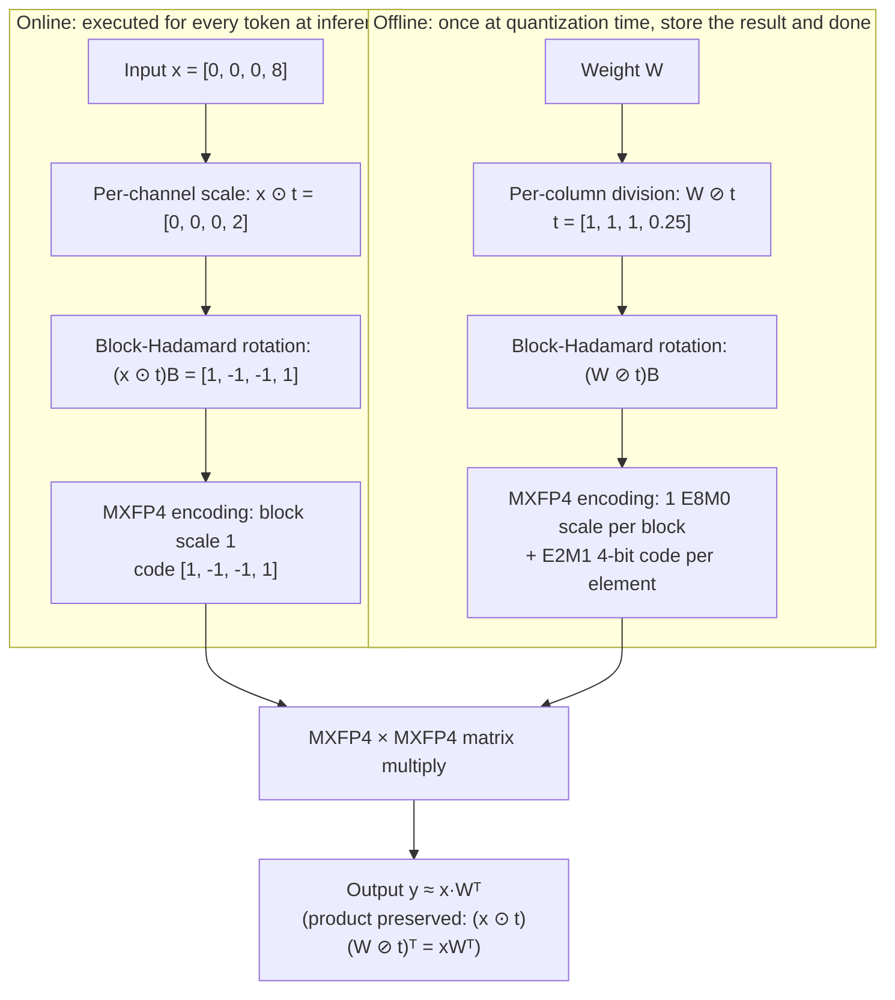

[Paper](https://arxiv.org/abs/2611.10649)
## Introduction

This paper proposes MACaQ, an MXFP4 W4A4 quantization method that reduces both weights and activations to 4 bits. The key is that each linear layer is processed independently of the others. Instead of eliminating the cost of applying the scale and rotation required by the input online, the method accepts that cost and thereby removes the dependencies between layers. As a result, quantization time drops substantially, and a streaming implementation that processes one layer at a time becomes possible, lowering GPU memory requirements. It also applies to new architectures without structural changes.

## Background: four things you need before reading

### 1) Quantization and W4A4

Quantization is a technique that approximates values with fewer bits to reduce storage and compute cost. Storing both weights and activations in 4 bits and multiplying 4-bit values with each other is called W4A4. This paper deals with MXFP4 W4A4, aiming to reduce memory and compute cost together.

### 2) MXFP4: one shared scale per block

The paper uses MXFP4 from the OCP (Open Compute Project) standard as its storage format. The format is defined by two rules.

- **Block scale**: 32 elements (block size B = 32) are treated as one group, and each group shares a single scale. The scale has an 8-bit exponent and 0 mantissa bits (E8M0), so it can express **only powers of two**.
- **Element code**: each element in the block is stored as a 4-bit (E2M1) code with 1 sign bit, 2 exponent bits, and 1 mantissa bit.

In other words, the 32 elements of a block **share a single grid spacing**. The design places a scale in every block to widen the representable range of the 4-bit code.

### 3) The outlier problem

The input activations of a neural network sometimes concentrate very large values in a particular channel. These are called outliers. Outliers are a problem because there is only one block scale. If the scale is set to match the large value, the small values in the same block are rounded to a coarse grid and mostly vanish to 0; conversely, if the scale is set small, the large value is clipped. **This means there is no way to capture large and small values precisely within a single block at the same time.**

### 4) The tool called change of basis

A change of basis multiplies the input by some matrix and applies the corresponding inverse transform to the weights, **leaving the result of the original product unchanged** while reshaping it into a form that is easier to quantize. The paper uses two of them.

- **Rotation**: multiply by an orthogonal matrix to spread a large value concentrated in one channel across multiple channels. The Hadamard transform in particular can be computed in O(N log N) operations and makes the transformed values roughly close to a Gaussian distribution.
- **Scaling**: use a diagonal matrix to suppress particular channels or divide the weight columns, matching the quantization difficulty of activations and weights.

## Problem: existing methods make transforms "disappear" by pushing them out

Existing techniques such as QuaRot and DuQuant++ **absorb the input-side transform into the preceding layer**. Fig. 1 shows the difference. Prior work applies the transform P outside the linear layer to eliminate runtime cost, while MACaQ computes `x·P` directly inside the linear layer.

The price of the absorption approach is inter-layer dependency. To apply a transform to a layer, the connected operators—that layer's normalization parameters, the preceding projection, the residual branch—must be adjusted together. This produces three costs.

1. **Quantization becomes slower.** For each layer you must find the right absorption target and adjust the connected operators together.
2. **Each architecture requires redoing the work.** Every time you apply it to a new model, you must find a different absorption point.
3. **Not every layer can receive absorption.** In some structures the place to push the transform to becomes ambiguous.

MACaQ makes the opposite choice. **It accepts the cost of an online transform and computes the transform inside that layer.** This removes the need to modify adjacent layers, and it enables streaming, where one layer is loaded onto the GPU, quantized, and then the next layer is processed. The paper's claim is that "this additional cost is small enough."

## A small example: what scale and rotation actually change

The following is **an illustrative example, not actual experimental numbers.** The input dimension is reduced to 4 (real MACaQ uses 32, the same as the MXFP4 block size), and it uses the standard E2M1 grid `{0, 0.5, 1, 1.5, 2, 3, 4, 6}` and E8M0 power-of-two scales.

### Example 1 — spreading an input with a single outlier

Suppose the input of one token has an outlier of 8 in the fourth channel. `t = [1, 1, 1, 0.25]` is the per-channel scale that suppresses only the outlier channel to 1/4, and `B` is the 4-point normalized Hadamard matrix.

| Step | Remaining state (4-channel example) | What actually happens |
| --- | --- | --- |
| Input x | `[0, 0, 0, 8]` | A single value of 8 is concentrated in the fourth channel |
| Per-channel scale x ⊙ t | `[0, 0, 0, 2]` | The outlier channel value is suppressed from 8 → 2 |
| Block-Hadamard rotation (x ⊙ t)B | `[1, -1, -1, 1]` | The remaining 2 is spread as ±1 across the four channels |
| MXFP4 encoding | code `[1, -1, -1, 1]`, block scale 1 | 1 is represented exactly in E2M1. No clipping and no rounding loss |

If you skip the scale and only rotate, `[0, 0, 0, 8]` becomes `[4, -4, -4, 4]`. Using both transforms makes the maximum smaller than rotation alone, so the distribution spreads more evenly.

### Example 2 — what a single block scale throws away

Let us compare before and after rotation on the same block to see how strong the "one scale per block" constraint is. The block values are `[7.0, 1.2, 0.9, 0.35]`.

**Before rotation.** For illustration, set the standard scale to `s = 8` relative to the block maximum of 7.0, and try all three candidates 16, 8, and 4 according to the paper's exponent offsets `{+1, 0, −1}`.

| Candidate scale | 7.0 → | 1.2 → | 0.9 → | 0.35 → | Sum of squared error | Verdict |
| --- | ---: | ---: | ---: | ---: | ---: | --- |
| 16 | 8 | **0** | **0** | **0** | 3.37 | Reject |
| 8 | 8 | **0** | **0** | **0** | 3.37 | Reject |
| 4 | 8 | 2 | **0** | **0** | 2.57 | Adopt |

Even the adopted candidate **erases two of the three small values to 0**. The block scale is pinned to the large value 7.0, so there is no grid left to represent the region near 1.0 finely.

**After rotation.** Applying only rotation to the same input gives `[4.725, 3.175, 3.475, 2.625]`, and setting the standard scale to `s = 8` relative to the maximum 4.725 gives the same candidates 16, 8, and 4.

| Candidate scale | 4.725 → | 3.175 → | 3.475 → | 2.625 → | Sum of squared error | Verdict |
| --- | ---: | ---: | ---: | ---: | ---: | --- |
| 16 | 8 | **0** | **0** | **0** | 39.77 | Reject |
| 8 | 4 | 4 | 4 | 4 | 3.37 | Reject |
| 4 | 4 | 4 | 4 | 2 | 1.87 | Adopt |

With the adopted `s = 4`, no element vanishes to 0, and the error sum is smaller than before rotation. **The role of the transform is not to "move values" but to "reduce the magnitude differences among values inside a block so that a single scale can hold them all within its representable range."**

Two caveats. First, real MACaQ chooses candidates by **reconstruction error weighted by the diagonal of the Hessian** (Eq. 12) rather than the sum of per-element errors, so a different candidate than in the example above may be selected. Second, this example is a 4-channel reduction, so in reality 32 elements per block mix more and the variance-reduction effect may be larger.

That is the "problem." If the transform has made the distribution even, what remains is **where to put that transform while preserving the original product**. The inverse of the transform applied to the input must be inserted correspondingly on the weight side for the product to hold. Existing methods push this inverse into the preceding layer, while MACaQ keeps it inside the same layer.

## Method: MACaQ

MACaQ processes each linear layer in four steps. ① per-channel scale, ② block-Hadamard rotation, ③ Hessian-aware block exponent selection, ④ Flip-Refinement, which polishes the FP4 codes. The first two steps are **the online transform executed for every token at inference**, and the last two are **the offline work that chooses the values to store at quantization time**.

### 1) Online transform ① — per-channel scale

Multiply each input channel by a scale `t_j`, and divide the corresponding column of the weight by the same value.

```
x·Wᵀ = (x ⊙ t)(W ⊘ t)ᵀ
```

The two operations cancel in the product, but **only the distribution handed to the quantizer changes.** A well-chosen scale suppresses outlier channels to make the input distribution even, while weight columns with large standard deviations can be reduced by the division.

The scale is determined as follows.

```
t_j = (σ_j^W)^α / (rms_x_j)^(1−α),   rms_x_j = sqrt(H_jj / N)
```

`σ_j^W` is the standard deviation of weight column j, and `rms_x_j` is the RMS magnitude of input channel j, obtained directly from the Hessian diagonal. The authors use **α = 0.75**, chosen on a validation set built from part of wikitext-2 train. α is the knob that trades off activation balance against weight balance. For numerical stability, the scale values are clamped to a finite range.

### 2) Online transform ② — block-Hadamard rotation

Multiply the scaled input by an orthonormal matrix B to flatten the distribution.

```
x·Wᵀ = (xB)(WB)ᵀ
```

Here MACaQ's choice diverges. Existing methods tried to propagate this rotation into adjacent layers to eliminate runtime cost, which creates dependencies between layers and slows quantization (Fig. 1). MACaQ **leaves the rotation online**, making each layer fully independent.

This is also why the rotation block size is set to 32. If the rotation spreads outliers across multiple MXFP4 blocks, the outlier problem returns because each block has its own scale. It must be cut to the same size as the microscale block so that mixing happens only within a block.

The order is intentional too. **Scale first, rotation second.** The operation that adjusts channel importance must happen in the original coordinates, before rotation.

### 3) Online transform ③ — encoding to MXFP4

The transformed activations are grouped into blocks of 32, one E8M0 scale is chosen per block, and a 4-bit E2M1 code is stored per element. On the weight side, the inverse of the same transform has already been absorbed, so the multiplication is performed directly as MXFP4 × MXFP4.

```
y = [ (x ⊙ t)B ]_MXFP4 · [ W′ ]_MXFP4ᵀ,     W′ = (W ⊘ t)B
```

Let us follow what actually happens in one layer, value by value.



From the numbers in the diagram: `2` is the value obtained by suppressing the outlier 8 to 1/4, and `1` is the value spread across four channels by the Hadamard rotation. Since the block maximum of the rotation result is 1, the E8M0 block scale becomes 1, and E2M1 represents 1 exactly. On the weight side, the **same inverse transform is absorbed in advance** by dividing by the same `t` and multiplying by the same `B`, so the two transforms cancel and the original product is preserved.

### 4) Offline ① — Hessian-weighted block exponent selection

Even if the transform has made the distribution even, how to set one scale per block remains. A small scale represents values near 0 finely but may clip large values; a large scale avoids clipping but coarsens the grid.

MACaQ creates only three candidates per weight row and block: offsets `{+1, 0, −1}` relative to the standard exponent derived from the block maximum. For each candidate it rounds the block to the corresponding E2M1 grid and computes the reconstruction error weighted by the Hessian diagonal, choosing the minimum.

```
E_i,B(e) = Σ_{j∈B} (H_f)_jj ( W′_ij − Ŵ′_ij(e) )²
```

The selected block exponent is fixed during Flip-Refinement. When this step finishes, each element has an **initial assignment (RTN)** rounded to the nearest E2M1 value. Here `H_f` is the Hessian in the transformed basis `H′ = BᵀDHDB` plus ridge regularization `H_f = H′ + λ·mean(diag(H′))·I`, and the authors use λ = 1.0 as the default. The appendix explains that λ sensitivity looks flat and they chose 1.0 conservatively.

### 5) Offline ② — Flip-Refinement

Flip-Refinement (Algorithm 1) improves on the initial rounding. Instead of assigning weights in order and compensating the remaining weights as GPTQ does, **it starts from cheap RTN and refines the codes by revisiting them one at a time.**

If you move an element's 4-bit code by one step to a neighboring E2M1 level, the reduction in that row's reconstruction error can be computed in closed form.

```
gain(i, j, Δ) = 2·Δ·g_i,j − Δ²·(H_f)_jj
```

Here `g_i = H_f r_iᵀ` is the gradient of the current residual multiplied by the Hessian, and `Δ` is the amount by which the reconstructed value changes when the code moves one step. Because the E2M1 grid is non-uniform, Δ depends on the current code and the direction of movement, with the block scale fixed. **Only positive gains need to be accepted.**

After accepting a move, the gradient is updated incrementally.

```
g_i ← g_i − Δ·(H_f)_:,j
```

Only one column of the Hessian needs to be added and subtracted, so the matrix multiply is not recomputed from scratch.

The structure of the algorithm is as follows. At each iteration, **at most one move per row** is selected, and rows are independent of each other, so they are processed in parallel. Rows with no positive gain left drop out of the active set and require no further computation. The iteration count K is also the maximum number of flips per row, and in practice many rows converge before reaching K. The block scale is fixed throughout this process.

### 6) What does the online transform cost?

The only things added online are the scale and the rotation (activation quantization is performed by every W4A4 implementation anyway). In a layer with input dimension n, output dimension m, and T tokens, the block-Hadamard transform takes about `T·n·log2B` additions and the scale takes `T·n` multiplications. The matrix multiply, by contrast, takes about `2·T·m·n` operations.

```
C_online / C_matmul = (log2B + 1) / (2m)
```

With B = 32 this value is `3/m`. Both transforms apply only to the input and are reused across the m output channels, and the matrix multiply cost is proportional to m, so **the larger the output dimension, the smaller the relative share of the online transform.** Among the linear layers quantized in Llama-3-8B, the smallest output dimension is m = 1024, so the ratio in operation count is under 0.3%.

This calculation is **an estimate of operation count, not wall-clock time.** The authors also state that measured overhead depends on kernel fusion, memory traffic, kernel launch overhead, and the throughput difference between FP16 and MXFP4, and they defer measurement to the later kernel and system results.

### 7) Streaming quantization procedure

When the transform is confined inside a layer, quantization itself also becomes streaming.

1. A forward hook splits the calibration sequence into chunks and accumulates each layer's input Hessian `H_ℓ = Σ_k X_ℓ,kᵀ X_ℓ,k`.
2. Once statistics collection is done, each layer is scaled, rotated, exponent-selected, and code-refined **separately**.
3. The refined layer is replaced with the packed MXFP4 implementation.

The only thing that must be on the GPU at once is the layer currently being processed (plus the output of the parallel layer for calibration), and the remaining weights stay in host memory. This makes it possible to quantize on a GPU that cannot hold the whole model in FP16, and the same implementation can be reused as is for other architectures.

### 8) Two knobs

MACaQ provides two knobs that trade quality against time: **the number of calibration tokens** and **the maximum number of flip iterations K**. The Pareto curve in Fig. 2 sweeps these two. Quality flattens around 2×10⁶ calibration tokens and K = 512. In the paper's experimental section, for fair comparison they use **K = 128 and 2×10⁵ calibration tokens**, and this setting takes about 150 seconds to quantize Llama-3-8B.

## Results: quality, time, memory

The hardware was standardized to a single GPU with 504 TFLOPS (FP16), 96GB of memory, and 1.79TB/s bandwidth. The paper uses OCP MXFP4 as the default format and includes the official NVFP4 checkpoint in the image diffusion comparison.

### Quality — perplexity (part of Table 1)

WikiText-2 is an in-distribution evaluation on the same family as the calibration data, and C4 is an out-of-distribution evaluation. The context length is 2048. Table 1 reports six models (Llama-3-8B, Llama-3.2-3B, Llama-3-8B-Inst, Llama-3.1-8B-Inst, Qwen3-32B, Qwen3.5-35B-A3B), and MACaQ recorded **the lowest perplexity among quantization methods in all twelve columns.** Three of them are shown below.

| Method | Llama-3-8B Wiki2 | Llama-3-8B C4 | Qwen3-32B Wiki2 | Qwen3-32B C4 | Qwen3.5-35B-A3B Wiki2 | Qwen3.5-35B-A3B C4 |
| --- | ---: | ---: | ---: | ---: | ---: | ---: |
| FP16 (baseline) | 6.14 | 9.46 | 7.62 | 12.45 | 6.55 | 10.98 |
| QuaRot (RTN) | 9.34 | 15.53 | 10.19 | 16.59 | 6.77 | 11.38 |
| MR-GPTQ | 7.13 | 11.37 | 8.15 | 13.27 | 6.75 | 11.22 |
| DuQuant++ (GPTQ) | 7.17 | 11.66 | 8.07 | 13.15 | 6.75 | 11.26 |
| **MACaQ** | **6.90** | **11.01** | **7.94** | **12.93** | **6.66** | **11.21** |

Under the same evaluation conditions, the loss relative to FP16 is 0.76 on Llama-3-8B Wiki2, 0.32 on Qwen3-32B Wiki2, and 0.11 on Qwen3.5-35B-A3B Wiki2. In the C4 column for the last model, MACaQ is 11.21 and MR-GPTQ 11.22, a gap of only 0.01, so it is better to regard this column as effectively a tie.

### Contribution of each component (Table 5)

On Llama-3-8B with 512 flips and 200,000 calibration tokens, components are stacked one at a time.

| Configuration | Wiki2 perplexity | Change vs. previous step |
| --- | ---: | ---: |
| FP16 (baseline) | 6.14 | – |
| RTN | 8.28 | – |
| + Hessian block exponent search | 8.09 | −0.19 |
| + micro rotation | 7.65 | −0.44 |
| + online second scale | 7.08 | −0.57 |
| + flip refinement (= MACaQ) | 6.87 | −0.21 |

Each element contributes a similar amount (~0.2~0.6), and the combined result is the lowest. That is, the 1.41 improvement over RTN is shared among four elements.

### Trade-off between quantization time and quality (Table 7, corresponding to Fig. 2)

Below are the key rows of Table 7. A "calibration block" is 2048 tokens, and MACaQ uses a flat token stream.

| Method | flips | Calibration blocks | Time (s) | Wiki2 PPL |
| --- | ---: | ---: | ---: | ---: |
| RTN | – | 0 | 2.2 | 8.29 |
| MACaQ (rotation + exponent search only) | 0* | 0 | 5.5 | 7.64 |
| MACaQ | 0 | 1 | 14.8 | 7.11 |
| **MACaQ** | **16** | **2** | **24.3** | **7.01** |
| MACaQ | 32 | 4 | 31.3 | 6.97 |
| MACaQ | 128 | 31.3 | 88.1 | 6.91 |
| MACaQ | 256 | 125 | 193.1 | 6.87 |
| MR-GPTQ | – | 64 | 267.9 | 7.11 |
| MR-GPTQ | – | 128 | 319.1 | 7.11 |
| DuQuant++ (GPTQ) | – | 128 | 624.4 | 7.16 |

This table shows one point of the 11x speedup that Fig. 2 describes. While MR-GPTQ takes 267.9 seconds to reach its best quality of 7.11, MACaQ produces **7.01 in 24.3 seconds**. The time is about 11x shorter and the perplexity is lower. Another reading is 88.1 seconds/6.91 versus 319.1 seconds/7.11 for MR-GPTQ, achieving a 3.6x time reduction and lower perplexity at the same time. In the end, it means **you can choose with the knobs between a setting that finishes quickly and a higher-quality setting that takes a bit longer.**

### Generation benchmarks (Table 2)

Perplexity is a metric measured only on fixed text, so it can miss situations where errors accumulate during generation. The authors therefore also evaluate IFEval (instruction following) and MATH-500 (free-form mathematical reasoning). Each value is the average of 10 runs, and ± is the standard error across seeds.

| Method | Qwen3-32B IFEval | Qwen3-32B MATH500 | Qwen3.5-35B-A3B IFEval | Qwen3.5-35B-A3B MATH500 |
| --- | ---: | ---: | ---: | ---: |
| FP16 (original) | 83.60% ±0.25 | 97.78% ±0.10 | 85.29% ±0.25 | 99.38% ±0.06 |
| QuaRot (RTN) | 78.46% ±0.23 | 93.65% ±0.20 | 85.41% ±0.33 | 98.78% ±0.10 |
| MR-GPTQ | 82.81% ±0.27 | 97.44% ±0.16 | 85.43% ±0.24 | 98.86% ±0.07 |
| DuQuant++ (GPTQ) | 82.81% ±0.27 | 96.90% ±0.14 | 85.59% ±0.21 | 98.50% ±0.11 |
| **MACaQ** | **83.20% ±0.26** | **97.26% ±0.11** | 85.42% ±0.40 | **98.90% ±0.09** |

On Qwen3-32B, MACaQ is 0.40%p lower than FP16 on IFEval and 0.52%p lower on MATH-500. On Qwen3.5-35B-A3B, IFEval is 85.42%, 0.13%p higher than FP16's 85.29%, and MATH-500 is 98.90%, 0.48%p lower than 99.38%. The observed generation quality drop is therefore under 1%p for both models. However, the 0.52%p drop on Qwen3-32B MATH-500 is not small relative to the standard error (±0.10, ±0.11), so it is hard to generalize as "within standard error."

### Extension to image diffusion models (Table 3)

To check whether the "process any linear layer independently" design works outside language models, FLUX.2 Klein 4B was quantized to MXFP4. It was applied as is without structural changes, and the comparison target is the official NVFP4 checkpoint. **Only the same layers that the official NVFP4 quantizes** were converted to MACaQ, for a comparison under exactly the same conditions. The setting is 800 GenEval2 prompts, 1024², 6 steps, W4A4 on the DiT only, and all metrics are compared against the BF16 output of the same prompt and seed.

| Method | Format | Bits/element | PSNR ↑ | SSIM ↑ | LPIPS ↓ | DINO global ↑ | DINO patch ↑ | VRAM (GB) ↓ |
| --- | --- | ---: | ---: | ---: | ---: | ---: | ---: | ---: |
| Original | BF16 | 16.0 | – | – | – | – | – | 18.5 |
| **MACaQ** | MXFP4 | **4.25** | **15.04** | **0.697** | **0.218** | **0.882** | **0.947** | **13.1** |
| Official NVFP4 | NVFP4 | 4.50 | 14.85 | 0.676 | 0.235 | 0.878 | 0.937 | 13.3 |

It is closer to the BF16 original on all of PSNR, SSIM, LPIPS, and DINO metrics, uses fewer bits at 4.25 versus 4.50, and VRAM is effectively a tie at 13.1GB versus 13.3GB. NVFP4 has a microscale group size of 16 while MACaQ has 32, which accounts for the bit count difference. Fig. 4 is a per-image qualitative comparison.

### Per-kernel speed (Table 4)

A single linear layer `X·Wᵀ` was measured directly. `W ∈ R^{N×N}` (N ∈ {4096, 16384}) and `X ∈ R^{B×L×N}` (B ∈ {1, 16}, L ∈ {512, 16384}), values are speedup relative to FP16 (↑), and the last column is the relative latency when online scale+rotation is enabled. L = 1 is the decode situation.

| N | B | L | MACaQ | MACaQ −SR | Marlin W4A16 | FP16 | SR cost |
| --- | ---: | ---: | ---: | ---: | ---: | ---: | ---: |
| 4096 | 1 | 1 | 1.31 | 1.31 | 1.31 | 1.00 | <1% |
| 4096 | 1 | 16384 | 1.75 | 1.86 | 1.02 | 1.00 | 6.4% |
| 4096 | 16 | 1 | 1.75 | 1.75 | 1.75 | 1.00 | <1% |
| 4096 | 16 | 16384 | 1.50 | 1.57 | 1.01 | 1.00 | 4.1% |
| 16384 | 1 | 1 | 5.04 | 5.11 | 8.26 | 1.00 | 1.3% |
| 16384 | 1 | 16384 | 2.01 | 2.05 | 1.00 | 1.00 | 1.6% |
| 16384 | 16 | 1 | 4.47 | 4.55 | 6.19 | 1.00 | 1.7% |
| 16384 | 16 | 16384 | 1.83 | 1.85 | 0.98 | 1.00 | 0.9% |

At N = 4096 the cost is at most 6.4%, and at N = 16384 it is 1.7% or less, consistent with the theoretical analysis ("the larger the layer, the smaller the relative overhead"). In short contexts (memory-bound), Marlin W4A16 is sometimes faster (e.g., at N = 16384, B = 1, L = 1, Marlin 8.26x, MACaQ 5.04x), while in long contexts (compute-bound) MACaQ leads (at the same N, B = 1, L = 16384, MACaQ 2.01x, Marlin 1.00x).

### End-to-end system speed (Table 6)

Decode speed (tok/s) on Qwen3-32B in vLLM graph mode with a 512-token prompt. "MACaQ −SR" is a speed-only ablation with online scale+rotation turned off.

| Batch | bf16 | Marlin W4A16 | MACaQ | MACaQ −SR |
| ---: | ---: | ---: | ---: | ---: |
| 1 | 22.8 | 71.8 | 69.8 | 69.4 |
| 16 | 342.7 | 994.6 | 949.4 | 976.9 |
| 32 | 652.1 | 1792.6 | 1756.7 | 1804.2 |
| 64 | 1234.7 | 2697.8 | 2709.8 | 2836.7 |
| 128 | 2086.1 | 3170.0 | 3983.3 | 4080.4 |
| 256 | 3061.5 | 3573.3 | 5252.8 | 5402.9 |

At batch 1, MACaQ reaches 69.8 tok/s versus FP16's 22.8 tok/s, or 3.06x; at batch 256 it is 5252.8 tok/s versus 3061.5 tok/s. At batches 1–32 Marlin W4A16 holds a slight edge, but as the batch grows, MXFP4 W4A4 pulls far ahead of W4A16 Marlin (5252.8 versus 3573.3 at batch 256). That is, **the gain from W4A4 appears larger in compute-bound situations than in memory-bound ones.**

Meanwhile, the online transform cost is only a 0.4 tok/s difference at batch 1 (MACaQ 69.8 versus MACaQ −SR 69.4), but at batch 16 and above −SR is about 2~5% faster. Fig. 3 separately reports the scale+rotate overhead by model scale, where overhead is about 8% on Qwen3-0.6B and falls to about 2.3% on Qwen3-32B (the main text says about 2%). This means **the online transform share is larger for smaller models**, and even at 0.6B the speed gain over FP16 itself remains.

### A model that does not fit on the target GPU (Qwen3.5-122B-A10B)

One of MACaQ's goals is "quantizing and loading a model that does not fit on the target GPU at its original precision." Qwen3.5-122B-A10B, with 122B total parameters, has about 244GB of FP16 weights alone and does not fit on a single 96GB GPU. MACaQ lazily loads layers, keeps GPU memory usage at **32.5GB**, and finished quantization in **64 minutes** (32 flips, 512K calibration tokens). The resulting WikiText-2 perplexity is 5.14, nearly equal to FP16's 5.06. The quantized model needs 74GB and can run inference on the same GPU. That is, **the point of this experiment is making a model that could not be loaded loadable.**

### One accuracy caveat

The DuQuant++ codebase contains a conversion function that allows fractional power-of-two scales, so numbers run with that version differ slightly from the paper's numbers. The authors eliminated this difference by **applying OCP-compliant conversion to all comparison methods**, not just their own. That is, the comparisons in Table 1 are all numbers produced under the same scale rule.

### Appendix: it extends to vector quantization formats

The appendix extends Flip-Refinement from scalar codes to codebook units and applies it to vector quantization formats such as llama.cpp's IQ3_S and IQ3_XXS. It avoids cases where scalar moves are constrained by the codebook by switching to block-level nearest-neighbor search, then measures on Qwen3-4B/14B. However, as the authors themselves acknowledge, **exact block minimization does not always lower model perplexity** (different local minima are reached, and the layer objective is only a proxy for model quality).

## Limitations and where it applies

### Limitations stated by the paper

1. **Cross-layer error compensation is impossible.** This is the result of confining everything inside a layer. A second-order correction using cross-layer statistics could be added, but that would likely lengthen quantization time like other methods.
2. **In the MoE experiments, only expert layers were quantized.** This is for practicality, and the comparison baselines were treated the same way. Embeddings and the lm-head are not quantized (by convention).
3. **On the smallest model (0.6B), the online transform overhead rises to 8%.** In some settings this is not negligible.
4. **Operation-count estimates do not predict wall-clock performance.** For example, the operation ratio based on the minimum output dimension of Llama-3-8B is under 0.3%, but the measured end-to-end overhead on Qwen3-32B is 2.3% (these are different models and different measurement targets, so it is not a direct comparison). The authors explain that measured overhead depends on kernel fusion, memory traffic, kernel launch overhead, and the throughput difference between FP16 and MXFP4. The absolute time of the online transform is not reported separately and is presented only as relative overhead at the kernel and system level.

### A reviewer's addition

These four limitations are tied to the conditions for application. The relative cost of the online transform shrinks as the output dimension grows, so it is most advantageous in models with many layers that have large output dimensions. The paper reports 2.3% at 32B and 8% at 0.6B. Conversely, in a situation where "GPU memory is too small to load the model but you also want quantization to finish quickly," or where the architecture changes often, **the layer-independent design** remains a clear strength.

However, the language model quality checks are limited to perplexity and a few benchmarks such as IFEval and MATH-500. The paper also acknowledges that error accumulation during generation may not show up in fixed-text metrics. Before adopting it for generation work in a particular domain, it is safer to check quality on that task separately. Also, minimizing the per-layer objective does not necessarily raise overall model quality (the vector quantization experiment in the appendix is evidence of that), so the final validation must ultimately be done with the target task's metrics.

The implementation is publicly available: https://github.com/huawei-csl/MACaQ


<!-- verbatim-tables -->

<details>
<summary>Tables from the paper</summary>

> Tables converted mechanically from the arXiv e-print LaTeX source. The numbers are the paper's own and did not pass through a model.

**Table 1. Additive contribution of each MACaQ component on Llama-3-8B (MXFP4 W4A4), WikiText-2 perplexity at 512 Flips and 200'000 calibration tokens.**

| Configuration | Wiki2 $\downarrow$ | $\Delta$ |
|---|---|---|
| Full Precision (FP16) | 6.14 | -- |
| RTN | 8.28 | -- |
| + Hessian exponent search | 8.09 | $-0.19$ |
| + micro-rotation | 7.65 | $-0.44$ |
| + online second scale | 7.08 | $-0.57$ |
| + flip refinement (= MACaQ) | 6.87 | $-0.21$ |

**Table 2. End-to-end throughput (median tok/s; 512-token prompt, vLLM graph mode) across batch sizes. Prefill$=$prompt$/$TTFT, decode$=$per-token rate, aggregated over the batch. MACaQ$-$SR disables the online scale$+$rotation (speed-only ablation).**

| Method | Llama-3-8B Prefill | Llama-3-8B Decode | Qwen3-32B Prefill | Qwen3-32B Decode |
|---|---|---|---|---|
| *Batch 1* |  |  |  |  |
| bf16 | 38,171 | 93.2 | 11,027 | 22.8 |
| Marlin W4A16 | **71,760** | 223.9 | **29,307** | **71.8** |
| **MACaQ (ours)** | 70,547 | **227.9** | 28,473 | 69.8 |
| *MACaQ $-$SR* | 72,852 | 232.9 | 28,364 | 69.4 |
| *Batch 16* |  |  |  |  |
| bf16 | 236,101 | 1383.9 | 57,621 | 342.7 |
| Marlin W4A16 | **442,456** | **3034.9** | **147,688** | **994.6** |
| **MACaQ (ours)** | 436,001 | 2842.1 | 143,225 | 949.4 |
| *MACaQ $-$SR* | 467,704 | 3058.2 | 147,370 | 976.9 |
| *Batch 32* |  |  |  |  |
| bf16 | 393,524 | 2471.6 | 107,240 | 652.1 |
| Marlin W4A16 | 599,408 | **5251.5** | 203,672 | **1792.6** |
| **MACaQ (ours)** | **650,692** | 5028.2 | **236,880** | 1756.7 |
| *MACaQ $-$SR* | 665,454 | 5426.4 | 243,237 | 1804.2 |
| *Batch 64* |  |  |  |  |
| bf16 | 607,508 | 4527.5 | 171,756 | 1234.7 |
| Marlin W4A16 | 748,422 | 7750.3 | 226,696 | 2697.8 |
| **MACaQ (ours)** | **904,177** | **7840.2** | **294,347** | **2709.8** |
| *MACaQ $-$SR* | 954,273 | 8418.5 | 305,896 | 2836.7 |
| *Batch 128* |  |  |  |  |
| bf16 | 816,722 | 7566.8 | 224,958 | 2086.1 |
| Marlin W4A16 | 915,282 | 9502.0 | 266,406 | 3170.0 |
| **MACaQ (ours)** | **1,087,913** | **11158.3** | **323,884** | **3983.3** |
| *MACaQ $-$SR* | 1,112,510 | 11345.3 | 333,024 | 4080.4 |
| *Batch 256* |  |  |  |  |
| bf16 | 965,564 | 10146.8 | 243,291 | 3061.5 |
| Marlin W4A16 | 1,020,529 | 11220.3 | 276,373 | 3573.3 |
| **MACaQ (ours)** | **1,157,387** | **14207.6** | **373,713** | **5252.8** |
| *MACaQ $-$SR* | 1,143,268 | 14899.2 | 375,743 | 5402.9 |

**Table 3. **FLUX.2-klein-4B**: MACaQ vs.\ the official NVFP4 QAD checkpoint. GenEval2 (800 prompts), $1024^2$, 6 steps, DiT-only W4A4. PSNR/SSIM/LPIPS and DINOv3 (ViT-L/16) feature cosine are paired against the BF16 output (same prompt and seed). Peak VRAM at batch 1. MACaQ is closer to BF16 on all four fidelity metrics and ties on VRAM.**

| Method | Format | bits/w | PSNR $\uparrow$ | SSIM $\uparrow$ | LPIPS $\downarrow$ | DINO$_{\text{global}}$ $\uparrow$ | DINO$_{\text{patch}}$ $\uparrow$ | VRAM (GB) $\downarrow$ |
|---|---|---|---|---|---|---|---|---|
| Full Precision | BF16 | 16.0 | - | - | - | - | - | 18.5 |
| **MACaQ (ours)** | MXFP4 | 4.25 | **15.04** | **0.697** | **0.218** | **0.882** | **0.947** | **13.1** |
| Official NVFP4 | NVFP4 | 4.50 | 14.85 | 0.676 | 0.235 | 0.878 | 0.937 | 13.3 |

**Table 4. Kernel-level speed of one linear layer $\mathbf{X}\cdot\mathbf{W}^\top$, $\mathbf{W}\in\mathbb{R}^{N\times N}$, $\mathbf{X}\in\mathbb{R}^{B\times L\times N}$ ($M=B\cdot L$ rows; $L=1$ is decode). Median as **speedup relative to fp16** ($\uparrow$; fp16$\equiv1.00$). Standard Error is omitted as it is below 0.02 in all cases. MACaQ is the MXFP4 W4A4 kernel with online per-channel scaling and block-Hadamard rotation; $-$SR disables both; Marlin is the W4A16 kernel of . ``SR cost'' is the relative slowdown from enabling scale+rotation.**

| $N$ | $B$ | $L$ | MACaQ | $-$SR | Marlin | FP16 | SR cost |
|---|---|---|---|---|---|---|---|
| 904096 | 1 | 1 | $\textbf{1.31}{\scriptstyle\,}$ | $1.31{\scriptstyle\,}$ | $\textbf{1.31}{\scriptstyle\,}$ | $1.00$ | <$1\%$ |
|  | 1 | 16384 | $\textbf{1.75}{\scriptstyle\,}$ | $1.86{\scriptstyle\,}$ | $1.02{\scriptstyle\,}$ | $1.00$ | 6.4% |
|  | 16 | 1 | $\textbf{1.75}{\scriptstyle\,}$ | $1.75{\scriptstyle\,}$ | $\textbf{1.75}{\scriptstyle\,}$ | $1.00$ | <$ 1\%$ |
|  | 16 | 16384 | $\textbf{1.50}{\scriptstyle\,}$ | $1.57{\scriptstyle\,}$ | $1.01{\scriptstyle\,}$ | $1.00$ | 4.1% |
| 9016384 | 1 | 1 | $5.04{\scriptstyle\,}$ | $5.11{\scriptstyle\,}$ | $\textbf{8.26}{\scriptstyle\,}$ | $1.00$ | 1.3% |
|  | 1 | 16384 | $\textbf{2.01}{\scriptstyle\,}$ | $2.05{\scriptstyle\,}$ | $1.00{\scriptstyle\,}$ | $1.00$ | 1.6% |
|  | 16 | 1 | $4.47{\scriptstyle\,}$ | $4.55{\scriptstyle\,}$ | $\textbf{6.19}{\scriptstyle\,}$ | $1.00$ | 1.7% |
|  | 16 | 16384 | $\textbf{1.83}{\scriptstyle\,}$ | $1.85{\scriptstyle\,}$ | $0.98{\scriptstyle\,}$ | $1.00$ | 0.9% |

**Table 5. OCP MXFP4 W4A4, WikiText2 / C4 perplexity ($\downarrow$). Best quantized result per column in bold, second best underlined.**

| Method | Llama-3-8B Wiki2 | Llama-3-8B C4 | Llama-3.2-3B Wiki2 | Llama-3.2-3B C4 | Llama-3-8B-Inst. Wiki2 | Llama-3-8B-Inst. C4 | Llama-3.1-8B-Inst. Wiki2 | Llama-3.1-8B-Inst. C4 | Qwen3-32B Wiki2 | Qwen3-32B C4 | Qwen3.5-35B-A3B Wiki2 | Qwen3.5-35B-A3B C4 |
|---|---|---|---|---|---|---|---|---|---|---|---|---|
| FP16 | 6.14 | 9.46 | 7.81 | 11.34 | 8.31 | 13.03 | 7.16 | 11.41 | 7.62 | 12.45 | 6.55 | 10.98 |
| QuaRot (RTN) | 9.34 | 15.53 | 12.40 | 18.63 | 11.74 | 19.21 | 10.00 | 16.48 | 10.19 | 16.59 | 6.77 | 11.38 |
| QuaRot (GPTQ) | 7.65 | 12.62 | 9.65 | 15.11 | 9.62 | 15.85 | 8.58 | 14.49 | 8.46 | 13.42 | 6.79 | 11.33 |
| FlatQuant | 7.21 | 11.65 | 9.00 | 14.87 | 9.25 | 15.27 | 8.10 | 13.40 | 8.11 | 13.28 | 6.87 | 11.57 |
| MR-GPTQ | 7.13 | 11.37 | 8.92 | 13.51 | 9.13 | 14.62 | 8.14 | 13.24 | 8.15 | 13.27 | 6.75 | 11.22 |
| DuQuant++ | 7.48 | 11.84 | 9.36 | 14.19 | 9.37 | 14.86 | 8.41 | 13.67 | 8.27 | 13.33 | 6.73 | 11.28 |
| DuQuant++ (GPTQ) | 7.17 | 11.66 | 9.02 | 13.92 | 9.04 | 14.64 | 8.18 | 13.48 | 8.07 | 13.15 | 6.75 | 11.26 |
| **MACaQ (ours)** | **6.90** | **11.01** | **8.61** | **13.07** | **8.90** | **14.41** | **7.88** | **12.91** | **7.94** | **12.93** | **6.66** | **11.21** |

**Table 6. OCP MXFP4 W4A4. **IFEval** strict prompt-level accuracy ($\uparrow$, average over $k{=}10$; $\pm$ across-seed standard error). **MATH500** accuracy ($\uparrow$, average over $k{=}10$; $\pm$ across-seed standard error). Best quantized result per column in bold, second best underlined; also all results within one standard error of the baseline are bolded.**

| Method | Qwen3-32B IFEval | Qwen3-32B MATH500 | Qwen3.5-35B-A3B IFEval | Qwen3.5-35B-A3B MATH500 |
|---|---|---|---|---|
| Original (FP16) | 83.60%$\pm$0.25 | 97.78%$\pm$0.10 | 85.29%$\pm$0.25 | 99.38%$\pm$0.06 |
| QuaRot (RTN) | 78.46%$\pm$0.23 | 93.65%$\pm$0.20 | **85.41**%$\pm$0.33 | 98.78%$\pm$0.10 |
| QuaRot (GPTQ) | 82.35%$\pm$0.29 | 96.98%$\pm$0.19 | **85.60%**$\pm$0.39 | 98.60%$\pm$0.10 |
| MR-GPTQ | 82.81%$\pm$0.27 | **97.44**%$\pm$0.16 | **85.43%**$\pm$0.24 | 98.86%$\pm$0.07 |
| DuQuant++ (RTN) | 81.57%$\pm$0.29 | 96.82%$\pm$0.21 | 85.29%$\pm$0.20 | 98.58%$\pm$0.11 |
| DuQuant++ (GPTQ) | 82.81%$\pm$0.27 | 96.90%$\pm$0.14 | **85.59%**$\pm$0.21 | 98.50%$\pm$0.11 |
| **MACaQ (ours)** | **83.20%**$\pm$0.26 | 97.26%$\pm$0.11 | **85.42**%$\pm$0.40 | **98.90%**$\pm$0.09 |

**Table 7. Quantization cost vs.\ quality on Llama-3-8B, MXFP4 W4A4. *Calib. Blocks* is the calibration budget in units of 2048 tokens: for the GPTQ-based baselines one block is exactly one $2048$-token calibration sequence, while MACaQ consumes a flat token stream (its rungs are round decimal token counts, hence the fractional blocks). PPL is WikiText-2 perplexity; FP16 is 6.14. The $^*$ configuration uses only rotation and exponent screen.**

| Method | Flips | Calib. Blocks | Time (s) | PPL |
|---|---|---|---|---|
| FP16 | -- | -- | -- | 6.14 |
| RTN | -- | 0 | 2.2 | 8.29 |
| MACaQ (ours) | 0$^{*}$ | 0 | 5.5 | 7.64 |
|  | 0 | 1 | 14.8 | 7.11 |
|  | 16 | 2 | 24.3 | 7.01 |
|  | 32 | 4 | 31.3 | 6.97 |
|  | 64 | 7.8 | 50.8 | 6.96 |
|  | 64 | 16 | 61.8 | 6.93 |
|  | 128 | 31.3 | 88.1 | 6.91 |
|  | 256 | 125 | 193.1 | 6.87 |
|  | 512 | 488.3 | 431.0 | 6.86 |
|  | 512 | 976.6 | 636.9 | 6.85 |
| MR-GPTQ | -- | 4 | 219.5 | 7.39 |
|  | -- | 16 | 230.3 | 7.18 |
|  | -- | 32 | 242.5 | 7.15 |
|  | -- | 64 | 267.9 | 7.11 |
|  | -- | 128 | 319.1 | 7.11 |
| DuQuant++ (GPTQ) | -- | 4 | 308.5 | 7.57 |
|  | -- | 16 | 347.4 | 7.27 |
|  | -- | 32 | 381.3 | 7.19 |
|  | -- | 64 | 457.5 | 7.19 |
|  | -- | 128 | 624.4 | 7.16 |

**Table 8. Weight-only quantization of MACaQ-transformed Qwen3 models. Lower perplexity is better. *imatrix* denotes initialization with `llama.cpp`'s importance matrix; *plain* omits it. *codes* refines codewords and signs only, while *codes+scales* additionally refines the shared scales. Codes-only refinement was not run at 14B.**

| Format | Refinement | Wiki2 | Pile |
|---|---|---|---|
| **Qwen3-4B** |  |  |  |
| F16 | -- | 11.56 | 7.41 |
| `IQ3_S` (plain) | none | 13.06 | 8.10 |
|  | scalar flips | 12.31 | 7.85 |
|  | block, codes | **11.81** | **7.67** |
|  | block, codes+scales | 11.86 | 7.68 |
| `IQ3_S` (imatrix) | none | 11.83 | 7.73 |
|  | scalar flips | 11.91 | 7.79 |
|  | block, codes | 11.88 | **7.72** |
|  | block, codes+scales | 11.89 | 7.73 |
| `IQ3_XXS` (imatrix) | none | 13.09 | 8.36 |
|  | scalar flips | 12.76 | 8.21 |
|  | block, codes | **12.64** | **8.14** |
|  | block, codes+scales | 12.82 | 8.21 |
| **Qwen3-14B** |  |  |  |
| F16 | -- | 7.52 | 5.63 |
| `IQ3_S` (plain) | none | 7.75 | 5.79 |
|  | scalar flips | 7.74 | 5.80 |
|  | block, codes+scales | **7.68** | **5.75** |
| `IQ3_S` (imatrix) | none | 7.69 | 5.73 |
|  | scalar flips | **7.61** | **5.71** |
|  | block, codes+scales | 7.64 | 5.73 |
| `IQ3_XXS` (imatrix) | none | 8.07 | 5.96 |
|  | scalar flips | **7.92** | **5.90** |
|  | block, codes+scales | 7.98 | 5.95 |

</details>
