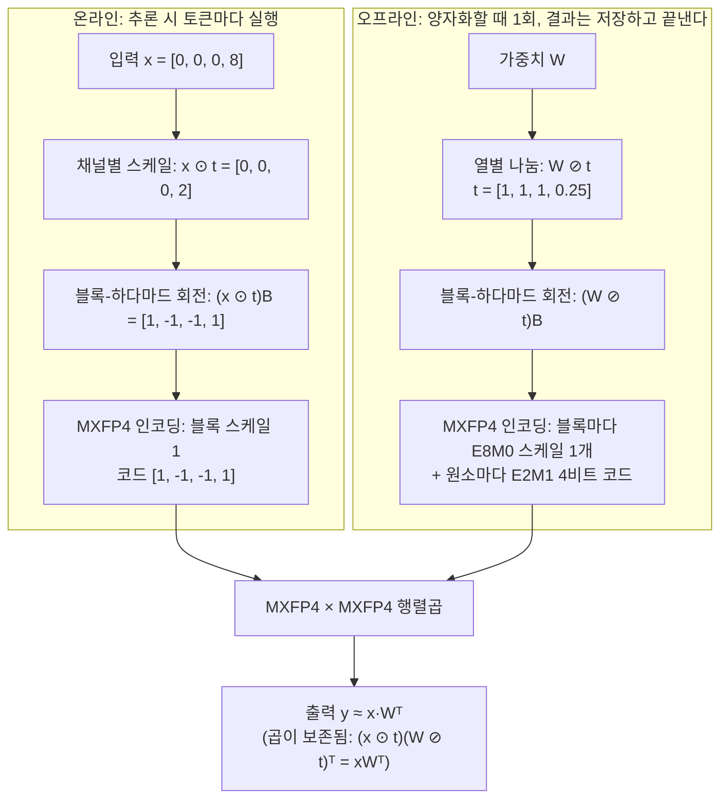

[논문 링크](https://arxiv.org/abs/2611.10649)
## 도입

이 논문은 가중치와 활성화를 모두 4비트로 줄이는 MXFP4 W4A4 양자화 방법 MACaQ를 제안한다. 각 선형 레이어를 서로 독립적으로 처리하는 것이 핵심이다. 입력에 필요한 스케일과 회전을 온라인으로 적용하는 비용을 감수하는 대신, 레이어 사이의 의존성을 없앤다. 그 결과 양자화 시간이 크게 줄고, 레이어를 하나씩 올려 처리하는 스트리밍 구현이 가능해 GPU 메모리 요구량도 낮아진다. 새로운 아키텍처에도 구조 변경 없이 적용된다.

## 배경: 읽기 전에 필요한 네 가지

### 1) 양자화와 W4A4

양자화는 값을 더 적은 비트로 근사해 저장·계산 비용을 줄이는 기법이다. 가중치와 활성화를 모두 4비트로 저장하고 4비트끼리 곱하는 방식을 W4A4라고 부른다. 이 논문은 메모리와 연산 비용을 함께 줄이는 것을 목표로 MXFP4 W4A4를 다룬다.

### 2) MXFP4: 블록마다 스케일 하나를 공유한다

이 논문은 OCP(Open Compute Project) 표준의 MXFP4를 저장 형식으로 쓴다. 형식은 두 가지 규칙으로 정의된다.

- **블록 스케일**: 원소 32개(블록 크기 B = 32)를 한 묶음으로 보고, 묶음마다 스케일 하나를 공유한다. 스케일은 지수 8비트·가수 0비트(E8M0)라서 **2의 거듭제곱 값만** 표현할 수 있다.
- **원소 코드**: 블록 안의 각 원소는 부호 1비트·지수 2비트·가수 1비트짜리 4비트(E2M1) 코드로 저장한다.

즉 한 블록의 32개 원소가 **눈금 간격 하나를 공유**한다. 블록마다 스케일을 두어 4비트 코드의 표현 범위를 넓히는 설계다.

### 3) 이상치(outlier)라는 문제

신경망의 입력 활성화는 가끔 특정 채널에 매우 큰 값이 몰린다. 이를 이상치라고 한다. 이상치가 문제인 이유는 블록 스케일이 하나뿐이기 때문이다. 스케일을 큰 값에 맞춰 잡으면 같은 블록의 작은 값들이 거친 눈금으로 반올림되어 대부분 0으로 사라지고, 반대로 스케일을 작게 잡으면 큰 값이 잘려 나간다. **블록 하나 안에서 큰 값과 작은 값을 동시에 정밀하게 담을 방법이 없다는 뜻**이다.

### 4) 기저 변환(change of basis)이라는 도구

기저 변환은 입력에 어떤 행렬을 곱하고, 가중치에 대응하는 역변환을 적용해 **원래 곱의 결과는 그대로 두면서** 양자화하기 쉬운 형태로 바꾸는 연산이다. 논문에서 쓰는 것은 두 가지다.

- **회전(rotation)**: 직교 행렬을 곱해 한 채널에 몰린 큰 값을 여러 채널로 흩뜨린다. 특히 Hadamard 변환은 O(N log N) 연산에 가능하고, 변환된 값을 대략 가우시언 분포에 가깝게 만든다.
- **스케일(scaling)**: 대각 행렬로 특정 채널을 눌러주거나 가중치 열을 나눠서, 활성화와 가중치 양쪽의 양자화 난이도를 맞춘다.

## 문제: 기존 방법은 변환을 "밀어내서" 없앤다

QuaRot·DuQuant++ 같은 기존 기법은 입력측 변환을 **앞선 레이어에 흡수**한다. Fig. 1이 그 차이를 보여 준다. prior work는 선형 레이어 바깥에서 변환 P를 적용해 런타임 비용을 없애고, MACaQ는 선형 레이어 안에서 `x·P`를 직접 계산한다.

흡수 방식의 대가는 레이어 간 의존성이다. 어떤 레이어에 변환을 적용하려면 그 레이어의 정규화 파라미터, 앞선 프로젝션, 잔차 브랜치 같은 연결된 연산자를 함께 손봐야 한다. 결과적으로 세 가지 손해가 생긴다.

1. **양자화가 느려진다.** 레이어마다 적절한 흡수 대상을 찾고, 연결된 연산자를 함께 조정해야 한다.
2. **아키텍처마다 다시 작업해야 한다.** 새 모델에 적용할 때마다 다른 흡수 지점을 새로 찾아야 한다.
3. **모든 레이어가 흡수를 받을 수 없다.** 일부 구조에서는 변환을 밀어낼 자리가 애매해진다.

MACaQ의 선택은 반대다. **온라인 변환의 비용을 감수하고, 변환을 그 레이어 안에서 계산한다.** 그러면 인접 레이어를 고칠 필요가 없어지고, 레이어 하나를 GPU에 올려 양자화한 뒤 다음 레이어로 넘어가는 스트리밍이 가능해진다. 논문의 주장은 "이 추가 비용은 충분히 작다"는 것이다.

## 작은 예시: 스케일과 회전이 실제로 무엇을 바꾸는가

아래는 **설명용 예시이며 실제 실험 수치가 아니다.** 입력 차원을 4로 줄였고(실제 MACaQ는 MXFP4 블록 크기와 같은 32를 쓴다), 표준 E2M1 격자 `{0, 0.5, 1, 1.5, 2, 3, 4, 6}`와 E8M0의 2의 거듭제곱 스케일을 사용한다.

### 예시 1 — 이상치 하나가 있는 입력을 펴는 과정

한 토큰의 입력이 네 번째 채널에 이상치 8을 가진다고 하자. `t = [1, 1, 1, 0.25]`는 이상치 채널만 1/4로 눌러주는 채널별 스케일이고, `B`는 4점 정규화 Hadamard 행렬이다.

| 단계 | 남는 상태 (4채널 예시) | 실제로 일어나는 일 |
| --- | --- | --- |
| 입력 x | `[0, 0, 0, 8]` | 네 번째 채널에 값 8 하나가 몰려 있다 |
| 채널별 스케일 x ⊙ t | `[0, 0, 0, 2]` | 이상치 채널 값이 8 → 2로 눌려 준다 |
| 블록-하다마드 회전 (x ⊙ t)B | `[1, -1, -1, 1]` | 남은 2가 네 채널에 ±1로 흩어진다 |
| MXFP4 인코딩 | 코드 `[1, -1, -1, 1]`, 블록 스케일 1 | 1은 E2M1에 정확히 표현된다. 잘림도 반올림 손실도 없다 |

스케일을 건너뛰고 회전만 하면 `[0, 0, 0, 8]`은 `[4, -4, -4, 4]`가 된다. 두 변환을 함께 쓰면 회전만 할 때보다 최댓값이 작아져 분포가 더 고르게 퍼진다.

### 예시 2 — 블록 스케일 하나가 무엇을 버리는가

"블록 하나에 스케일 하나"라는 제약이 얼마나 강한지, 회전 전후를 같은 블록으로 비교해 보자. 블록 값은 `[7.0, 1.2, 0.9, 0.35]`이다.

**회전하지 않은 상태.** 설명을 위해 블록 최댓값 7.0에 대해 표준 스케일을 `s = 8`로 두고, 논문의 지수 오프셋 `{+1, 0, −1}`에 따라 후보 16·8·4를 모두 시도한다.

| 후보 스케일 | 7.0 → | 1.2 → | 0.9 → | 0.35 → | 제곱 오차 합 | 판정 |
| --- | ---: | ---: | ---: | ---: | ---: | --- |
| 16 | 8 | **0** | **0** | **0** | 3.37 | 거절 |
| 8 | 8 | **0** | **0** | **0** | 3.37 | 거절 |
| 4 | 8 | 2 | **0** | **0** | 2.57 | 채택 |

채택된 후보조차 작은 값 세 개 중 두 개를 **0으로 지워 버린다**. 블록 스케일이 큰 값 7.0에 맞춰져 1.0 근방을 세밀하게 표현할 눈금이 없어진 것이다.

**회전한 상태.** 같은 입력에 회전만 적용하면 `[4.725, 3.175, 3.475, 2.625]`가 되고, 최댓값 4.725에 대해 표준 스케일을 `s = 8`로 두면 후보는 똑같이 16·8·4이다.

| 후보 스케일 | 4.725 → | 3.175 → | 3.475 → | 2.625 → | 제곱 오차 합 | 판정 |
| --- | ---: | ---: | ---: | ---: | ---: | --- |
| 16 | 8 | **0** | **0** | **0** | 39.77 | 거절 |
| 8 | 4 | 4 | 4 | 4 | 3.37 | 거절 |
| 4 | 4 | 4 | 4 | 2 | 1.87 | 채택 |

채택된 `s = 4`에서는 어느 원소도 0으로 사라지지 않고, 오차 합도 회전 전보다 작다. **변환의 역할은 "값을 옮기는" 것이 아니라 "블록 안 값들의 크기 차이를 줄여, 하나의 스케일이 표현할 수 있는 범위 안에 전부 담을 수 있게 만드는 것"** 이다.

두 가지 주의를 붙이자. 첫째, 실제 MACaQ는 개별 원소 오차의 합이 아니라 **헤시안 대각 성분으로 가중한 재구성 오차**(식 12)로 후보를 고르므로, 위 예시와 다른 후보가 선택될 수 있다. 둘째, 이 예시는 4채널 축소본이므로 실제로는 한 블록 32개 원소가 더 많이 섞여 분산 효과가 더 클 수 있다.

여기까지가 "문제"다. 변환으로 분포를 고르게 만들었다면, 남은 일은 **원래 곱을 보존하면서 그 변환을 어디에 넣을 것인가**다. 입력에 적용한 변환의 역변환을 가중치 쪽에 상응하게 넣어야 곱이 유지된다. 기존 방법은 이 역변환을 앞 레이어로 밀어냈고, MACaQ는 같은 레이어 안에 남긴다.

## 방법: MACaQ

MACaQ는 각 선형 레이어를 네 단계로 처리한다. ① 채널별 스케일, ② 블록-하다마드 회전, ③ 헤시안을 반영한 블록 지수 선택, ④ FP4 코드를 다듬는 Flip-Refinement. 앞의 두 단계가 **추론 시 매 토큰마다 실행되는 온라인 변환**이고, 뒤의 두 단계가 **양자화 시 저장할 값을 고르는 오프라인 작업**이다.

### 1) 온라인 변환 ① — 채널별 스케일

입력 채널마다 스케일 `t_j`를 곱하고, 가중치의 대응 열을 같은 값으로 나눈다.

```
x·Wᵀ = (x ⊙ t)(W ⊘ t)ᵀ
```

양쪽 연산은 곱에서 상쇄되지만, **양자화기에 넘기는 분포만 바뀐다.** 스케일 값을 잘 고르면 이상치 채널을 눌러 입력 분포를 고르게 만들면서, 표준편차가 큰 가중치 열은 나눗셈으로 줄일 수 있다.

스케일은 다음과 같이 정한다.

```
t_j = (σ_j^W)^α / (rms_x_j)^(1−α),   rms_x_j = sqrt(H_jj / N)
```

`σ_j^W`는 가중치 열 j의 표준편차, `rms_x_j`는 입력 채널 j의 RMS 크기이며 헤시안 대각 성분에서 바로 얻는다. 저자들은 **α = 0.75**를 사용하고, 이는 wikitext-2 train의 일부로 만든 검증 세트에서 골랐다. α는 활성화 균형과 가중치 균형 사이의 절충을 조절하는 손잡이다. 수치 안정성을 위해 스케일 값은 유한 범위로 클램프한다.

### 2) 온라인 변환 ② — 블록-하다마드 회전

스케일한 입력에 정규직교 행렬 B를 곱해 분포를 평평하게 만든다.

```
x·Wᵀ = (xB)(WB)ᵀ
```

여기서 MACaQ의 선택이 갈린다. 기존 방법은 이 회전을 인접 레이어로 전파해 런타임 비용을 없애려 했고, 그러면 레이어 사이에 의존성이 생겨 양자화가 느려진다(Fig. 1). MACaQ는 **회전을 온라인에 그대로 남겨** 각 레이어를 완전히 독립적으로 만든다.

회전 블록 크기를 32로 맞춘 이유도 여기에 있다. 회전이 이상치를 여러 MXFP4 블록에 걸쳐 흩어 놓으면, 블록마다 스케일이 따로라 이상치 문제가 되살아난다. 마이크로스케일 블록과 같은 크기로 잘라야 한 블록 안에서만 섞인다.

순서도 의도적이다. **스케일을 먼저, 회전을 나중에** 적용한다. 채널의 중요도를 조절하는 작업이 아직 회전되지 않은 원래 좌표에서 일어나야 하기 때문이다.

### 3) 온라인 변환 ③ — MXFP4로 인코딩

변환된 활성화를 블록 32개 단위로 묶어, 블록마다 E8M0 스케일 하나를 정하고 원소마다 E2M1 4비트 코드를 저장한다. 가중치 쪽에는 같은 변환의 역변환이 이미 흡수되어 있으므로, 곱셈은 MXFP4 × MXFP4로 그대로 수행된다.

```
y = [ (x ⊙ t)B ]_MXFP4 · [ W′ ]_MXFP4ᵀ,     W′ = (W ⊘ t)B
```

한 레이어에서 실제로 일어나는 일을 값으로 따라가 보자.



도식의 숫자에서: `2`는 이상치 8을 1/4로 눌러 얻은 값이고, `1`은 Hadamard 회전으로 네 채널에 펼친 값이다. 회전 결과의 블록 최댓값이 1이므로 E8M0 블록 스케일은 1이 되고, E2M1은 1을 정확히 표현한다. 가중치 쪽은 같은 `t`로 나누고 같은 `B`를 곱해 **같은 역변환을 미리 흡수**했기 때문에, 두 변환이 상쇄되어 원래 곱이 보존된다.

### 4) 오프라인 ① — 헤시안 가중 블록 지수 선택

변환으로 분포가 고르게 만들어졌다고 해도, 블록마다 스케일 하나를 어떻게 정하느냐는 남는다. 스케일이 작으면 0 근처를 잘게 표현하지만 큰 값이 잘릴 수 있고, 크면 잘림은 피하지만 눈금이 거칠어진다.

MACaQ는 각 가중치 행과 블록마다 후보를 세 개만 만든다. 블록 최댓값에서 유도한 표준 지수를 기준으로 오프셋 `{+1, 0, −1}`이다. 각 후보마다 블록을 해당 E2M1 격자로 반올림하고, 헤시안 대각으로 가중한 재구성 오차를 계산해 최솟값을 고른다.

```
E_i,B(e) = Σ_{j∈B} (H_f)_jj ( W′_ij − Ŵ′_ij(e) )²
```

선택된 블록 지수는 Flip-Refinement 동안 고정된다. 이 과정이 끝나면 각 원소는 가장 가까운 E2M1 값으로 반올림된 **초기 배정(RTN)** 을 얻는다. 여기서 `H_f`는 변환된 기저에서의 헤시안 `H′ = BᵀDHDB`에 리지 정규화 `H_f = H′ + λ·mean(diag(H′))·I`를 더한 것이며, 저자들은 λ = 1.0을 기본값으로 쓴다. 부록에서는 λ 민감도가 평평해 보수적으로 1.0을 택했다고 설명한다.

### 5) 오프라인 ② — Flip-Refinement

초기 반올림을 더 좋게 만드는 것이 Flip-Refinement(Algorithm 1)이다. GPTQ처럼 가중치를 순서대로 배정하고 남은 가중치를 보상하는 대신, **값싼 RTN에서 출발해 코드를 하나씩 되돌아보며 다듬는다.**

어떤 원소의 4비트 코드를 이웃한 E2M1 레벨로 한 칸 옮기면, 그 행의 재구성 오차가 얼마나 줄어드는지 닫힌 식으로 계산할 수 있다.

```
gain(i, j, Δ) = 2·Δ·g_i,j − Δ²·(H_f)_jj
```

여기서 `g_i = H_f r_iᵀ`는 현재 잔차에 헤시안을 곱한 기울기이고, `Δ`는 코드를 한 칸 옮겼을 때 재구성 값이 바뀌는 양이다. E2M1 격자가 균등하지 않기 때문에 Δ는 현재 코드와 이동 방향, 고정된 블록 스케일에 따라 달라진다. **양수인 gain만 받아들이면 된다.**

이동 하나를 받아들인 뒤에는 기울기를 점진적으로 갱신한다.

```
g_i ← g_i − Δ·(H_f)_:,j
```

헤시안 한 열만 더하고 빼면 되므로, 행렬곱을 처음부터 다시 계산하지 않는다.

알고리즘의 구조는 다음과 같다. 매 반복마다 **행마다 최대 한 개의 이동만** 선택하고, 각 행은 서로 독립이므로 병렬로 처리한다. 양수 gain이 남지 않은 행은 활성 집합에서 빠지고 추가 계산이 없다. 반복 횟수 K는 곧 행당 최대 flip 횟수이며, 실제로는 많은 행이 K에 도달하기 전에 수렴한다. 블록 스케일은 이 과정 내내 고정된다.

### 6) 온라인 변환 비용은 얼마인가

온라인에서 추가되는 것은 스케일과 회전뿐이다(활성화 양자화는 모든 W4A4 구현이 어차피 한다). 입력 차원 n, 출력 차원 m, 토큰 수 T인 레이어에서 블록-Hadamard 변환은 약 `T·n·log2B`번의 덧셈, 스케일은 `T·n`번의 곱셈이 든다. 반면 행렬곱은 약 `2·T·m·n`번의 연산이다.

```
C_online / C_matmul = (log2B + 1) / (2m)
```

B = 32이면 이 값은 `3/m`이다. 두 변환은 입력에만 적용되어 출력 채널 m개에 걸쳐 재사용되고, 행렬곱 비용은 m에 비례하므로 **출력 차원이 클수록 온라인 변환의 상대 비중은 작아진다.** Llama-3-8B의 양자화 대상 선형 레이어 중 가장 작은 출력 차원이 m = 1024여서, 연산 횟수 기준 비율은 0.3% 미만이다.

이 계산은 **연산 횟수의 추정이지 벽시계 시간이 아니다.** 저자들도 실측 오버헤드는 커널 퓨전, 메모리 트래픽, 커널 실행 오버헤드, FP16과 MXFP4의 처리량 차이에 따라 달라진다고 명시하고, 실측은 뒤의 커널·시스템 결과로 미룬다.

### 7) 스트리밍 양자화 절차

변환이 레이어 안에 갇혀 있으면 양자화 자체도 스트리밍으로 바뀐다.

1. forward 훅이 보정 시퀀스를 조각으로 나눠 각 레이어의 입력 헤시안 `H_ℓ = Σ_k X_ℓ,kᵀ X_ℓ,k` 를 누적한다.
2. 통계 수집이 끝나면 각 레이어를 **따로** 스케일하고, 회전하고, 지수를 고르고, 코드를 다듬는다.
3. 다듬어진 레이어를 팩킹된 MXFP4 구현으로 교체한다.

한 번에 GPU에 올려야 하는 것은 현재 처리 중인 레이어 하나(그리고 보정을 위한 병렬 레이어의 출력)뿐이고, 나머지 가중치는 호스트 메모리에 남는다. 덕분에 전체 모델을 FP16으로 올리지 못하는 GPU에서도 양자화할 수 있고, 동일한 구현을 다른 아키텍처에 그대로 재사용할 수 있다.

### 8) 손잡이 두 개

MACaQ는 품질과 시간을 맞바꾸는 두 손잡이를 제공한다. **보정 토큰 수**와 **최대 flip 반복 횟수 K**다. Fig. 2의 파레토 곡선은 이 둘을 훑어 그린다. 품질은 보정 토큰 약 2×10⁶개와 K = 512 부근에서 평탄해진다. 논문의 실험 절에서는 공정 비교를 위해 **K = 128, 보정 토큰 2×10⁵** 를 사용하며, 이 설정으로 Llama-3-8B 양자화에 약 150초가 걸린다.

## 결과: 품질, 시간, 메모리

하드웨어는 504 TFLOPS(FP16)·96GB 메모리·1.79TB/s 대역폭의 GPU 하나로 통일했다. 논문은 OCP MXFP4를 기본 형식으로 쓰며, 이미지 확산 비교에는 공식 NVFP4 체크포인트도 포함한다.

### 품질 — perplexity (Table 1 일부)

WikiText-2는 보정 데이터와 같은 계열의 배포 안 평가, C4는 배포 밖 평가다. 문맥 길이는 2048이다. Table 1은 여섯 모델(Llama-3-8B, Llama-3.2-3B, Llama-3-8B-Inst, Llama-3.1-8B-Inst, Qwen3-32B, Qwen3.5-35B-A3B)을 보고하며, MACaQ는 **열두 개 컬럼 전부에서 양자화 방법 중 가장 낮은 perplexity**를 기록했다. 아래는 그중 세 모델이다.

| 방법 | Llama-3-8B Wiki2 | Llama-3-8B C4 | Qwen3-32B Wiki2 | Qwen3-32B C4 | Qwen3.5-35B-A3B Wiki2 | Qwen3.5-35B-A3B C4 |
| --- | ---: | ---: | ---: | ---: | ---: | ---: |
| FP16 (기준) | 6.14 | 9.46 | 7.62 | 12.45 | 6.55 | 10.98 |
| QuaRot (RTN) | 9.34 | 15.53 | 10.19 | 16.59 | 6.77 | 11.38 |
| MR-GPTQ | 7.13 | 11.37 | 8.15 | 13.27 | 6.75 | 11.22 |
| DuQuant++ (GPTQ) | 7.17 | 11.66 | 8.07 | 13.15 | 6.75 | 11.26 |
| **MACaQ** | **6.90** | **11.01** | **7.94** | **12.93** | **6.66** | **11.21** |

같은 평가 조건에서 FP16 대비 손실 폭은 Llama-3-8B Wiki2에서 0.76, Qwen3-32B Wiki2에서 0.32, Qwen3.5-35B-A3B Wiki2에서 0.11이다. 마지막 모델의 C4 컬럼은 MACaQ 11.21, MR-GPTQ 11.22로 격차가 0.01에 불과해, 이 열에서는 사실상 동률로 보는 편이 낫다.

### 구성 요소별 기여 (Table 5)

Llama-3-8B에서 flip 512회·보정 토큰 200,000개 설정으로, 컴포넌트를 하나씩 쌓아 올린다.

| 구성 | Wiki2 perplexity | 직전 단계 대비 변화 |
| --- | ---: | ---: |
| FP16 (기준) | 6.14 | – |
| RTN | 8.28 | – |
| + 헤시안 블록 지수 탐색 | 8.09 | −0.19 |
| + 마이크로 회전 | 7.65 | −0.44 |
| + 온라인 두 번째 스케일 | 7.08 | −0.57 |
| + flip refinement (= MACaQ) | 6.87 | −0.21 |

각 요소가 비슷한 크기(~0.2~0.6)로 기여하고, 합친 결과가 가장 낮다. 즉 RTN 대비 1.41의 개선은 네 요소가 나눠 갖는다.

### 양자화 시간과 품질의 절충 (Table 7, Fig. 2 대응)

아래는 Table 7의 핵심 행들이다. "보정 블록"은 2048토큰 단위이고, MACaQ는 평평한 토큰 스트림을 쓴다.

| 방법 | flips | 보정 블록 | 시간 (s) | Wiki2 PPL |
| --- | ---: | ---: | ---: | ---: |
| RTN | – | 0 | 2.2 | 8.29 |
| MACaQ (회전 + 지수 탐색만) | 0* | 0 | 5.5 | 7.64 |
| MACaQ | 0 | 1 | 14.8 | 7.11 |
| **MACaQ** | **16** | **2** | **24.3** | **7.01** |
| MACaQ | 32 | 4 | 31.3 | 6.97 |
| MACaQ | 128 | 31.3 | 88.1 | 6.91 |
| MACaQ | 256 | 125 | 193.1 | 6.87 |
| MR-GPTQ | – | 64 | 267.9 | 7.11 |
| MR-GPTQ | – | 128 | 319.1 | 7.11 |
| DuQuant++ (GPTQ) | – | 128 | 624.4 | 7.16 |

이 표는 Fig. 2가 말하는 11배 단축의 한 지점을 보여 준다. MR-GPTQ가 최고 품질 7.11에 도달하는 데 267.9초가 걸리는 동안, MACaQ는 **24.3초 만에 7.01**을 만든다. 시간은 약 11배 짧고 perplexity는 더 낮다. 다른 읽기로는 319.1초/7.11인 MR-GPTQ 대비 88.1초/6.91로, 시간 3.6배 단축과 더 낮은 perplexity를 동시에 얻는다. 결국 **짧게 끝나는 설정과 조금 더 오래 걸리는 고품질 설정 사이를 손잡이로 고를 수 있다**는 뜻이다.

### 생성 벤치마크 (Table 2)

perplexity는 고정된 텍스트만 재는 지표라서, 생성 중 오차가 누적되는 상황을 놓칠 수 있다. 그래서 IFEval(지시 따르기)과 MATH-500(자유 형식 수학 추론)도 함께 평가한다. 각 값은 10회 실행 평균이며 ±는 시드 간 표준오차다.

| 방법 | Qwen3-32B IFEval | Qwen3-32B MATH500 | Qwen3.5-35B-A3B IFEval | Qwen3.5-35B-A3B MATH500 |
| --- | ---: | ---: | ---: | ---: |
| FP16 (원본) | 83.60% ±0.25 | 97.78% ±0.10 | 85.29% ±0.25 | 99.38% ±0.06 |
| QuaRot (RTN) | 78.46% ±0.23 | 93.65% ±0.20 | 85.41% ±0.33 | 98.78% ±0.10 |
| MR-GPTQ | 82.81% ±0.27 | 97.44% ±0.16 | 85.43% ±0.24 | 98.86% ±0.07 |
| DuQuant++ (GPTQ) | 82.81% ±0.27 | 96.90% ±0.14 | 85.59% ±0.21 | 98.50% ±0.11 |
| **MACaQ** | **83.20% ±0.26** | **97.26% ±0.11** | 85.42% ±0.40 | **98.90% ±0.09** |

Qwen3-32B에서 MACaQ는 FP16 대비 IFEval 0.40%p, MATH-500 0.52%p 낮다. Qwen3.5-35B-A3B에서는 IFEval이 85.42%로 FP16의 85.29%보다 0.13%p 높고, MATH-500은 98.90%로 99.38%보다 0.48%p 낮다. 따라서 관측된 생성 품질 하락은 두 모델 모두 1%p 미만이다. 다만 Qwen3-32B의 MATH-500 하락 0.52%p는 표준오차(±0.10, ±0.11)에 비해 작지 않으므로, "표준오차 이내"라고 일반화하기는 어렵다.

### 이미지 확산 모델로의 확장 (Table 3)

"어떤 선형 레이어든 따로 처리한다"는 설계가 언어 모델 밖에서도 통하는지 확인하려고 FLUX.2 Klein 4B를 MXFP4로 양자화했다. 구조 변경 없이 그대로 적용했고, 비교 대상은 공식 NVFP4 체크포인트다. **공식 NVFP4가 양자화하는 것과 같은 레이어들만** MACaQ로 바꿔 정확히 같은 조건으로 비교했다. 설정은 GenEval2 프롬프트 800개, 1024², 6스텝, DiT만 W4A4이며, 모든 지표는 같은 프롬프트·시드의 BF16 출력과 비교했다.

| 방법 | 형식 | 비트/원소 | PSNR ↑ | SSIM ↑ | LPIPS ↓ | DINO global ↑ | DINO patch ↑ | VRAM (GB) ↓ |
| --- | --- | ---: | ---: | ---: | ---: | ---: | ---: | ---: |
| 원본 | BF16 | 16.0 | – | – | – | – | – | 18.5 |
| **MACaQ** | MXFP4 | **4.25** | **15.04** | **0.697** | **0.218** | **0.882** | **0.947** | **13.1** |
| 공식 NVFP4 | NVFP4 | 4.50 | 14.85 | 0.676 | 0.235 | 0.878 | 0.937 | 13.3 |

PSNR·SSIM·LPIPS·DINO 지표 모두에서 BF16 원본에 더 가깝고, 비트 수는 4.25 대 4.50으로 더 적고, VRAM은 13.1GB 대 13.3GB로 사실상 동률이다. NVFP4는 마이크로스케일 그룹 크기가 16인 반면 MACaQ는 32여서 비트 수 차이가 난다. Fig. 4는 그림 단위의 정성 비교다.

### 커널 단위 속도 (Table 4)

선형 레이어 하나 `X·Wᵀ`를 직접 측정했다. `W ∈ R^{N×N}`(N ∈ {4096, 16384}), `X ∈ R^{B×L×N}`(B ∈ {1, 16}, L ∈ {512, 16384})이며, 값은 FP16 대비 속도 배율(↑)이고 마지막 열이 online scale+rotation을 켰을 때의 상대 지연이다. L = 1은 디코드 상황이다.

| N | B | L | MACaQ | MACaQ −SR | Marlin W4A16 | FP16 | SR 비용 |
| --- | ---: | ---: | ---: | ---: | ---: | ---: | ---: |
| 4096 | 1 | 1 | 1.31 | 1.31 | 1.31 | 1.00 | <1% |
| 4096 | 1 | 16384 | 1.75 | 1.86 | 1.02 | 1.00 | 6.4% |
| 4096 | 16 | 1 | 1.75 | 1.75 | 1.75 | 1.00 | <1% |
| 4096 | 16 | 16384 | 1.50 | 1.57 | 1.01 | 1.00 | 4.1% |
| 16384 | 1 | 1 | 5.04 | 5.11 | 8.26 | 1.00 | 1.3% |
| 16384 | 1 | 16384 | 2.01 | 2.05 | 1.00 | 1.00 | 1.6% |
| 16384 | 16 | 1 | 4.47 | 4.55 | 6.19 | 1.00 | 1.7% |
| 16384 | 16 | 16384 | 1.83 | 1.85 | 0.98 | 1.00 | 0.9% |

N = 4096에서는 최대 6.4%, N = 16384에서는 1.7% 이하로, 이론 분석("레이어가 클수록 상대 오버헤드가 줄어든다")과 방향이 일치한다. 짧은 컨텍스트(메모리 바운드)에서는 Marlin W4A16이 더 빠른 경우가 있고(예: N = 16384, B = 1, L = 1에서 Marlin 8.26배, MACaQ 5.04배), 긴 컨텍스트(컴퓨트 바운드)에서는 MACaQ가 앞선다(같은 N, B = 1, L = 16384에서 MACaQ 2.01배, Marlin 1.00배).

### 전체 시스템 속도 (Table 6)

Qwen3-32B에서 vLLM 그래프 모드, 512토큰 프롬프트 기준 디코드 속도(tok/s)다. "MACaQ −SR"은 online scale+rotation만 끈 속도 전용 ablation이다.

| 배치 | bf16 | Marlin W4A16 | MACaQ | MACaQ −SR |
| ---: | ---: | ---: | ---: | ---: |
| 1 | 22.8 | 71.8 | 69.8 | 69.4 |
| 16 | 342.7 | 994.6 | 949.4 | 976.9 |
| 32 | 652.1 | 1792.6 | 1756.7 | 1804.2 |
| 64 | 1234.7 | 2697.8 | 2709.8 | 2836.7 |
| 128 | 2086.1 | 3170.0 | 3983.3 | 4080.4 |
| 256 | 3061.5 | 3573.3 | 5252.8 | 5402.9 |

배치 1에서 MACaQ는 FP16의 22.8 tok/s에 대해 69.8 tok/s로 3.06배, 배치 256에서는 3061.5 tok/s에 대해 5252.8 tok/s다. 배치 1~32에서는 Marlin W4A16이 근소 우위지만, 배치가 커지면 MXFP4 W4A4가 W4A16 Marlin을 크게 앞선다(배치 256에서 5252.8 대 3573.3). 즉 **W4A4의 이득은 메모리 바운드 상황보다 컴퓨트 바운드 상황에서 더 크게 나타난다.**

한편 online 변환의 비용은 배치 1에서 MACaQ 69.8과 MACaQ −SR 69.4로 0.4 tok/s 차이에 불과하지만, 배치 16 이상에서는 −SR이 약 2~5% 더 빠르다. Fig. 3은 모델 규모에 따른 scale+rotate 오버헤드를 따로 정리하는데, Qwen3-0.6B에서 약 8%였던 오버헤드가 Qwen3-32B에서 약 2.3%(본문 서술은 약 2%)까지 떨어진다. **작은 모델일수록 online 변환 비중이 크다**는 뜻이며, 0.6B에서도 FP16 대비 속도 이득 자체는 남아 있다.

### 목표 GPU에 들어가지 못하는 모델 (Qwen3.5-122B-A10B)

MACaQ의 목표 중 하나는 "원래 정밀도로는 목표 GPU에 못 올라가는 모델을 양자화해 올리는 것"이다. 총 파라미터 122B의 Qwen3.5-122B-A10B는 FP16 가중치만 약 244GB라 96GB GPU 한 장에 들어가지 않는다. MACaQ는 레이어를 지연 로딩하며 GPU 메모리 사용량을 **32.5GB**로 유지하고, **64분**(flip 32회, 보정 토큰 512K)에 양자화를 끝냈다. 결과 WikiText-2 perplexity는 5.14로 FP16의 5.06과 거의 같다. 양자화된 모델은 74GB가 필요해 같은 GPU에서 추론할 수 있다. 즉 **올릴 수 없던 모델을 올릴 수 있게 만든 것**이 이 실험의 요지다.

### 정확성 측면의 주의 한 가지

DuQuant++의 코드베이스에는 2의 분수 거듭제곱 스케일을 허용하는 변환 함수가 있어, 그 버전으로 돌린 수치와 논문 수치가 조금 다르다. 저자들은 자기 자신뿐 아니라 **모든 비교 방법에 OCP 규격에 맞는 변환을 적용**해 이 차이를 없앴다. 즉 Table 1의 비교는 모두 같은 스케일 규칙 아래에서 나온 수치다.

### 부록: 벡터 양자화 형식까지 확장된다

부록에서는 Flip-Refinement를 스칼라 코드 대신 코드북 단위로 확장해 llama.cpp의 IQ3_S·IQ3_XXS 같은 벡터 양자화 형식에 적용한다. 스칼라 이동이 코드북 제약에 걸리는 경우를 피해 블록 단위 최근접 이웃 탐색으로 바꾼 뒤, Qwen3-4B/14B에서 측정한다. 다만 저자들도 인정하듯 **정확한 블록 최소화가 모델 perplexity를 항상 낮추지는 않는다**(서로 다른 국소 최솟값에 도달하고, 레이어 목적함수는 모델 품질의 대리 지표일 뿐이다).

## 한계와 적용 지점

### 논문이 밝힌 한계

1. **레이어 간 오차 보상이 불가능하다.** 모든 것을 레이어 안에 가둔 결과다. 교차 레이어 통계를 쓰는 2차 보정을 덧붙일 수는 있지만, 그러면 다른 방법들처럼 양자화 시간이 길어질 가능성이 높다.
2. **MoE 실험에서는 전문가 레이어만 양자화했다.** 실용성 고려이며 비교 기준선도 동일하게 처리했다. 임베딩과 lm-head는 양자화하지 않는다(관례).
3. **가장 작은 모델(0.6B)에서 online 변환 오버헤드가 8%까지 올라간다.** 일부 설정에서는 무시할 수 없는 수준이다.
4. **연산 횟수 추정이 벽시계 성능을 예측하지 못한다.** 예컨대 Llama-3-8B의 최소 출력 차원 기준 연산 비율은 0.3% 미만이지만, Qwen3-32B의 실측 end-to-end 오버헤드는 2.3%다(서로 다른 모델과 측정 대상이므로 직접 비교는 아니다). 저자들은 실측 오버헤드가 커널 퓨전, 메모리 트래픽, 커널 실행 오버헤드, FP16과 MXFP4의 처리량 차이에 달려 있다고 설명한다. 온라인 변환의 절대 시간은 별도로 보고되지 않고, 커널·시스템 수준의 상대 오버헤드로만 제시된다.

### 리뷰어 관점의 보태기

이 네 한계는 곧 적용 조건과 맞물린다. 온라인 변환의 상대 비용은 출력 차원이 클수록 작아지므로, 출력 차원이 큰 레이어가 많은 모델에서 가장 유리하다. 논문은 32B에서 2.3%, 0.6B에서 8%를 보고한다. 반대로 "GPU 메모리가 부족해 모델을 못 올리는데 양자화도 빨리 끝내고 싶다"는 상황, 혹은 아키텍처가 자주 바뀌는 상황에서는 **레이어 독립 설계**가 뚜렷한 강점으로 남는다.

다만 언어 모델 품질 확인이 perplexity와 IFEval·MATH-500 같은 일부 벤치마크에 한정되어 있다. 논문도 생성 중 오차 누적은 고정 텍스트 지표에 보이지 않을 수 있다고 인정한다. 특정 도메인의 생성 작업에 도입하기 전에는 그 태스크에서의 품질을 별도로 확인하는 편이 안전하다. 또한 층별 목적함수를 최소화한다고 모델 전체 품질이 함께 올라가는 것은 아니므로(부록의 벡터 양자화 실험이 그 증거), 마지막 검증은 결국 목표 태스크 지표로 해야 한다.

구현은 코드 공개되어 있다: https://github.com/huawei-csl/MACaQ


<!-- verbatim-tables -->

<details>
<summary>논문 원문의 표</summary>

> arXiv e-print 의 LaTeX 원본에서 기계적으로 옮긴 표입니다. 숫자는 논문의 값이며 모델을 거치지 않았습니다.

**표 1. Additive contribution of each MACaQ component on Llama-3-8B (MXFP4 W4A4), WikiText-2 perplexity at 512 Flips and 200'000 calibration tokens.**

| Configuration | Wiki2 $\downarrow$ | $\Delta$ |
|---|---|---|
| Full Precision (FP16) | 6.14 | -- |
| RTN | 8.28 | -- |
| + Hessian exponent search | 8.09 | $-0.19$ |
| + micro-rotation | 7.65 | $-0.44$ |
| + online second scale | 7.08 | $-0.57$ |
| + flip refinement (= MACaQ) | 6.87 | $-0.21$ |

**표 2. End-to-end throughput (median tok/s; 512-token prompt, vLLM graph mode) across batch sizes. Prefill$=$prompt$/$TTFT, decode$=$per-token rate, aggregated over the batch. MACaQ$-$SR disables the online scale$+$rotation (speed-only ablation).**

| Method | Llama-3-8B Prefill | Llama-3-8B Decode | Qwen3-32B Prefill | Qwen3-32B Decode |
|---|---|---|---|---|
| *Batch 1* |  |  |  |  |
| bf16 | 38,171 | 93.2 | 11,027 | 22.8 |
| Marlin W4A16 | **71,760** | 223.9 | **29,307** | **71.8** |
| **MACaQ (ours)** | 70,547 | **227.9** | 28,473 | 69.8 |
| *MACaQ $-$SR* | 72,852 | 232.9 | 28,364 | 69.4 |
| *Batch 16* |  |  |  |  |
| bf16 | 236,101 | 1383.9 | 57,621 | 342.7 |
| Marlin W4A16 | **442,456** | **3034.9** | **147,688** | **994.6** |
| **MACaQ (ours)** | 436,001 | 2842.1 | 143,225 | 949.4 |
| *MACaQ $-$SR* | 467,704 | 3058.2 | 147,370 | 976.9 |
| *Batch 32* |  |  |  |  |
| bf16 | 393,524 | 2471.6 | 107,240 | 652.1 |
| Marlin W4A16 | 599,408 | **5251.5** | 203,672 | **1792.6** |
| **MACaQ (ours)** | **650,692** | 5028.2 | **236,880** | 1756.7 |
| *MACaQ $-$SR* | 665,454 | 5426.4 | 243,237 | 1804.2 |
| *Batch 64* |  |  |  |  |
| bf16 | 607,508 | 4527.5 | 171,756 | 1234.7 |
| Marlin W4A16 | 748,422 | 7750.3 | 226,696 | 2697.8 |
| **MACaQ (ours)** | **904,177** | **7840.2** | **294,347** | **2709.8** |
| *MACaQ $-$SR* | 954,273 | 8418.5 | 305,896 | 2836.7 |
| *Batch 128* |  |  |  |  |
| bf16 | 816,722 | 7566.8 | 224,958 | 2086.1 |
| Marlin W4A16 | 915,282 | 9502.0 | 266,406 | 3170.0 |
| **MACaQ (ours)** | **1,087,913** | **11158.3** | **323,884** | **3983.3** |
| *MACaQ $-$SR* | 1,112,510 | 11345.3 | 333,024 | 4080.4 |
| *Batch 256* |  |  |  |  |
| bf16 | 965,564 | 10146.8 | 243,291 | 3061.5 |
| Marlin W4A16 | 1,020,529 | 11220.3 | 276,373 | 3573.3 |
| **MACaQ (ours)** | **1,157,387** | **14207.6** | **373,713** | **5252.8** |
| *MACaQ $-$SR* | 1,143,268 | 14899.2 | 375,743 | 5402.9 |

**표 3. **FLUX.2-klein-4B**: MACaQ vs.\ the official NVFP4 QAD checkpoint. GenEval2 (800 prompts), $1024^2$, 6 steps, DiT-only W4A4. PSNR/SSIM/LPIPS and DINOv3 (ViT-L/16) feature cosine are paired against the BF16 output (same prompt and seed). Peak VRAM at batch 1. MACaQ is closer to BF16 on all four fidelity metrics and ties on VRAM.**

| Method | Format | bits/w | PSNR $\uparrow$ | SSIM $\uparrow$ | LPIPS $\downarrow$ | DINO$_{\text{global}}$ $\uparrow$ | DINO$_{\text{patch}}$ $\uparrow$ | VRAM (GB) $\downarrow$ |
|---|---|---|---|---|---|---|---|---|
| Full Precision | BF16 | 16.0 | - | - | - | - | - | 18.5 |
| **MACaQ (ours)** | MXFP4 | 4.25 | **15.04** | **0.697** | **0.218** | **0.882** | **0.947** | **13.1** |
| Official NVFP4 | NVFP4 | 4.50 | 14.85 | 0.676 | 0.235 | 0.878 | 0.937 | 13.3 |

**표 4. Kernel-level speed of one linear layer $\mathbf{X}\cdot\mathbf{W}^\top$, $\mathbf{W}\in\mathbb{R}^{N\times N}$, $\mathbf{X}\in\mathbb{R}^{B\times L\times N}$ ($M=B\cdot L$ rows; $L=1$ is decode). Median as **speedup relative to fp16** ($\uparrow$; fp16$\equiv1.00$). Standard Error is omitted as it is below 0.02 in all cases. MACaQ is the MXFP4 W4A4 kernel with online per-channel scaling and block-Hadamard rotation; $-$SR disables both; Marlin is the W4A16 kernel of . ``SR cost'' is the relative slowdown from enabling scale+rotation.**

| $N$ | $B$ | $L$ | MACaQ | $-$SR | Marlin | FP16 | SR cost |
|---|---|---|---|---|---|---|---|
| 904096 | 1 | 1 | $\textbf{1.31}{\scriptstyle\,}$ | $1.31{\scriptstyle\,}$ | $\textbf{1.31}{\scriptstyle\,}$ | $1.00$ | <$1\%$ |
|  | 1 | 16384 | $\textbf{1.75}{\scriptstyle\,}$ | $1.86{\scriptstyle\,}$ | $1.02{\scriptstyle\,}$ | $1.00$ | 6.4% |
|  | 16 | 1 | $\textbf{1.75}{\scriptstyle\,}$ | $1.75{\scriptstyle\,}$ | $\textbf{1.75}{\scriptstyle\,}$ | $1.00$ | <$ 1\%$ |
|  | 16 | 16384 | $\textbf{1.50}{\scriptstyle\,}$ | $1.57{\scriptstyle\,}$ | $1.01{\scriptstyle\,}$ | $1.00$ | 4.1% |
| 9016384 | 1 | 1 | $5.04{\scriptstyle\,}$ | $5.11{\scriptstyle\,}$ | $\textbf{8.26}{\scriptstyle\,}$ | $1.00$ | 1.3% |
|  | 1 | 16384 | $\textbf{2.01}{\scriptstyle\,}$ | $2.05{\scriptstyle\,}$ | $1.00{\scriptstyle\,}$ | $1.00$ | 1.6% |
|  | 16 | 1 | $4.47{\scriptstyle\,}$ | $4.55{\scriptstyle\,}$ | $\textbf{6.19}{\scriptstyle\,}$ | $1.00$ | 1.7% |
|  | 16 | 16384 | $\textbf{1.83}{\scriptstyle\,}$ | $1.85{\scriptstyle\,}$ | $0.98{\scriptstyle\,}$ | $1.00$ | 0.9% |

**표 5. OCP MXFP4 W4A4, WikiText2 / C4 perplexity ($\downarrow$). Best quantized result per column in bold, second best underlined.**

| Method | Llama-3-8B Wiki2 | Llama-3-8B C4 | Llama-3.2-3B Wiki2 | Llama-3.2-3B C4 | Llama-3-8B-Inst. Wiki2 | Llama-3-8B-Inst. C4 | Llama-3.1-8B-Inst. Wiki2 | Llama-3.1-8B-Inst. C4 | Qwen3-32B Wiki2 | Qwen3-32B C4 | Qwen3.5-35B-A3B Wiki2 | Qwen3.5-35B-A3B C4 |
|---|---|---|---|---|---|---|---|---|---|---|---|---|
| FP16 | 6.14 | 9.46 | 7.81 | 11.34 | 8.31 | 13.03 | 7.16 | 11.41 | 7.62 | 12.45 | 6.55 | 10.98 |
| QuaRot (RTN) | 9.34 | 15.53 | 12.40 | 18.63 | 11.74 | 19.21 | 10.00 | 16.48 | 10.19 | 16.59 | 6.77 | 11.38 |
| QuaRot (GPTQ) | 7.65 | 12.62 | 9.65 | 15.11 | 9.62 | 15.85 | 8.58 | 14.49 | 8.46 | 13.42 | 6.79 | 11.33 |
| FlatQuant | 7.21 | 11.65 | 9.00 | 14.87 | 9.25 | 15.27 | 8.10 | 13.40 | 8.11 | 13.28 | 6.87 | 11.57 |
| MR-GPTQ | 7.13 | 11.37 | 8.92 | 13.51 | 9.13 | 14.62 | 8.14 | 13.24 | 8.15 | 13.27 | 6.75 | 11.22 |
| DuQuant++ | 7.48 | 11.84 | 9.36 | 14.19 | 9.37 | 14.86 | 8.41 | 13.67 | 8.27 | 13.33 | 6.73 | 11.28 |
| DuQuant++ (GPTQ) | 7.17 | 11.66 | 9.02 | 13.92 | 9.04 | 14.64 | 8.18 | 13.48 | 8.07 | 13.15 | 6.75 | 11.26 |
| **MACaQ (ours)** | **6.90** | **11.01** | **8.61** | **13.07** | **8.90** | **14.41** | **7.88** | **12.91** | **7.94** | **12.93** | **6.66** | **11.21** |

**표 6. OCP MXFP4 W4A4. **IFEval** strict prompt-level accuracy ($\uparrow$, average over $k{=}10$; $\pm$ across-seed standard error). **MATH500** accuracy ($\uparrow$, average over $k{=}10$; $\pm$ across-seed standard error). Best quantized result per column in bold, second best underlined; also all results within one standard error of the baseline are bolded.**

| Method | Qwen3-32B IFEval | Qwen3-32B MATH500 | Qwen3.5-35B-A3B IFEval | Qwen3.5-35B-A3B MATH500 |
|---|---|---|---|---|
| Original (FP16) | 83.60%$\pm$0.25 | 97.78%$\pm$0.10 | 85.29%$\pm$0.25 | 99.38%$\pm$0.06 |
| QuaRot (RTN) | 78.46%$\pm$0.23 | 93.65%$\pm$0.20 | **85.41**%$\pm$0.33 | 98.78%$\pm$0.10 |
| QuaRot (GPTQ) | 82.35%$\pm$0.29 | 96.98%$\pm$0.19 | **85.60%**$\pm$0.39 | 98.60%$\pm$0.10 |
| MR-GPTQ | 82.81%$\pm$0.27 | **97.44**%$\pm$0.16 | **85.43%**$\pm$0.24 | 98.86%$\pm$0.07 |
| DuQuant++ (RTN) | 81.57%$\pm$0.29 | 96.82%$\pm$0.21 | 85.29%$\pm$0.20 | 98.58%$\pm$0.11 |
| DuQuant++ (GPTQ) | 82.81%$\pm$0.27 | 96.90%$\pm$0.14 | **85.59%**$\pm$0.21 | 98.50%$\pm$0.11 |
| **MACaQ (ours)** | **83.20%**$\pm$0.26 | 97.26%$\pm$0.11 | **85.42**%$\pm$0.40 | **98.90%**$\pm$0.09 |

**표 7. Quantization cost vs.\ quality on Llama-3-8B, MXFP4 W4A4. *Calib. Blocks* is the calibration budget in units of 2048 tokens: for the GPTQ-based baselines one block is exactly one $2048$-token calibration sequence, while MACaQ consumes a flat token stream (its rungs are round decimal token counts, hence the fractional blocks). PPL is WikiText-2 perplexity; FP16 is 6.14. The $^*$ configuration uses only rotation and exponent screen.**

| Method | Flips | Calib. Blocks | Time (s) | PPL |
|---|---|---|---|---|
| FP16 | -- | -- | -- | 6.14 |
| RTN | -- | 0 | 2.2 | 8.29 |
| MACaQ (ours) | 0$^{*}$ | 0 | 5.5 | 7.64 |
|  | 0 | 1 | 14.8 | 7.11 |
|  | 16 | 2 | 24.3 | 7.01 |
|  | 32 | 4 | 31.3 | 6.97 |
|  | 64 | 7.8 | 50.8 | 6.96 |
|  | 64 | 16 | 61.8 | 6.93 |
|  | 128 | 31.3 | 88.1 | 6.91 |
|  | 256 | 125 | 193.1 | 6.87 |
|  | 512 | 488.3 | 431.0 | 6.86 |
|  | 512 | 976.6 | 636.9 | 6.85 |
| MR-GPTQ | -- | 4 | 219.5 | 7.39 |
|  | -- | 16 | 230.3 | 7.18 |
|  | -- | 32 | 242.5 | 7.15 |
|  | -- | 64 | 267.9 | 7.11 |
|  | -- | 128 | 319.1 | 7.11 |
| DuQuant++ (GPTQ) | -- | 4 | 308.5 | 7.57 |
|  | -- | 16 | 347.4 | 7.27 |
|  | -- | 32 | 381.3 | 7.19 |
|  | -- | 64 | 457.5 | 7.19 |
|  | -- | 128 | 624.4 | 7.16 |

**표 8. Weight-only quantization of MACaQ-transformed Qwen3 models. Lower perplexity is better. *imatrix* denotes initialization with `llama.cpp`'s importance matrix; *plain* omits it. *codes* refines codewords and signs only, while *codes+scales* additionally refines the shared scales. Codes-only refinement was not run at 14B.**

| Format | Refinement | Wiki2 | Pile |
|---|---|---|---|
| **Qwen3-4B** |  |  |  |
| F16 | -- | 11.56 | 7.41 |
| `IQ3_S` (plain) | none | 13.06 | 8.10 |
|  | scalar flips | 12.31 | 7.85 |
|  | block, codes | **11.81** | **7.67** |
|  | block, codes+scales | 11.86 | 7.68 |
| `IQ3_S` (imatrix) | none | 11.83 | 7.73 |
|  | scalar flips | 11.91 | 7.79 |
|  | block, codes | 11.88 | **7.72** |
|  | block, codes+scales | 11.89 | 7.73 |
| `IQ3_XXS` (imatrix) | none | 13.09 | 8.36 |
|  | scalar flips | 12.76 | 8.21 |
|  | block, codes | **12.64** | **8.14** |
|  | block, codes+scales | 12.82 | 8.21 |
| **Qwen3-14B** |  |  |  |
| F16 | -- | 7.52 | 5.63 |
| `IQ3_S` (plain) | none | 7.75 | 5.79 |
|  | scalar flips | 7.74 | 5.80 |
|  | block, codes+scales | **7.68** | **5.75** |
| `IQ3_S` (imatrix) | none | 7.69 | 5.73 |
|  | scalar flips | **7.61** | **5.71** |
|  | block, codes+scales | 7.64 | 5.73 |
| `IQ3_XXS` (imatrix) | none | 8.07 | 5.96 |
|  | scalar flips | **7.92** | **5.90** |
|  | block, codes+scales | 7.98 | 5.95 |

</details>
