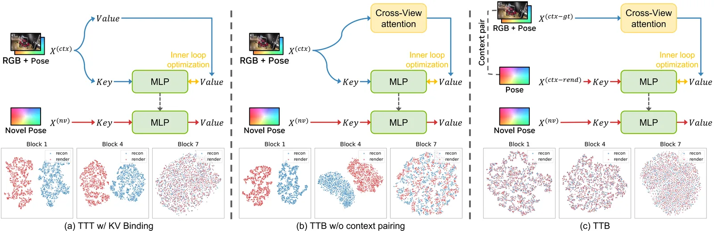
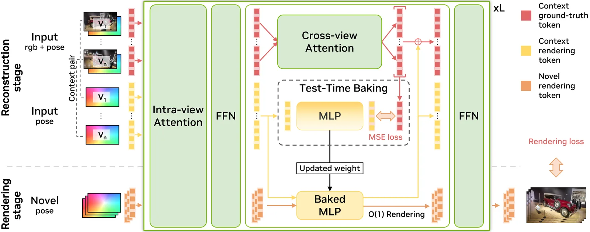
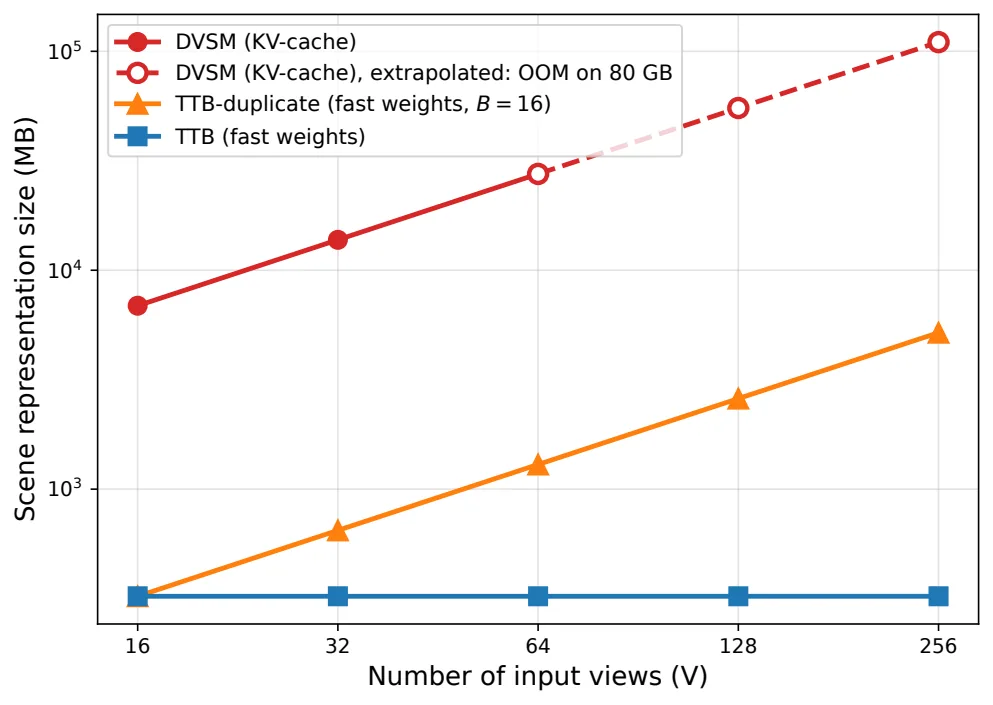
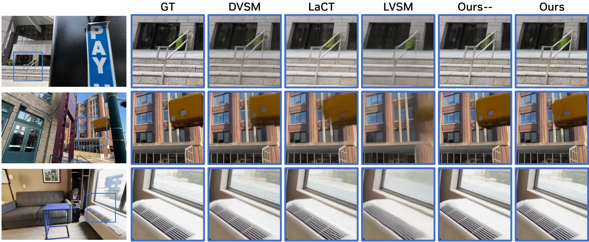

[Paper](https://arxiv.org/abs/2611.17331)
## 1. Introduction: every new view reads the entire cache

Among models that generate video from multiple photographs at a new angle, the highest-quality design stores scene information in a Transformer's key-value cache. The price of this design is that every new view requires re-reading the entire cache, so rendering slows down as the number of input photographs grows. This paper proposes a method that bakes that information once into the weights of a small neural network, making the cost of rendering a new view independent of the number of input photographs.

---

## 2. Background: what is changed, and why

### 2.1 The task, and the criterion that divides the cost

Novel view synthesis is the problem of regressing RGB for an arbitrary new camera position given the camera poses and intrinsics of $V$ context images. Such models split into two stages. Reconstruction (Recon) turns the context into a scene representation $S$, and rendering (Rend) draws a new view conditioned on $S$.

$$ S = \mathrm{Recon}(I, P, K), \qquad \bar{I} = \mathrm{Rend}(P', K', S) $$

The key question is how the cost is divided between these two stages. Reconstruction happens once per scene, so it can be expensive; rendering happens repeatedly, so it must be cheap. The choice of representation for $S$ determines this division directly.

### 2.2 The KV cache of decoder-only LVSM and DVSM

LVSM (Large View Synthesis Model) is a family of models that regress new views from a latent representation alone, without constructing 3D geometry. The decoder-only variant uses a single Transformer decoder for both reconstruction and rendering. DVSM adds a KV cache to the cross-view attention layers. In other words, the scene representation $S$ is the cache itself.

Decoder blocks stack in the order of Eq. 3: intra-view attention, FFN, cross-view attention, FFN. During reconstruction, context tokens are stored as the keys and values of each cross-view attention; during rendering, new-view tokens read those keys and values. Here $V$ is the number of context views and $L$ is the number of tokens per view.

The problem arises here. A single new-view token reads $V \times L$ keys and values at every layer. Rendering cost per token is therefore linear in $V$, and cache size also grows linearly in $V$. At 960p with 64 views, DVSM drops to 1 FPS (Table 1, PDF p.7). This cost structure is summarized in Table 8 (PDF p.20). DVSM has reconstruction $O(V^2L^2)$, rendering $O(V \cdot L)$, and the scene representation is the KV cache.

### 2.3 fast-weight MLP and LaCT: speed solved, image quality lost

An alternative that removes the cache entirely is the Test-Time Training (TTT) layer. A fast-weight MLP is a small MLP that normally uses fixed weights, but its weights are updated directly by a few steps of gradient descent per scene so that it memorizes the context. The update rule is Eq. 6a.

$$ \theta_{\text{TTT}} = \theta - \eta \nabla_\theta \mathcal{L}(f_\theta(W_k X), W_v X) $$

$W_v X$ is the value projection of each token. Using this value as the target makes the MLP close to a linear write that memorizes each view's own token values. Rendering only requires a single pass through the learned weights, giving $O(1)$ independent of the number of views. LaCT is a model that replaces cross-view attention in this way, and the literature [36] interprets this design as a variant of linear attention.

The problem is image quality. At 960p with 64 views, LaCT reaches 28.30 dB and DVSM 31.11 dB, a gap of 2.81 dB (Table 1, PDF p.7). Fine-tuning from DVSM weights still leaves the gap (Sec. 3.3, PDF p.5).

---

## 3. A small example: keep weights instead of a cache

The example in this section is a **reduced setting for explanation**. It is not a value from the paper's experiments. The actual model uses 768-dimensional latents, 12 blocks, and patch size 8; here we shrink to $V=4$, 4 tokens per view, and latent dimension 4 to observe only the change in state.

**DVSM approach**

- Reconstruction: encode the RGB and poses of 4 context views into 16 tokens. The cross-view attention of each layer stores these 16 tokens as 16 keys and 16 values. → Retained state: 16 keys and 16 values per layer.
- Rendering: 4 new-view tokens read all 16 keys at each layer and take a weighted sum of the 16 values. → $4 \times 16 = 64$ key comparisons per layer. Retained state: none. Output: RGB patch.

**TTB approach**

- Reconstruction: duplicate the 4 context views into two copies. 16 ground-truth tokens carrying RGB and pose, and 16 rendering tokens carrying pose only. At each layer, cross-view attention computes the output $O$ for the ground-truth tokens, and the MLP takes the rendering tokens as input and $(O - X^{(\text{ctx-rend})})$ as the residual target, training for 3 steps. → Retained state: per-layer fast weight $\theta$. Not stored: the key-value cache.
- Rendering: 4 new-view tokens pass through the same MLP. → 0 key comparisons, no cache reads, no retained state. Output: RGB patch.

| Stage | Input | Retained state | Omitted or skipped | Output |
| --- | --- | --- | --- | --- |
| DVSM reconstruction | 4 context views RGB·pose → 16 tokens | 16 keys and 16 values per layer | — | Stored KV cache |
| DVSM rendering | 4 new-view tokens | (nothing further retained) | — | Features combined with weights from comparison against 16 keys → $2\times2$ RGB patch |
| TTB reconstruction | 4 context views → 16 RGB·pose tokens + 16 pose-only tokens | per-layer fast weight $\theta$ | KV cache (not stored) | MLP $\theta$ baked into each layer |
| TTB rendering | 4 new-view tokens | (nothing further retained) | 16-key comparison (omitted) | MLP output → $2\times2$ RGB patch |

```
[Reconstruction] once per scene
  4 context views
    ├─ 16 RGB+pose tokens ──cross-view attention──► O ──┐
    │                                                  │ match with MSE
    └─ 16 pose-only tokens ──W_k──► f_θ ─► Y' ─────────┘
                                                       │
                                      Retained state: per-layer fast weight θ
                                      Not stored: KV cache (16 keys·16 values)

[Rendering] per new view
  4 new-view tokens ──W_k──► f_θ ─► Y' ─► RGB 2×2 patch
                   (0 key comparisons, no cache reads)
```

The difference between the two paths comes down to what is retained. DVSM retains arrays of keys and values and re-reads them each time. TTB retains only the MLP weights, and retrieves the same information with a single pass through those weights. The size of the retained state becomes independent of the number of views.

---

## 4. Method

### 4.1 Bake the output of attention, not replace attention

TTB updates the weights $\theta$ of a fast-weight MLP per scene, but changes the training target.

$$ \theta_{\text{TTB}} = \theta - \eta \nabla_\theta \mathcal{L}(f_\theta(W_k X), g(X^*)) $$

Here $g$ is cross-view attention, $X^*$ is the context token $X^{(\text{ctx-gt})}$ that includes RGB, and the input $X$ is $X^{(\text{ctx-rend})}$, which has pose only. TTT can be seen as the special case where $X^*=X$ and $g$ is a linear projection.

The reason for changing the target is that the output of cross-view attention already mixes all context views. Using that output as the target means the input-output pairs the MLP memorizes inherit information from the entire scene rather than from a single view. Instead of removing attention, the method uses attention's product as training material.

The paper verifies this with input-gradient sensitivity. In block 7 of TTB with $V=16$, it measures how much each context image contributes to the output of the new-view rendering token, sorts by output position, and averages (Fig. 4, PDF p.6). With the $W_vX$ target, contribution concentrates on the top-1 view and then falls off quickly; with the cross-view attention target, contribution remains on mid-ranked views as well.

Complexity splits. Rendering is a single MLP pass as in TTT, so it is $O(1)$ in $V$. Reconstruction, by contrast, contains cross-view attention inside the inner loop, making it $O(V^2L^2)$ (Table 8, PDF p.20). Context pairing increases the number of reconstruction tokens by 2x and adds an inner loop, so reconstruction costs more than DVSM (at $V=64$ in Table 1, reconstruction goes from 60 s to 65 s; Sec. 3.3.2, PDF p.6). To keep reconstruction linear, use **TTB--**, which changes the target to the linear projection $W_v X^{(\text{ctx-gt})}$. Reconstruction is $O(VL)$, but image quality is slightly lower.

Here $O(1)$ refers to complexity with respect to the number of input views $V$. Per-token cost is proportional to MLP width and the number of blocks. It means that rendering cost does not grow as $V$ grows, not that rendering is free.

### 4.2 Match the modality of reconstruction input and rendering input

TTB's second problem is the input distribution. During reconstruction the MLP sees context tokens that carry RGB and pose together, while during rendering the new-view tokens carry pose only. Training the same MLP on inputs with photographs and querying it with pose-only inputs forces the MLP to do view interpolation and modality generalization at the same time. This is what the authors call the reconstruction–rendering modality mismatch (Sec. 3.3.2, PDF p.6).

The fix is to split each context view into two copies.

$$ X^{(\text{ctx-gt})} = \mathrm{LN}(\mathrm{PE}_{ray}(P,K) + \mathrm{PE}_{rgb}(I)) $$

$$ X^{(\text{ctx-rend})} = \mathrm{LN}(\mathrm{PE}_{ray}(P,K)) $$

TTB takes $X^{(\text{ctx-rend})}$ as input and $\mathrm{CrossAttn}(X^{(\text{ctx-gt})})$ as target. The new-view token $X^{(\text{nv})}$ also carries pose only, so the rendering input and the reconstruction input now share the same modality.

Without this pairing, distribution alignment is delayed. Fig. 2 (PDF p.2) shows t-SNE plots of the three variants. What the source text confirms is that only (c) aligns the two token streams from the first block (the color mapping is not described in the text), while (b) aligns only in later blocks.



Original Fig. 2 (PDF p.2). (a) is TTT, which memorizes value tokens directly; (b) is TTB, which uses cross-view attention output as the target but without context pairing; (c) is the final TTB with input and target modalities matched. The source shows, in the t-SNE panels, when the two token distributions overlap.

### 4.3 Detailed design of the TTB layer: the inner loop

The inner loop uses an MSE loss, $T=3$ steps, the Muon optimizer, and weight normalization. The target is the residual after subtracting the input, not an absolute value.

$$ \theta_{t+1} = \theta_t - \mathrm{Muon}\left(\nabla_{\theta_t} \left\| f_{\theta_t}(W_k X^{(\text{ctx-rend})}) - W_v \left( \mathrm{CrossAttn}(X^{(\text{ctx-gt})}) - X^{(\text{ctx-rend})} \right) \right\|^2 \right) $$

The actual computation order in Algo. 1 is as follows. At each layer, compute $O = \mathrm{CrossAttn}(X^{(\text{ctx-gt})})$, take $Y = W_v(O - X^{(\text{ctx-rend})})$ as the target and $X = W_k X^{(\text{ctx-rend})}$ as the input, and obtain $\theta^{(T)}$. The output $Y'$ of the baked MLP then sends the two streams ($X^{(\text{ctx-rend})}$, $X^{(\text{nv})}$) to the next layer, and is added to $X^{(\text{ctx-gt})}$ as an auxiliary signal. Having all three streams pass through the same operator in the next layer is this feedback path.



Original Fig. 3 (PDF p.4). In reconstruction, each context view is duplicated into an RGB+pose token and a pose-only token, and the TTB layer updates the MLP so that the latter matches the cross-view attention output of the former. In rendering, new-view tokens pass through the same baked MLP to read scene information. Following the arrows shows which tokens carry on to the next layer and which outputs feed back as context tokens.

The contribution of the two design choices is broken down in a table. Using the residual as target reduces the magnitude of the value to regress, making it easier to fit within a few steps. Adding feedback makes the three token streams pass through the same operator in the next layer. Each alone raises PSNR by +0.44 dB and +0.43 dB respectively, and together they give +0.52 dB (Table 6, PDF p.9, 720p ablation).

The loss and step count also matter. Replacing TTT's unnormalized inner-product loss with MSE raises 23.12 dB at $T=1$ with the inner product to 23.39 dB at $T=3$ with MSE, a gain of 0.27 dB, in the same TTT structure. In TTB-- it rises from 23.78 to 24.22 dB, a further 0.44 dB. Going to $T=5$ gives 24.29 dB, only 0.07 dB above $T=3$, so the authors choose $T=3$ as the balance point between cost and quality (Table 5, PDF p.9).

The layer consists of a SwiGLU fast-weight MLP with a single head, hidden dimension 3072 (4x the model dimension), a linear projection sharing query and key, and an additional linear head that predicts a per-token learning rate (base value 0.01) (Sec. 4.1, PDF p.7; App. A.2, PDF p.15).

Training starts from a DVSM checkpoint. Patch embedding, input LayerNorm, Plücker encoding, intra-view attention, both FFNs per block, and the RGB head are carried over as is, while modules inside the TTB layer are freshly initialized. DVSM's cross-view attention projections are not reused. The TTB output projection is initialized with a small standard deviation (residual zero-init) so that the TTB block behaves close to identity at fine-tuning step 0. This initialization and parameter inheritance contribute +1.02 dB of pretraining benefit (App. A.2, PDF p.15; Table 13, PDF p.22).

Memory is not small. Keeping the activations of the $T$-step inner loop for backpropagation is TTB's dominant memory cost. Two levels of gradient checkpointing make 64×A100·960p·$V=32$ training feasible, with a training peak memory of 76 GB (App. A.2, PDF p.17; Table 14, PDF p.23).

### 4.4 local-duplicate inference to widen fast-weight capacity

The capacity of the fast-weight MLP is fixed, so quality saturates as $V$ grows. The paper works around this at inference time. It runs k-means on a 6-dimensional descriptor summarizing the camera pose (camera origin and unit optical axis), groups context views into $K=V/16$ spatially local groups, reconstructs each group independently, and obtains per-group, per-layer fast weights. At rendering, a new view is routed to the nearest centroid group and queries only that copy. Per-token rendering cost is unchanged, and switching between copies is a hard switch without blending (Sec. 3.3.4, PDF p.7; App. A.6, PDF p.18).

---

## 5. Results

### 5.1 Experimental setup

Training is on DL3DV-10K. At training, 16 or 32 context views are sampled at random per scene, and the same number of target views is sampled. Evaluation is on 140 held-out DL3DV test scenes. Resolution is 960p, and evaluation input views are 16/32/64. Metrics are PSNR, SSIM, LPIPS, per-scene reconstruction time, and new-view rendering FPS. Model sizes are TTB 271M, TTB-- 244M, DVSM 163M, and LaCT 379M (24 blocks); TTB uses the same 12-block, 768-dimensional structure as DVSM (Sec. 4.1, PDF p.7; Table 3, PDF p.8; Table 9, PDF p.20).

### 5.2 DL3DV 960p: the quality-speed trade

| Method | $V=16$ | $V=32$ | $V=64$ |
| --- | --- | --- | --- |
| DVSM | 26.86 / 4.4s / 4 | 29.13 / 15s / 2 | 31.11 / 60s / 1 |
| LaCT | 24.70 / 1.9s / 10 | 26.90 / 3.7s / 10 | 28.30 / 7.3s / 10 |
| TTB-- | 26.26 / 1.9s / 23 | 28.12 / 3.7s / 23 | 29.29 / 7.5s / 23 |
| TTB | 27.00 / 5.4s / 23 | 28.92 / 18s / 23 | 30.20 / 65s / 23 |
| TTB(dup) | — | 29.26 / 18s / 23 | 31.33 / 65s / 23 |

Each cell is PSNR(dB) / scene reconstruction time(seconds) / rendering FPS (Table 1, PDF p.7). Reconstruction is once per scene, and FPS is new-view rendering. TTB(dup) uses $K=V/16$ fast-weight copies at $V=32/64$.

At $V=64$, TTB gives up 0.91 dB of PSNR versus DVSM and gains 23x in rendering. Against LaCT it is 1.90 dB higher in PSNR and 2.3x faster in rendering, but reconstruction takes 65 s, about 9x longer than LaCT's 7.3 s. TTB-- is 29.29 dB·23 FPS·7.5 s, 0.99 dB above LaCT with comparable reconstruction.

The quality gap varies with $V$. At $V=16$, TTB at 27.00 dB is slightly above DVSM at 26.86 dB; at $V=32$ it is 28.92 vs 29.13 dB, and at $V=64$ it widens to 30.20 vs 31.11 dB. "Nearly maintained" does not mean the same thing at every $V$. At $V=64$, SSIM/LPIPS are also slightly lower for TTB at 0.897/0.131 versus DVSM at 0.920/0.104. TTB(dup) reaches 31.33 dB and 0.919/0.108, comparable to DVSM, but with 4 copies and reconstruction time unchanged at 65 s.

The conditions behind the 23x figure also need to be stated. It is the ratio at $V=64$, 23 FPS against DVSM's 1 FPS. At $V=16$ it is about 5.8x, from 4 to 23 FPS, and at $V=32$ about 11.5x, from 2 to 23 FPS. TTB's rendering FPS stays constant at 23 as $V$ grows. However, Table 1 does not state the measurement GPU, so one cannot generalize that the same FPS would appear on other GPUs (not reported in the source).

### 5.3 Contribution of each design element

The 720p ablation breaks the path from TTT to TTB into three elements.

| Stage | PSNR | SSIM | LPIPS | Reconstruction time ($V=64$) | Rendering FPS |
| --- | --- | --- | --- | --- | --- |
| DVSM | 24.68 | 0.776 | 0.220 | 18.4s | 3.7 |
| + replace with TTT | 23.12 | 0.704 | 0.286 | 1.7s | 49.1 |
| + context pairing | 23.78 | 0.728 | 0.264 | 2.5s | 50.7 |
| + MSE, $T=3$ (TTB--) | 24.22 | 0.747 | 0.248 | 3.8s | 50.6 |
| + cross-view attention target (TTB) | 24.84 | 0.768 | 0.230 | 21.0s | 50.5 |

This is the $V=32$ setting of Table 4 (PDF p.9). Stacking all three elements narrows the quality gap to DVSM while keeping TTT-level rendering speed (about 50 FPS). In exchange, reconstruction time grows quadratically in $V$ because of cross-view attention in the inner loop. This table is a smaller setting with 8×A100 and patch size 16, so it should not be compared directly with 960p Table 1.

### 5.4 Generalization beyond training scenes

The 960p model trained on DL3DV is applied zero-shot to MipNeRF360, Free, and Hike (64 views, Table 3, PDF p.8).

| Method | MipNeRF360 | Free | Hike | Reconstruction / FPS |
| --- | --- | --- | --- | --- |
| LaCT | 23.01 | 24.61 | 22.39 | 7.3s / 10 |
| DVSM | 24.76 | 25.57 | 23.10 | 60s / 1 |
| TTB-- | 23.93 | 25.28 | 22.53 | 7.5s / 23 |
| TTB | 24.49 | 26.05 | 23.77 | 65s / 23 |
| TTB(dup) | 25.05 | 26.82 | 25.37 | 65s / 23 |

Single TTB is 0.27 dB below DVSM on MipNeRF360 and higher on Free and Hike. With copies, it exceeds DVSM on all three datasets. The same trend continues at 16 views (Table 10, PDF p.21): TTB reaches 22.03 dB on MipNeRF360, above DVSM's 21.51 dB, with FPS still 23 versus DVSM's 4. Under the 512-pixel long-side condition, LagerNVS is 7 FPS and TTB is 67 FPS, with PSNR 23.62, 2.64 dB above 20.98 (Table 3, PDF p.8).

### 5.5 How many new views are rendered

Looking at FPS alone, TTB always appears to win, but adding reconstruction time changes the answer depending on the number of new views. Table 15 (PDF p.23) gives end-to-end time as reconstruction time plus $N$/FPS. At $V=64$, with 1 new view, DVSM is 61 s and TTB 65 s. At 10 views it is 70 s vs 65.4 s, and at 100 views 160 s vs 69.3 s, with TTB ahead. The paper reports that TTB overtakes after 5–7 views at all $V$. TTB-- is ahead from the first view.

### 5.6 Scene state size and actual memory



Original Fig. 7 (PDF p.24). The horizontal axis is the number of input views $V$, and the vertical axis is scene representation size (MB). DVSM's KV cache grows linearly in $V$, while TTB's fast weights stay constant regardless of $V$. TTB(dup) grows with the number of copies $K=V/16$ but is 21x smaller than the KV cache at the same $V$, and the $V=256$ region where DVSM goes OOM at 80GB is extrapolated as empty dots.

TTB's fast weights total 324 MB in FP32 across all blocks and remain constant regardless of $V$. DVSM's KV cache grows linearly in $V$, reaching an 85x difference at $V=64$ and 340x at $V=256$. This 324 MB should not be read as an overall GPU memory saving. At $V=32$, 544×960, TTB's inference peak memory is 18 GB, only slightly below DVSM's 20 GB (Table 14, PDF p.23). What shrinks is the scene state, and peak memory retains a portion not explained by state size alone. In the same table, training peak is 76 GB for TTB and 65 GB for DVSM, and training time per iteration is 90 s for TTB and 133 s for DVSM.

### 5.7 Qualitative comparison



Original Fig. 5 (PDF p.7). Each column shows ground truth, DVSM, LaCT, LVSM, TTB--, and TTB. Zooming in on thin, repeating structures such as railings, window bars, and sign lettering, LaCT and LVSM blur the boundaries while TTB retains detail similar to DVSM. This is the material for checking high-frequency preservation differences that PSNR tables alone do not show.

### 5.8 Number of views and the two-view condition

Two-view Re10K is not the main target. At 512×512, TTB is 31.28 dB and DVSM 31.17 dB, similar in quality, but the cross-attention cost itself is small, so the rendering gain is limited to 64→72 FPS at 256×256 and 45→52 FPS at 512×512 (App. C.1, PDF p.21). TTB's gain comes from conditions with many views.

---

## 6. Limitations and deployment judgment

### 6.1 Limitations acknowledged by the authors

The authors acknowledge four limitations (Sec. 4.3, PDF p.9). First, the capacity of the fast-weight MLP is fixed, so quality saturates as $V$ grows. In the 720p ablation, the single MLP stalls near 25.8 dB after $V=64$ and is 25.78 dB even at $V=256$. In the same table, DVSM keeps rising, from 27.20 dB at $V=128$ to 27.56 dB at $V=256$ (Table 11, PDF p.22). The local-duplicate variant exceeds DVSM at $V=256$ with 27.74 dB, but reconstruction time is 52.1 s, longer than the single MLP's 20.5 s and DVSM's 18.1 s. In the same table, rendering FPS stays in the 67–72 range while DVSM falls from 63.6 to 12.6.

Second, the local-duplicate inference that mitigates this is a heuristic. It splits into $K=V/16$ copies and routes to the nearest group centroid, and the routing is not learned by training (App. A.6, PDF p.18). Third, cross-view attention in the inner loop makes reconstruction quadratic in $V$, which is disadvantageous for scenarios that render a scene only once. Fourth, the model does not generate; it interpolates between context views. It does not extrapolate to unobserved views.

A table also shows widening the fast-weight MLP instead of increasing the number of copies. At $V=64$, 340p, widening from 4x to 16x raises PSNR from 25.36 to 25.61 dB, catching up to DVSM's 25.60 dB. However, this requires retraining, so the authors keep the 4x width and widen capacity through $K$ (Table 12, PDF p.22).

### 6.2 The reviewer's inference

From here on is the reviewer's judgment. First, the phrase "nearly the same quality" should be read differently depending on $V$. The tables have no seeds or confidence intervals, and the 0.91 dB gap at $V=64$ is not small. Even where PSNR is similar, SSIM/LPIPS are lower for TTB. Second, TTB's absolute quality leans heavily on the DVSM checkpoint. TTB trained from scratch is 23.82 dB, 1.02 dB below pretrained TTB at 24.84 dB (Table 13, PDF p.22). However, since from-scratch TTB at 23.82 dB is above pretrained TTT at 23.12 dB in the same table, the claim that it is structurally better than TTT has support. Third, Table 1 does not state the measurement hardware alongside the numbers, so one cannot generalize that the same FPS would appear on other GPUs. Fourth, the 324 MB state size is the scene state alone, and actual inference peak is 18 GB. The benefit differs depending on whether what matters for deployment is per-scene state or total GPU memory.

### 6.3 Deployment judgment

If the use case is an interactive viewer or trajectory rendering that draws 5–7 or more new views per scene, with 16–64 views at 960p, TTB's trade is worthwhile. If reconstruction latency matters and some quality loss is acceptable, TTB-- is the candidate. TTB--'s PSNR gap to DVSM is 0.60/1.01/1.82 dB at $V=16/32/64$ respectively, widening as $V$ grows (Table 1, PDF p.7). If $V$ exceeds 64 and the single MLP saturates, use TTB(dup).

Conversely, this method is not yet the right fit if you render only one or two new views, need to extrapolate outside the observed range, lack a training/fine-tuning budget on the scale of 64×A100, or have a contract requiring quality identical to DVSM.

Finally, the paper mentions that the baking idea could apply to long-context KV caches in LLMs, video world models, and streaming sensor input in autonomous driving (Sec. E, PDF p.24), but this is a proposal, not an experiment. The validation scope of this paper is view synthesis.<!-- verbatim-tables -->

<details>
<summary>Tables from the paper</summary>

> Tables converted mechanically from the arXiv e-print LaTeX source. The numbers are the paper's own and did not pass through a model.

**Table 1. \bf Two input views on Re10K.**

| Method | Venue |  | PSNR$\uparrow$ | SSIM$\uparrow$ | LPIPS$\downarrow$ |
|---|---|---|---|---|---|
| \bf Resolution: 256$\times$256 |  |  |  |  |  |
| pixelNeRF | CVPR'21 |  | 20.43 | 0.589 | 0.550 |
| AttnRend | CVPR'23 |  | 24.78 | 0.820 | 0.213 |
| ViewCrafter | TPAMI'24 |  | 21.63 | 0.642 | 0.175 |
| GPNR | ECCV'24 |  | 24.11 | 0.793 | 0.255 |
| PixelSplat | CVPR'24 |  | 26.09 | 0.863 | 0.136 |
| MVSplat | ECCV'24 |  | 26.39 | 0.869 | 0.128 |
| GS-LRM | ECCV'24 |  | 28.10 | 0.892 | 0.114 |
| DepthSplat | CVPR'25 |  | 27.46 | 0.889 | 0.115 |
| SEVA | ICCV'25 |  | 25.66 | 0.841 | 0.139 |
| LVSM | ICLR'25 |  | 28.58 | 0.893 | 0.114 |
| Dec.-only | ICLR'25 |  | 29.67 | 0.906 | 0.098 |
| Btimer | NeurIPS'25 |  | 26.49 | 0.886 | 0.096 |
| Eff. LVSM | ICLR'26 |  | 28.93 | 0.895 | 0.102 |
| TokenGS | CVPR'26 |  | 28.41 | 0.903 | 0.135 |
| SVSM | CVPR'26 |  | 30.01 | 0.910 | 0.096 |
| DVSM | \@setfontsize\@setfontsize\@setfontsize\@setfontsize\@setfontsize\@setfontsize\@ixpt\@xpt\@ixpt\@xpt\@ixpt\@xpt\@ixpt\@xpt\@ixpt\@xpt\@ixpt\@xpt anonymized |  | 31.23 | 0.925 | 0.085 |
| Ours-- |  |  | 31.04 | 0.921 | 0.086 |
| Ours |  |  | 31.35 | 0.926 | 0.083 |
| \bf Resolution: 512$\times$512 |  |  |  |  |  |
| LVSM | ICLR'25 |  | 28.55 | 0.894 | 0.173 |
| Dec.-only | ICLR'25 |  | 29.53 | 0.904 | 0.141 |
| Eff. LVSM | ICLR'26 |  | 29.86 | 0.905 | 0.147 |
| DVSM | \@setfontsize\@setfontsize\@setfontsize\@setfontsize\@setfontsize\@setfontsize\@ixpt\@xpt\@ixpt\@xpt\@ixpt\@xpt\@ixpt\@xpt\@ixpt\@xpt\@ixpt\@xpt anonymized |  | 31.17 | 0.924 | 0.129 |
| Ours-- |  |  | 31.00 | 0.921 | 0.130 |
| Ours |  |  | 31.28 | 0.926 | 0.127 |

**Table 2. \bf Quantitative comparison on DL3DV.**

| Method | Venue | \bf 16 input views PSNR$\uparrow$ | \bf 16 input views SSIM$\uparrow$ | \bf 16 input views LPIPS$\downarrow$ | \bf 16 input views Time$\downarrow$ | \bf 16 input views FPS$\uparrow$ | \bf 32 input views PSNR$\uparrow$ | \bf 32 input views SSIM$\uparrow$ | \bf 32 input views LPIPS$\downarrow$ | \bf 32 input views Time$\downarrow$ | \bf 32 input views FPS$\uparrow$ | \bf 64 input views PSNR$\uparrow$ | \bf 64 input views SSIM$\uparrow$ | \bf 64 input views LPIPS$\downarrow$ | \bf 64 input views Time$\downarrow$ | \bf 64 input views FPS$\uparrow$ |
|---|---|---|---|---|---|---|---|---|---|---|---|---|---|---|---|---|
| 3DGS | ToG'23 | 21.20 | 0.708 | 0.264 | >600s | >50 | 23.60 | 0.779 | 0.213 | >600s | >50 | 26.43 | 0.854 | 0.167 | >600s | >50 |
| LongLRM | ICCV'25 | 22.66 | 0.740 | 0.292 | 0.4s | >50 | 24.10 | 0.783 | 0.254 | 1s | >50 | 24.77 | 0.804 | 0.239 | 3s | >50 |
| LongLRM++ | arxiv'25 | 24.40 | 0.795 | 0.231 | 1.6s | 14 | 26.43 | 0.846 | 0.180 | 4.7s | 14 | 27.30 | 0.869 | 0.161 | 16s | 14 |
| tttLRM | CVPR'26 | 23.60 | 0.784 | 0.255 | 3.6s | - | 25.07 | 0.822 | 0.215 | 7.2s | - | 25.95 | 0.844 | 0.195 | 15s | - |
| LVSM | ICLR'25 | 22.18 | 0.694 | 0.351 | 3.8s | 20 | 22.24 | 0.691 | 0.352 | 15s | 20 | 21.96 | 0.678 | 0.364 | 59s | 20 |
| LaCT | ICLR'26 | 24.70 | 0.793 | 0.224 | 1.9s | 10 | 26.90 | 0.837 | 0.185 | 3.7s | 10 | 28.30 | 0.857 | 0.169 | 7.3s | 10 |
| DVSM | \@setfontsize\@setfontsize\@setfontsize\@setfontsize\@setfontsize\@setfontsize\@ixpt\@xpt\@ixpt\@xpt\@ixpt\@xpt\@ixpt\@xpt\@ixpt\@xpt\@ixpt\@xpt arXiv'26 | 26.86 | 0.852 | 0.170 | 4.4s | 4 | 29.13 | 0.893 | 0.129 | 15s | 2 | 31.11 | 0.920 | 0.104 | 60s | 1 |
| Ours-- |  | 26.26 | 0.833 | 0.191 | 1.9s | 23 | 28.12 | 0.867 | 0.158 | 3.7s | 23 | 29.29 | 0.882 | 0.144 | 7.5s | 23 |
| Ours |  | 27.00 | 0.849 | 0.177 | 5.4s | 23 | 28.92 | 0.882 | 0.145 | 18s | 23 | 30.20 | 0.897 | 0.131 | 65s | 23 |
| Ours (duplicate) |  | - | - | - | - | - | 29.26 | 0.890 | 0.136 | 18s | 23 | 31.33 | 0.919 | 0.108 | 65s | 23 |

**Table 3. \bf Quantitative comparison on in-the-wild datasets.**

| Method | Size | \bf MipNerf360 PSNR$\uparrow$ | \bf MipNerf360 SSIM$\uparrow$ | \bf MipNerf360 LPIPS$\downarrow$ | \bf MipNerf360 | \bf Free PSNR$\uparrow$ | \bf Free SSIM$\uparrow$ | \bf Free LPIPS$\downarrow$ | \bf Free | \bf Hike PSNR$\uparrow$ | \bf Hike SSIM$\uparrow$ | \bf Hike LPIPS$\downarrow$ | \bf Hike | \bf Efficiency Time$\downarrow$ | \bf Efficiency FPS$\uparrow$ |
|---|---|---|---|---|---|---|---|---|---|---|---|---|---|---|---|
| \bf Input: 64 views $\times$ 518,400 pixels per view (960p) |  |  |  |  |  |  |  |  |  |  |  |  |  |  |  |
| LVSM | \@setfontsize\@setfontsize\@setfontsize\@setfontsize\@setfontsize\@setfontsize\@viipt\@viiipt\@viipt\@viiipt\@viipt\@viiipt\@viipt\@viiipt\@viipt\@viiipt\@viipt\@viiipt 165M | 20.07 | 0.459 | 0.559 |  | 20.27 | 0.517 | 0.444 |  | 18.60 | 0.433 | 0.502 |  | 59s | 20 |
| LaCT | \@setfontsize\@setfontsize\@setfontsize\@setfontsize\@setfontsize\@setfontsize\@viipt\@viiipt\@viipt\@viiipt\@viipt\@viiipt\@viipt\@viiipt\@viipt\@viiipt\@viipt\@viiipt 379M | 23.01 | 0.557 | 0.435 |  | 24.61 | 0.680 | 0.265 |  | 22.39 | 0.648 | 0.305 |  | 7.3s | 10 |
| DVSM | \@setfontsize\@setfontsize\@setfontsize\@setfontsize\@setfontsize\@setfontsize\@viipt\@viiipt\@viipt\@viiipt\@viipt\@viiipt\@viipt\@viiipt\@viipt\@viiipt\@viipt\@viiipt 163M | 24.76 | 0.660 | 0.337 |  | 25.57 | 0.756 | 0.205 |  | 23.10 | 0.697 | 0.262 |  | 60s | 1 |
| Ours-- | \@setfontsize\@setfontsize\@setfontsize\@setfontsize\@setfontsize\@setfontsize\@viipt\@viiipt\@viipt\@viiipt\@viipt\@viiipt\@viipt\@viiipt\@viipt\@viiipt\@viipt\@viiipt 244M | 23.93 | 0.597 | 0.397 |  | 25.28 | 0.708 | 0.253 |  | 22.53 | 0.660 | 0.300 |  | 7.5s | 23 |
| Ours | \@setfontsize\@setfontsize\@setfontsize\@setfontsize\@setfontsize\@setfontsize\@viipt\@viiipt\@viipt\@viiipt\@viipt\@viiipt\@viipt\@viiipt\@viipt\@viiipt\@viipt\@viiipt 271M | 24.49 | 0.624 | 0.375 |  | 26.05 | 0.744 | 0.225 |  | 23.77 | 0.707 | 0.259 |  | 65s | 23 |
| Ours (duplicate) | \@setfontsize\@setfontsize\@setfontsize\@setfontsize\@setfontsize\@setfontsize\@viipt\@viiipt\@viipt\@viiipt\@viipt\@viiipt\@viipt\@viiipt\@viipt\@viiipt\@viipt\@viiipt 271M | 25.05 | 0.667 | 0.341 |  | 26.82 | 0.800 | 0.187 |  | 25.37 | 0.782 | 0.195 |  | 65s | 23 |
| \bf Input: 64 views $\times$ 512 pixels at image longer side |  |  |  |  |  |  |  |  |  |  |  |  |  |  |  |
| LagerNVS | \@setfontsize\@setfontsize\@setfontsize\@setfontsize\@setfontsize\@setfontsize\@viipt\@viiipt\@viipt\@viiipt\@viipt\@viiipt\@viipt\@viiipt\@viipt\@viiipt\@viipt\@viiipt 1052M | 20.98 | 0.481 | 0.503 |  | 19.50 | 0.486 | 0.396 |  | 18.54 | 0.436 | 0.415 |  | 2.3s | 7 |
| DVSM | \@setfontsize\@setfontsize\@setfontsize\@setfontsize\@setfontsize\@setfontsize\@viipt\@viiipt\@viipt\@viiipt\@viipt\@viiipt\@viipt\@viiipt\@viipt\@viiipt\@viipt\@viiipt 163M | 24.04 | 0.607 | 0.422 |  | 24.72 | 0.717 | 0.268 |  | 23.39 | 0.705 | 0.264 |  | 5.0s | 12 |
| Ours-- | \@setfontsize\@setfontsize\@setfontsize\@setfontsize\@setfontsize\@setfontsize\@viipt\@viiipt\@viipt\@viiipt\@viipt\@viiipt\@viipt\@viiipt\@viipt\@viiipt\@viipt\@viiipt 244M | 23.18 | 0.552 | 0.478 |  | 24.27 | 0.665 | 0.323 |  | 22.41 | 0.646 | 0.295 |  | 1.8s | 67 |
| Ours | \@setfontsize\@setfontsize\@setfontsize\@setfontsize\@setfontsize\@setfontsize\@viipt\@viiipt\@viipt\@viiipt\@viipt\@viiipt\@viipt\@viiipt\@viipt\@viiipt\@viipt\@viiipt 271M | 23.62 | 0.568 | 0.463 |  | 24.92 | 0.692 | 0.299 |  | 23.52 | 0.687 | 0.262 |  | 6.3s | 67 |
| Ours (duplicate) | \@setfontsize\@setfontsize\@setfontsize\@setfontsize\@setfontsize\@setfontsize\@viipt\@viiipt\@viipt\@viiipt\@viipt\@viiipt\@viipt\@viiipt\@viipt\@viiipt\@viipt\@viiipt 271M | 24.03 | 0.602 | 0.434 |  | 25.45 | 0.733 | 0.267 |  | 24.96 | 0.760 | 0.206 |  | 6.3s | 67 |

**Table 4. **Ablation study from TTT to TTB on DL3DV.** ({1ptgreen!60!black!15 light }=worst, {1ptgreen!60!black!55 dark }=best).**

| Method | Quality ($V{=}32$) PSNR$\uparrow$ | Quality ($V{=}32$) SSIM$\uparrow$ | Quality ($V{=}32$) LPIPS$\downarrow$ | Recon-time$\downarrow$ $V{=}16$ | Recon-time$\downarrow$ $V{=}32$ | Recon-time$\downarrow$ $V{=}64$ | Rend-fps$\uparrow$ $V{=}16$ | Rend-fps$\uparrow$ $V{=}32$ | Rend-fps$\uparrow$ $V{=}64$ |
|---|---|---|---|---|---|---|---|---|---|
| (a) = DVSM | 24.68 | 0.776 | 0.220 | 1.300 | 4.907 | 18.396 | 12.1 | 6.8 | 3.7 |
| (b) = (a) + TTT | 23.12 | 0.704 | 0.286 | 0.439 | 0.862 | 1.706 | 49.5 | 49.1 | 49.1 |
| *TTB (Ours):* |  |  |  |  |  |  |  |  |  |
| (c) = (b) + context pairing | 23.78 | 0.728 | 0.264 | 0.626 | 1.237 | 2.458 | 50.8 | 50.8 | 50.7 |
| (d) = (b) + cross-view attn. | 24.13 | 0.742 | 0.252 | 1.267 | 5.178 | 17.745 | 50.4 | 50.4 | 50.5 |
| (e) = (c) + MSE loss, $T{=}3$ | 24.22 | 0.747 | 0.248 | 0.994 | 1.939 | 3.828 | 51.0 | 50.6 | 50.6 |
| (f) = (e) + cross-view attn. | 24.84 | 0.768 | 0.230 | 1.998 | 6.251 | 20.996 | 50.9 | 50.4 | 50.5 |

**Table 5. \bf Inner-loop optimization ablation.**

| Framework | $T$ | Loss | PSNR$\uparrow$ | SSIM$\uparrow$ | LPIPS$\downarrow$ |
|---|---|---|---|---|---|
| TTT | 1 | dot-prod | 23.12 | 0.704 | 0.286 |
| TTT | 3 | MSE | 23.39 | 0.715 | 0.277 |
| TTB-- | 1 | dot-prod | 23.78 | 0.728 | 0.264 |
| TTB-- | 2 | MSE | 24.16 | 0.744 | 0.251 |
| TTB-- | 3 | MSE | 24.22 | 0.747 | 0.248 |
| TTB-- | 5 | MSE | 24.29 | 0.751 | 0.246 |

**Table 6. **Training settings across methods.** ``Multi-dataset'' indicates training on a curated mixture beyond a single benchmark. ``DVSM ckpt'' refers to initializing from the corresponding DVSM checkpoint released for that benchmark. ``--'' marks compute resources that are not explicitly reported by the corresponding paper.**

| Method | Training data | GPUs | Pretrain source |
|---|---|---|---|
| LVSM | Objaverse / Re10K | 64$\times$A100 | from scratch |
| Efficient-LVSM | Re10K | 64$\times$A100 | from scratch |
| DVSM | DL3DV / Re10K | 64$\times$A100 | from scratch |
| LaCT | Objaverse / DL3DV | 64$\times$A100 | from scratch |
| LongLRM | DL3DV | 64$\times$A100 | from scratch |
| tttLRM | Objaverse / DL3DV | 64$\times$A100 | LaCT ckpt |
| LagerNVS | Multi-dataset | --- | VGGT ckpt |
| TTB (ours) | DL3DV / Re10K | 64$\times$A100 | DVSM ckpt |

**Table 7. **Asymptotic complexity comparison.** $V$ denotes the number of context views and $L$ the number of tokens per view. Reconstruction is reported per scene, rendering per novel-view token. ``GS rasterizer'' denotes that rendering is handled by a Gaussian splatting rasterizer rather than a neural module, which is not directly comparable in $\mathcal{O}(\cdot)$ form. We only list the complexity of the main model layer for global scene understanding. LongLRM still employs a few cross-view attention layers with $\mathcal{O}(V^2 \cdot L^2)$ complexity. LaCT, tttLRM, LagerNVS, and ours also employ intra-view attention with $\mathcal{O}(V \cdot L^2)$ reconstruction complexity and $\mathcal{O}(L)$ per-token rendering complexity.**

| Method | Reconstruction | Rendering (per token) | Scene representation |
|---|---|---|---|
| LVSM (decoder-only) | --- | $\mathcal{O}(V \cdot L)$ | context tokens |
| LVSM (enc.-dec.) | $\mathcal{O}(V^2 \cdot L^2)$ | $\mathcal{O}(L_s)$ | latent scene tokens |
| Efficient-LVSM | $\mathcal{O}(V \cdot L^2)$ | $\mathcal{O}(V \cdot L)$ | KV-cache |
| DVSM | $\mathcal{O}(V^2 \cdot L^2)$ | $\mathcal{O}(V \cdot L)$ | KV-cache |
| LaCT | $\mathcal{O}(V \cdot L)$ | $\mathcal{O}(1)$ | fast weights |
| LongLRM | $\mathcal{O}(V \cdot L)$ | GS rasterizer | 3D Gaussians |
| tttLRM | $\mathcal{O}(V \cdot L)$ | GS rasterizer | 3D Gaussians |
| LagerNVS | $\mathcal{O}(V^2 \cdot L^2)$ | $\mathcal{O}(V \cdot L)$ | latent scene tokens |
| TTB-- (ours) | $\mathcal{O}(V \cdot L)$ | $\mathcal{O}(1)$ | fast weights |
| TTB (ours) | $\mathcal{O}(V^2 \cdot L^2)$ | $\mathcal{O}(1)$ | fast weights |

**Table 8. **Architectural composition.** ``Cross-view sublayer'' indicates the module that exchanges information across views in each block. The depth column is the number of decoder blocks, with the encoder depth listed in parentheses for encoder-decoder methods. The latent-dim column reports the decoder width, with the encoder width also given for encoder-decoder methods.**

| Method | # blocks | Latent dim | Cross-view sublayer |
|---|---|---|---|
| LVSM | 24 | 768 | cross-view attention |
| Efficient-LVSM | 24 | 1024 | cached KV cross-attention |
| DVSM | 12 | 768 | cross-view attention (cached KV) |
| LaCT | 24 | 768 | large-chunk TTT layer |
| LongLRM | 24 | 768 | Mamba2 + attention hybrid |
| tttLRM | 24 | 768 | large-chunk TTT layer |
| LagerNVS | 12 ($+$24 enc.) | 768 ($+$1024 enc.) | VGGT alt.\ frame/global attn.\ (enc.)\ + cross-attn.\ (dec.) |
| TTB-- (ours) | 12 | 768 | TTB layer (linear target) |
| TTB (ours) | 12 | 768 | cross-view attn.\ + TTB layer |

</details>


> Figures in this post are taken from the original arXiv:2611.17331 (CC BY 4.0). Only size and format were changed.
