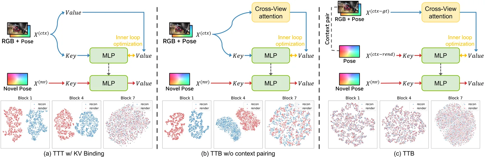
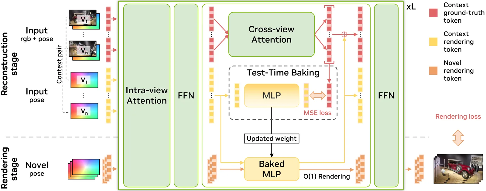
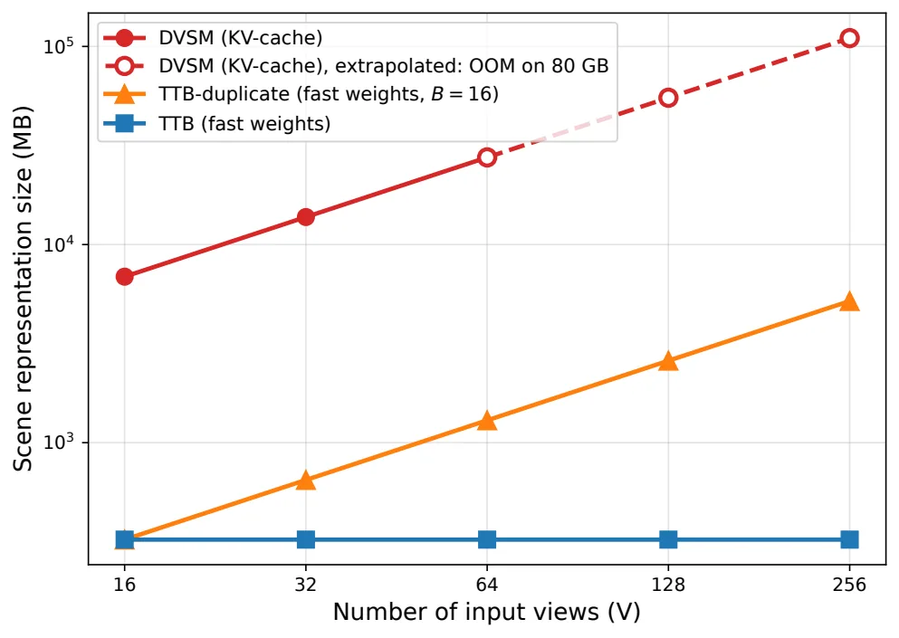
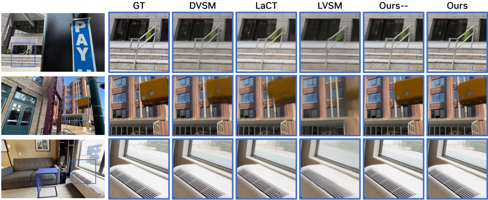

[논문 링크](https://arxiv.org/abs/2611.17331)
## 1. 도입: 새 시점을 그릴 때마다 캐시 전체를 읽는다

여러 장의 사진으로부터 새 각도의 영상을 만드는 모델 중 품질이 가장 앞서는 설계는, 장면 정보를 Transformer의 키·값 캐시에 담아 두는 방식이다. 이 설계의 대가는 새 시점 한 장을 그릴 때마다 캐시 전체를 다시 읽어야 한다는 것이고, 그래서 입력 사진이 늘수록 그리는 속도가 떨어진다. 이 논문은 그 정보를 작은 신경망의 가중치에 한 번 구워 두어, 새 시점을 그리는 비용을 입력 사진 수와 무관하게 만드는 방법을 제안한다.

---

## 2. 배경: 무엇을, 왜 바꾸는가

### 2.1 과제와 비용을 나누는 기준

신규 시점 합성(novel view synthesis)은 컨텍스트 이미지 $V$장의 카메라 포즈와 내부 파라미터가 주어졌을 때, 임의의 새 카메라 위치에 대한 RGB를 회귀해 내는 문제다. 이런 모델은 두 단계로 나뉜다. 재구성(Recon)은 컨텍스트를 장면 표현 $S$로 만들고, 렌더링(Rend)은 $S$를 조건으로 새 시점을 그린다.

$$ S = \mathrm{Recon}(I, P, K), \qquad \bar{I} = \mathrm{Rend}(P', K', S) $$

핵심은 이 두 단계의 비용을 어떻게 나누느냐다. 장면당 한 번만 드는 재구성은 비싸도 괜찮고, 반복해서 일어나는 렌더링은 싸야 한다. 어떤 표현을 $S$로 선택하느냐가 이 분배를 그대로 결정한다.

### 2.2 decoder-only LVSM과 DVSM의 KV 캐시

LVSM(Large View Synthesis Model)은 3D 기하를 만들지 않고 잠재 표현만으로 새 시점을 회귀하는 모델 묶음이다. 그중 decoder-only 변형은 하나의 Transformer 디코더를 재구성과 렌더링에 함께 쓴다. DVSM은 여기에 cross-view attention 층에 KV 캐시를 둔다. 즉 장면 표현 $S$가 곧 그 캐시다.

디코더 블록은 Eq. 3의 순서로 쌓인다. Intra-view attention, FFN, cross-view attention, FFN이다. 재구성할 때 컨텍스트 토큰이 각 cross-view attention의 키·값으로 저장되고, 렌더링할 때 새 시점 토큰이 그 키·값을 읽는다. 여기서 $V$는 컨텍스트 시점 수, $L$은 시점 하나의 토큰 수다.

문제는 여기서 나온다. 새 시점 토큰 하나가 층마다 $V \times L$개의 키·값을 읽는다. 그래서 토큰당 렌더링 비용이 $V$에 대해 선형이고, 캐시 크기도 $V$에 대해 선형으로 커진다. 960p·64시점에서 DVSM은 1 FPS로 떨어진다(Table 1, PDF p.7). 이 비용 구조는 Table 8(PDF p.20)에 정리돼 있다. DVSM은 재구성 $O(V^2L^2)$, 렌더링 $O(V \cdot L)$, 장면 표현은 KV 캐시다.

### 2.3 fast-weight MLP와 LaCT: 속도는 해결했지만 화질이 떨어졌다

캐시 자체를 없애는 대안은 Test-Time Training(TTT) 층이다. fast-weight MLP는 평소엔 고정 가중치를 쓰는 작은 MLP인데, 이 MLP의 가중치를 매 장면마다 몇 스텝의 경사 하강으로 직접 업데이트해 컨텍스트를 외우게 한다. 갱신 규칙이 Eq. 6a다.

$$ \theta_{\text{TTT}} = \theta - \eta \nabla_\theta \mathcal{L}(f_\theta(W_k X), W_v X) $$

$W_v X$는 각 토큰의 값(value) 투영이다. 이 값을 타깃으로 삼으면 MLP는 시점별로 자기 토큰의 값을 외우는 선형 쓰기에 가깝다. 렌더링은 학습된 가중치를 한 번 통과시키기만 하므로 시점 수와 무관한 $O(1)$이 된다. LaCT는 cross-view attention을 이 방식으로 대체한 모델이며, 문헌 [36]에서는 이 설계를 linear attention의 변형으로 해석한다.

문제는 화질이다. LaCT는 960p·64시점에서 28.30 dB, DVSM은 31.11 dB로 2.81 dB가 떨어진다(Table 1, PDF p.7). DVSM 가중치에서 미세조정해도 격차가 남는다(Sec. 3.3, PDF p.5).

---

## 3. 작은 예시: 캐시를 남기는 대신 가중치를 남긴다

이 절의 예시는 **축소한 설명용 설정**이다. 논문 실험값이 아니다. 실제 모델은 768차원 잠재, 12블록, 패치 8이며, 여기서는 $V=4$, 시점당 4토큰, 잠재 차원 4로 줄여 상태 변화만 본다.

**DVSM 방식**

- 재구성: 컨텍스트 4시점의 RGB와 포즈를 인코딩해 16토큰을 만든다. 각 층의 cross-view attention이 이 16토큰을 키 16개와 값 16개로 저장한다. → 남는 상태: 층마다 키 16개·값 16개.
- 렌더링: 새 시점 4토큰이 층마다 16키를 모두 읽고 16값을 가중 합산한다. → 층마다 $4 \times 16 = 64$번의 키 비교. 남는 상태: 없음. 출력: RGB 패치.

**TTB 방식**

- 재구성: 컨텍스트 4시점을 두 벌로 복제한다. RGB와 포즈를 담은 ground-truth 토큰 16개와 포즈만 담은 rendering 토큰 16개다. 각 층에서 cross-view attention가 ground-truth 토큰에 대한 출력 $O$를 계산하고, MLP는 rendering 토큰을 입력으로, $(O - X^{(\text{ctx-rend})})$를 잔차 타깃으로 삼아 3스텝 학습한다. → 남는 상태: 층별 fast weight $\theta$. 저장하지 않는 것: 키·값 캐시.
- 렌더링: 새 시점 4토큰이 같은 MLP를 통과한다. → 키 비교 0번, 캐시 읽기 없음, 남는 상태 없음. 출력: RGB 패치.

| 단계 | 입력 | 남는 상태 | 생략·거절되는 것 | 출력 |
| --- | --- | --- | --- | --- |
| DVSM 재구성 | 컨텍스트 4시점 RGB·포즈 → 16토큰 | 층마다 키 16개·값 16개 | — | 저장된 KV 캐시 |
| DVSM 렌더링 | 새 시점 4토큰 | (추가로 남는 것 없음) | — | 16키와 비교한 가중치로 합친 특징 → $2\times2$ RGB 패치 |
| TTB 재구성 | 컨텍스트 4시점 → RGB·포즈 토큰 16개 + 포즈만 토큰 16개 | 층별 fast weight $\theta$ | KV 캐시(저장하지 않음) | 각 층에 구워진 MLP $\theta$ |
| TTB 렌더링 | 새 시점 4토큰 | (추가로 남는 것 없음) | 16키 비교(생략) | MLP 통과 결과 → $2\times2$ RGB 패치 |

```
[재구성] 한 장면당 1회
  컨텍스트 4시점
    ├─ RGB+포즈 16토큰 ──cross-view attention──► O ──┐
    │                                                  │ MSE로 맞춤
    └─ 포즈만  16토큰 ──W_k──► f_θ ─► Y' ─────────────┘
                                                       │
                                      남는 상태: 층별 fast weight θ
                                      저장하지 않음: KV 캐시(16키·16값)

[렌더링] 새 시점마다
  새 시점 4토큰 ──W_k──► f_θ ─► Y' ─► RGB 2×2 패치
                   (키 비교 0번, 캐시 읽기 없음)
```

두 경로의 차이는 결국 무엇을 남기느냐다. DVSM은 키·값 배열을 남기고 매번 다시 읽는다. TTB는 MLP 가중치만 남기고, 그 가중치를 한 번 통과시켜 같은 정보를 꺼낸다. 남는 상태의 크기가 시점 수와 무관해진다.

---

## 4. 방법

### 4.1 attention을 대체하지 않고 그 출력을 굽는다

TTB는 fast-weight MLP의 가중치 $\theta$를 장면마다 업데이트하되, 학습 타깃을 바꾼다.

$$ \theta_{\text{TTB}} = \theta - \eta \nabla_\theta \mathcal{L}(f_\theta(W_k X), g(X^*)) $$

여기서 $g$는 cross-view attention이고, $X^*$는 RGB를 포함한 컨텍스트 토큰 $X^{(\text{ctx-gt})}$, 입력 $X$는 포즈만 있는 $X^{(\text{ctx-rend})}$다. TTT는 $X^*=X$이고 $g$가 선형 투영인 특수한 경우로 볼 수 있다.

타깃을 바꾸는 이유는 cross-view attention의 출력이 이미 모든 컨텍스트 시점을 섞은 값이기 때문이다. 그 출력을 타깃으로 쓰면 MLP가 외우는 입력–출력 쌍이 자기 시점 하나가 아니라 전체 장면의 정보를 물려받는다. attention을 없애는 대신 attention의 산출물을 학습 재료로 쓴다.

논문은 이를 입력 그래디언트 민감도로 확인한다. TTB 7번 블록에서 $V=16$일 때, 새 시점 렌더링 토큰의 출력에 각 컨텍스트 이미지가 얼마나 기여하는지 측정한 뒤 출력 위치별로 정렬해 평균냈다(Fig. 4, PDF p.6). $W_vX$ 타깃은 상위 1개 시점에 기여가 몰린 뒤 빠르게 줄고, cross-view attention 타깃은 중간 순위의 시점들에도 기여가 남는다.

복잡도는 쪽이 갈린다. 렌더링은 TTT와 같은 MLP 한 번 통과이므로 $V$에 대해 $O(1)$이다. 반면 재구성에는 내부 루프 안에 cross-view attention이 들어가 $O(V^2L^2)$가 된다(Table 8, PDF p.20). 컨텍스트 페어링이 재구성 토큰 수를 두 배로 늘리고 내부 루프도 추가되므로, 재구성 비용은 DVSM보다 크다(Table 1의 $V=64$에서 재구성 60초 → 65초, Sec. 3.3.2, PDF p.6). 재구성을 선형으로 유지하고 싶으면 타깃을 선형 투영 $W_v X^{(\text{ctx-gt})}$로 바꾼 <strong>TTB--</strong>를 쓴다. 재구성은 $O(VL)$이지만 화질은 조금 낮다.

여기서 $O(1)$은 입력 시점 수 $V$에 대한 복잡도다. 토큰당 비용은 MLP 폭과 블록 수에 비례한다. $V$가 늘어도 렌더링 비용이 늘지 않는다는 뜻이지, 렌더링이 공짜라는 뜻은 아니다.

### 4.2 재구성 입력과 렌더링 입력의 모달리티를 맞춘다

TTB의 두 번째 문제는 입력 분포다. 재구성 때 MLP가 보는 컨텍스트 토큰은 RGB와 포즈를 함께 담고, 렌더링 때 새 시점 토큰은 포즈만 담는다. 같은 MLP를 사진이 붙은 입력으로 학습하고 포즈만 있는 입력으로 질의하면, MLP는 시점 보간과 모달리티 일반화를 동시에 해야 한다. 이것이 저자가 말하는 재구성–렌더링 모달리티 불일치다(Sec. 3.3.2, PDF p.6).

해결책은 컨텍스트 시점 하나를 두 벌로 나누는 것이다.

$$ X^{(\text{ctx-gt})} = \mathrm{LN}(\mathrm{PE}_{ray}(P,K) + \mathrm{PE}_{rgb}(I)) $$

$$ X^{(\text{ctx-rend})} = \mathrm{LN}(\mathrm{PE}_{ray}(P,K)) $$

TTB는 $X^{(\text{ctx-rend})}$를 입력으로, $\mathrm{CrossAttn}(X^{(\text{ctx-gt})})$를 타깃으로 삼는다. 새 시점 토큰 $X^{(\text{nv})}$도 포즈만 있으므로 렌더링 입력과 재구성 입력의 모달리티가 같아진다.

이 페어링이 없으면 분포 정렬이 늦어진다. Fig. 2(PDF p.2)는 세 변형의 t-SNE을 보여준다. 원문 텍스트가 확인해 주는 것은 (c)만 첫 블록부터 두 토큰 스트림이 정렬된다는 점이며(색 매핑은 텍스트에 기술되어 있지 않다), (b)는 뒤쪽 블록에서야 정렬된다.



원문 Fig. 2 (PDF p.2). (a)는 값 토큰을 직접 외우는 TTT, (b)는 cross-view attention 출력을 타깃으로 쓰지만 컨텍스트 페어링이 없는 TTB, (c)는 입력과 타깃의 모달리티를 맞춘 최종 TTB다. 원문은 t-SNE 패널에서 두 토큰 분포가 언제 겹치는지를 보여준다.

### 4.3 TTB 층의 세부 설계: 내부 루프

내부 루프는 MSE 손실, $T=3$ 스텝, Muon 옵티마이저와 가중치 정규화를 쓴다. 타깃은 절대값이 아니라 입력을 뺀 잔차다.

$$ \theta_{t+1} = \theta_t - \mathrm{Muon}\left(\nabla_{\theta_t} \left\| f_{\theta_t}(W_k X^{(\text{ctx-rend})}) - W_v \left( \mathrm{CrossAttn}(X^{(\text{ctx-gt})}) - X^{(\text{ctx-rend})} \right) \right\|^2 \right) $$

Algo. 1의 실제 계산 순서는 이렇다. 각 층에서 $O = \mathrm{CrossAttn}(X^{(\text{ctx-gt})})$를 계산하고, $Y = W_v(O - X^{(\text{ctx-rend})})$를 타깃으로, $X = W_k X^{(\text{ctx-rend})}$를 입력으로 삼아 $\theta^{(T)}$를 구한다. 이후 구워진 MLP의 출력 $Y'$는 두 스트림($X^{(\text{ctx-rend})}$, $X^{(\text{nv})}$)을 다음 층으로 보내고, $X^{(\text{ctx-gt})}$에는 보조 신호로 더해진다. 세 스트림이 다음 층에서 같은 연산자를 통과하게 하는 것이 이 피드백 경로다.



원문 Fig. 3 (PDF p.4). 재구성 단계에서 각 컨텍스트 시점은 RGB+포즈 토큰과 포즈만 있는 토큰으로 복제되고, TTB 층이 후자를 전자의 cross-view attention 출력에 맞추도록 MLP를 업데이트한다. 렌더링 단계에서는 새 시점 토큰이 같은 baked MLP를 통과해 장면 정보를 읽는다. 화살표를 따라가면 어느 토큰이 다음 층으로 남고, 어느 출력이 다시 컨텍스트 토큰으로 피드백되는지 볼 수 있다.

두 설계 선택의 기여는 표로 분해된다. 잔차를 타깃으로 쓰면 회귀할 값의 크기가 줄어 몇 스텝 안에 맞추기 쉬워진다. 피드백을 더하면 세 토큰 스트림이 다음 층에서 같은 연산자를 통과한다. 각각만 쓰면 PSNR이 각각 +0.44 dB, +0.43 dB 오르고, 둘을 같이 쓰면 +0.52 dB가 된다(Table 6, PDF p.9, 720p ablation).

손실과 스텝 수도 중요하다. TTT의 비정규화 내적 손실 대신 MSE를 쓰면, 같은 TTT 구조에서 $T=1$ 내적 23.12 dB가 $T=3$ MSE 23.39 dB로 0.27 dB 오른다. TTB--에서는 23.78에서 24.22 dB로 0.44 dB 더 오른다. $T=5$까지 늘리면 24.29 dB로 $T=3$보다 0.07 dB 높을 뿐이라, 저자는 $T=3$을 비용과 품질의 균형점으로 고른다(Table 5, PDF p.9).

층 구성은 SwiGLU fast-weight MLP에 단일 헤드, 숨은 차원 3072(모델 차원의 4배), 쿼리와 키를 공유하는 선형 투영, 그리고 토큰별 학습률을 예측하는 추가 선형 헤드(기준값 0.01)다(Sec. 4.1, PDF p.7; App. A.2, PDF p.15).

학습은 DVSM 체크포인트에서 시작한다. 패치 임베딩, 입력 LayerNorm, Plücker 인코딩, intra-view attention, 블록마다 FFN 둘, RGB 헤드를 그대로 가져오고 TTB 층 내부의 모듈은 새로 초기화한다. DVSM의 cross-view attention 투영은 재사용하지 않는다. TTB 출력 투영을 작은 표준편차로 시작(residual zero-init)해 미세조정 0스텝에서 TTB 블록이 항등에 가깝게 동작하게 한다. 이 초기화와 파라미터 상속이 pretraining 이득 +1.02 dB에 기여한다(App. A.2, PDF p.15; Table 13, PDF p.22).

메모리는 작지 않다. 내부 루프 $T$스텝의 활성값을 역전파에 보관하는 것이 TTB의 지배적 메모리 비용이다. 두 겹의 그래디언트 체크포인팅으로 64×A100·960p·$V=32$ 학습을 가능하게 했고, 학습 피크 메모리는 76 GB다(App. A.2, PDF p.17; Table 14, PDF p.23).

### 4.4 fast-weight의 용량을 넓히는 local-duplicate 추론

fast-weight MLP의 용량은 고정이라 $V$가 커지면 품질이 포화된다. 논문은 추론 시점에 이를 우회한다. 카메라 포즈를 요약한 6차원 서술자(카메라 원점과 단위 광학축)로 k-means를 돌려 컨텍스트 시점을 $K=V/16$개의 공간적으로 국소인 그룹으로 묶고, 각 그룹을 독립적으로 재구성해 그룹별·층별 fast weight를 얻는다. 렌더링할 때 새 시점은 가장 가까운 센트로이드 그룹으로 보내 그 복사본만 질의한다. 토큰당 렌더링 비용은 그대로이고, 복사본 전환은 블렌딩 없는 hard switch다(Sec. 3.3.4, PDF p.7; App. A.6, PDF p.18).

---

## 5. 결과

### 5.1 실험 설정

학습은 DL3DV-10K에서 한다. 학습 때 매 장면에서 컨텍스트 시점 16 또는 32개를 무작위로 뽑고, 타깃 시점도 같은 수로 뽑는다. 평가는 140개의 held-out DL3DV 테스트 장면에서 한다. 해상도는 960p, 평가 입력 시점은 16/32/64다. 지표는 PSNR·SSIM·LPIPS, 장면당 재구성 시간, 새 시점 렌더링 FPS다. 모델 크기는 TTB 271M, TTB-- 244M, DVSM 163M, LaCT 379M(24블록)이며, TTB는 DVSM과 같은 12블록·768차원 구조를 쓴다(Sec. 4.1, PDF p.7; Table 3, PDF p.8; Table 9, PDF p.20).

### 5.2 DL3DV 960p: 화질과 속도의 교환

| 방법 | $V=16$ | $V=32$ | $V=64$ |
| --- | --- | --- | --- |
| DVSM | 26.86 / 4.4s / 4 | 29.13 / 15s / 2 | 31.11 / 60s / 1 |
| LaCT | 24.70 / 1.9s / 10 | 26.90 / 3.7s / 10 | 28.30 / 7.3s / 10 |
| TTB-- | 26.26 / 1.9s / 23 | 28.12 / 3.7s / 23 | 29.29 / 7.5s / 23 |
| TTB | 27.00 / 5.4s / 23 | 28.92 / 18s / 23 | 30.20 / 65s / 23 |
| TTB(dup) | — | 29.26 / 18s / 23 | 31.33 / 65s / 23 |

각 칸은 PSNR(dB) / 장면 재구성 시간(초) / 렌더링 FPS 순이다(Table 1, PDF p.7). 재구성은 장면당 한 번, FPS는 새 시점 렌더링이다. TTB(dup)는 $V=32/64$에서 $K=V/16$개의 fast-weight 복사본을 쓴다.

$V=64$에서 TTB는 DVSM보다 PSNR 0.91 dB를 내주고 렌더링을 23배 얻는다. LaCT 대비로는 PSNR이 1.90 dB 높고 렌더링이 2.3배 빠른 대신, 재구성은 65초로 LaCT의 7.3초보다 약 9배 오래 걸린다. TTB--는 29.29 dB·23 FPS·7.5초로 LaCT보다 0.99 dB 높고 재구성도 비슷하다.

화질 격차는 $V$에 따라 다르다. $V=16$에서는 TTB 27.00 dB가 DVSM 26.86 dB보다 조금 높고, $V=32$에서는 28.92 대 29.13 dB, $V=64$에서는 30.20 대 31.11 dB로 벌어진다. "거의 유지"는 모든 $V$에서 같은 뜻이 아니다. $V=64$에서 SSIM/LPIPS도 TTB 0.897/0.131, DVSM 0.920/0.104로 TTB가 조금 낮다. TTB(dup)는 31.33 dB, 0.919/0.108로 DVSM에 필적하지만, 복사본 4개를 두고 재구성 시간은 65초 그대로다.

23배라는 숫자의 조건도 분명히 해야 한다. $V=64$에서 DVSM 1 FPS 대비 23 FPS일 때의 배수다. $V=16$에서는 4에서 23 FPS로 약 5.8배, $V=32$에서는 2에서 23 FPS로 약 11.5배다. TTB의 렌더링 FPS는 $V$가 커져도 23으로 일정하다. 다만 Table 1에는 측정 GPU가 적혀 있지 않아, 다른 GPU에서 같은 FPS가 나온다고 일반화할 수는 없다(원문 미보고).

### 5.3 설계 요소별 기여

720p ablation에서 TTT에서 TTB로 올라가는 과정을 세 요소로 분해한다.

| 단계 | PSNR | SSIM | LPIPS | 재구성 시간($V=64$) | 렌더링 FPS |
| --- | --- | --- | --- | --- | --- |
| DVSM | 24.68 | 0.776 | 0.220 | 18.4s | 3.7 |
| + TTT로 대체 | 23.12 | 0.704 | 0.286 | 1.7s | 49.1 |
| + 컨텍스트 페어링 | 23.78 | 0.728 | 0.264 | 2.5s | 50.7 |
| + MSE, $T=3$ (TTB--) | 24.22 | 0.747 | 0.248 | 3.8s | 50.6 |
| + cross-view attention 타깃 (TTB) | 24.84 | 0.768 | 0.230 | 21.0s | 50.5 |

Table 4(PDF p.9)의 $V=32$ 설정이다. 세 요소를 모두 쌓으면 DVSM과의 화질 격차를 좁히면서 TTT급 렌더링 속도(약 50 FPS)를 유지한다. 대신 재구성 시간은 내부 루프의 cross-view attention 때문에 $V$에 대해 제곱으로 늘어난다. 이 표는 8×A100·패치 16의 작은 설정이라 960p Table 1과 직접 비교하면 안 된다.

### 5.4 학습 장면을 벗어난 일반화

DL3DV에서 학습한 960p 모델을 MipNeRF360, Free, Hike에 zero-shot으로 적용한다(64시점, Table 3, PDF p.8).

| 방법 | MipNeRF360 | Free | Hike | 재구성 / FPS |
| --- | --- | --- | --- | --- |
| LaCT | 23.01 | 24.61 | 22.39 | 7.3s / 10 |
| DVSM | 24.76 | 25.57 | 23.10 | 60s / 1 |
| TTB-- | 23.93 | 25.28 | 22.53 | 7.5s / 23 |
| TTB | 24.49 | 26.05 | 23.77 | 65s / 23 |
| TTB(dup) | 25.05 | 26.82 | 25.37 | 65s / 23 |

단일 TTB는 MipNeRF360에서 DVSM보다 0.27 dB 낮고 Free와 Hike에서는 더 높다. 복사본을 쓰면 세 데이터셋 모두 DVSM보다 높아진다. 16시점에서도 같은 경향이 이어지며(Table 10, PDF p.21), TTB는 MipNeRF360 22.03 dB로 DVSM 21.51 dB를 넘고 FPS는 여전히 23으로 DVSM의 4보다 빠르다. 512 픽셀 긴 변 조건에서 LagerNVS는 7 FPS, TTB는 67 FPS이고 PSNR은 23.62로 20.98보다 2.64 dB 높다(Table 3, PDF p.8).

### 5.5 새 시점을 몇 장 그리는가

FPS만 보면 TTB가 항상 이기는 것처럼 보이지만, 재구성 시간을 더하면 새 시점 수에 따라 달라진다. Table 15(PDF p.23)는 재구성 시간에 $N$/FPS를 더한 종단 시간을 낸다. $V=64$에서 새 시점 1장이면 DVSM 61초, TTB 65초다. 10장이면 70초 대 65.4초, 100장이면 160초 대 69.3초로 TTB가 앞선다. 논문은 모든 $V$에서 5–7장 이후 TTB가 역전한다고 보고한다. TTB--는 첫 장부터 앞선다.

### 5.6 장면 상태 크기와 실제 메모리



원문 Fig. 7 (PDF p.24). 가로축은 입력 시점 수 $V$, 세로축은 장면 표현 크기(MB)다. DVSM의 KV 캐시는 $V$에 선형으로 증가하고, TTB의 fast weight는 $V$와 무관하게 일정하다. TTB(dup)는 복사본 수 $K=V/16$에 따라 늘지만 같은 $V$의 KV 캐시보다 21배 작고, DVSM이 80GB에서 OOM이 난 $V=256$ 구간은 빈 점으로 외삽돼 있다.

TTB의 fast weight는 모든 블록을 합쳐 FP32로 324 MB이고 $V$와 무관하게 일정하다. DVSM의 KV 캐시는 $V$에 선형으로 커져 $V=64$에서 85배, $V=256$에서 340배 차이가 난다. 이 324 MB를 전체 GPU 메모리 절감으로 읽으면 안 된다. $V=32$, 544×960에서 TTB의 추론 피크 메모리는 18 GB로 DVSM의 20 GB보다 조금 작을 뿐이다(Table 14, PDF p.23). 줄어드는 것은 장면 상태이고, 피크 메모리에는 상태 크기만으로 설명되지 않는 부분이 남는다. 같은 표에서 학습 피크는 TTB 76 GB, DVSM 65 GB이고, 반복당 학습 시간은 TTB 90초, DVSM 133초다.

### 5.7 정성 비교



원문 Fig. 5 (PDF p.7). 각 열은 ground truth, DVSM, LaCT, LVSM, TTB--, TTB를 보여준다. 난간·창살·간판 글자처럼 얇고 반복되는 구조를 확대해서 보면, LaCT와 LVSM은 경계가 뭉개지고 TTB는 DVSM과 비슷한 디테일을 남긴다. PSNR 표만으로는 보이지 않는 고주파 보존 차이를 확인하는 자료다.

### 5.8 시점 수와 두 시점 조건

2시점 Re10K는 주 대상이 아니다. 512×512에서 TTB 31.28 dB, DVSM 31.17 dB로 화질은 비슷한데, cross-attention 비용 자체가 작아서 렌더링 이득이 256×256에서는 64에서 72 FPS로, 512×512에서는 45에서 52 FPS로 그친다(App. C.1, PDF p.21). TTB의 이득은 시점이 많은 조건에서 나온다.

---

## 6. 한계와 적용 판단

### 6.1 저자가 인정한 한계

저자가 인정한 한계는 네 가지다(Sec. 4.3, PDF p.9). 첫째, fast-weight MLP의 용량이 고정이라 $V$가 커지면 품질이 포화한다. 720p ablation에서 단일 MLP는 $V=64$ 이후 25.8 dB 근처에서 멈추고, $V=256$에서도 25.78 dB다. 같은 표에서 DVSM은 $V=128$에서 27.20 dB, $V=256$에서 27.56 dB로 계속 오른다(Table 11, PDF p.22). local-duplicate 변형은 $V=256$에서 27.74 dB로 DVSM을 넘지만, 재구성 시간은 52.1초로 단일 MLP의 20.5초와 DVSM의 18.1초보다 길다. 같은 표에서 렌더링 FPS는 67~72 범위로 유지되고 DVSM은 63.6에서 12.6으로 떨어진다.

둘째, 이를 완화하는 local-duplicate 추론은 휴리스틱이다. $K=V/16$개의 복사본으로 나누고 가장 가까운 그룹 중심(centroid)으로 라우팅하며, 학습으로 라우팅을 배우지는 않는다(App. A.6, PDF p.18). 셋째, 내부 루프의 cross-view attention 때문에 재구성이 $V$에 대해 제곱이고, 한 장면을 한 번만 그리는 시나리오에는 불리하다. 넷째, 이 모델은 생성을 하지 않고 컨텍스트 시점 사이를 보간한다. 관측하지 않은 시점으로 외삽하지는 않는다.

복제본 개수를 늘리는 대신 fast-weight MLP의 폭을 넓히는 방법도 표에 있다. $V=64$, 340p에서 폭을 4배에서 16배로 넓히면 PSNR이 25.36에서 25.61 dB로 올라가 DVSM의 25.60 dB를 따라잡는다. 다만 재학습이 필요하므로 저자는 4배 폭을 유지하고 용량을 $K$로 넓힌다(Table 12, PDF p.22).

### 6.2 리뷰어의 추론

여기서부터는 리뷰어의 판단이다. 첫째, "화질이 거의 같다"는 표현은 $V$에 따라 다르게 읽어야 한다. 표에는 시드나 신뢰구간이 없고, $V=64$의 0.91 dB 차이는 작지 않다. PSNR이 비슷해도 SSIM/LPIPS는 TTB가 더 낮다. 둘째, TTB의 절대 화질은 DVSM 체크포인트에 기대는 부분이 크다. 처음부터 학습한 TTB는 23.82 dB로, pretrained TTB 24.84 dB보다 1.02 dB 낮다(Table 13, PDF p.22). 다만 같은 표에서 from-scratch TTB 23.82 dB가 pretrained TTT 23.12 dB보다 높으므로, TTT보다 구조적으로 낫다는 주장에는 근거가 있다. 셋째, Table 1에는 측정 하드웨어가 병기되지 않아 다른 GPU에서 같은 FPS가 나온다고 일반화할 수 없다. 넷째, 324 MB 상태 크기는 장면 상태만의 값이고 실제 추론 피크는 18 GB다. 배포에서 중요한 것이 장면당 상태인지 전체 GPU 메모리인지에 따라 이득이 달라진다.

### 6.3 적용 판단

장면당 새 시점을 5–7장 이상 그리는 대화형 뷰어나 궤적 렌더링이고, 960p에서 시점 수가 16–64 정도라면 TTB의 교환이 남는다. 재구성 지연이 중요하고 화질 저하를 감수할 수 있다면 TTB--가 후보다. TTB--의 DVSM 대비 PSNR 격차는 $V=16/32/64$에서 각각 0.60/1.01/1.82 dB로 $V$가 커질수록 커진다(Table 1, PDF p.7). $V$가 64를 넘어 단일 MLP가 포화한다면 TTB(dup)를 쓴다.

반대로 새 시점을 한두 장만 그리거나, 관측 범위 밖으로 외삽해야 하거나, 64×A100 규모의 학습·미세조정 예산이 없거나, DVSM과 동일한 화질이 계약 조건이라면 이 방법은 아직 맞지 않다.

마지막으로, 논문은 이 베이킹 아이디어를 LLM의 긴 문맥 KV 캐시나 비디오 월드 모델, 자율주행의 스트리밍 센서 입력에도 적용할 수 있다고 언급하지만(Sec. E, PDF p.24), 이는 실험이 아니라 제안이다. 이 논문의 검증 범위는 뷰 합성이다.


<!-- verbatim-tables -->

<details>
<summary>논문 원문의 표</summary>

> arXiv e-print 의 LaTeX 원본에서 기계적으로 옮긴 표입니다. 숫자는 논문의 값이며 모델을 거치지 않았습니다.

**표 1. \bf Two input views on Re10K.**

| Method | Venue |  | PSNR$\uparrow$ | SSIM$\uparrow$ | LPIPS$\downarrow$ |
|---|---|---|---|---|---|
| \bf Resolution: 256$\times$256 |  |  |  |  |  |
| pixelNeRF | CVPR'21 |  | 20.43 | 0.589 | 0.550 |
| AttnRend | CVPR'23 |  | 24.78 | 0.820 | 0.213 |
| ViewCrafter | TPAMI'24 |  | 21.63 | 0.642 | 0.175 |
| GPNR | ECCV'24 |  | 24.11 | 0.793 | 0.255 |
| PixelSplat | CVPR'24 |  | 26.09 | 0.863 | 0.136 |
| MVSplat | ECCV'24 |  | 26.39 | 0.869 | 0.128 |
| GS-LRM | ECCV'24 |  | 28.10 | 0.892 | 0.114 |
| DepthSplat | CVPR'25 |  | 27.46 | 0.889 | 0.115 |
| SEVA | ICCV'25 |  | 25.66 | 0.841 | 0.139 |
| LVSM | ICLR'25 |  | 28.58 | 0.893 | 0.114 |
| Dec.-only | ICLR'25 |  | 29.67 | 0.906 | 0.098 |
| Btimer | NeurIPS'25 |  | 26.49 | 0.886 | 0.096 |
| Eff. LVSM | ICLR'26 |  | 28.93 | 0.895 | 0.102 |
| TokenGS | CVPR'26 |  | 28.41 | 0.903 | 0.135 |
| SVSM | CVPR'26 |  | 30.01 | 0.910 | 0.096 |
| DVSM | \@setfontsize\@setfontsize\@setfontsize\@setfontsize\@setfontsize\@setfontsize\@ixpt\@xpt\@ixpt\@xpt\@ixpt\@xpt\@ixpt\@xpt\@ixpt\@xpt\@ixpt\@xpt anonymized |  | 31.23 | 0.925 | 0.085 |
| Ours-- |  |  | 31.04 | 0.921 | 0.086 |
| Ours |  |  | 31.35 | 0.926 | 0.083 |
| \bf Resolution: 512$\times$512 |  |  |  |  |  |
| LVSM | ICLR'25 |  | 28.55 | 0.894 | 0.173 |
| Dec.-only | ICLR'25 |  | 29.53 | 0.904 | 0.141 |
| Eff. LVSM | ICLR'26 |  | 29.86 | 0.905 | 0.147 |
| DVSM | \@setfontsize\@setfontsize\@setfontsize\@setfontsize\@setfontsize\@setfontsize\@ixpt\@xpt\@ixpt\@xpt\@ixpt\@xpt\@ixpt\@xpt\@ixpt\@xpt\@ixpt\@xpt anonymized |  | 31.17 | 0.924 | 0.129 |
| Ours-- |  |  | 31.00 | 0.921 | 0.130 |
| Ours |  |  | 31.28 | 0.926 | 0.127 |

**표 2. \bf Quantitative comparison on DL3DV.**

| Method | Venue | \bf 16 input views PSNR$\uparrow$ | \bf 16 input views SSIM$\uparrow$ | \bf 16 input views LPIPS$\downarrow$ | \bf 16 input views Time$\downarrow$ | \bf 16 input views FPS$\uparrow$ | \bf 32 input views PSNR$\uparrow$ | \bf 32 input views SSIM$\uparrow$ | \bf 32 input views LPIPS$\downarrow$ | \bf 32 input views Time$\downarrow$ | \bf 32 input views FPS$\uparrow$ | \bf 64 input views PSNR$\uparrow$ | \bf 64 input views SSIM$\uparrow$ | \bf 64 input views LPIPS$\downarrow$ | \bf 64 input views Time$\downarrow$ | \bf 64 input views FPS$\uparrow$ |
|---|---|---|---|---|---|---|---|---|---|---|---|---|---|---|---|---|
| 3DGS | ToG'23 | 21.20 | 0.708 | 0.264 | >600s | >50 | 23.60 | 0.779 | 0.213 | >600s | >50 | 26.43 | 0.854 | 0.167 | >600s | >50 |
| LongLRM | ICCV'25 | 22.66 | 0.740 | 0.292 | 0.4s | >50 | 24.10 | 0.783 | 0.254 | 1s | >50 | 24.77 | 0.804 | 0.239 | 3s | >50 |
| LongLRM++ | arxiv'25 | 24.40 | 0.795 | 0.231 | 1.6s | 14 | 26.43 | 0.846 | 0.180 | 4.7s | 14 | 27.30 | 0.869 | 0.161 | 16s | 14 |
| tttLRM | CVPR'26 | 23.60 | 0.784 | 0.255 | 3.6s | - | 25.07 | 0.822 | 0.215 | 7.2s | - | 25.95 | 0.844 | 0.195 | 15s | - |
| LVSM | ICLR'25 | 22.18 | 0.694 | 0.351 | 3.8s | 20 | 22.24 | 0.691 | 0.352 | 15s | 20 | 21.96 | 0.678 | 0.364 | 59s | 20 |
| LaCT | ICLR'26 | 24.70 | 0.793 | 0.224 | 1.9s | 10 | 26.90 | 0.837 | 0.185 | 3.7s | 10 | 28.30 | 0.857 | 0.169 | 7.3s | 10 |
| DVSM | \@setfontsize\@setfontsize\@setfontsize\@setfontsize\@setfontsize\@setfontsize\@ixpt\@xpt\@ixpt\@xpt\@ixpt\@xpt\@ixpt\@xpt\@ixpt\@xpt\@ixpt\@xpt arXiv'26 | 26.86 | 0.852 | 0.170 | 4.4s | 4 | 29.13 | 0.893 | 0.129 | 15s | 2 | 31.11 | 0.920 | 0.104 | 60s | 1 |
| Ours-- |  | 26.26 | 0.833 | 0.191 | 1.9s | 23 | 28.12 | 0.867 | 0.158 | 3.7s | 23 | 29.29 | 0.882 | 0.144 | 7.5s | 23 |
| Ours |  | 27.00 | 0.849 | 0.177 | 5.4s | 23 | 28.92 | 0.882 | 0.145 | 18s | 23 | 30.20 | 0.897 | 0.131 | 65s | 23 |
| Ours (duplicate) |  | - | - | - | - | - | 29.26 | 0.890 | 0.136 | 18s | 23 | 31.33 | 0.919 | 0.108 | 65s | 23 |

**표 3. \bf Quantitative comparison on in-the-wild datasets.**

| Method | Size | \bf MipNerf360 PSNR$\uparrow$ | \bf MipNerf360 SSIM$\uparrow$ | \bf MipNerf360 LPIPS$\downarrow$ | \bf MipNerf360 | \bf Free PSNR$\uparrow$ | \bf Free SSIM$\uparrow$ | \bf Free LPIPS$\downarrow$ | \bf Free | \bf Hike PSNR$\uparrow$ | \bf Hike SSIM$\uparrow$ | \bf Hike LPIPS$\downarrow$ | \bf Hike | \bf Efficiency Time$\downarrow$ | \bf Efficiency FPS$\uparrow$ |
|---|---|---|---|---|---|---|---|---|---|---|---|---|---|---|---|
| \bf Input: 64 views $\times$ 518,400 pixels per view (960p) |  |  |  |  |  |  |  |  |  |  |  |  |  |  |  |
| LVSM | \@setfontsize\@setfontsize\@setfontsize\@setfontsize\@setfontsize\@setfontsize\@viipt\@viiipt\@viipt\@viiipt\@viipt\@viiipt\@viipt\@viiipt\@viipt\@viiipt\@viipt\@viiipt 165M | 20.07 | 0.459 | 0.559 |  | 20.27 | 0.517 | 0.444 |  | 18.60 | 0.433 | 0.502 |  | 59s | 20 |
| LaCT | \@setfontsize\@setfontsize\@setfontsize\@setfontsize\@setfontsize\@setfontsize\@viipt\@viiipt\@viipt\@viiipt\@viipt\@viiipt\@viipt\@viiipt\@viipt\@viiipt\@viipt\@viiipt 379M | 23.01 | 0.557 | 0.435 |  | 24.61 | 0.680 | 0.265 |  | 22.39 | 0.648 | 0.305 |  | 7.3s | 10 |
| DVSM | \@setfontsize\@setfontsize\@setfontsize\@setfontsize\@setfontsize\@setfontsize\@viipt\@viiipt\@viipt\@viiipt\@viipt\@viiipt\@viipt\@viiipt\@viipt\@viiipt\@viipt\@viiipt 163M | 24.76 | 0.660 | 0.337 |  | 25.57 | 0.756 | 0.205 |  | 23.10 | 0.697 | 0.262 |  | 60s | 1 |
| Ours-- | \@setfontsize\@setfontsize\@setfontsize\@setfontsize\@setfontsize\@setfontsize\@viipt\@viiipt\@viipt\@viiipt\@viipt\@viiipt\@viipt\@viiipt\@viipt\@viiipt\@viipt\@viiipt 244M | 23.93 | 0.597 | 0.397 |  | 25.28 | 0.708 | 0.253 |  | 22.53 | 0.660 | 0.300 |  | 7.5s | 23 |
| Ours | \@setfontsize\@setfontsize\@setfontsize\@setfontsize\@setfontsize\@setfontsize\@viipt\@viiipt\@viipt\@viiipt\@viipt\@viiipt\@viipt\@viiipt\@viipt\@viiipt\@viipt\@viiipt 271M | 24.49 | 0.624 | 0.375 |  | 26.05 | 0.744 | 0.225 |  | 23.77 | 0.707 | 0.259 |  | 65s | 23 |
| Ours (duplicate) | \@setfontsize\@setfontsize\@setfontsize\@setfontsize\@setfontsize\@setfontsize\@viipt\@viiipt\@viipt\@viiipt\@viipt\@viiipt\@viipt\@viiipt\@viipt\@viiipt\@viipt\@viiipt 271M | 25.05 | 0.667 | 0.341 |  | 26.82 | 0.800 | 0.187 |  | 25.37 | 0.782 | 0.195 |  | 65s | 23 |
| \bf Input: 64 views $\times$ 512 pixels at image longer side |  |  |  |  |  |  |  |  |  |  |  |  |  |  |  |
| LagerNVS | \@setfontsize\@setfontsize\@setfontsize\@setfontsize\@setfontsize\@setfontsize\@viipt\@viiipt\@viipt\@viiipt\@viipt\@viiipt\@viipt\@viiipt\@viipt\@viiipt\@viipt\@viiipt 1052M | 20.98 | 0.481 | 0.503 |  | 19.50 | 0.486 | 0.396 |  | 18.54 | 0.436 | 0.415 |  | 2.3s | 7 |
| DVSM | \@setfontsize\@setfontsize\@setfontsize\@setfontsize\@setfontsize\@setfontsize\@viipt\@viiipt\@viipt\@viiipt\@viipt\@viiipt\@viipt\@viiipt\@viipt\@viiipt\@viipt\@viiipt 163M | 24.04 | 0.607 | 0.422 |  | 24.72 | 0.717 | 0.268 |  | 23.39 | 0.705 | 0.264 |  | 5.0s | 12 |
| Ours-- | \@setfontsize\@setfontsize\@setfontsize\@setfontsize\@setfontsize\@setfontsize\@viipt\@viiipt\@viipt\@viiipt\@viipt\@viiipt\@viipt\@viiipt\@viipt\@viiipt\@viipt\@viiipt 244M | 23.18 | 0.552 | 0.478 |  | 24.27 | 0.665 | 0.323 |  | 22.41 | 0.646 | 0.295 |  | 1.8s | 67 |
| Ours | \@setfontsize\@setfontsize\@setfontsize\@setfontsize\@setfontsize\@setfontsize\@viipt\@viiipt\@viipt\@viiipt\@viipt\@viiipt\@viipt\@viiipt\@viipt\@viiipt\@viipt\@viiipt 271M | 23.62 | 0.568 | 0.463 |  | 24.92 | 0.692 | 0.299 |  | 23.52 | 0.687 | 0.262 |  | 6.3s | 67 |
| Ours (duplicate) | \@setfontsize\@setfontsize\@setfontsize\@setfontsize\@setfontsize\@setfontsize\@viipt\@viiipt\@viipt\@viiipt\@viipt\@viiipt\@viipt\@viiipt\@viipt\@viiipt\@viipt\@viiipt 271M | 24.03 | 0.602 | 0.434 |  | 25.45 | 0.733 | 0.267 |  | 24.96 | 0.760 | 0.206 |  | 6.3s | 67 |

**표 4. **Ablation study from TTT to TTB on DL3DV.** ({1ptgreen!60!black!15 light }=worst, {1ptgreen!60!black!55 dark }=best).**

| Method | Quality ($V{=}32$) PSNR$\uparrow$ | Quality ($V{=}32$) SSIM$\uparrow$ | Quality ($V{=}32$) LPIPS$\downarrow$ | Recon-time$\downarrow$ $V{=}16$ | Recon-time$\downarrow$ $V{=}32$ | Recon-time$\downarrow$ $V{=}64$ | Rend-fps$\uparrow$ $V{=}16$ | Rend-fps$\uparrow$ $V{=}32$ | Rend-fps$\uparrow$ $V{=}64$ |
|---|---|---|---|---|---|---|---|---|---|
| (a) = DVSM | 24.68 | 0.776 | 0.220 | 1.300 | 4.907 | 18.396 | 12.1 | 6.8 | 3.7 |
| (b) = (a) + TTT | 23.12 | 0.704 | 0.286 | 0.439 | 0.862 | 1.706 | 49.5 | 49.1 | 49.1 |
| *TTB (Ours):* |  |  |  |  |  |  |  |  |  |
| (c) = (b) + context pairing | 23.78 | 0.728 | 0.264 | 0.626 | 1.237 | 2.458 | 50.8 | 50.8 | 50.7 |
| (d) = (b) + cross-view attn. | 24.13 | 0.742 | 0.252 | 1.267 | 5.178 | 17.745 | 50.4 | 50.4 | 50.5 |
| (e) = (c) + MSE loss, $T{=}3$ | 24.22 | 0.747 | 0.248 | 0.994 | 1.939 | 3.828 | 51.0 | 50.6 | 50.6 |
| (f) = (e) + cross-view attn. | 24.84 | 0.768 | 0.230 | 1.998 | 6.251 | 20.996 | 50.9 | 50.4 | 50.5 |

**표 5. \bf Inner-loop optimization ablation.**

| Framework | $T$ | Loss | PSNR$\uparrow$ | SSIM$\uparrow$ | LPIPS$\downarrow$ |
|---|---|---|---|---|---|
| TTT | 1 | dot-prod | 23.12 | 0.704 | 0.286 |
| TTT | 3 | MSE | 23.39 | 0.715 | 0.277 |
| TTB-- | 1 | dot-prod | 23.78 | 0.728 | 0.264 |
| TTB-- | 2 | MSE | 24.16 | 0.744 | 0.251 |
| TTB-- | 3 | MSE | 24.22 | 0.747 | 0.248 |
| TTB-- | 5 | MSE | 24.29 | 0.751 | 0.246 |

**표 6. **Training settings across methods.** ``Multi-dataset'' indicates training on a curated mixture beyond a single benchmark. ``DVSM ckpt'' refers to initializing from the corresponding DVSM checkpoint released for that benchmark. ``--'' marks compute resources that are not explicitly reported by the corresponding paper.**

| Method | Training data | GPUs | Pretrain source |
|---|---|---|---|
| LVSM | Objaverse / Re10K | 64$\times$A100 | from scratch |
| Efficient-LVSM | Re10K | 64$\times$A100 | from scratch |
| DVSM | DL3DV / Re10K | 64$\times$A100 | from scratch |
| LaCT | Objaverse / DL3DV | 64$\times$A100 | from scratch |
| LongLRM | DL3DV | 64$\times$A100 | from scratch |
| tttLRM | Objaverse / DL3DV | 64$\times$A100 | LaCT ckpt |
| LagerNVS | Multi-dataset | --- | VGGT ckpt |
| TTB (ours) | DL3DV / Re10K | 64$\times$A100 | DVSM ckpt |

**표 7. **Asymptotic complexity comparison.** $V$ denotes the number of context views and $L$ the number of tokens per view. Reconstruction is reported per scene, rendering per novel-view token. ``GS rasterizer'' denotes that rendering is handled by a Gaussian splatting rasterizer rather than a neural module, which is not directly comparable in $\mathcal{O}(\cdot)$ form. We only list the complexity of the main model layer for global scene understanding. LongLRM still employs a few cross-view attention layers with $\mathcal{O}(V^2 \cdot L^2)$ complexity. LaCT, tttLRM, LagerNVS, and ours also employ intra-view attention with $\mathcal{O}(V \cdot L^2)$ reconstruction complexity and $\mathcal{O}(L)$ per-token rendering complexity.**

| Method | Reconstruction | Rendering (per token) | Scene representation |
|---|---|---|---|
| LVSM (decoder-only) | --- | $\mathcal{O}(V \cdot L)$ | context tokens |
| LVSM (enc.-dec.) | $\mathcal{O}(V^2 \cdot L^2)$ | $\mathcal{O}(L_s)$ | latent scene tokens |
| Efficient-LVSM | $\mathcal{O}(V \cdot L^2)$ | $\mathcal{O}(V \cdot L)$ | KV-cache |
| DVSM | $\mathcal{O}(V^2 \cdot L^2)$ | $\mathcal{O}(V \cdot L)$ | KV-cache |
| LaCT | $\mathcal{O}(V \cdot L)$ | $\mathcal{O}(1)$ | fast weights |
| LongLRM | $\mathcal{O}(V \cdot L)$ | GS rasterizer | 3D Gaussians |
| tttLRM | $\mathcal{O}(V \cdot L)$ | GS rasterizer | 3D Gaussians |
| LagerNVS | $\mathcal{O}(V^2 \cdot L^2)$ | $\mathcal{O}(V \cdot L)$ | latent scene tokens |
| TTB-- (ours) | $\mathcal{O}(V \cdot L)$ | $\mathcal{O}(1)$ | fast weights |
| TTB (ours) | $\mathcal{O}(V^2 \cdot L^2)$ | $\mathcal{O}(1)$ | fast weights |

**표 8. **Architectural composition.** ``Cross-view sublayer'' indicates the module that exchanges information across views in each block. The depth column is the number of decoder blocks, with the encoder depth listed in parentheses for encoder-decoder methods. The latent-dim column reports the decoder width, with the encoder width also given for encoder-decoder methods.**

| Method | # blocks | Latent dim | Cross-view sublayer |
|---|---|---|---|
| LVSM | 24 | 768 | cross-view attention |
| Efficient-LVSM | 24 | 1024 | cached KV cross-attention |
| DVSM | 12 | 768 | cross-view attention (cached KV) |
| LaCT | 24 | 768 | large-chunk TTT layer |
| LongLRM | 24 | 768 | Mamba2 + attention hybrid |
| tttLRM | 24 | 768 | large-chunk TTT layer |
| LagerNVS | 12 ($+$24 enc.) | 768 ($+$1024 enc.) | VGGT alt.\ frame/global attn.\ (enc.)\ + cross-attn.\ (dec.) |
| TTB-- (ours) | 12 | 768 | TTB layer (linear target) |
| TTB (ours) | 12 | 768 | cross-view attn.\ + TTB layer |

</details>


> 이 글의 그림은 arXiv:2611.17331 원본에서 가져왔습니다 (CC BY 4.0). 크기와 형식만 바꿨습니다.
