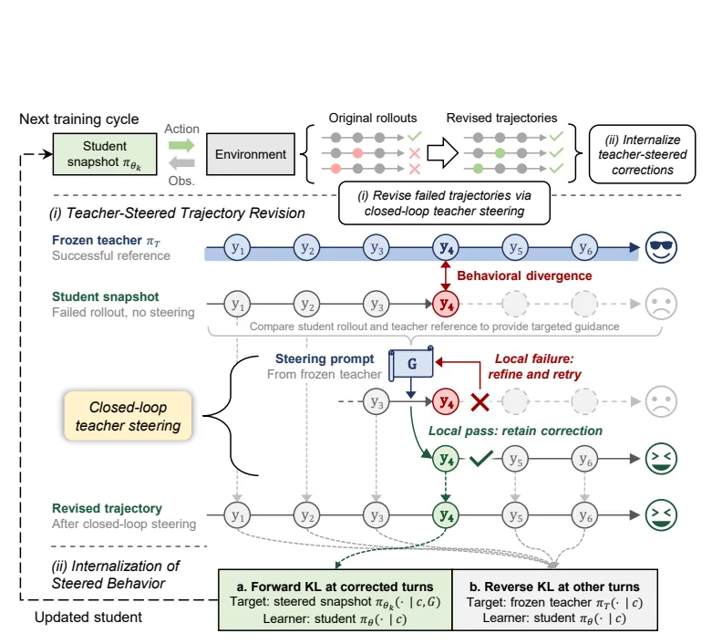
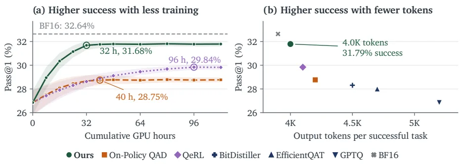

[Paper](https://arxiv.org/abs/2611.13410)
## SteerDistill: Reviving the Judgment of Quantized Agents through Teacher Steering

Agents call tools multiple times to finish a task, so inference cost is deployment cost. Low-bit quantization reduces that cost, but a quantized agent produces different environment transitions from a successful full-precision run, which can lower the task success rate. SteerDistill has the teacher point out this mismatch, lets the student fix it itself, and then instills only the verified corrections into the student through distillation.

To summarize the results, on three models and five agent benchmarks the method scores 1.67–2.18 points higher on average than the strongest quantized baseline at W4A16, and narrows the gap to the BF16 reference to within 1 point. On τ²-Bench it achieves a 1.84%p higher success rate than QeRL with 67% less training GPU time (Figure 3a). The figure below shows the overall flow and the key performance at a glance.

Figure 1 of the original paper (original PDF p.1) reads in two parts. The left side depicts a closed loop in which, in a failure context, the full-precision teacher spells out the requirement the student missed so that the student can correct its own judgment, and then refines the guidance using execution feedback. The right panel (a) shows the average score across five benchmarks approaching BF16 when Qwen3-8B is quantized to W4A16, and (b) shows a higher τ²-Bench success rate than QeRL with 67% less training GPU time. The project page and code are available at https://air-embodied-brain.github.io/SteerDistill and https://github.com/air-embodied-brain/SteerDistill , respectively.

## 1. Quantization throws off an agent's judgment

**Quantization** is a technique that stores a model's weights (and, depending on the setting, activations) in fewer bits to reduce memory usage and inference cost. This paper's notation **W4A16** denotes a setting with 4-bit weights and 16-bit (BF16) activations. However, an agent is evaluated not on a single answer but on the entire multi-turn **rollout** (the record an agent leaves while performing a task), so what quantization can damage is not only sentence generation but also **decision making**.

The problem is a phenomenon the authors call "**behavioral divergence**." A quantized agent misses a task requirement or an environment constraint and produces **different environment transitions** (how the environment state changes) from a successful full-precision reference (§1, Figure 1). Two concrete examples are reported. One is a case where a read tool can only read files in the current directory, yet the agent tries to read files inside a directory before entering it (§1, Figure 11). The other is a case where the agent creates all the requested files but leaves the contents of some of them empty (Figure 6).

Why this divergence is hard to fix has two branches. Training on offline data tends to miss the context in which the student actually fails (§2), and letting the student retry on its own rarely produces a correct response in that context. In the authors' BFCL V4 multi-turn diagnostic, when the student retried four times without guidance on divergent turns, the fraction of turns that produced at least one correct action (**turn-level Pass@4** — the fraction of turns where at least one of four attempts produced a correct action, with each attempt starting from the same pre-turn history and environment state) was only 9.6% (§1, footnote 1).

## 2. A small example: create the file first, then write the sentence

Let us follow the Figure 8 case from the paper to see where a requirement gets missed. The task is "create 1.txt, and append from dev_summary.txt the second full sentence containing 'server error'"; the first matching sentence is "No server error occurred during the initial phase.", and the second is "However, a server error was detected in the final testing phase." The table below is an **illustrative example**, adapted from the actual case in Figure 8 of the original paper (original PDF p.21), and is not a measurement result.

| Step | Original rollout (no guidance) | After teacher steering |
|---|---|---|
| Input | Same task + initial state with no files | Same task + same initial state |
| First action | Attempts to write directly to the nonexistent 1.txt | Creates an empty file as guided |
| Tool return | Rejection: `cannot write to '1.txt': No such file` | Success: file created |
| Remaining state | Initial state unchanged, file still absent | A new empty 1.txt exists |
| Verification | None | New empty file matches the reference state → local verification passes |
| Next action | After creating the file, records a sentence fragment ("resolving the server error.") rather than the matching sentence | Records the second full sentence verbatim without guidance |
| Output | A file that does not contain the required sentence | A file that contains the second full sentence |

The original rollout took the order "write rejection → file creation → sentence fragment recording," and after teacher steering it was corrected to "file creation → local verification → full sentence recording." What changed is that the precondition "create the file first" was stated explicitly in the guidance, and once the student fixes that condition through its own action, it continues even without guidance. This structure — "fixed with guidance, then maintained without it" — runs through the entire paper.

## 3. Method: fix divergent turns with a closed loop, then instill them through distillation

SteerDistill's training repeats two stages every cycle. First, **teacher-steered trajectory revision** repairs the failed rollout, and then **internalization of the steered behavior** etches that correction into the student's weights (§3, Figure 2).

The setup is as follows. A frozen full-precision teacher $\pi_T$ and a trainable quantized student $\pi_\theta$ start from the same checkpoint. Here $\theta$ is the BF16 master weights maintained during training, and the quantization operator $Q$ is fixed. Every cycle $k$, the frozen snapshot $\pi_{\theta_k}$ generates and revises rollouts, and distillation updates the learner $\pi_\theta$ to produce the next cycle's snapshot (§3). At inference time only the quantized student is used, and neither the teacher nor the guidance prompt intervenes (§4.1).

### 3-1. Teacher-steered trajectory revision

**1. Find the divergent turn.** Prepare a successful teacher reference trajectory from the same task and initial state, and align the student and the reference by **environment state transitions**. Because alignment is by "how the environment changed after execution" rather than by action strings, superficially different actions that produce the same transition are treated as identical. Intervention happens at the student turn $t^\star$ where the transitions first diverge.

**2. The teacher builds guidance and the student tries to fix it.** The teacher compares the failed response with the successful reference and builds a guidance prompt $G$ that points out the requirement or environment constraint the student missed. $G$ is divided into what went wrong (the mismatch), the condition under which the guidance applies, and the correction rule. Conditioned on this $G$, the frozen student generates a revised response and actually executes it.

**3. Judge by local verification.** The environment state and return information produced by the revised response are compared with the reference. If they match, it is accepted; otherwise, the execution feedback is reflected in the guidance and the attempt is retried from the same pre-error state. The attempt budget per intervention is $R=4$ (Appendix B).

**4. Keep only verified corrections.** If the revised response passes, that turn is replaced and the student continues without guidance thereafter. If it still fails, realign with the reference and find the next divergence point. Even if the task ultimately fails, verified corrections are kept for distillation (§3.1).

Summarizing what is stored and what changes in this loop gives the following.

| Iteration step | Input | Remaining state | Next action |
|---|---|---|---|
| Locate intervention point | Failed rollout + fixed successful reference | The turn $t^\star$ where the two trajectories first diverge, plus the history and environment state before it | Rewind to the state before $t^\star$ |
| Generate and execute guidance | Failed response + reference + previously approved guidance memory | The environment transition executed by the student conditioned on the teacher-built guidance $G$ | Judge by local verification |
| Verification failure | Execution result + verification report $f$ | The failed attempt and the report accumulate in the feedback history $F$ | The teacher summarizes $F$, refines $G$, and retries from the same state (budget $R=4$) |
| Verification pass | The passing revised response | The divergent turn is replaced, and the suffix after it is discarded | The student continues anew without guidance |
| Termination | (success / intervention budget exhausted / no further divergence to align) | The current trajectory, the verified corrections, and their guidance | Handed to distillation. Corrections are preserved even if the task failed |

What local verification compares differs by benchmark. In AgentWorldModel, the database state before and after execution must match the reference, responses that cause environment errors are rejected, and read actions must return the same information as the reference. For termination responses, the reference must also terminate and the candidate must pass the task verifier (Appendix A). In ALFWorld, WebShop, and Search QA, a candidate is accepted if the post-execution state matches the reference or both executions reach task success. In other words, the core of the check is "is the transition the same?"

The name "closed loop" comes from the fact that the teacher does not give guidance once and stop, but looks at the student's execution results and repeatedly refines the guidance. In the same diagnostic, this steering raised turn-level Pass@4 on divergent turns from 9.6% to 82.3% (§1).

### 3-2. Distillation that makes it work without steering

Building the corrected trajectory alone is not enough. At inference time there must be neither a teacher nor a guidance prompt, so the student must have "the correct behavior when guided" etched into its weights so that it can reproduce it without guidance (§3.2).

To this end, the source of the supervision signal is split by turn. On **revised turns**, the distribution the learner predicts without $G$ is made to follow the distribution the steered snapshot predicts when it sees $G$. On the remaining turns (including subsequent turns), the learner follows the full-precision teacher's distribution. In both cases the learner is not given the guidance prompt. The objectives for revised and other turns can be written as follows (§3.2).

Revised turns (forward KL, where $c$ is the dialogue context and response prefix without the guidance):

$$D_{\mathrm{KL}}\left(\pi_{\theta_k}(\cdot\mid c,G)\ \|\ \pi_\theta(\cdot\mid c)\right)$$

Other turns (reverse KL):

$$D_{\mathrm{KL}}\left(\pi_\theta(\cdot\mid c)\ \|\ \pi_T(\cdot\mid c)\right)$$

The paper only states that the rationale for choosing the two KL directions follows prior work [26] and does not explain the detailed reason (§3.2). Therefore, what effect each direction had cannot be isolated from this paper's description alone, and the Q5 ablation later only shows that the routing combination affects the score. The loss is assigned per turn over all retained response tokens and averaged (§3.2).

Figure 2 of the original paper (original PDF p.4) shows one full cycle. (i) is the loop of teacher steering → execution → local verification → refining the guidance with feedback and retrying on failure, keeping only verified corrections and then continuing without guidance. (ii) is the distillation stage, which targets the steered snapshot's predictions for revised turns and the full-precision teacher's predictions for other turns. The key point of this figure is that the learner receives no guidance prompt in either case.

## 4. Results

### 4-1. Accuracy: recovering almost all of the lost performance

**When the same Qwen3-8B is quantized to W4A16, how much does SteerDistill recover relative to the best baseline?** The table below summarizes the scores on five benchmarks and their average, showing full-precision BF16 alongside the strongest quantized baseline (QeRL) (reconstructed from the Qwen3-8B W4A16 row of Table 1).

| Method | BFCL V4 | τ²-Bench | WebShop | ALFWorld | Search QA | Average |
|---|---|---|---|---|---|---|
| BF16 (reference) | 46.89 | 32.64 | 68.58 | 79.92 | 39.65 | 53.54 |
| QeRL (best baseline) | 44.91 | 29.84 | 65.29 | 77.04 | 37.94 | 51.00 |
| **SteerDistill** | **46.84** | **31.79** | **68.41** | **79.75** | **39.12** | **53.18** |

SteerDistill's average of 53.18 is 2.18 points above QeRL and only 0.36 points from the BF16 reference of 53.54, recovering almost all of it. It also leads every quantized baseline on each of the five benchmarks (§4.2). The advantage holds across models: 1.71 points above QeRL on Qwen3.5-4B and 1.67 points on Gemma 4 12B-it, with all three models within 1 point of BF16 (§4.2, Table 1). At lower precision the gap widens: 1.93 points above QeRL at W4A8 and 3.39 points above On-Policy QAD at W2A16. The only exception is a single W2A16 Search QA metric, where it trails BitDistiller (34.22) by 0.17 points (§4.2).

Secondary metrics keep the same ordering. τ²-Bench Pass@4 is 53.05 (QeRL 50.10), WebShop Task Score is 78.57 (76.08), and Search QA average EM is 39.12 (37.94); BF16 is 54.20, 78.69, and 39.65, respectively. On Search QA it leads the quantized baseline not only in-domain (NQ, HotpotQA) but also on the other five out-of-domain datasets (Table 6, §C.2).

### 4-2. Efficiency: training time and output tokens

If the accuracy gain came from training longer or talking more, its significance would be halved. The figure below separates training cost from inference cost.

Figure 3 of the original paper (original PDF p.7) has two panels. In panel (a), the x-axis is training GPU time (based on 8 A100 80GB GPUs, including teacher steering and verification time) and the y-axis is τ²-Bench success rate. SteerDistill reaches 31.68% at 32 GPU hours, higher than On-Policy QAD (28.75%), which converged at about 40 GPU hours, and achieves a 1.84%p higher success rate than QeRL (29.84%), which converged at 96 GPU hours, with 67% less GPU time (§4.3). The paper writes the difference versus On-Policy QAD as 2.91%p, but the arithmetic difference between the 31.68% and 28.75% shown in the figure is 2.93%p. In panel (b), the x-axis is average output tokens per successful task and the y-axis is success rate. SteerDistill uses 4.0K tokens and achieves a higher success rate than quantized baselines using 4.1K–5.2K, close to BF16's 3.9K (§4.3). In other words, the trajectories of successful tasks are shorter.

Averaging over successful tasks only, this difference shows up across several metrics. Note that each number is an average over only the tasks that method succeeded on, so different task sets are being compared (Table 7).

| Method | Input tokens | Output tokens | Interaction steps | Tool calls |
|---|---|---|---|---|
| BF16 | 185K | 3.9K | 11.4 | 4.2 |
| GPTQ | 270K | 5.2K | 13.8 | 5.25 |
| On-Policy QAD | 214K | 4.2K | 12.3 | 4.55 |
| QeRL | 206K | 4.1K | 12.1 | 4.43 |
| **SteerDistill** | **192K** | **4.0K** | **11.6** | **4.24** |

SteerDistill uses fewer input tokens, interaction steps, and tool calls than every quantized baseline in the table. Training that precisely fixes the divergence points may have reduced wasted retries, but this is a consistent direction in the numbers, not a causal interpretation. The same pattern repeats at W4A8 and W2A16 (Figure 4, §C.3).

### 4-3. How much do the design choices contribute?

How much each design choice actually contributes is checked by an ablation on BFCL V4 (Qwen3-8B, W4A16). Below is a reconstruction of Table 2, and every difference is the value subtracted from the full SteerDistill score of 46.84.

| Group | Variant | Score | Difference |
|---|---|---|---|
| (reference) | BF16 / On-Policy QAD / full SteerDistill | 46.89 / 44.43 / 46.84 | — |
| Q1 intervention location | Random turn | 43.52 | −3.32 |
| | First action mismatch | 45.01 | −1.83 |
| Q2 intervention mode | Student retry without guidance | 44.46 | −2.38 |
| | Teacher takeover | 45.06 | −1.78 |
| Q3 guidance format/source | Teacher / free-form | 44.78 | −2.06 |
| | Student / structured | 41.74 | −5.10 |
| | GPT-5.6-Sol / structured | 45.27 | −1.57 |
| Q4 retention criterion | No local verification | 42.18 | −4.66 |
| | Require final success only | 46.30 | −0.54 |
| Q5 distillation routing | All reverse KL | 45.29 | −1.55 |
| | All forward KL | 44.58 | −2.26 |
| | Reversed routing (RKL/FKL) | 44.28 | −2.56 |

The reading is as follows. **Intervening at the divergence point in environment state** rather than at the first action mismatch is 1.83 points higher, and intervening at an arbitrary turn (43.52) is even lower than On-Policy QAD (44.43). **Steering the student instead of having the teacher inject the answer directly** is 2.38 points higher than retrying and 1.78 points higher than teacher takeover. **Structured teacher guidance** is 2.06 points higher than free-form, 5.10 points higher than student-generated guidance, and 1.57 points higher than structured guidance produced by GPT-5.6-Sol. **Removing local verification** drops the score sharply from 46.84 to 42.18, while a filter that requires final success after verification actually lowers it slightly to 46.30. For the distillation direction, the combination of forward KL on revised turns and reverse KL on the rest is 1.55 points higher than all-reverse and 2.26 points higher than all-forward, and reversing the routing lowers it by 2.56 points (§4.4).

The effect of guidance format shows up as a state change in the ticket-creation case (Figure 12). The task is to create a priority-3 ticket, and the transaction session was authenticated while the ticket session was not.

| Guidance format/source | Action the student continued with | Remaining state |
|---|---|---|
| Teacher / structured | Log in, then create ticket | 1 ticket, no credentials in the description |
| Teacher / free-form | Claims completion after logging in, without creating | Ticket queue is empty |
| Student / structured | Log in, then create ticket | 1 ticket, no credentials in the description |
| GPT-5.6-Sol / structured | Log in, then create ticket | 1 ticket, login credentials included in the description |
| No guidance (original rollout) | Retries after a login error and succeeds | 1 ticket, credentials included in the description |

GPT-5.6-Sol's structured guidance got the login order right, but the student put the credentials into the ticket description and only partially followed the instruction. The free-form guidance ended the attempt with "the ticket has already been created," leaving no actual ticket, which is a failure that local verification must catch. In this case, then, the score difference shows up not as an abstract metric but as the state "does a ticket remain?"

## 5. Limitations and when to apply it

To judge applicability, the constraints must be separated. The limitations the authors state are collected in Appendix E. First, teacher-steered trajectory revision requires a **successful teacher reference trajectory**. Without a reference, a failed rollout remains only as distillation data and receives no correction. Second, the dialogue history and environment state before the error must be **reversible**. Third, there must be **reliable local verification** to judge the effect of the revised response. The authors state that application in environments where state restoration or local verification is difficult has not been validated. Fourth, local verification only checks the effect of the revised response in the current context; it neither guarantees final success nor that every reasoning step in the response is correct.

Beyond that, there are a few conditions a reviewer would point out (not stated by the authors). Training requires a full-precision teacher, so if a BF16 checkpoint cannot be obtained, applying it as-is is difficult. It is also designed for tool-use benchmarks where environment state can be read and rewound, so it does not carry over unchanged to open-ended dialogue where "state" is not well defined. The experiments start from checkpoints that have undergone per-task GRPO post-training. In the appendix experiment that starts without GRPO, the relative ordering is maintained, but the absolute scores of all methods drop (Table 5). The reported absolute performance therefore depends on this initial checkpoint.

| Method (Qwen3-8B, W4A16) | BFCL V4 | τ²-Bench (Pass@1) |
|---|---|---|
| BF16 | 40.40 | 30.00 |
| BitDistiller | 35.34 | 24.29 |
| On-Policy QAD | 36.16 | 24.58 |
| QeRL | 38.85 | 28.92 |
| **SteerDistill** | **39.67** | **29.05** |

In other words, the method recovers a large share of the capability lost to quantization, but that share is measured on top of an initial checkpoint that has gone through GRPO. Overall, SteerDistill is a method with clear conditions for low-bit deployment of tool-use agents that have "a full-precision teacher, a reversible environment, and reliable verification." If those conditions break down, the benefit may shrink or application itself may be difficult, and this remains an unvalidated area.

<!-- verbatim-tables -->

Tables from the paper

> Tables converted mechanically from the arXiv e-print LaTeX source. The numbers are the paper's own and did not pass through a model.

**Table 1. Agentic benchmark results across models and quantization settings. Scores are percentages; higher is better. Avg. is the unweighted mean of the five displayed benchmark scores. Bold marks the best quantized result for each model and precision.**

| Model | Precision | Method | BFCL V4 Overall | $\tau^2$-Bench Pass@1 | WebShop SR | ALFWorld SR | Search QA EM | Avg. |
|---|---|---|---|---|---|---|---|---|
| **Qwen3** **8B** | *BF16* | *--* | *46.89* | *32.64* | *68.58* | *79.92* | *39.65* | *53.54* |
|  | W4A16 | GPTQ | 40.73 | 26.85 | 59.24 | 71.32 | 33.64 | 46.36 |
|  |  | EfficientQAT | 41.77 | 28.00 | 61.34 | 73.18 | 35.08 | 47.87 |
|  |  | BitDistiller | 42.46 | 28.31 | 62.07 | 73.91 | 35.69 | 48.49 |
|  |  | On-Policy QAD | 44.43 | 28.77 | 64.72 | 76.53 | 37.47 | 50.38 |
|  |  | QeRL | 44.91 | 29.84 | 65.29 | 77.04 | 37.94 | 51.00 |
|  |  | **Ours** | **46.84** | **31.79** | **68.41** | **79.75** | **39.12** | **53.18** |
|  | W4A8 | GPTQ | 35.90 | 22.90 | 54.70 | 66.80 | 30.20 | 42.10 |
|  |  | EfficientQAT | 40.20 | 27.10 | 60.00 | 71.80 | 34.00 | 46.62 |
|  |  | BitDistiller | 41.20 | 27.80 | 60.80 | 72.90 | 34.80 | 47.50 |
|  |  | On-Policy QAD | 43.15 | 27.85 | 63.35 | 75.10 | 36.25 | 49.14 |
|  |  | QeRL | 42.85 | 29.05 | 64.10 | 75.55 | 36.90 | 49.69 |
|  |  | **Ours** | **45.20** | **30.10** | **66.70** | **78.25** | **37.85** | **51.62** |
|  | W2A16 | GPTQ | 13.84 | 6.72 | 30.21 | 24.63 | 18.91 | 18.86 |
|  |  | EfficientQAT | 30.92 | 18.44 | 49.13 | 53.87 | 31.46 | 36.76 |
|  |  | BitDistiller | 33.71 | 19.86 | 51.84 | 57.36 | **34.22** | 39.40 |
|  |  | On-Policy QAD | 32.88 | 20.57 | 53.08 | 58.41 | 32.96 | 39.58 |
|  |  | QeRL | 31.64 | 20.91 | 50.74 | 55.62 | 31.58 | 38.10 |
|  |  | **Ours** | **38.12** | **23.68** | **55.71** | **63.27** | 34.05 | **42.97** |
| **Qwen3.5** **4B** | *BF16* | *--* | *50.40* | *62.80* | *69.80* | *78.60* | *46.80* | *61.68* |
|  | W4A16 | GPTQ | 43.91 | 56.18 | 60.65 | 69.78 | 40.58 | 54.22 |
|  |  | EfficientQAT | 45.36 | 57.68 | 62.76 | 71.84 | 42.08 | 55.94 |
|  |  | BitDistiller | 46.17 | 58.33 | 63.61 | 72.54 | 42.77 | 56.68 |
|  |  | On-Policy QAD | 48.02 | 59.48 | 66.03 | 74.92 | 44.49 | 58.59 |
|  |  | QeRL | 48.53 | 60.31 | 66.73 | 75.63 | 45.01 | 59.24 |
|  |  | **Ours** | **49.82** | **61.91** | **69.08** | **77.82** | **46.11** | **60.95** |
| **Gemma 4** **12B-it** | *BF16* | *--* | *64.18* | *61.46* | *72.41* | *84.63* | *42.96* | *65.13* |
|  | W4A16 | GPTQ | 57.82 | 54.36 | 63.48 | 75.72 | 36.91 | 57.66 |
|  |  | EfficientQAT | 59.46 | 56.12 | 65.72 | 77.68 | 38.24 | 59.44 |
|  |  | BitDistiller | 60.08 | 56.74 | 66.43 | 78.31 | 38.79 | 60.07 |
|  |  | On-Policy QAD | 61.87 | 58.36 | 68.61 | 80.76 | 40.52 | 62.02 |
|  |  | QeRL | 62.41 | 59.02 | 69.33 | 81.35 | 41.07 | 62.64 |
|  |  | **Ours** | **63.54** | **60.72** | **71.38** | **83.62** | **42.31** | **64.31** |

**Table 2. Ablation study on BFCL V4 using Qwen3-8B under W4A16. BF16 and On-Policy QAD provide reference scores. Each Q1--Q5 group lists alternatives to its stated default; all defaults together form the full-method row. Bold marks the best quantized result in each column. The *Final success only* variant adds terminal-success filtering after local verification. app:steering_case shows a case study for Q3.**

| Configuration | Overall | Non-Live | Live | Multi- Turn | Web Search | Memory | Irrel. |
|---|---|---|---|---|---|---|---|
| *BF16* | 46.89 | 87.14 | 81.76 | 48.53 | 18.57 | 19.32 | 78.63 |
| *On-Policy QAD* | 44.43 | 85.72 | 80.19 | 45.14 | 16.86 | 17.16 | 74.88 |
| **Full SteerDistill\xspace (Ours)** | **46.84** | **88.29** | **81.71** | **48.47** | **18.44** | **18.79** | **78.56** |
| **Q1: Intervention localization** (default: Behavioral divergence) |  |  |  |  |  |  |  |
| Random eligible turn | 43.52 | 85.20 | 79.72 | 44.00 | 16.10 | 16.30 | 73.48 |
| First action mismatch | 45.01 | 86.20 | 80.55 | 45.95 | 17.20 | 17.45 | 76.20 |
| **Q2: Intervention strategy** (default: Teacher steering) |  |  |  |  |  |  |  |
| Unguided student retry | 44.46 | 85.81 | 80.08 | 45.26 | 16.93 | 17.05 | 74.97 |
| Teacher takeover | 45.06 | 86.31 | 80.69 | 46.02 | 17.31 | 17.55 | 75.81 |
| **Q3: Steering format and source** (default: Teacher / Structured) |  |  |  |  |  |  |  |
| Teacher / Free-form | 44.78 | 87.10 | 80.85 | 45.35 | 17.10 | 17.05 | 75.50 |
| Student / Structured | 41.74 | 83.72 | 79.02 | 41.48 | 14.66 | 14.91 | 71.08 |
| GPT-5.6-Sol / Structured | 45.27 | 87.05 | 80.90 | 46.15 | 17.55 | 17.65 | 75.90 |
| **Q4: Revision retention** (default: Local verification) |  |  |  |  |  |  |  |
| No local verification | 42.18 | 84.10 | 78.95 | 42.30 | 14.95 | 15.20 | 71.55 |
| Final success only | 46.30 | 87.91 | 81.09 | 47.72 | 18.16 | 18.27 | 78.02 |
| **Q5: Distillation routing** (default: FKL at corrected turns; RKL elsewhere) |  |  |  |  |  |  |  |
| Reverse KL throughout | 45.29 | 86.45 | 80.93 | 46.33 | 17.48 | 17.78 | 76.02 |
| Forward KL throughout | 44.58 | 85.98 | 80.47 | 45.22 | 17.28 | 16.89 | 75.32 |
| Reversed routing (RKL / FKL) | 44.28 | 85.64 | 80.28 | 44.75 | 16.96 | 16.89 | 74.93 |

**Table 3. Key notation for SteerDistill\xspace. The revision algorithm handles one trajectory; training adds index $i$.**

| Symbol | Meaning |
|---|---|
| **Policies and conditioning** |  |
| $\pi_T$ | Frozen full-precision teacher. |
| $\theta$, $\pi_\theta$ | Student master weights and trainable quantized policy. |
| $k$, $\theta_k$, $\pi_{\theta_k}$ | Training cycle, frozen student weights, and corresponding policy. |
| $i$, $t$, $j$ | Trajectory, turn, and response-token indices. |
| $\tau$, $\tau^T$ | Student trajectory and its fixed successful teacher reference. |
| $h_t$, $y_t$ | History before turn $t$ and the response generated at that turn. |
| $c_{i,t,j}$ | Token context $(h_{i,t},y_{i,t,\lt j})$, with all steering prompts removed. |
| **Revision state and retained supervision** |  |
| $t^\star$ | Intervention turn selected by alignment at the current revision step. |
| $\rho$, $\rho^T$ | Candidate transition and its aligned reference transition. |
| $R$, $v$, $f$, $F$ | Attempt budget, acceptance flag, verification report, and accumulated feedback. |
| $G$, $G_{i,t}$ | Current steering prompt and the prompt retained for turn $t$ in trajectory $i$. |
| $\mathcal M$ | Memory holding the latest accepted steering prompt within the current trajectory. |
| $\mathcal G$ | Stored prompt map: $\mathcal G[t]=G_{i,t}$ for trajectory $i$. |
| $\mathcal I_i$ | Retained corrected turns in trajectory $i$; these receive FKL supervision. |
| **Training objective** |  |
| $\mathcal A_k$ | Retained assistant-token positions $(i,t,j)$ in cycle $k$. |
| $\ell_{\mathrm{FKL}}$, $\ell_{\mathrm{RKL}}$ | Per-token losses at corrected and other turns (eq:forward_kleq:reverse_kl). |
| $\mathcal L^{(k)}(\theta)$ | Mean token loss over $\mathcal A_k$, assigned by turn (eq:steerdistill_objective). |

**Table 4. Hyperparameters for the low-bit training stage. Batch size counts complete trajectories. For EfficientQAT, $1+1$ denotes one epoch of Block-AP followed by one epoch of E2E-QP.**

| Method | Epochs | Learning Rate | Batch Size (trajectories) |
|---|---|---|---|
| EfficientQAT | $1+1$ | $8\times10^{-6}$ | 16 |
| BitDistiller | 2 | $8\times10^{-6}$ | 16 |
| On-Policy QAD | 2 | $8\times10^{-6}$ | 16 |
| QeRL | 2 | $8\times10^{-6}$ | 16 |
| **Ours** | 2 | $8\times10^{-6}$ | 16 |

**Table 5. Results without initial GRPO post-training on Qwen3-8B. Quantized methods use W4A16. Scores are percentages; bold marks the best quantized result.**

| Model | Precision | Method | BFCL V4 Overall | $\tau^{2}$-Bench Pass@1 |
|---|---|---|---|---|
| **Qwen3** **8B** | *BF16* | *--* | *40.40* | *30.00* |
|  | W4A16 | BitDistiller | 35.34 | 24.29 |
|  |  | On-Policy QAD | 36.16 | 24.58 |
|  |  | QeRL | 38.85 | 28.92 |
|  |  | **Ours** | **39.67** | **29.05** |

**Table 6. Additional evaluation metrics for Qwen3-8B. Quantized methods use W4A16, with BF16 as the full-precision reference. On $\tau^{2}$-Bench, Pass@4 is the fraction of tasks solved at least once in four runs. We report Task Score for WebShop and per-dataset Exact Match (EM) for Search QA. $\dagger$ and $\star$ denote in-domain and out-of-domain Search QA datasets, respectively. Higher is better for all metrics; bold marks the best quantized result in each column.**

| Method | $\tau^{2}$-Bench Pass@4 | WebShop Score | Search QA (EM) NQ$^{\dagger}$ | Search QA (EM) TriviaQA$^{\star}$ | Search QA (EM) PopQA$^{\star}$ | Search QA (EM) HotpotQA$^{\dagger}$ | Search QA (EM) 2Wiki$^{\star}$ | Search QA (EM) MuSiQue$^{\star}$ | Search QA (EM) Bamboogle$^{\star}$ |
|---|---|---|---|---|---|---|---|---|---|
| *BF16* | *54.20* | *78.69* | *43.36* | *62.42* | *41.96* | *36.58* | *35.12* | *15.92* | *42.18* |
| GPTQ | 45.50 | 70.86 | 37.62 | 56.04 | 36.05 | 30.44 | 28.39 | 12.23 | 34.71 |
| EfficientQAT | 47.10 | 72.73 | 39.08 | 57.69 | 37.48 | 32.02 | 30.17 | 12.88 | 36.25 |
| BitDistiller | 47.55 | 73.41 | 39.71 | 58.31 | 38.11 | 32.71 | 30.86 | 13.21 | 36.92 |
| On-Policy QAD | 48.20 | 75.61 | 41.18 | 60.22 | 39.69 | 34.47 | 32.86 | 14.46 | 39.44 |
| QeRL | 50.10 | 76.08 | 41.64 | 60.73 | 40.13 | 35.03 | 33.36 | 14.79 | 39.92 |
| **Ours** | **53.05** | **78.57** | **42.84** | **61.88** | **41.41** | **36.01** | **34.55** | **15.53** | **41.61** |

**Table 7. Detailed trajectory and inference statistics for Qwen3-8B on $\tau^{2}$-Bench. Quantized methods use W4A16, with BF16 as the full-precision reference. All entries are averages over each method's own successful tasks. Cached-input token counts are reported descriptively; K denotes thousands of tokens.**

| Method | Input Tokens | Cached Input | Output Tokens | Interaction Steps | Tool Calls |
|---|---|---|---|---|---|
| *BF16* | *185K* | *148K* | *3.9K* | *11.4* | *4.2* |
| GPTQ | 270K | 223K | 5.2K | 13.8 | 5.25 |
| EfficientQAT | 243K | 199K | 4.7K | 13.1 | 4.92 |
| BitDistiller | 235K | 192K | 4.5K | 12.9 | 4.78 |
| On-Policy QAD | 214K | 173K | 4.2K | 12.3 | 4.55 |
| QeRL | 206K | 166K | 4.1K | 12.1 | 4.43 |
| **Ours** | **192K** | 153K | **4.0K** | **11.6** | **4.24** |

> Figures in this post are taken from the original arXiv:2611.13410 (CC BY 4.0). Only size and format were changed.
