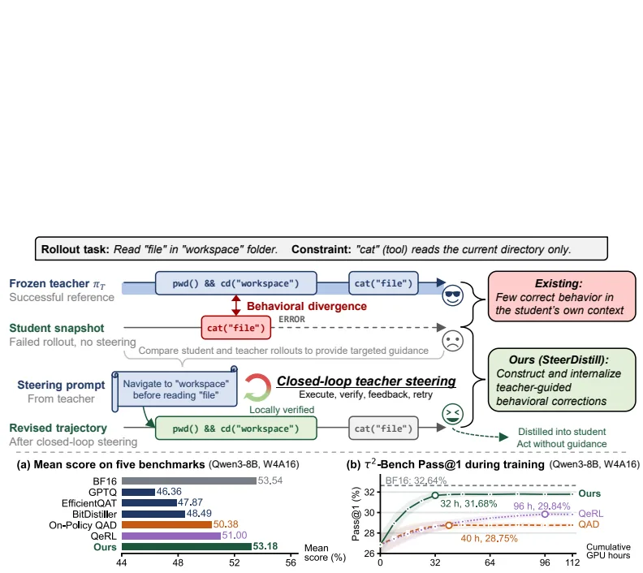
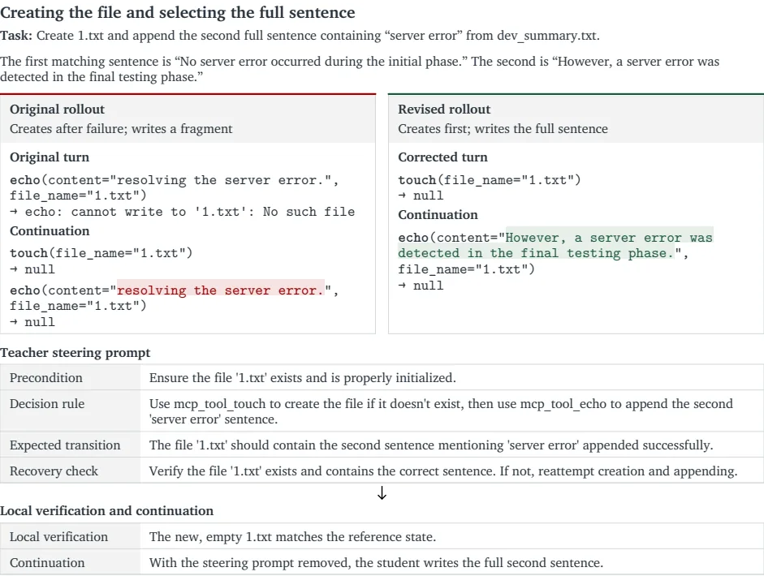
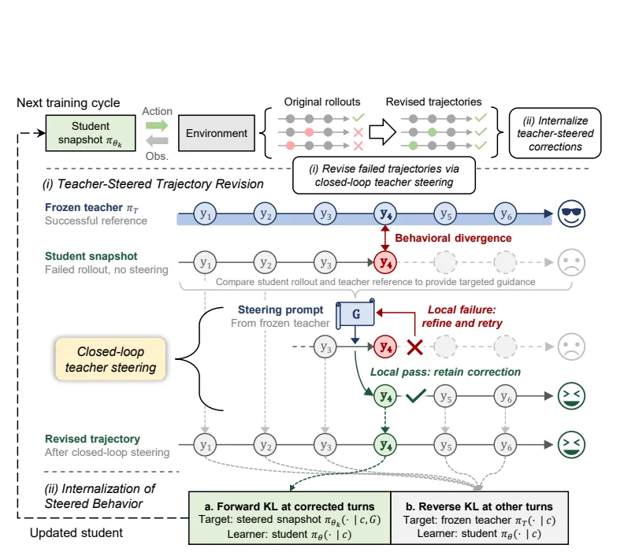
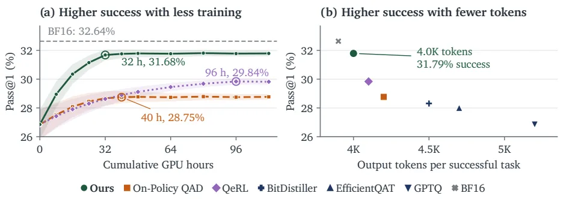

[논문 링크](https://arxiv.org/abs/2611.13410)
## SteerDistill: 교사 조종으로 양자화된 에이전트의 판단을 되살리다

에이전트는 도구를 여러 번 호출해 작업을 끝내므로 추론 비용이 곧 배포 비용이다. 저비트 양자화는 그 비용을 줄이지만, 양자화된 에이전트는 성공한 전체 정밀도 실행과 다른 환경 전이를 만들어 작업 성공률이 떨어질 수 있다. SteerDistill은 이 어긋남을 교사가 짚어 학생이 직접 고치게 한 뒤, 검증된 교정만 증류로 학생 안에 심는다.

결과를 요약하면 이 방법은 세 모델, 다섯 개 에이전트 벤치마크에서 W4A16 기준 가장 강한 양자화 baseline보다 평균 1.67~2.18점 높은 점수를 내고, BF16 기준과의 격차를 1점 이내로 좁혔다. τ²-Bench에서는 QeRL보다 1.84%p 높은 성공률을 67% 적은 학습 GPU 시간으로 달성했다(Figure 3a). 아래 그림이 전체 흐름과 핵심 성능을 한눈에 보여 준다.

원문 Figure 1(원문 PDF p.1)은 두 부분으로 읽는다. 왼쪽은 실패 맥락에서 전체 정밀도 교사가 놓친 요구 조건을 명시해 학생이 스스로 판단을 고치게 하고, 실행 피드백으로 안내를 다듬는 닫힌 고리를 그린다. 오른쪽 패널 (a)는 Qwen3-8B를 W4A16으로 양자화했을 때 다섯 벤치마크 평균 점수가 BF16에 근접하는 모습, (b)는 67% 적은 학습 GPU 시간으로 QeRL보다 높은 τ²-Bench 성공률을 내는 모습을 보여 준다. 프로젝트 페이지와 코드는 각각 https://air-embodied-brain.github.io/SteerDistill , https://github.com/air-embodied-brain/SteerDistill 에 공개되어 있다.

## 1. 양자화가 에이전트의 판단을 어긋나게 만든다

**양자화**는 모델의 가중치(설정에 따라 활성화까지)를 더 적은 비트로 저장해 메모리 사용량과 추론 비용을 줄이는 기법이다. 이 논문의 표기 **W4A16**은 가중치를 4비트, 활성화를 16비트(BF16)로 두는 설정을 뜻한다. 다만 에이전트는 한 번의 답이 아니라 여러 턴에 걸친 **rollout**(에이전트가 작업을 수행하며 남긴 기록) 전체로 평가되므로, 양자화가 손상시킬 수 있는 것은 문장 생성만이 아니라 **의사 결정**이다.

문제는 저자들이 '**행동 발산(behavioral divergence)**'이라 부르는 현상이다. 양자화된 에이전트가 과제의 요구 조건이나 환경의 제약을 놓쳐, 성공한 전체 정밀도 참조와 **다른 환경 전이**(환경 상태가 어떻게 바뀌는가)를 만들어 낸다(§1, Figure 1). 구체적인 예 두 가지가 보고되어 있다. 하나는 읽기 도구가 현재 디렉터리의 파일만 읽을 수 있는데도, 에이전트가 디렉터리에 들어가기 전에 그 안의 파일을 읽으려는 경우다(§1, Figure 11). 다른 하나는 요청받은 파일들을 모두 만들면서도 일부 파일의 내용을 비워 두는 경우다(Figure 6).

이런 발산을 고치기 어려운 이유는 두 갈래다. 오프라인 데이터로 학습하면 학생이 실제로 실패하는 맥락을 놓치기 쉽고(§2), 학생 스스로 다시 시도하게 하면 그 맥락에서 올바른 응답을 거의 만들어 내지 못한다. 저자들의 BFCL V4 다중 턴 진단에서, 어긋난 턴에서 학생이 안내 없이 네 번 재시도했을 때 올바른 행동을 하나라도 낸 턴 비율(**turn-level Pass@4** — 네 번 시도 중 하나라도 올바른 행동이 나온 턴의 비율, 각 시도는 동일한 턴 전 이력과 환경 상태에서 시작)은 9.6%에 그쳤다(§1, 각주 1).

## 2. 작은 예시: 파일을 먼저 만들고, 그다음 문장을 쓴다

논문의 Figure 8 사례를 따라 요구 조건이 어디서 놓치는지 확인해 보자. 과제는 "1.txt를 만들고, dev_summary.txt에서 'server error'가 들어간 두 번째 전체 문장을 덧붙여라"이며, 첫 번째 일치 문장은 "No server error occurred during the initial phase.", 두 번째는 "However, a server error was detected in the final testing phase."다. 아래 표는 **설명용 예시**로, 원문 Figure 8의 실제 사례(원문 PDF p.21)를 옮겨 정리한 것이며 측정 결과가 아니다.

| 단계 | 원래 rollout (안내 없음) | 교사 조종 후 |
|---|---|---|
| 입력 | 같은 과제 + 파일이 없는 초기 상태 | 같은 과제 + 같은 초기 상태 |
| 첫 행동 | 존재하지 않는 1.txt에 바로 쓰기 시도 | 안내에 따라 빈 파일 생성 |
| 도구가 돌려준 결과 | 거절: `cannot write to '1.txt': No such file` | 성공: 파일이 생성됨 |
| 남는 상태 | 파일이 여전히 없는 초기 상태 그대로 | 비어 있는 1.txt가 새로 존재함 |
| 검증 | 없음 | 새 빈 파일이 참조 상태와 일치 → 국소 검증 통과 |
| 다음 행동 | 파일을 만든 뒤 매칭 문장이 아닌 문장 조각("resolving the server error.")을 기록 | 안내 없이 두 번째 전체 문장을 그대로 기록 |
| 출력 | 요구된 문장이 담기지 않은 파일 | 두 번째 전체 문장이 담긴 파일 |

원래 rollout은 '쓰기 거절 → 파일 생성 → 문장 조각 기록' 순서를 탔고, 교사 조종 뒤에는 '파일 생성 → 국소 검증 → 전체 문장 기록' 순서로 바로잡았다. 달라진 것은 "파일을 먼저 만든다"는 선행 조건이 안내에 명시적으로 실렸다는 점이며, 학생은 그 조건을 자기 행동으로 고친 뒤에는 안내가 없어도 이어 간다. 이 "안내를 받아 고친 뒤 안내 없이도 유지되는" 구조가 논문 전체를 관통한다.

## 3. 방법: 닫힌 고리로 어긋난 턴을 고치고, 증류로 심는다

SteerDistill의 학습은 매 사이클마다 두 단계를 반복한다. 먼저 <strong>교사 조종 궤적 수정(teacher-steered trajectory revision)</strong>이 실패한 rollout을 고치고, 다음으로 **조종된 행동의 내재화**가 그 교정을 학생의 가중치에 새긴다(§3, Figure 2).

설정은 이렇다. 동결된 전체 정밀도 교사 $\pi_T$와 학습 가능한 양자화 학생 $\pi_\theta$가 같은 체크포인트에서 출발한다. 여기서 $\theta$는 학습 중 유지하는 BF16 마스터 가중치이고, 양자화 연산 $Q$는 고정되어 있다. 매 사이클 $k$마다 동결된 스냅샷 $\pi_{\theta_k}$가 rollout을 생성하고 수정하며, 증류는 학습자 $\pi_\theta$를 갱신해 다음 사이클의 스냅샷을 만든다(§3). 추론 시점에는 이 양자화된 학생만 쓰며, 교사와 안내 프롬프트는 개입하지 않는다(§4.1).

### 3-1. 교사 조종 궤적 수정

**1. 어긋난 턴을 찾는다.** 같은 작업과 초기 상태에서 성공한 교사 참조 궤적을 준비하고, 학생과 참조를 **환경 상태의 전이**로 정렬한다. 행동 문자열이 아니라 "실행 뒤 환경이 어떻게 변했는지"로 맞추기 때문에, 표면적으로 다른 행동이라도 같은 전이를 만들면 동일하게 취급한다. 처음으로 전이가 갈라지는 학생 턴 $t^\star$에서 개입한다.

**2. 교사가 안내를 만들고 학생이 고쳐 본다.** 교사는 실패한 응답과 성공 참조를 비교해 학생이 놓친 요구 조건이나 환경 제약을 짚는 안내 프롬프트 $G$를 만든다. $G$는 무엇이 어긋났는지(불일치), 그 안내가 적용되는 조건, 그리고 수정 규칙을 나눠 담는다. 이 $G$를 조건으로 동결된 학생이 수정 응답을 생성하고 실제로 실행한다.

**3. 국소 검증으로 판정한다.** 수정 응답이 만든 환경 상태와 반환 정보를 참조와 비교한다. 일치하면 수용, 아니면 실행 피드백을 안내에 반영해 같은 오류 이전 상태에서 다시 시도한다. 개입마다 시도 예산은 $R=4$다(부록 B).

**4. 검증된 교정만 남긴다.** 수정 응답이 통과하면 그 턴을 대체하고, 이후는 안내 없이 학생이 이어 간다. 그래도 실패하면 참조와 다시 정렬해 다음 발산 지점을 찾는다. 작업이 끝내 실패해도 검증된 교정은 증류용으로 남긴다(§3.1).

이 반복에서 무엇이 저장되고 무엇이 바뀌는지를 정리하면 다음과 같다.

| 반복 단계 | 입력 | 남는 상태 | 다음 행동 |
|---|---|---|---|
| 개입 지점 탐색 | 실패 rollout + 고정된 성공 참조 | 두 궤적이 처음 갈라지는 턴 $t^\star$와 그 이전 이력·환경 상태 | $t^\star$ 이전 상태로 되돌림 |
| 안내 생성 및 실행 | 실패 응답 + 참조 + 앞서 승인된 안내 메모리 | 교사가 만든 안내 $G$를 조건으로 학생이 실행한 환경 전이 | 국소 검증으로 판정 |
| 검증 실패 | 실행 결과 + 검증 보고서 $f$ | 실패한 시도와 보고서가 피드백 이력 $F$에 쌓임 | 교사가 $F$를 요약해 $G$를 다듬고 같은 상태에서 재시도 (예산 $R=4$) |
| 검증 통과 | 통과한 수정 응답 | 어긋난 턴이 교체되고, 그 뒤 접미부는 버려짐 | 학생이 안내 없이 새로 이어 감 |
| 종료 | (성공 / 개입 예산 소진 / 더 맞출 발산 없음) | 현재 궤적과 검증된 교정, 그 안내 | 증류에 넘김. 작업이 실패했어도 교정은 보존 |

국소 검증이 비교하는 대상은 벤치마크마다 다르다. AgentWorldModel에서는 실행 전후의 데이터베이스 상태가 참조와 같아야 하고, 환경 오류를 일으키는 응답은 기각하며, 읽기 동작은 참조와 같은 정보를 돌려주어야 한다. 종료 응답은 참조 역시 종료하고 후보가 과제 검증기를 통과해야 한다(부록 A). ALFWorld·WebShop·Search QA에서는 실행 뒤 상태가 참조와 같거나, 두 실행이 모두 과제 성공에 도달하면 후보를 받아들인다. 즉 검사의 핵심은 "전이가 같은가"다.

여기서 "닫힌 고리"라는 이름이 나오는 이유는, 교사가 안내를 한 번 주고 끝내는 것이 아니라 학생의 실행 결과를 보고 안내를 반복해서 다듬기 때문이다. 같은 진단에서 이 조종은 어긋난 턴의 turn-level Pass@4를 9.6%에서 82.3%로 끌어올렸다(§1).

### 3-2. 조종 없이도 되게 만드는 증류

교정 궤적을 만든 것만으로는 부족하다. 추론 시점에는 교사도 안내 프롬프트도 없어야 하므로, 학생이 "안내를 받을 때의 올바른 행동"을 안내 없이도 재현하도록 가중치에 새겨야 한다(§3.2).

이를 위해 턴마다 지도 신호의 출처를 나눈다. **수정된 턴**에서는 학습자가 $G$ 없이 예측한 분포가 조종을 받은 스냅샷이 $G$를 보고 예측한 분포를 따라가게 한다. 나머지 턴(이어지는 턴 포함)에서는 학습자가 전체 정밀도 교사의 분포를 따라가게 한다. 두 경우 모두 학습자에게 안내 프롬프트는 주어지지 않는다. 수정된 턴과 그 외 턴의 목적 함수를 수식으로 적으면 다음과 같다(§3.2).

수정된 턴(순방향 KL, $c$는 안내를 뺀 대화 맥락과 응답 접두어):

$$D_{\mathrm{KL}}\left(\pi_{\theta_k}(\cdot\mid c,G)\ \|\ \pi_\theta(\cdot\mid c)\right)$$

그 외 턴(역방향 KL):

$$D_{\mathrm{KL}}\left(\pi_\theta(\cdot\mid c)\ \|\ \pi_T(\cdot\mid c)\right)$$

논문은 두 KL 방향의 선택 근거를 이전 연구[26]를 따랐다고만 밝히고 상세한 이유는 설명하지 않는다(§3.2). 따라서 각 방향이 어떤 효과를 냈는지는 이 논문의 서술만으로는 분리해 확인할 수 없고, 뒤의 Q5 ablation은 라우팅 조합이 점수에 영향을 준다는 사실만 보여 준다. 손실은 모든 남겨진 응답 토큰에 대해 턴별로 배정하고 평균한다(§3.2).

원문 Figure 2(원문 PDF p.4)는 한 사이클 전체를 보여 준다. (i)은 교사 조종 → 실행 → 국소 검증 → 실패 시 피드백으로 안내를 다듬어 재시도하는 루프이고, 검증된 교정만 남긴 뒤 안내 없이 이어 간다. (ii)는 증류 단계로, 수정된 턴은 조종된 스냅샷의 예측을, 그 외 턴은 전체 정밀도 교사의 예측을 목표로 삼는다. 학습자는 어느 쪽이든 안내 프롬프트를 받지 않는다는 점이 이 그림의 핵심이다.

## 4. 결과

### 4-1. 정확도: 잃은 성능을 거의 다 되찾는다

**같은 Qwen3-8B를 W4A16으로 양자화했을 때, SteerDistill은 최고 baseline 대비 얼마나 회복하는가?** 아래 표는 다섯 벤치마크의 점수와 그 평균을 정리한 것으로, 전체 정밀도 BF16과 가장 강한 양자화 baseline(QeRL)을 함께 보여 준다(Table 1에서 Qwen3-8B W4A16 행만 재구성).

| 방법 | BFCL V4 | τ²-Bench | WebShop | ALFWorld | Search QA | 평균 |
|---|---|---|---|---|---|---|
| BF16 (기준) | 46.89 | 32.64 | 68.58 | 79.92 | 39.65 | 53.54 |
| QeRL (최고 baseline) | 44.91 | 29.84 | 65.29 | 77.04 | 37.94 | 51.00 |
| **SteerDistill** | **46.84** | **31.79** | **68.41** | **79.75** | **39.12** | **53.18** |

SteerDistill의 평균 53.18은 QeRL보다 2.18점 높고, BF16 기준 53.54와는 0.36점 차이로 거의 다 회복한다. 다섯 벤치마크 각각에서도 모든 양자화 baseline을 앞선다(§4.2). 이 우위는 모델을 바꿔도 유지되어, Qwen3.5-4B에서는 QeRL보다 1.71점, Gemma 4 12B-it에서는 1.67점 높고 세 모델 모두 BF16과 1점 이내다(§4.2, Table 1). 더 낮은 정밀도에서도 격차는 커져 W4A8에서 QeRL보다 1.93점, W2A16에서 On-Policy QAD보다 3.39점 높다. W2A16의 Search QA 한 지표만 BitDistiller(34.22)에 0.17점 뒤지는 유일한 예외다(§4.2).

보조 지표에서도 같은 순서가 유지된다. τ²-Bench Pass@4는 53.05(QeRL 50.10), WebShop Task Score는 78.57(76.08), Search QA 평균 EM은 39.12(37.94)이며, BF16은 각각 54.20, 78.69, 39.65다. Search QA에서는 인-domain(NQ, HotpotQA)뿐 아니라 나머지 다섯 out-of-domain 데이터셋에서도 양자화 baseline을 앞선다(Table 6, §C.2).

### 4-2. 효율: 학습 시간과 출력 토큰

정확도가 올랐다고 해서 더 오래 학습하거나 더 많이 말해서 얻은 것이라면 의미가 반감된다. 아래 그림이 학습 비용과 추론 비용을 나눠 보여 준다.

원문 Figure 3(원문 PDF p.7)은 두 패널로 나뉜다. 패널 (a)의 x축은 학습 GPU 시간(8대의 A100 80GB 기준, 교사 조종·검증 시간 포함), y축은 τ²-Bench 성공률이다. SteerDistill은 32 GPU 시간 시점에 31.68%에 도달해, 약 40 GPU 시간에서 수렴한 On-Policy QAD(28.75%)보다 높고, 96 GPU 시간에서 수렴한 QeRL(29.84%)보다 1.84%p 높은 성공률을 67% 적은 GPU 시간으로 달성한다(§4.3). 논문은 On-Policy QAD 대비 차이를 2.91%p로 적었으나, 그림에 표시된 31.68%와 28.75%의 산술 차이는 2.93%p다. 패널 (b)의 x축은 성공한 작업당 평균 출력 토큰 수, y축은 성공률이다. SteerDistill은 4.0K 토큰으로 4.1K~5.2K를 쓰는 양자화 baseline보다 높은 성공률을 내고, BF16의 3.9K에 가깝다(§4.3). 즉 성공한 작업의 궤적이 더 짧다.

성공한 작업끼리 평균을 내면 이 차이는 여러 지표에서 함께 나타난다. 각 수치는 그 방법이 성공한 작업들만 평균한 값이라 서로 다른 과제 집합을 비교한다는 점은 감안해야 한다(Table 7).

| 방법 | 입력 토큰 | 출력 토큰 | 상호작용 단계 | 도구 호출 |
|---|---|---|---|---|
| BF16 | 185K | 3.9K | 11.4 | 4.2 |
| GPTQ | 270K | 5.2K | 13.8 | 5.25 |
| On-Policy QAD | 214K | 4.2K | 12.3 | 4.55 |
| QeRL | 206K | 4.1K | 12.1 | 4.43 |
| **SteerDistill** | **192K** | **4.0K** | **11.6** | **4.24** |

SteerDistill은 표에 든 양자화 baseline보다 입력 토큰·상호작용 단계·도구 호출이 모두 적다. 어긋난 지점을 정확히 고치는 학습이 헛도는 재시도를 줄였을 수 있으나, 이는 인과적 해석이 아니라 수치의 일관된 방향이다. W4A8과 W2A16에서도 같은 패턴이 반복된다(Figure 4, §C.3).

### 4-3. 설계 선택이 얼마나 기여하는가

설계 선택이 실제로 얼마나 기여하는지는 BFCL V4(Qwen3-8B, W4A16)의 ablation으로 확인된다. 아래는 Table 2를 재구성한 것이고, 차이는 모두 전체 SteerDistill 46.84에서 뺀 값이다.

| 묶음 | 변형 | 점수 | 차이 |
|---|---|---|---|
| (기준선) | BF16 / On-Policy QAD / 전체 SteerDistill | 46.89 / 44.43 / 46.84 | — |
| Q1 개입 위치 | 무작위 턴 | 43.52 | −3.32 |
| | 첫 행동 불일치 | 45.01 | −1.83 |
| Q2 개입 방식 | 안내 없는 학생 재시도 | 44.46 | −2.38 |
| | 교사 인수(takeover) | 45.06 | −1.78 |
| Q3 안내 형식·출처 | 교사 / 자유 형식 | 44.78 | −2.06 |
| | 학생 / 구조화 | 41.74 | −5.10 |
| | GPT-5.6-Sol / 구조화 | 45.27 | −1.57 |
| Q4 보존 기준 | 국소 검증 없음 | 42.18 | −4.66 |
| | 최종 성공만 요구 | 46.30 | −0.54 |
| Q5 증류 라우팅 | 전체 역방향 KL | 45.29 | −1.55 |
| | 전체 순방향 KL | 44.58 | −2.26 |
| | 라우팅 반전(RKL/FKL) | 44.28 | −2.56 |

읽히는 방식은 이렇다. 행동 문자열이 아니라 **환경 상태의 발산 지점에서 개입**하는 것이 첫 행동 불일치에서 개입하는 것보다 1.83점 높고, 임의 턴 개입(43.52)은 On-Policy QAD(44.43)보다도 낮다. **교사가 답을 직접 주입하는 대신 학생을 조종**하는 것이 재시도보다 2.38점, 교사 인수보다 1.78점 높다. **구조화된 교사 안내**는 자유 형식보다 2.06점, 학생이 만든 안내보다 5.10점, GPT-5.6-Sol이 만든 구조화 안내보다 1.57점 높다. **국소 검증을 빼면** 점수가 46.84에서 42.18로 급락하고, 검증 뒤에 최종 성공까지 요구하는 필터는 오히려 46.30으로 소폭 낮춘다. 증류 방향은 수정 턴에 순방향 KL, 그 외에 역방향 KL을 쓰는 조합이 역방향 일괄보다 1.55점, 순방향 일괄보다 2.26점 높고, 라우팅을 반전하면 2.56점 낮아진다(§4.4).

안내 형식의 차이는 티켓 생성 사례에서 상태 변화로 확인된다(Figure 12). 과제는 우선순위 3 티켓을 만드는 것이며, 거래 세션은 인증되어 있지만 티켓 세션은 인증되지 않은 상태였다.

| 안내 형식·출처 | 학생이 이어 간 행동 | 남는 상태 |
|---|---|---|
| 교사 / 구조화 | 로그인 후 티켓 생성 | 티켓 1건, 설명에 자격증명 없음 |
| 교사 / 자유 형식 | 로그인한 뒤 생성 없이 완료했다고 주장 | 티켓 큐가 비어 있음 |
| 학생 / 구조화 | 로그인 후 티켓 생성 | 티켓 1건, 설명에 자격증명 없음 |
| GPT-5.6-Sol / 구조화 | 로그인 후 티켓 생성 | 티켓 1건, 설명에 로그인 자격증명 포함 |
| 안내 없음(원본 rollout) | 로그인 오류 후 재시도해 성공 | 티켓 1건, 설명에 자격증명 포함 |

GPT-5.6-Sol의 구조화 안내는 로그인 순서는 맞혔지만, 학생이 자격증명을 티켓 설명에 넣어 지시를 부분적으로만 따랐다. 자유 형식 안내는 "티켓이 이미 생성됐다"고 말하는 내용으로 시도를 끝내 실제 티켓이 남지 않았고, 이는 국소 검증이 확인해야 할 실패다. 즉 이 사례에서 점수 차이는 추상적 지표가 아니라 "티켓이 남았는가"라는 상태로 드러난다.

## 5. 한계와 적용 판단

적용 가능 여부를 판단하려면 제약을 분리해 봐야 한다. 저자가 명시한 한계는 부록 E에 정리되어 있다. 첫째, 교사 조종 궤적 수정은 **성공한 교사 참조 궤적**이 필요하다. 참조가 없으면 실패한 rollout은 증류 데이터로만 남고 교정을 받지 못한다. 둘째, 오류 이전의 대화 이력과 환경 상태를 **되돌릴 수 있어야** 한다. 셋째, 수정 응답의 효과를 판정할 **신뢰할 수 있는 국소 검증**이 있어야 한다. 저자들은 상태 복원이나 국소 검증이 어려운 환경에서의 적용은 검증되지 않았다고 명시한다. 넷째, 국소 검증은 현재 맥락에서 수정 응답의 효과만 확인할 뿐, 최종 성공을 보장하지도 응답의 모든 추론 단계가 옳음을 보장하지도 않는다.

여기에 더해 리뷰어 관점에서 짚을 조건이 몇 가지 있다(저자가 명시한 것은 아니다). 학습 중 전체 정밀도 교사가 필요하므로, BF16 체크포인트를 확보하지 못하면 그대로 적용하기 어렵다. 또 환경 상태를 읽고 되돌릴 수 있는 도구 사용 벤치마크에 맞춰 설계되어 있어, '상태'가 잘 정의되지 않는 개방형 대화에는 그대로 옮기기 어렵다. 실험은 작업별 GRPO 사후학습을 거친 체크포인트에서 시작한다. GRPO 없이 시작한 부록 실험에서도 상대 순위는 유지되지만 모든 방법의 절대 점수가 낮아진다(Table 5). 따라서 보고된 절대 성능은 이 초기 체크포인트에 의존한다.

| 방법 (Qwen3-8B, W4A16) | BFCL V4 | τ²-Bench (Pass@1) |
|---|---|---|
| BF16 | 40.40 | 30.00 |
| BitDistiller | 35.34 | 24.29 |
| On-Policy QAD | 36.16 | 24.58 |
| QeRL | 38.85 | 28.92 |
| **SteerDistill** | **39.67** | **29.05** |

즉 이 방법은 양자화로 잃은 능력을 회복하는 폭이 크지만, 그 폭은 GRPO를 거친 초기 체크포인트 위에서 측정된 값이다. 종합하면 SteerDistill은 "전체 정밀도 교사와 되돌릴 수 있는 환경, 신뢰할 수 있는 검증"이 모두 갖춰진 도구 사용 에이전트를 저비트로 내릴 때 적용 조건이 분명한 방법이다. 그 조건이 깨지면 이득이 줄거나 적용 자체가 어려울 수 있고, 이는 아직 검증되지 않은 영역으로 남아 있다.

<!-- verbatim-tables -->

논문 원문의 표

> arXiv e-print 의 LaTeX 원본에서 기계적으로 옮긴 표입니다. 숫자는 논문의 값이며 모델을 거치지 않았습니다.

**표 1. Agentic benchmark results across models and quantization settings. Scores are percentages; higher is better. Avg. is the unweighted mean of the five displayed benchmark scores. Bold marks the best quantized result for each model and precision.**

| Model | Precision | Method | BFCL V4 Overall | $\tau^2$-Bench Pass@1 | WebShop SR | ALFWorld SR | Search QA EM | Avg. |
|---|---|---|---|---|---|---|---|---|
| **Qwen3** **8B** | *BF16* | *--* | *46.89* | *32.64* | *68.58* | *79.92* | *39.65* | *53.54* |
|  | W4A16 | GPTQ | 40.73 | 26.85 | 59.24 | 71.32 | 33.64 | 46.36 |
|  |  | EfficientQAT | 41.77 | 28.00 | 61.34 | 73.18 | 35.08 | 47.87 |
|  |  | BitDistiller | 42.46 | 28.31 | 62.07 | 73.91 | 35.69 | 48.49 |
|  |  | On-Policy QAD | 44.43 | 28.77 | 64.72 | 76.53 | 37.47 | 50.38 |
|  |  | QeRL | 44.91 | 29.84 | 65.29 | 77.04 | 37.94 | 51.00 |
|  |  | **Ours** | **46.84** | **31.79** | **68.41** | **79.75** | **39.12** | **53.18** |
|  | W4A8 | GPTQ | 35.90 | 22.90 | 54.70 | 66.80 | 30.20 | 42.10 |
|  |  | EfficientQAT | 40.20 | 27.10 | 60.00 | 71.80 | 34.00 | 46.62 |
|  |  | BitDistiller | 41.20 | 27.80 | 60.80 | 72.90 | 34.80 | 47.50 |
|  |  | On-Policy QAD | 43.15 | 27.85 | 63.35 | 75.10 | 36.25 | 49.14 |
|  |  | QeRL | 42.85 | 29.05 | 64.10 | 75.55 | 36.90 | 49.69 |
|  |  | **Ours** | **45.20** | **30.10** | **66.70** | **78.25** | **37.85** | **51.62** |
|  | W2A16 | GPTQ | 13.84 | 6.72 | 30.21 | 24.63 | 18.91 | 18.86 |
|  |  | EfficientQAT | 30.92 | 18.44 | 49.13 | 53.87 | 31.46 | 36.76 |
|  |  | BitDistiller | 33.71 | 19.86 | 51.84 | 57.36 | **34.22** | 39.40 |
|  |  | On-Policy QAD | 32.88 | 20.57 | 53.08 | 58.41 | 32.96 | 39.58 |
|  |  | QeRL | 31.64 | 20.91 | 50.74 | 55.62 | 31.58 | 38.10 |
|  |  | **Ours** | **38.12** | **23.68** | **55.71** | **63.27** | 34.05 | **42.97** |
| **Qwen3.5** **4B** | *BF16* | *--* | *50.40* | *62.80* | *69.80* | *78.60* | *46.80* | *61.68* |
|  | W4A16 | GPTQ | 43.91 | 56.18 | 60.65 | 69.78 | 40.58 | 54.22 |
|  |  | EfficientQAT | 45.36 | 57.68 | 62.76 | 71.84 | 42.08 | 55.94 |
|  |  | BitDistiller | 46.17 | 58.33 | 63.61 | 72.54 | 42.77 | 56.68 |
|  |  | On-Policy QAD | 48.02 | 59.48 | 66.03 | 74.92 | 44.49 | 58.59 |
|  |  | QeRL | 48.53 | 60.31 | 66.73 | 75.63 | 45.01 | 59.24 |
|  |  | **Ours** | **49.82** | **61.91** | **69.08** | **77.82** | **46.11** | **60.95** |
| **Gemma 4** **12B-it** | *BF16* | *--* | *64.18* | *61.46* | *72.41* | *84.63* | *42.96* | *65.13* |
|  | W4A16 | GPTQ | 57.82 | 54.36 | 63.48 | 75.72 | 36.91 | 57.66 |
|  |  | EfficientQAT | 59.46 | 56.12 | 65.72 | 77.68 | 38.24 | 59.44 |
|  |  | BitDistiller | 60.08 | 56.74 | 66.43 | 78.31 | 38.79 | 60.07 |
|  |  | On-Policy QAD | 61.87 | 58.36 | 68.61 | 80.76 | 40.52 | 62.02 |
|  |  | QeRL | 62.41 | 59.02 | 69.33 | 81.35 | 41.07 | 62.64 |
|  |  | **Ours** | **63.54** | **60.72** | **71.38** | **83.62** | **42.31** | **64.31** |

**표 2. Ablation study on BFCL V4 using Qwen3-8B under W4A16. BF16 and On-Policy QAD provide reference scores. Each Q1--Q5 group lists alternatives to its stated default; all defaults together form the full-method row. Bold marks the best quantized result in each column. The *Final success only* variant adds terminal-success filtering after local verification. the paper's appendix shows a case study for Q3.**

| Configuration | Overall | Non-Live | Live | Multi- Turn | Web Search | Memory | Irrel. |
|---|---|---|---|---|---|---|---|
| *BF16* | 46.89 | 87.14 | 81.76 | 48.53 | 18.57 | 19.32 | 78.63 |
| *On-Policy QAD* | 44.43 | 85.72 | 80.19 | 45.14 | 16.86 | 17.16 | 74.88 |
| **Full SteerDistill (Ours)** | **46.84** | **88.29** | **81.71** | **48.47** | **18.44** | **18.79** | **78.56** |
| **Q1: Intervention localization** (default: Behavioral divergence) |  |  |  |  |  |  |  |
| Random eligible turn | 43.52 | 85.20 | 79.72 | 44.00 | 16.10 | 16.30 | 73.48 |
| First action mismatch | 45.01 | 86.20 | 80.55 | 45.95 | 17.20 | 17.45 | 76.20 |
| **Q2: Intervention strategy** (default: Teacher steering) |  |  |  |  |  |  |  |
| Unguided student retry | 44.46 | 85.81 | 80.08 | 45.26 | 16.93 | 17.05 | 74.97 |
| Teacher takeover | 45.06 | 86.31 | 80.69 | 46.02 | 17.31 | 17.55 | 75.81 |
| **Q3: Steering format and source** (default: Teacher / Structured) |  |  |  |  |  |  |  |
| Teacher / Free-form | 44.78 | 87.10 | 80.85 | 45.35 | 17.10 | 17.05 | 75.50 |
| Student / Structured | 41.74 | 83.72 | 79.02 | 41.48 | 14.66 | 14.91 | 71.08 |
| GPT-5.6-Sol / Structured | 45.27 | 87.05 | 80.90 | 46.15 | 17.55 | 17.65 | 75.90 |
| **Q4: Revision retention** (default: Local verification) |  |  |  |  |  |  |  |
| No local verification | 42.18 | 84.10 | 78.95 | 42.30 | 14.95 | 15.20 | 71.55 |
| Final success only | 46.30 | 87.91 | 81.09 | 47.72 | 18.16 | 18.27 | 78.02 |
| **Q5: Distillation routing** (default: FKL at corrected turns; RKL elsewhere) |  |  |  |  |  |  |  |
| Reverse KL throughout | 45.29 | 86.45 | 80.93 | 46.33 | 17.48 | 17.78 | 76.02 |
| Forward KL throughout | 44.58 | 85.98 | 80.47 | 45.22 | 17.28 | 16.89 | 75.32 |
| Reversed routing (RKL / FKL) | 44.28 | 85.64 | 80.28 | 44.75 | 16.96 | 16.89 | 74.93 |

**표 3. Key notation for SteerDistill. The revision algorithm handles one trajectory; training adds index $i$.**

| Symbol | Meaning |
|---|---|
| **Policies and conditioning** |  |
| $\pi_T$ | Frozen full-precision teacher. |
| $\theta$, $\pi_\theta$ | Student master weights and trainable quantized policy. |
| $k$, $\theta_k$, $\pi_{\theta_k}$ | Training cycle, frozen student weights, and corresponding policy. |
| $i$, $t$, $j$ | Trajectory, turn, and response-token indices. |
| $\tau$, $\tau^T$ | Student trajectory and its fixed successful teacher reference. |
| $h_t$, $y_t$ | History before turn $t$ and the response generated at that turn. |
| $c_{i,t,j}$ | Token context $(h_{i,t},y_{i,t,\lt j})$, with all steering prompts removed. |
| **Revision state and retained supervision** |  |
| $t^\star$ | Intervention turn selected by alignment at the current revision step. |
| $\rho$, $\rho^T$ | Candidate transition and its aligned reference transition. |
| $R$, $v$, $f$, $F$ | Attempt budget, acceptance flag, verification report, and accumulated feedback. |
| $G$, $G_{i,t}$ | Current steering prompt and the prompt retained for turn $t$ in trajectory $i$. |
| $\mathcal M$ | Memory holding the latest accepted steering prompt within the current trajectory. |
| $\mathcal G$ | Stored prompt map: $\mathcal G[t]=G_{i,t}$ for trajectory $i$. |
| $\mathcal I_i$ | Retained corrected turns in trajectory $i$; these receive FKL supervision. |
| **Training objective** |  |
| $\mathcal A_k$ | Retained assistant-token positions $(i,t,j)$ in cycle $k$. |
| $\ell_{\mathrm{FKL}}$, $\ell_{\mathrm{RKL}}$ | Per-token losses at corrected and other turns (eq:forward_kleq:reverse_kl). |
| $\mathcal L^{(k)}(\theta)$ | Mean token loss over $\mathcal A_k$, assigned by turn (the paper's equation). |

**표 4. Hyperparameters for the low-bit training stage. Batch size counts complete trajectories. For EfficientQAT, $1+1$ denotes one epoch of Block-AP followed by one epoch of E2E-QP.**

| Method | Epochs | Learning Rate | Batch Size (trajectories) |
|---|---|---|---|
| EfficientQAT | $1+1$ | $8\times10^{-6}$ | 16 |
| BitDistiller | 2 | $8\times10^{-6}$ | 16 |
| On-Policy QAD | 2 | $8\times10^{-6}$ | 16 |
| QeRL | 2 | $8\times10^{-6}$ | 16 |
| **Ours** | 2 | $8\times10^{-6}$ | 16 |

**표 5. Results without initial GRPO post-training on Qwen3-8B. Quantized methods use W4A16. Scores are percentages; bold marks the best quantized result.**

| Model | Precision | Method | BFCL V4 Overall | $\tau^{2}$-Bench Pass@1 |
|---|---|---|---|---|
| **Qwen3** **8B** | *BF16* | *--* | *40.40* | *30.00* |
|  | W4A16 | BitDistiller | 35.34 | 24.29 |
|  |  | On-Policy QAD | 36.16 | 24.58 |
|  |  | QeRL | 38.85 | 28.92 |
|  |  | **Ours** | **39.67** | **29.05** |

**표 6. Additional evaluation metrics for Qwen3-8B. Quantized methods use W4A16, with BF16 as the full-precision reference. On $\tau^{2}$-Bench, Pass@4 is the fraction of tasks solved at least once in four runs. We report Task Score for WebShop and per-dataset Exact Match (EM) for Search QA. $\dagger$ and $\star$ denote in-domain and out-of-domain Search QA datasets, respectively. Higher is better for all metrics; bold marks the best quantized result in each column.**

| Method | $\tau^{2}$-Bench Pass@4 | WebShop Score | Search QA (EM) NQ$^{\dagger}$ | Search QA (EM) TriviaQA$^{\star}$ | Search QA (EM) PopQA$^{\star}$ | Search QA (EM) HotpotQA$^{\dagger}$ | Search QA (EM) 2Wiki$^{\star}$ | Search QA (EM) MuSiQue$^{\star}$ | Search QA (EM) Bamboogle$^{\star}$ |
|---|---|---|---|---|---|---|---|---|---|
| *BF16* | *54.20* | *78.69* | *43.36* | *62.42* | *41.96* | *36.58* | *35.12* | *15.92* | *42.18* |
| GPTQ | 45.50 | 70.86 | 37.62 | 56.04 | 36.05 | 30.44 | 28.39 | 12.23 | 34.71 |
| EfficientQAT | 47.10 | 72.73 | 39.08 | 57.69 | 37.48 | 32.02 | 30.17 | 12.88 | 36.25 |
| BitDistiller | 47.55 | 73.41 | 39.71 | 58.31 | 38.11 | 32.71 | 30.86 | 13.21 | 36.92 |
| On-Policy QAD | 48.20 | 75.61 | 41.18 | 60.22 | 39.69 | 34.47 | 32.86 | 14.46 | 39.44 |
| QeRL | 50.10 | 76.08 | 41.64 | 60.73 | 40.13 | 35.03 | 33.36 | 14.79 | 39.92 |
| **Ours** | **53.05** | **78.57** | **42.84** | **61.88** | **41.41** | **36.01** | **34.55** | **15.53** | **41.61** |

**표 7. Detailed trajectory and inference statistics for Qwen3-8B on $\tau^{2}$-Bench. Quantized methods use W4A16, with BF16 as the full-precision reference. All entries are averages over each method's own successful tasks. Cached-input token counts are reported descriptively; K denotes thousands of tokens.**

| Method | Input Tokens | Cached Input | Output Tokens | Interaction Steps | Tool Calls |
|---|---|---|---|---|---|
| *BF16* | *185K* | *148K* | *3.9K* | *11.4* | *4.2* |
| GPTQ | 270K | 223K | 5.2K | 13.8 | 5.25 |
| EfficientQAT | 243K | 199K | 4.7K | 13.1 | 4.92 |
| BitDistiller | 235K | 192K | 4.5K | 12.9 | 4.78 |
| On-Policy QAD | 214K | 173K | 4.2K | 12.3 | 4.55 |
| QeRL | 206K | 166K | 4.1K | 12.1 | 4.43 |
| **Ours** | **192K** | 153K | **4.0K** | **11.6** | **4.24** |

> 이 글의 그림은 arXiv:2611.13410 원본에서 가져왔습니다 (CC BY 4.0). 크기와 형식만 바꿨습니다.
