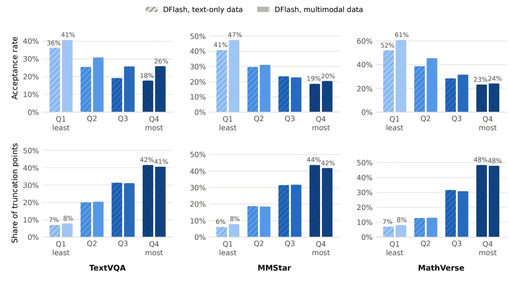
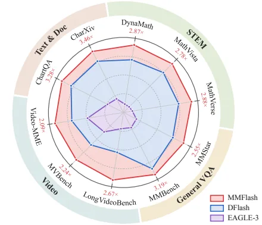

[Paper](https://arxiv.org/abs/2611.18482)
## MMFlash: Speculative Decoding That Focuses on the Tokens the Image Determines

## Introduction

Vision-language models read an image or video and produce an answer one token at a time. The longer the answer, the higher the generation cost, and for long videos the context that must be referenced at every token also grows. MMFlash targets both costs: it concentrates the training of a small candidate generator on the points where the image governs the next token, and it reduces the reference range on long videos.

## Background: Speculative Decoding and Block Diffusion

| Term | Meaning | Why it matters |
|---|---|---|
| Target model | The large vision-language model that verifies the final answer | It determines the output distribution, so it is what the drafter imitates. |
| Drafter | A candidate generator smaller than the target | It pre-generates several tokens and hands them to verification, accelerating decoding. |
| Speculative decoding | A scheme where the drafter produces candidates and the target verifies them in parallel | It speeds things up while keeping the same output distribution as target-only generation. |
| Acceptance length $\tau$ | The average number of tokens that survive one draft-verify cycle | One of the key metrics for speedup. |
| Acceptance rate | The fraction of proposed tokens that the target accepts | It shows where the drafter is weak. |
| Block diffusion | A generation scheme that fills masks in parallel in a single forward pass | It reduces the number of sequential forward passes in the drafter. |
| KL divergence | A measure of how different two probability distributions are | It measures how much the image changes the next-token prediction. |
| Concurrency | The number of requests a server handles at the same time | It is the condition under which speedup is checked in real serving. |

In speculative decoding, the target verifies the candidates in a single forward pass and accepts only the prefix that matches its own predictions. At the first mismatch, every subsequent candidate is discarded. Because of this rule, the final output distribution is identical to target-only generation; only the speed differs. Speedup is read as decode speed relative to the same target model without speculative decoding.

An autoregressive drafter must run one forward pass for each token it generates. As the draft length grows, the number of forward passes grows with it. DFlash breaks this relationship with block diffusion. A block consists of one anchor token and $B-1$ slots left empty as masks, and the drafter fills the masked slots simultaneously in a single forward pass (§3).

In training, it imitates the tokens chosen by the target with cross-entropy. However, it assigns a different weight to each position within the block. The weight of later slots is reduced as $w_k=\exp(-(k-1)/\gamma)$, because verification accepts only the prefix. If even one token at position $k$ is rejected, everything after it is discarded, so for the gradient of a later slot to translate into acceptance, all earlier positions must survive.

The ways of feeding visual input to the drafter fall into three categories (§2, Appendix A): providing the full image, providing only compressed visual information, or providing no visual tokens at all. MMFlash takes the third. Since the target has already fused the image information into its hidden states during prefill, the drafter only needs to read those states. As a result, drafter cost does not scale with the number of visual tokens.

## Problem: Acceptance Breaks Down at Tokens with High Visual Dependence

DFlash's training weights look only at position within the block. A token that continues a sentence and a token that reads a number off a chart receive the same gradient. But in speculative decoding, the drafter's goal is to imitate the target's next-token distribution. When the image accounts for a large share of the target's prediction, acceptance breaks down if the drafter cannot match that share.

MMFlash measures that share using the target model alone. It runs the target twice with the same text prefix $x_{\lt t}$, once with the image and once without. The KL divergence (Kullback–Leibler divergence) between the two next-token distributions is taken as that token's visual dependence (§4.1, Eq. 1).

$$d_t = \mathrm{KL}\big(p(\cdot \mid x_{\lt t}, I) \,\|\, p(\cdot \mid x_{\lt t})\big)$$

KL divergence is 0 when the two distributions are identical and grows as they differ. The reason for using the target, rather than the drafter or attention maps, as the reference is that acceptance requires matching the target's prediction. This score is computed once offline over the training data and stored. There is no extra computation during training, and it is not used in the inference path either (§4.2).

Consider a question that asks for the "rejection" rate from a chart. The number token corresponding to the answer is predicted stably only when the image is present, and without the image it is hard to reproduce the same probability from the text prefix alone. In that case $d_t$ is large. Conversely, tokens that connect sentences, such as "therefore" or "the answer is", are barely affected by the presence of the image, so $d_t$ is small. Figure 3 of the original shows whether this score lines up with the actual bottleneck.

Figure 3 of the original ([PDF p.4](https://arxiv.org/pdf/2611.18482#page=4)) used 200 samples each from TextVQA, MMStar, and MathVerse on Qwen3.5-4B, with up to 128 anchor positions per sample. The top panel shows the acceptance rate of draft tokens by quartile, and the bottom panel shows the share of blocks whose first rejection point falls in each quartile. The horizontal axis runs from Q1 (lowest visual dependence) to Q4 (highest), and the vertical axes are acceptance rate and truncation-point share, respectively. The original caption has no color legend, so we do not interpret color and read only the axes and values.

As visual dependence goes from Q1 to Q4, acceptance falls and truncation points cluster toward Q4. Average acceptance drops from 46% at Q1 to 22% at Q4 (a 2.1x difference), and 44% of first rejection points fall in Q4 while only 7% fall in Q1. Q3–Q4 combined is 72–80% (§4.1, Figure 3). The same shape holds for a drafter retrained on multimodal data.

The direction is the same at the block level. Grouping by the quartile of a block's first predicted token, acceptance falls from 33% at Q1 to 14% at Q4 (2.4x, Appendix B, Figure 5). Multimodal training raises Q1 by about 5%p but Q4 by less than 3%p. In other words, the acceptance loss is concentrated on tokens the image determines, and adding more data alone does not close this gap.

For illustration, shrinking the block from 16 slots to 4 to show the verification rule and state changes gives the following. These are reduced examples for explaining the method, not actual experimental values.

| Step | Input | Remaining state | Change / omission / rejection | Output |
|---|---|---|---|---|
| 1. Prefill | Text prefix $x_{\lt t}$ + image $I$ | Hidden state with image information fused by the target | The drafter receives only the hidden state and does not re-read visual tokens | Drafter context |
| 2. Draft | 1 anchor token + 3 mask slots | 4 candidates filled in a single forward pass | The drafter fills 4 slots simultaneously | Candidate block $[A,B,C,D]$ |
| 3. Verify | Candidate block + target | The target computes a probability for each position | $A,B$ accepted, first mismatch at $C$ → $C,D$ rejected | Accepted prefix $[A,B]$ + the target's bonus token |
| 4. Train | Ground-truth tokens at the same positions | Visual dependence $d_t$, quartile $g_t$, drafter probability $q_k$ | Upweights slots the image determines and the drafter still gets wrong | Gradient for the next step |

## Method

Figure 2 of the original ([PDF p.2](https://arxiv.org/pdf/2611.18482#page=2)) covers the whole method in one figure. The left panel (a) shows the difference between the two distributions obtained by running the same prefix $x_{\lt t}$ with and without the image $I$, and the structure in which the visual bonus computed from that difference is multiplied into the base weight $b_k$ of each mask slot. The right panel (b) is the part where 40K+ tokens of video context are reduced to about 1.6K tokens for the drafter.

### 1) Compute and store visual dependence

For each token $t$ in the training data, compute $d_t$ with Eq. 1. Fix the target model, image $I$, and prefix $x_{\lt t}$, and run two forward passes, with and without the image. The computed $d_t$ is attached to the training data and stored. The target is not run again during training.

Raw KL values are unbounded and heavy-tailed. So we use $\tilde g_t$, mapped to $[0,1]$ by rank over the whole training data (Appendix C.1, Eq. 5).

$$\tilde g_t = F_D(d_t) = \frac{1}{|D|}\sum_{t' \in D} \mathbf{1}[d_{t'} \le d_t]$$

The quartiles Q1–Q4 correspond to $\tilde g_t \in [0,0.25), [0.25,0.5), [0.5,0.75), [0.75,1]$, respectively. Visual dependence alone is not enough. For a token where the image changes the distribution but the target has not yet committed among the candidates, there is no committed answer to imitate even if the weight is raised. So we measure the entropy $H_t$ of the image-included distribution and multiply by $\exp(-H_t)$ (§4.2, Eq. 2). Lower entropy means the target is more confident.

$$g_t = \tilde g_t \cdot \exp(-H_t)$$

$g_t$ is largest at tokens where the image changes the prediction and simultaneously commits.

### 2) Multiply three signals to build the training weight

| Component | Computation | Role |
|---|---|---|
| Static visual score $g_k$ | Eqs. 1–2 | Is this a token the image changed and committed? |
| Base weight $b_k$ | $\prod_{i=1}^k \bar q_i$ | Probability that verification reaches this slot |
| Immaturity $1-\mathrm{sg}(q_k)$ | The drafter's current probability for the correct answer | Gives a bonus to slots it cannot yet get right |

$b_k$ is an estimate, from the drafter's own confidence, of the probability that verification survives to this slot. $\bar q_i=(1-\lambda)\mathrm{sg}(q_i)+\lambda$ keeps each factor at or above $\lambda$. This is a device to prevent the weight of a later slot from becoming 0 after a single early mistake. $(1-\mathrm{sg}(q_k))$ is the current failure probability, so the bonus is largest at the point where the drafter cannot yet get it right and shrinks toward 0 as training progresses. Rather than overfitting to image tokens, the weight shifts to other positions.

$$w_k = b_k \left(1 + \alpha\, g_k \left(1 - \mathrm{sg}(q_k)\right)\right), \qquad b_k = \prod_{i=1}^{k} \bar q_i, \quad \bar q_i = (1-\lambda)\,\mathrm{sg}(q_i) + \lambda$$

The default settings are $\alpha=1$ and $\lambda=0.5$. What changes is the magnitude of the gradient. The inputs and ground-truth targets stay the same; which slots the training effort concentrates on changes. Since $d_t$ is pre-attached to the training data, there is no computation that runs the target twice during training.

### 3) Reduce reference positions on long video

The bottleneck is a different kind from images. The average input length for image benchmarks is 477 tokens, but for video benchmarks it is 41,218 tokens (§4.2). The drafter sweeps the entire context with attention at every decoding step. Here we check where attention concentrates and whether acceptance holds when only a recent window is kept.

Figure 4 of the original ([PDF p.5](https://arxiv.org/pdf/2611.18482#page=5)) is read as follows. (a) is attention per decoding step for one LongVideoBench question. Attention concentrates on the question and the generated answer in the text, while visual tokens are faintly spread out with no standout frame. (b) overlays the cumulative attention share by distance from the current position (solid line) with the share of context tokens within that distance (dashed line). A region where the solid line substantially leads the dashed line is one where few tokens receive much attention. (c) is the change in average acceptance length $\tau$ when a recent 512-position window is applied.

Over 60 questions, the most recent 256 positions are 0.8% of the context but receive 50.1% of the attention. Distant frames make up more than 96% of the context yet share 46% of the attention (§4.2, Figure 4b). There is a strong bias toward recent positions, and far visual tokens are individually small but collectively take a substantial share of attention.

Applying a window naively may discard visual evidence outside the window that the answer needs. Indeed, a window of 512 reduces acceptance length on image benchmarks and increases it on video (Figure 4c). The resulting pattern is 4 leading sink tokens, visual tokens sampled at stride 32, all text tokens, and a local window of the most recent 256 tokens. Sink tokens are the early tokens where attention concentrates, and a stride of 32 means keeping one out of every 32 visual tokens. This reduces 40K+ tokens to about 1.6K. The same pattern is used in training and inference so that the range the drafter sees does not diverge (Figure 2b, §4.2, §5.2).

What shrinks is the number of positions the drafter references when computing attention at every step. The original does not report that this pattern changes the target model's KV cache or storage format, nor does it directly report attention FLOPs or kernel speed. What can be confirmed is that the context drops from 40K+ to about 1.6K, along with the resulting changes in acceptance length and speedup.

## Results

The comparison question is how many more tokens MMFlash accepts and how much actual decode time it cuts compared with methods trained on the same data, under the same target model, hardware, and framework. Unless noted otherwise: temperature 0, a single H200, SGLang, concurrency 1, 200 samples per benchmark, and draft block size 16 (§5.1). Training used 8×H100 with batch 2, 512 anchors, 6 epochs, and learning rate $6.0\times10^{-4}$. It generated up to 4096 tokens with top-p 0.95, top-k 20, and thinking mode disabled. SGLang and vLLM are inference serving frameworks. Temperature 1 and concurrency experiments are noted separately in the relevant tables. The original reports end-to-end decode speed, not per-kernel throughput.

### Image benchmarks

Figure 1 of the original ([PDF p.1](https://arxiv.org/pdf/2611.18482#page=1)) compares decode speedup of the three methods in SGLang by benchmark. We read the values in the later table rather than the fine-grained numbers in the figure. The claim this figure makes is the same as §5.2: MMFlash achieves the highest average acceptance length and speedup in every image-benchmark setting.

| Method (parentheses: MTP is the number of draft steps, EAGLE-3 is tree size, DFlash and MMFlash are block size) | Qwen3.5-4B $\tau$ / speedup | Qwen3.5-9B $\tau$ / speedup |
|---|---|---|
| MTP (15) | 4.38 / 1.19× | 4.81 / 1.27× |
| EAGLE-3 (16) | 3.86 / 1.58× | 3.45 / 1.68× |
| DFlash-z (16) | 4.71 / 2.62× | 4.62 / 2.70× |
| DFlash (16) | 5.12 / 2.72× | 4.95 / 2.75× |
| **MMFlash (16)** | **5.70 / 3.00×** | **5.60 / 3.05×** |

*Average over 7 image benchmarks, temperature 0, single H200, SGLang, concurrency 1 (original Table 1). Only the 15-step MTP row is reproduced. DFlash-z is the official released drafter (text-only training, 6 layers, hidden states extracted from target layer 8), while DFlash (5 layers, target 5 layers) and EAGLE-3 were trained on the same data as MMFlash (§5.1).*

In acceptance length, MMFlash at 5.70 beats DFlash at 5.12 (4B), and 5.60 beats 4.95 on 9B. Since both use block size 16 and therefore propose the same number of tokens at once, the difference comes from how many survive. Speedup rises from 2.72× to 3.00× (4B) and from 2.75× to 3.05× (9B). The gain in acceptance length translates into reduced processing time.

The greedy average of 3.00–3.05× is 10.3–10.9% higher than DFlash (Page 2). The direction is the same at temperature 1. MMFlash is 2.54–2.70× and DFlash is 2.38–2.46×, and §5.2 summarizes that, across both temperatures, it leads DFlash by 6.7–10.9%. 3.58× is the value for ChartQA at temperature 0 on Qwen3.5-9B. The "up to 195.4% over EAGLE-3 and up to 17.1% over DFlash" also given in the abstract are maximum values, and the body does not specify which item and condition they were computed from. These values are not numbers under the same conditions as the average improvement.

It also generalizes to other model families. On Gemma4-E4B-it, training EAGLE-3 and MMFlash on the same data gave 2.10–3.02×, and on Qwen3.8-27B, MMFlash gave 3.54–4.71× (Table 5). The Qwen3.8-27B comparison in Table 5 has no EAGLE-3 and only MTP and MMFlash, so the comparison scope for the two models is not the same.

### Long video

For video, we look at three stages. Conditions are temperature 0, with average context lengths of 41.6K tokens for LongVideoBench, 42.3K for MVBench, and 39.8K for Video-MME.

| Method (Qwen3.5, temperature 0) | LongVideoBench | MVBench | Video-MME |
|---|---|---|---|
| DFlash (16), 4B | 2.11× | 1.82× | 1.75× |
| MMFlash (16), 4B | 2.23× | 1.83× | 1.82× |
| + sparse attention, 4B | 2.44× | 2.05× | 1.93× |
| + fine-tuning, 4B | 2.67× | 2.24× | 2.09× |
| DFlash (16), 9B | 2.71× | 2.37× | 2.22× |
| MMFlash (16), 9B | 2.79× | 2.42× | 2.27× |
| + sparse attention, 9B | 2.81× | 2.49× | 2.21× |
| + fine-tuning, 9B | 3.07× | 2.66× | 2.39× |

*Original Table 2. Fine-tuning uses 2K samples from LLaVA-Video-178K for 3 epochs with the sparse attention pattern applied (§5.2). In the same table, MTP (15) is 1.00–1.31× for 4B and 1.10–1.34× for 9B, and EAGLE-3 (4) is 1.43–1.63× for 4B and 1.06–1.29× for 9B.*

Applying sparse attention alone without additional training raises average acceptance length by 11.1% and speedup by 4.7% (§5.2). Adding video fine-tuning increases the average improvement to 20.0% in acceptance length and 13.7% in speedup, and average speedup of 2.33–2.71× leads DFlash by 11.2–23.2%. However, it is not consistent across all items. On 9B Video-MME, sparse attention alone lowers the value from 2.27× to 2.21× relative to base MMFlash. The average improvement is driven by LongVideoBench and MVBench. Since the final video numbers include fine-tuning, they should not be compared directly with image-benchmark results that lack video fine-tuning.

### Concurrency and ablations

Raising serving concurrency generally reduces the speedup margin. For Qwen3.5-4B on CharXiv in SGLang, at concurrency 1 the baseline is 238 tok/s and MMFlash is 826 tok/s, 3.46×; at concurrency 32 it is 2733 tok/s versus 4395 tok/s, 1.61× (§5.3, Table 3). The drop occurs because higher concurrency pushes decoding into a compute-bound regime (§5.3). However, MMFlash throughput at concurrency 16 is higher than the concurrency-32 baseline in all six items. vLLM also records 1.17–3.72×, but because vLLM raises baseline throughput by 21–38% and MMFlash by 17–28% relative to SGLang, the speedup margin for Qwen3.5-4B is smaller than with SGLang. On Qwen3.5-9B, vLLM speedup is larger than SGLang at low concurrency (Appendix E.1, Table 8).

Design choices were ablated in three ways.

| Ablation | Change | Observation | Default |
|---|---|---|---|
| Test-time block size | 16 → 8 | Average speedup -5.3%, average $\tau$ -18.7%. On ChartQA and CharXiv, 28.8% and 27.6% of blocks already hit the acceptance ceiling of 8 | 16 |
| Drafter layers | 3 → 5 → 8 | 3→5 speedup +6.7–8.1%, 5→8 less than +1% | 5 |
| Target hidden states | 5 → 8 | $\tau$ rises but speedup gain at most 0.01×, online training time +19.9% | 5 |

A shorter block lowers the ceiling on how many tokens can be accepted at once. So speedup falls only 5.3% while acceptance length falls 18.7%. Going from 5 to 8 drafter layers yields less than 1% speedup gain, so 5 layers is the default. Reading target hidden states from 8 layers raises acceptance length but yields at most 0.01× speedup gain and increases online training time by 19.9% (Tables 4, 6, 7, §5.3).

## Limitations and Adoption Guidance

### Limitations acknowledged by the authors

MMFlash is designed and evaluated for vision-language models that take an image or video as input and generate text (Appendix F). For video, instead of a dedicated drafter that selects visual context to match the question or compresses redundancy across frames, it relies on a simple sparse attention pattern and lightweight fine-tuning. The paper notes that drafting on long video remains harder than on images. Extending to omni-modal models that also handle audio and speech streaming would require generalizing visual dependence to audio and audiovisual coupling criteria, and addressing longer audio-visual contexts and speech generation speedup.

### Reviewer's inference

- The visual dependence score is computed offline by running the target twice over the training data (§4.2). There is no extra computation at inference, but it must be recomputed if the training data changes or the target model is replaced. The cost is incurred only in training preprocessing.
- The concurrency experiments use a single H200 over concurrency 1–32 (§5.1, §5.3). The speedup margin under tensor parallelism or multi-GPU configurations is not reported in the original. The trend of shrinking speedup as concurrency rises would likely continue, but the original provides no evidence for how far.
- The final video numbers include fine-tuning (Table 2). The 4B results achieved without additional fine-tuning are 1.82–2.23× for base MMFlash and 1.93–2.44× with sparse attention. For 9B, base is 2.27–2.79× and with sparse attention 2.21–2.81×, which must be distinguished from the final 2.39–3.07×.
- The training data is about 900K samples regenerated by the target from LLaVA-OV-1.5-Instruct-Data. Some prompts were modified to elicit longer responses, and 37.0% were changed for 4B. As a result, the share of responses of 8 tokens or fewer fell from 12.5% to 1.0%, and the median response length for changed prompts rose from 3 tokens to 130 tokens (Appendix D.1). The original does not separately analyze the effect of changing the training data distribution.
- The training recipe for the official DFlash-z drafter has not been released (§5.1, footnote 3). Comparisons with DFlash-z must distinguish between using the official weights as-is and placing a DFlash trained on the same data under the same conditions.

### Adoption guidance

For single-GPU serving that mainly handles images, charts, and documents, consistent gains in acceptance length and speedup over DFlash trained on the same data have been reported, so it is worth considering (Table 1). Serving beyond concurrency 32, multi-GPU configurations, and workloads mixing audio and speech input are conditions not yet validated. Omitting fine-tuning on video reduces the gain (Table 2), and since the final video gain includes fine-tuning, anyone planning a video-only pipeline should also account for the training data and fine-tuning costs.

<!-- verbatim-tables -->

Tables from the paper

> Tables converted mechanically from the arXiv e-print LaTeX source. The numbers are the paper's own and did not pass through a model.

**Table 1. Decoding speedup over baseline and average acceptance length ($\tau$) on Qwen3.5 models across various benchmarks. Parenthesized values indicate the number of draft steps for MTP, the draft tree size for EAGLE-3, and the diffusion block size for DFlash & MMFlash.**

| Model | Method | Text & Doc |  |  |  | General VQA |  |  |  | STEM |  |  |  |  |  | *Avg.* |  |
|---|---|---|---|---|---|---|---|---|---|---|---|---|---|---|---|---|---|
|  |  | ChartQA |  | CharXiv |  | MMStar |  | MMBench |  | DynaMath |  | MathVista |  | MathVerse |  |  |  |
| Temperature $= 0$ |  | $\tau$ | Speedup | $\tau$ | Speedup | $\tau$ | Speedup | $\tau$ | Speedup | $\tau$ | Speedup | $\tau$ | Speedup | $\tau$ | Speedup | $\tau$ | Speedup |
| Qwen3.5-4B | MTP (3) | 3.18 | 1.69$\times$ | 3.27 | 1.76$\times$ | 2.95 | 1.61$\times$ | 2.43 | 1.40$\times$ | 3.27 | 1.69$\times$ | 3.18 | 1.68$\times$ | 3.17 | 1.69$\times$ | 3.06 | 1.64$\times$ |
|  | MTP (7) | 4.26 | 1.68$\times$ | 4.64 | 1.87$\times$ | 3.75 | 1.57$\times$ | 2.58 | 1.24$\times$ | 4.42 | 1.69$\times$ | 4.29 | 1.67$\times$ | 4.27 | 1.69$\times$ | 4.03 | 1.63$\times$ |
|  | MTP (15) | 4.67 | 1.26$\times$ | 5.37 | 1.43$\times$ | 3.99 | 1.14$\times$ | 2.60 | 0.87$\times$ | 4.76 | 1.23$\times$ | 4.65 | 1.21$\times$ | 4.61 | 1.22$\times$ | 4.38 | 1.19$\times$ |
|  | EAGLE-3 (16) | 4.31 | 1.74$\times$ | 4.38 | 1.86$\times$ | 3.49 | 1.49$\times$ | 2.61 | 1.08$\times$ | 4.29 | 1.67$\times$ | 4.02 | 1.56$\times$ | 3.95 | 1.68$\times$ | 3.86 | 1.58$\times$ |
|  | DFlash-z (16) | 4.92 | 2.76$\times$ | 5.63 | 3.10$\times$ | 3.81 | 2.35$\times$ | 5.01 | 2.62$\times$ | 4.82 | 2.56$\times$ | 4.43 | 2.45$\times$ | 4.34 | 2.50$\times$ | 4.71 | 2.62$\times$ |
|  | DFlash (16) | 5.43 | 2.97$\times$ | 5.60 | 3.13$\times$ | 4.05 | 2.31$\times$ | 5.17 | 2.93$\times$ | 5.57 | 2.57$\times$ | 5.16 | 2.53$\times$ | 4.84 | 2.62$\times$ | 5.12 | 2.72$\times$ |
|  | MMFlash (16) | **5.97** | **3.28$\times$** | **6.17** | **3.46$\times$** | **4.49** | **2.55$\times$** | **5.68** | **3.19$\times$** | **6.26** | **2.87$\times$** | **6.00** | **2.78$\times$** | **5.35** | **2.88$\times$** | **5.70** | **3.00$\times$** |
| Qwen3.5-9B | MTP (3) | 3.32 | 1.83$\times$ | 3.28 | 1.87$\times$ | 3.01 | 1.73$\times$ | 2.88 | 1.57$\times$ | 3.38 | 1.80$\times$ | 3.26 | 1.80$\times$ | 3.24 | 1.80$\times$ | 3.20 | 1.77$\times$ |
|  | MTP (7) | 4.66 | 1.88$\times$ | 4.60 | 1.94$\times$ | 3.91 | 1.66$\times$ | 3.55 | 1.41$\times$ | 4.74 | 1.77$\times$ | 4.52 | 1.78$\times$ | 4.43 | 1.77$\times$ | 4.34 | 1.74$\times$ |
|  | MTP (15) | 5.27 | 1.38$\times$ | 5.27 | 1.47$\times$ | 4.20 | 1.18$\times$ | 3.75 | 0.99$\times$ | 5.25 | 1.30$\times$ | 5.08 | 1.32$\times$ | 4.90 | 1.30$\times$ | 4.81 | 1.27$\times$ |
|  | EAGLE-3 (16) | 3.93 | 1.81$\times$ | 3.85 | 1.93$\times$ | 3.06 | 1.55$\times$ | 2.72 | 1.32$\times$ | 3.60 | 1.76$\times$ | 3.50 | 1.63$\times$ | 3.48 | 1.75$\times$ | 3.45 | 1.68$\times$ |
|  | DFlash-z (16) | 5.22 | 3.03$\times$ | 5.27 | 3.15$\times$ | 3.93 | 2.46$\times$ | 3.67 | 2.11$\times$ | 4.96 | 2.75$\times$ | 4.77 | 2.75$\times$ | 4.52 | 2.67$\times$ | 4.62 | 2.70$\times$ |
|  | DFlash (16) | 5.59 | 3.20$\times$ | 5.17 | 3.09$\times$ | 4.15 | 2.46$\times$ | 3.79 | 2.20$\times$ | 5.62 | 2.71$\times$ | 5.38 | 2.83$\times$ | 4.92 | 2.79$\times$ | 4.95 | 2.75$\times$ |
|  | MMFlash (16) | **6.19** | **3.58$\times$** | **5.67** | **3.42$\times$** | **4.58** | **2.67$\times$** | **4.20** | **2.39$\times$** | **6.44** | **3.02$\times$** | **6.49** | **3.17$\times$** | **5.60** | **3.10$\times$** | **5.60** | **3.05$\times$** |
| Temperature $= 1$ |  | $\tau$ | Speedup | $\tau$ | Speedup | $\tau$ | Speedup | $\tau$ | Speedup | $\tau$ | Speedup | $\tau$ | Speedup | $\tau$ | Speedup | $\tau$ | Speedup |
| Qwen3.5-4B | MTP (3) | 3.04 | 1.58$\times$ | 3.07 | 1.60$\times$ | 2.74 | 1.48$\times$ | 2.41 | 1.34$\times$ | 3.17 | 1.59$\times$ | 3.00 | 1.54$\times$ | 3.00 | 1.57$\times$ | 2.92 | 1.53$\times$ |
|  | MTP (7) | 3.93 | 1.53$\times$ | 4.26 | 1.68$\times$ | 3.41 | 1.40$\times$ | 2.58 | 1.14$\times$ | 4.22 | 1.55$\times$ | 3.97 | 1.49$\times$ | 3.91 | 1.52$\times$ | 3.75 | 1.48$\times$ |
|  | MTP (15) | 4.33 | 1.14$\times$ | 4.76 | 1.24$\times$ | 3.57 | 0.99$\times$ | 2.62 | 0.86$\times$ | 4.55 | 1.14$\times$ | 4.33 | 1.08$\times$ | 4.22 | 1.11$\times$ | 4.06 | 1.08$\times$ |
|  | EAGLE-3 (16) | 3.97 | 1.59$\times$ | 3.97 | 1.60$\times$ | 3.23 | 1.38$\times$ | 2.60 | 1.01$\times$ | 4.09 | 1.49$\times$ | 3.87 | 1.45$\times$ | 3.68 | 1.53$\times$ | 3.63 | 1.44$\times$ |
|  | DFlash-z (16) | 4.49 | 2.42$\times$ | 5.00 | 2.66$\times$ | 3.43 | 2.06$\times$ | 4.81 | 2.12$\times$ | 4.64 | 2.41$\times$ | 4.14 | 2.19$\times$ | 4.01 | 2.28$\times$ | 4.36 | 2.30$\times$ |
|  | DFlash (16) | 4.87 | 2.56$\times$ | 4.95 | 2.66$\times$ | 3.71 | 2.04$\times$ | 4.92 | 2.48$\times$ | 5.07 | 2.31$\times$ | 4.66 | 2.22$\times$ | 4.47 | 2.37$\times$ | 4.67 | 2.38$\times$ |
|  | MMFlash (16) | **5.23** | **2.74$\times$** | **5.39** | **2.86$\times$** | **3.96** | **2.18$\times$** | **5.25** | **2.58$\times$** | **5.75** | **2.56$\times$** | **5.23** | **2.37$\times$** | **4.69** | **2.49$\times$** | **5.07** | **2.54$\times$** |
| Qwen3.5-9B | MTP (3) | 3.19 | 1.72$\times$ | 3.08 | 1.72$\times$ | 2.86 | 1.61$\times$ | 2.78 | 1.49$\times$ | 3.25 | 1.70$\times$ | 3.11 | 1.69$\times$ | 3.11 | 1.71$\times$ | 3.05 | 1.66$\times$ |
|  | MTP (7) | 4.35 | 1.72$\times$ | 4.15 | 1.71$\times$ | 3.60 | 1.49$\times$ | 3.37 | 1.34$\times$ | 4.46 | 1.64$\times$ | 4.26 | 1.65$\times$ | 4.17 | 1.66$\times$ | 4.05 | 1.60$\times$ |
|  | MTP (15) | 4.84 | 1.24$\times$ | 4.57 | 1.27$\times$ | 3.81 | 1.06$\times$ | 3.53 | 0.93$\times$ | 4.92 | 1.22$\times$ | 4.65 | 1.18$\times$ | 4.56 | 1.21$\times$ | 4.41 | 1.16$\times$ |
|  | EAGLE-3 (16) | 3.60 | 1.67$\times$ | 3.56 | 1.72$\times$ | 2.84 | 1.42$\times$ | 2.59 | 1.23$\times$ | 3.46 | 1.61$\times$ | 3.32 | 1.50$\times$ | 3.29 | 1.62$\times$ | 3.24 | 1.54$\times$ |
|  | DFlash-z (16) | 4.77 | 2.64$\times$ | 4.70 | 2.76$\times$ | 3.66 | 2.25$\times$ | 3.42 | 1.97$\times$ | 4.71 | 2.57$\times$ | 4.49 | 2.51$\times$ | 4.26 | 2.49$\times$ | 4.29 | 2.46$\times$ |
|  | DFlash (16) | 4.94 | 2.75$\times$ | 4.50 | 2.65$\times$ | 3.74 | 2.18$\times$ | 3.55 | 2.02$\times$ | 5.24 | 2.52$\times$ | 4.85 | 2.52$\times$ | 4.53 | 2.57$\times$ | 4.48 | 2.46$\times$ |
|  | MMFlash (16) | **5.54** | **3.22$\times$** | **4.85** | **2.85$\times$** | **4.13** | **2.37$\times$** | **3.82** | **2.17$\times$** | **6.07** | **2.77$\times$** | **5.71** | **2.74$\times$** | **5.10** | **2.81$\times$** | **5.03** | **2.70$\times$** |

**Table 2. Average acceptance length ($\tau$) and decoding speedup over baseline on three video benchmarks at temperature $= 0$. The gray number under each benchmark gives its average context length.**

| Method | LongVideoBench |  | MVBench |  | Video-MME |  |
|---|---|---|---|---|---|---|
|  | $\sim$ 41.6 K tokens |  | $\sim$ 42.3 K tokens |  | $\sim$ 39.8 K tokens |  |
|  | $\tau$ | Speedup | $\tau$ | Speedup | $\tau$ | Speedup |
| **Qwen3.5-4B** |  |  |  |  |  |  |
| MTP (15) | 3.99 | 1.31$\times$ | 3.80 | 1.09$\times$ | **3.50** | 1.00$\times$ |
| EAGLE-3 (4) | 2.04 | 1.63$\times$ | 1.91 | 1.45$\times$ | 1.92 | 1.43$\times$ |
| DFlash (16) | 3.14 | 2.11$\times$ | 3.01 | 1.82$\times$ | 2.81 | 1.75$\times$ |
| MMFlash (16) | 3.23 | 2.23$\times$ | 2.91 | 1.83$\times$ | 2.86 | 1.82$\times$ |
| + sparse attn. | 3.81 | 2.44$\times$ | 3.50 | 2.05$\times$ | 3.20 | 1.93$\times$ |
| + fine-tuning | **4.09** | **2.67$\times$** | **3.83** | **2.24$\times$** | 3.45 | **2.09$\times$** |
| **Qwen3.5-9B** |  |  |  |  |  |  |
| MTP (15) | 4.07 | 1.34$\times$ | **3.94** | 1.26$\times$ | **3.73** | 1.10$\times$ |
| EAGLE-3 (4) | 1.88 | 1.29$\times$ | 1.67 | 1.06$\times$ | 1.79 | 1.25$\times$ |
| DFlash (16) | 3.56 | 2.71$\times$ | 3.19 | 2.37$\times$ | 3.21 | 2.22$\times$ |
| MMFlash (16) | 3.63 | 2.79$\times$ | 3.23 | 2.42$\times$ | 3.28 | 2.27$\times$ |
| + sparse attn. | 3.81 | 2.81$\times$ | 3.46 | 2.49$\times$ | 3.42 | 2.21$\times$ |
| + fine-tuning | **4.16** | **3.07$\times$** | 3.74 | **2.66$\times$** | 3.63 | **2.39$\times$** |

**Table 3. Decode throughput (tok/s), speedup over the baseline, and average acceptance length ($\tau$) on SGLang under increasing serving concurrency. For each MMFlash block the upper line reports throughput and the lower line the speedup at the same concurrency.**

| Task | Method | Concurrency 1 | Concurrency 4 | Concurrency 8 | Concurrency 16 | Concurrency 32 | *Avg.* $\tau$ |
|---|---|---|---|---|---|---|---|
| **Qwen3.5-4B** |  |  |  |  |  |  |  |
| CharXiv | Baseline | 238 | 794 | 1306 | 2094 | 2733 | -- |
|  | MMFlash | 826 | 2054 | 3102 | 3943 | 4395 | 6.23 |
|  |  | 3.46$\times$ | 2.59$\times$ | 2.37$\times$ | 1.88$\times$ | 1.61$\times$ |  |
| MMBench | Baseline | 242 | 453 | 672 | 1141 | 1748 | -- |
|  | MMFlash | 772 | 1032 | 1451 | 1929 | 2364 | 5.69 |
|  |  | 3.19$\times$ | 2.28$\times$ | 2.16$\times$ | 1.69$\times$ | 1.35$\times$ |  |
| DynaMath | Baseline | 239 | 836 | 1456 | 2276 | 3440 | -- |
|  | MMFlash | 685 | 1991 | 3081 | 4066 | 4643 | 6.27 |
|  |  | 2.87$\times$ | 2.38$\times$ | 2.12$\times$ | 1.79$\times$ | 1.35$\times$ |  |
| **Qwen3.5-9B** |  |  |  |  |  |  |  |
| ChartQA | Baseline | 174 | 633 | 1048 | 1694 | 1952 | -- |
|  | MMFlash | 623 | 1732 | 2438 | 3080 | 3685 | 6.21 |
|  |  | 3.58$\times$ | 2.73$\times$ | 2.33$\times$ | 1.82$\times$ | 1.89$\times$ |  |
| MMStar | Baseline | 172 | 633 | 1064 | 1697 | 2462 | -- |
|  | MMFlash | 460 | 1380 | 1964 | 2511 | 2814 | 4.59 |
|  |  | 2.67$\times$ | 2.18$\times$ | 1.85$\times$ | 1.48$\times$ | 1.14$\times$ |  |
| DynaMath | Baseline | 172 | 655 | 1155 | 1884 | 2665 | -- |
|  | MMFlash | 520 | 1645 | 2541 | 3308 | 3792 | 6.49 |
|  |  | 3.02$\times$ | 2.51$\times$ | 2.20$\times$ | 1.76$\times$ | 1.42$\times$ |  |

**Table 4. Effect of the test-time block size on MMFlash. Parenthesized values indicate the test-time block size for MMFlash. All drafters are trained with block size 16.**

| Model | Method | Text & Doc |  |  |  | General VQA |  |  |  | STEM |  |  |  |  |  | *Avg.* |  |
|---|---|---|---|---|---|---|---|---|---|---|---|---|---|---|---|---|---|
|  |  | ChartQA |  | CharXiv |  | MMStar |  | MMBench |  | DynaMath |  | MathVista |  | MathVerse |  |  |  |
|  |  | $\tau$ | Speedup | $\tau$ | Speedup | $\tau$ | Speedup | $\tau$ | Speedup | $\tau$ | Speedup | $\tau$ | Speedup | $\tau$ | Speedup | $\tau$ | Speedup |
| Qwen3.5-4B | MMFlash (8) | 4.70 | 3.01$\times$ | 4.77 | 3.13$\times$ | 3.80 | 2.49$\times$ | 4.52 | 2.89$\times$ | 4.92 | 2.80$\times$ | 4.68 | 2.74$\times$ | 4.43 | 2.83$\times$ | 4.55 | 2.84$\times$ |
|  | MMFlash (16) | 5.97 | 3.28$\times$ | 6.17 | 3.46$\times$ | 4.49 | 2.55$\times$ | 5.68 | 3.19$\times$ | 6.26 | 2.87$\times$ | 6.00 | 2.78$\times$ | 5.35 | 2.88$\times$ | 5.70 | 3.00$\times$ |
| Qwen3.5-9B | MMFlash (8) | 5.07 | 3.22$\times$ | 4.72 | 3.17$\times$ | 4.01 | 2.65$\times$ | 3.77 | 2.30$\times$ | 5.18 | 2.94$\times$ | 5.02 | 2.96$\times$ | 4.68 | 2.95$\times$ | 4.64 | 2.89$\times$ |
|  | MMFlash (16) | 6.19 | 3.58$\times$ | 5.67 | 3.42$\times$ | 4.58 | 2.67$\times$ | 4.20 | 2.39$\times$ | 6.44 | 3.02$\times$ | 6.49 | 3.17$\times$ | 5.60 | 3.10$\times$ | 5.60 | 3.05$\times$ |

**Table 5. Average acceptance length ($\tau$) and decoding speedup on Gemma4-E4B-it and Qwen3.8-27B at temperature $= 0$.**

| Method | ChartQA $\tau$ | ChartQA Speedup | MMStar $\tau$ | MMStar Speedup | DynaMath $\tau$ | DynaMath Speedup |
|---|---|---|---|---|---|---|
| **Gemma4-E4B-it** |  |  |  |  |  |  |
| MTP (5, official) | 3.81 | 1.78$\times$ | 3.19 | 1.48$\times$ | 4.04 | 1.89$\times$ |
| MTP (15) | 4.73 | 1.66$\times$ | 3.74 | 1.33$\times$ | 5.17 | 1.75$\times$ |
| EAGLE-3 (16) | 4.87 | 2.27$\times$ | 4.04 | 1.50$\times$ | 6.23 | 1.90$\times$ |
| MMFlash (16) | **6.39** | **2.87$\times$** | **4.83** | **2.10$\times$** | **7.15** | **3.02$\times$** |
| **Qwen3.8-27B** |  |  |  |  |  |  |
| MTP (7) | 5.19 | 2.90$\times$ | 4.55 | 2.59$\times$ | 5.48 | 3.07$\times$ |
| MTP (15) | 6.36 | 2.47$\times$ | 5.25 | 2.16$\times$ | 6.63 | 2.68$\times$ |
| MMFlash (16) | **6.37** | **4.18$\times$** | **5.36** | **3.54$\times$** | **7.57** | **4.71$\times$** |

**Table 6. Effect of the number of drafter layers on MMFlash for Qwen3.5-4B at temperature $= 0$. $n$-L denotes a drafter with $n$ layers; all drafters are trained with block size 16 and read hidden features from 5 layers of the target model.**

| Setting | CharXiv $\tau$ | CharXiv Speedup | MMBench $\tau$ | MMBench Speedup | DynaMath $\tau$ | DynaMath Speedup |
|---|---|---|---|---|---|---|
| 3-L | 5.56 | 3.25$\times$ | 4.69 | 2.86$\times$ | 5.78 | 2.70$\times$ |
| 5-L | 6.17 | 3.46$\times$ | 5.68 | 3.19$\times$ | 6.26 | 2.87$\times$ |
| 8-L | 6.39 | 3.42$\times$ | 6.21 | 3.21$\times$ | 6.69 | 2.88$\times$ |

**Table 7. Effect of the number of tapped target hidden states on MMFlash for Qwen3.5-4B at temperature $= 0$. $n$-H denotes a drafter that reads hidden features from $n$ layers of the target model; all drafters have 5 layers and are trained with block size 16.**

| Setting | CharXiv $\tau$ | CharXiv Speedup | MMBench $\tau$ | MMBench Speedup | DynaMath $\tau$ | DynaMath Speedup |
|---|---|---|---|---|---|---|
| 5-H | 6.17 | 3.46$\times$ | 5.68 | 3.19$\times$ | 6.26 | 2.87$\times$ |
| 8-H | 6.18 | 3.47$\times$ | 6.01 | 3.20$\times$ | 6.37 | 2.88$\times$ |

**Table 8. Decode throughput (tok/s), speedup over the baseline, and average acceptance length ($\tau$) on vLLM under increasing serving concurrency, complementing Table . For each MMFlash block the upper line reports throughput and the lower line the speedup at the same concurrency.**

| Task | Method | Concurrency 1 | Concurrency 4 | Concurrency 8 | Concurrency 16 | Concurrency 32 | *Avg.* $\tau$ |
|---|---|---|---|---|---|---|---|
| **Qwen3.5-4B** |  |  |  |  |  |  |  |
| CharXiv | Baseline | 284 | 1022 | 1783 | 2690 | 3772 | -- |
|  | MMFlash | 907 | 2555 | 3634 | 4590 | 5514 | 6.17 |
|  |  | 3.19$\times$ | 2.50$\times$ | 2.04$\times$ | 1.71$\times$ | 1.46$\times$ |  |
| MMBench | Baseline | 274 | 479 | 705 | 1051 | 1768 | -- |
|  | MMFlash | 923 | 836 | 1347 | 1717 | 2859 | 5.74 |
|  |  | 3.37$\times$ | 1.75$\times$ | 1.91$\times$ | 1.63$\times$ | 1.62$\times$ |  |
| DynaMath | Baseline | 295 | 1052 | 1829 | 3199 | 4159 | -- |
|  | MMFlash | 821 | 2430 | 3685 | 4705 | 5323 | 6.27 |
|  |  | 2.78$\times$ | 2.31$\times$ | 2.02$\times$ | 1.47$\times$ | 1.28$\times$ |  |
| **Qwen3.5-9B** |  |  |  |  |  |  |  |
| ChartQA | Baseline | 188 | 648 | 1241 | 1911 | 2133 | -- |
|  | MMFlash | 701 | 1975 | 2795 | 3318 | 3500 | 6.17 |
|  |  | 3.72$\times$ | 3.05$\times$ | 2.25$\times$ | 1.74$\times$ | 1.64$\times$ |  |
| MMStar | Baseline | 190 | 700 | 1253 | 2080 | 3076 | -- |
|  | MMFlash | 529 | 1663 | 2461 | 2893 | 3606 | 4.59 |
|  |  | 2.79$\times$ | 2.38$\times$ | 1.96$\times$ | 1.39$\times$ | 1.17$\times$ |  |
| DynaMath | Baseline | 189 | 708 | 1272 | 2128 | 3127 | -- |
|  | MMFlash | 602 | 1860 | 2810 | 3604 | 4001 | 6.57 |
|  |  | 3.18$\times$ | 2.63$\times$ | 2.21$\times$ | 1.69$\times$ | 1.28$\times$ |  |

> Figures in this post are taken from the original arXiv:2611.18482 (CC BY 4.0). Only size and format were changed.
