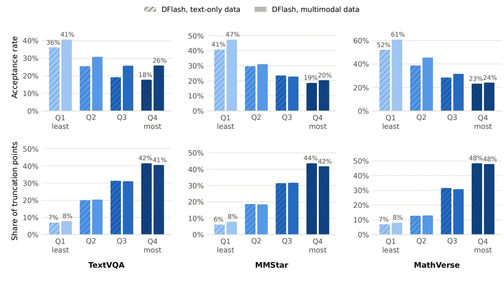
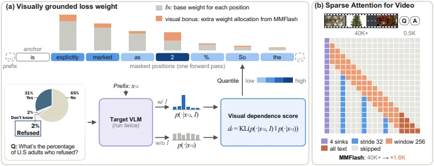
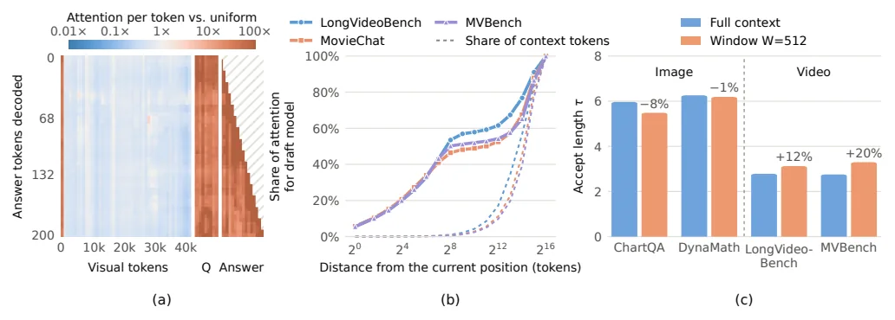
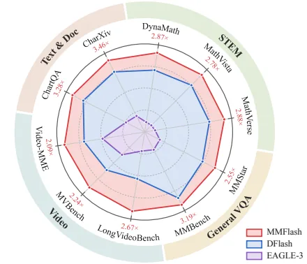

[논문 링크](https://arxiv.org/abs/2611.18482)
## MMFlash: 이미지가 결정하는 토큰에 집중하는 추측 디코딩

## 도입

비전-언어 모델은 이미지나 영상을 읽고 답을 한 토큰씩 만든다. 답이 길어질수록 생성 비용이 커지고, 긴 영상에서는 매 토큰마다 참조할 맥락까지 커진다. MMFlash는 이 두 비용을 줄이려는 방법으로, 이미지가 다음 토큰을 좌우하는 지점에 작은 후보 생성기의 학습을 집중하고 긴 영상에서는 참조 범위를 줄인다.

## 배경: 추측 디코딩과 블록 확산

| 용어 | 뜻 | 왜 필요한가 |
|---|---|---|
| 타깃 모델 | 최종 답을 검증하는 큰 비전-언어 모델 | 출력 분포를 결정하므로 드래프터가 흉내낼 대상이다. |
| 드래프터 | 타깃보다 작은 후보 생성기 | 여러 토큰을 미리 만들어 검증에 넘겨 디코딩을 가속한다. |
| 추측 디코딩 | 드래프터가 후보를 만들고 타깃이 병렬 검증하는 방식 | 타깃 단독 생성과 같은 출력 분포를 유지하면서 속도를 높인다. |
| 수용 길이 $\tau$ | 한 번의 드래프트·검증 주기에서 평균적으로 살아남는 토큰 수 | 가속률의 핵심 지표 중 하나다. |
| 수용률 | 제안한 토큰 중 타깃이 받아들인 비율 | 어느 토큰에서 드래프터가 약한지 보여 준다. |
| 블록 확산 | 마스크를 한 번의 순전파로 병렬로 채우는 생성 방식 | 드래프터의 순차 순전파 횟수를 줄인다. |
| KL 발산 | 두 확률 분포가 얼마나 다른지 재는 값 | 이미지가 다음 토큰 예측을 얼마나 바꾸는지 잰다. |
| 동시성 | 서버가 동시에 처리하는 요청 수 | 실제 서빙에서 가속이 유지되는지 보는 조건이다. |

추측 디코딩에서 타깃은 후보를 한 번의 순전파로 검증하고, 타깃 예측과 일치하는 접두사만 받아들인다. 첫 불일치가 나오면 그 뒤 후보는 모두 버린다. 이 규칙 때문에 최종 출력 분포는 타깃 단독 생성과 같고, 속도만 달라진다. 가속 배수는 추측 디코딩을 쓰지 않은 같은 타깃 모델 대비 디코드 속도로 읽는다.

자동회귀 드래프터는 토큰을 하나 만들 때마다 순전파를 한 번씩 해야 한다. 드래프트 길이가 길어지면 순전파 횟수도 같이 늘어난다. DFlash는 블록 확산으로 이 관계를 끊는다. 한 블록은 앵커 토큰 1개와 마스크로 비워 둔 $B-1$개 칸으로 이루어지고, 드래프터는 한 번의 순전파로 마스크 칸을 동시에 채운다(§3).

학습에서는 타깃이 고른 토큰을 교차 엔트로피로 흉내낸다. 다만 블록 안 위치마다 가중치를 다르게 준다. 뒤쪽 칸의 가중치를 $w_k=\exp(-(k-1)/\gamma)$로 줄인다. 검증이 접두사만 받아들이기 때문이다. 위치 $k$에서 한 토큰이라도 거절되면 그 뒤는 모두 폐기되므로, 뒤쪽 칸의 그래디언트가 수용으로 이어지려면 앞쪽이 전부 살아남아야 한다.

시각 입력을 드래프터에 주는 방식은 세 갈래로 정리된다(§2, Appendix A). 전체 이미지를 주거나, 압축한 시각 정보만 주거나, 시각 토큰을 아예 주지 않는 방식이다. MMFlash는 세 번째를 택한다. 타깃이 프리필 단계에서 이미지 정보를 숨겨진 상태에 융합해 두었으므로, 드래프터는 그 상태만 읽으면 된다. 그래서 드래프터 비용이 시각 토큰 수에 비례하지 않는다.

## 문제: 시각 의존도가 높은 토큰에서 수용이 끊긴다

DFlash의 학습 가중치는 블록 안 위치만 본다. 문장을 이어 쓰는 토큰과 차트에서 숫자를 읽어 오는 토큰이 같은 그래디언트를 받는다. 그러나 추측 디코딩에서 드래프터의 목표는 타깃의 다음 토큰 분포를 흉내내는 것이다. 타깃 예측 중 이미지가 차지하는 몫이 크면, 드래프터가 그 몫을 맞히지 못할 때 수용이 끊긴다.

MMFlash는 타깃 모델만으로 그 몫을 잰다. 같은 텍스트 프리픽스 $x_{\lt t}$를 두고 이미지를 넣은 경우와 뺀 경우로 타깃을 두 번 돌린다. 두 다음 토큰 분포의 KL 발산(쿨백-라이블러 발산)을 그 토큰의 시각 의존도로 삼는다(§4.1, 식 1).

$$d_t = \mathrm{KL}\big(p(\cdot \mid x_{\lt t}, I) \,\|\, p(\cdot \mid x_{\lt t})\big)$$

KL 발산은 두 분포가 같으면 0이고, 다를수록 커진다. 드래프터나 어텐션 맵이 아니라 타깃을 기준으로 삼는 이유는 검증이 타깃 예측과 일치해야만 수용되기 때문이다. 이 점수는 학습 데이터에 대해 오프라인으로 한 번 계산해 저장한다. 학습 중 추가 계산은 없고, 추론 경로에도 쓰지 않는다(§4.2).

차트에서 “거절” 비율을 묻는 질문을 생각하자. 답에 해당하는 숫자 토큰은 이미지가 있어야 예측이 안정되고, 이미지를 빼면 텍스트 프리픽스만으로는 같은 확률을 재현하기 어렵다. 이때 $d_t$가 커진다. 반대로 “따라서”나 “정답은”처럼 문장을 잇는 토큰은 이미지 유무에 거의 영향받지 않아 $d_t$가 작다. 원문 Figure 3은 이 점수가 실제 병목과 맞물리는지 보여 준다.

원문 Figure 3([PDF p.4](https://arxiv.org/pdf/2611.18482#page=4))은 Qwen3.5-4B에 TextVQA·MMStar·MathVerse 세 벤치마크의 샘플 200개씩, 샘플당 최대 128개 앵커 위치를 썼다. 위쪽 패널은 사분위별 드래프트 토큰 수용률, 아래쪽 패널은 블록의 첫 거절 지점이 어느 사분위에 몰리는지의 비중이다. 가로축은 Q1(시각 의존도 최소)에서 Q4(최대)로 가고, 세로축은 각각 수용률과 잘림 지점 비중이다. 원문 캡션에 색 범례가 없으므로 색은 해석하지 않고 축과 값만 읽는다.

시각 의존도가 Q1에서 Q4로 갈수록 수용률이 내려가고, 잘림 지점은 Q4 쪽에 몰린다. 평균 수용률은 Q1 46%에서 Q4 22%로 떨어지고(2.1배 차이), 첫 거절 지점의 44%가 Q4에 몰리는 반면 Q1은 7%에 그친다. Q3–Q4를 합치면 72–80%다(§4.1·Figure 3). 멀티모달 데이터로 다시 학습한 드래프터에서도 같은 형태가 유지된다.

블록 단위로도 방향은 같다. 블록의 첫 예측 토큰이 속한 사분위로 묶으면 수용률이 Q1 33%에서 Q4 14%로 내려간다(2.4배, Appendix B·Figure 5). 멀티모달 학습은 Q1을 약 5%p 올리지만 Q4는 3%p 미만 올린다. 즉 수용 손실이 이미지가 결정하는 토큰에 집중되어 있고, 데이터만 늘리는 것으로는 이 격차가 닫히지 않는다.

설명을 위해 블록을 16칸에서 4칸으로 줄여 검증 규칙과 상태 변화를 보이면 다음과 같다. 실제 실험 값이 아니라 방법 설명용 축소 예시다.

| 단계 | 입력 | 남는 상태 | 변경·생략·거절 | 출력 |
|---|---|---|---|---|
| 1. 프리필 | 텍스트 프리픽스 $x_{\lt t}$ + 이미지 $I$ | 타깃이 이미지 정보를 융합한 숨겨진 상태 | 드래프터는 시각 토큰을 다시 읽지 않고 숨겨진 상태만 받음 | 드래프터의 컨텍스트 |
| 2. 드래프트 | 앵커 토큰 1개 + 마스크 3칸 | 한 번의 순전파로 채운 후보 4개 | 드래프터가 4칸을 동시에 채움 | 후보 블록 $[A,B,C,D]$ |
| 3. 검증 | 후보 블록 + 타깃 | 타깃이 각 위치의 확률을 계산 | $A,B$ 수용, $C$에서 첫 불일치 → $C,D$ 거절 | 수용 접두사 $[A,B]$ + 타깃의 보너스 토큰 |
| 4. 학습 | 같은 위치의 정답 토큰 | 시각 의존도 $d_t$, 사분위 $g_t$, 드래프터 확률 $q_k$ | 이미지가 결정하고 아직 틀리는 칸의 가중치를 키움 | 다음 스텝의 그래디언트 |

## 방법

원문 Figure 2([PDF p.2](https://arxiv.org/pdf/2611.18482#page=2))은 방법 전체를 한 장에 담았다. 왼쪽 패널 (a)는 같은 프리픽스 $x_{\lt t}$를 이미지 $I$의 유무 두 경우로 돌려 얻은 두 분포의 차이, 그리고 그 차이에서 계산한 시각 보너스가 각 마스크 칸의 기본 가중치 $b_k$에 곱해지는 구조를 보여 준다. 오른쪽 패널 (b)는 40K+ 토큰의 영상 맥락이 드래프터에게 약 1.6K 토큰으로 줄어드는 부분이다.

### 1) 시각 의존도를 계산해 저장한다

학습 데이터의 각 토큰 $t$에 대해 식 1로 $d_t$를 계산한다. 타깃 모델, 이미지 $I$, 프리픽스 $x_{\lt t}$를 고정하고 이미지 포함·제외 두 번의 순전파를 한다. 계산된 $d_t$는 학습 데이터에 붙여 저장한다. 학습 중에 타깃을 다시 돌리지 않는다.

원시 KL 값은 범위가 없고 꼬리가 두껍다. 그래서 학습 데이터 전체에서의 순위로 $[0,1]$에 매핑한 $\tilde g_t$를 쓴다(Appendix C.1, 식 5).

$$\tilde g_t = F_D(d_t) = \frac{1}{|D|}\sum_{t' \in D} \mathbf{1}[d_{t'} \le d_t]$$

사분위 Q1–Q4는 각각 $\tilde g_t \in [0,0.25), [0.25,0.5), [0.5,0.75), [0.75,1]$에 대응한다. 시각 의존도만으로는 부족하다. 이미지가 분포를 바꾸는데 타깃이 아직 후보들 사이에서 확정하지 못한 토큰은, 가중치를 올려도 흉내낼 확정 답이 없다. 그래서 이미지 포함 분포의 엔트로피 $H_t$를 재고 $\exp(-H_t)$를 곱한다(§4.2, 식 2). 엔트로피가 낮을수록 타깃이 확신한다는 뜻이다.

$$g_t = \tilde g_t \cdot \exp(-H_t)$$

$g_t$는 이미지가 예측을 바꾸고 동시에 확정한 토큰에서 가장 크다.

### 2) 세 신호를 곱해 학습 가중치를 만든다

| 요소 | 계산 | 역할 |
|---|---|---|
| 정적 시각 점수 $g_k$ | 식 1–2 | 이미지가 바꾸고 확정한 토큰인가 |
| 기본 가중치 $b_k$ | $\prod_{i=1}^k \bar q_i$ | 검증이 그 칸까지 도달할 확률 |
| 미숙함 $1-\mathrm{sg}(q_k)$ | 드래프터의 현재 정답 확률 | 아직 못 맞추는 칸에 보너스를 줌 |

$b_k$는 검증이 이 칸까지 살아남을 확률을 드래프터 자신의 확신도로 추정한 값이다. $\bar q_i=(1-\lambda)\mathrm{sg}(q_i)+\lambda$로 각 인자를 $\lambda$ 이상으로 유지한다. 앞에서 한 번 틀려도 뒤 칸의 가중치가 0이 되지 않게 하려는 장치다. $(1-\mathrm{sg}(q_k))$는 현재 실패 확률이라, 아직 못 맞춘 시점에 보너스가 가장 크고 학습이 진행되면 0으로 줄어든다. 이미지 토큰에 과적합되는 대신 가중치가 다른 자리로 옮겨가는 구조다.

$$w_k = b_k \left(1 + \alpha\, g_k \left(1 - \mathrm{sg}(q_k)\right)\right), \qquad b_k = \prod_{i=1}^{k} \bar q_i, \quad \bar q_i = (1-\lambda)\,\mathrm{sg}(q_i) + \lambda$$

기본 설정은 $\alpha=1$, $\lambda=0.5$다. 바뀌는 것은 그래디언트의 크기다. 입력과 타깃의 정답은 그대로이고, 어느 칸에 학습 노력이 몰리느냐가 달라진다. 학습 데이터에는 $d_t$가 미리 붙어 있으므로 학습 중 타깃을 두 번 돌리는 계산은 없다.

### 3) 긴 영상에서는 참조 위치를 줄인다

병목의 종류가 이미지와 다르다. 이미지 벤치마크의 평균 입력 길이는 477 토큰이지만 영상 벤치마크는 41,218 토큰이다(§4.2). 드래프터는 매 디코딩 스텝 전체 맥락을 어텐션으로 훑는다. 여기서 어텐션이 어디에 몰리는지, 최근 창만 남겨도 수용이 유지되는지 확인한다.

원문 Figure 4([PDF p.5](https://arxiv.org/pdf/2611.18482#page=5))를 읽는 방법은 다음과 같다. (a)는 LongVideoBench 한 질문의 디코딩 스텝별 어텐션이다. 텍스트에 해당하는 질문과 생성된 답변 쪽에 어텐션이 집중하고, 시각 토큰은 희미하게 분산되어 두드러진 프레임이 없다. (b)는 현재 위치로부터의 거리별 누적 어텐션 점유율(실선)과 그 거리 안에 드는 컨텍스트 토큰 비중(점선)을 겹친 것이다. 실선이 점선을 크게 앞지르는 구간은 적은 토큰이 많은 어텐션을 받는 구간이다. (c)는 최근 512 위치 윈도를 적용했을 때의 평균 수용 길이 $\tau$ 변화다.

60개 질문에서 최근 256 위치는 맥락의 0.8%인데 어텐션의 50.1%를 받는다. 멀리 있는 프레임은 맥락의 96% 넘게 차지하면서 어텐션의 46%를 나눠 받는다(§4.2·Figure 4b). 최근 위치에 강한 편향이 있고, 먼 시각 토큰은 개별적으로는 적게 보지만 전체로는 상당한 어텐션을 나눠 갖는다.

창을 그냥 씌우면 창 밖의 시각 증거가 질문 답에 필요할 수 있다. 실제로 윈도 512는 이미지 벤치마크에서는 수용 길이를 줄이고 영상에서는 늘린다(Figure 4c). 그래서 만든 패턴이 앞쪽 sink 토큰 4개, 간격 32로 샘플링한 시각 토큰, 모든 텍스트 토큰, 최근 256 토큰의 로컬 윈도다. sink 토큰은 어텐션이 몰리는 앞쪽 토큰이고, 간격 32는 시각 토큰을 32개마다 하나씩 남긴다는 뜻이다. 이렇게 40K+ 토큰을 약 1.6K로 줄인다. 학습과 추론에서 같은 패턴을 써서 드래프터가 보는 범위가 어긋나지 않게 한다(Figure 2b·§4.2·§5.2).

줄어드는 것은 드래프터가 매 스텝 어텐션을 계산할 때 참조하는 위치 수다. 원문은 이 패턴이 타깃 모델의 KV 캐시나 저장 형식을 바꾼다고 보고하지 않으며, 어텐션 FLOPs나 커널 속도도 직접 보고하지 않는다. 확인할 수 있는 것은 컨텍스트가 40K+에서 약 1.6K로 줄어든 것과, 그에 따른 수용 길이·가속률 변화다.

## 결과

비교 질문은 같은 타깃 모델·하드웨어·프레임워크에서, 같은 데이터로 학습한 방법들과 비교해 MMFlash가 얼마나 더 많은 토큰을 수용하고 실제 디코드 시간을 얼마나 줄이는가다. 별도 표기가 없으면 온도 0, 단일 H200, SGLang, 동시성 1, 벤치마크당 샘플 200개, 드래프트 블록 크기 16이다(§5.1). 학습은 8×H100에서 배치 2, 앵커 512, 6 epoch, 학습률 $6.0\times10^{-4}$로 했다. 최대 4096 토큰을 생성하고 top-p 0.95, top-k 20, 사고 모드는 비활성화했다. SGLang과 vLLM은 추론 서빙 프레임워크다. 온도 1과 동시성 실험은 해당 표에서 따로 표기한다. 원문은 커널 단위 처리량이 아니라 전 구간 디코드 속도를 보고한다.

### 이미지 벤치마크

원문 Figure 1([PDF p.1](https://arxiv.org/pdf/2611.18482#page=1))은 SGLang에서 세 방법의 디코드 가속률을 벤치마크별로 비교한 그림이다. 그림의 세부 수치보다는 뒤 표의 값을 기준으로 읽는다. 이 그림이 말하는 주장은 §5.2와 같다. 이미지 벤치마크의 모든 설정에서 MMFlash가 가장 높은 평균 수용 길이와 가속률을 얻는다.

| 방법 (괄호: MTP는 드래프트 스텝 수, EAGLE-3는 트리 크기, DFlash·MMFlash는 블록 크기) | Qwen3.5-4B $\tau$ / 가속 | Qwen3.5-9B $\tau$ / 가속 |
|---|---|---|
| MTP (15) | 4.38 / 1.19× | 4.81 / 1.27× |
| EAGLE-3 (16) | 3.86 / 1.58× | 3.45 / 1.68× |
| DFlash-z (16) | 4.71 / 2.62× | 4.62 / 2.70× |
| DFlash (16) | 5.12 / 2.72× | 4.95 / 2.75× |
| **MMFlash (16)** | **5.70 / 3.00×** | **5.60 / 3.05×** |

*7개 이미지 벤치마크 평균, 온도 0, 단일 H200, SGLang, 동시성 1 (원문 Table 1). MTP는 15스텝 행만 옮겼다. DFlash-z는 공식 공개 드래프터(텍스트 전용 학습, 6층, 타깃 8층에서 숨겨진 상태 추출)이고, DFlash(5층, 타깃 5층)와 EAGLE-3는 MMFlash와 같은 데이터로 학습한 것이다(§5.1).*

수용 길이에서 DFlash 5.12를 MMFlash 5.70이 이기고(4B), 9B에서도 4.95를 5.60이 이긴다. 블록 크기가 16으로 같아 한 번에 제안하는 토큰 수가 같으므로, 차이는 “몇 개가 살아남느냐”에서 나온다. 가속 배수는 2.72× → 3.00×(4B), 2.75× → 3.05×(9B)로 올라간다. 수용 길이의 증가가 처리 시간 단축으로 이어진 것이다.

greedy 평균 3.00–3.05×는 DFlash보다 10.3–10.9% 높다(Page 2). 온도 1에서도 방향은 같다. MMFlash는 2.54–2.70×, DFlash는 2.38–2.46×이며, §5.2는 두 온도를 합쳐 DFlash 대비 6.7–10.9% 앞선다고 요약한다. 3.58×는 Qwen3.5-9B의 ChartQA, 온도 0 항목의 값이다. 초록이 함께 제시한 “EAGLE-3 대비 최대 195.4%, DFlash 대비 최대 17.1%”는 최대치이며, 어떤 항목·조건에서 계산된 것인지는 본문에 명시되지 않는다. 이 값들은 평균 개선률과 같은 조건의 숫자가 아니다.

다른 모델 계열로도 일반화한다. Gemma4-E4B-it에서는 EAGLE-3와 MMFlash를 같은 데이터로 학습해 2.10–3.02×를 기록했고, Qwen3.8-27B에서는 MMFlash가 3.54–4.71×를 기록했다(Table 5). Table 5의 Qwen3.8-27B 비교에는 EAGLE-3가 없고 MTP와 MMFlash만 있으므로, 두 모델의 비교 범위는 같지 않다.

### 긴 영상

영상에서는 세 단계를 나눠 본다. 조건은 온도 0이고, 평균 컨텍스트 길이는 LongVideoBench 41.6K, MVBench 42.3K, Video-MME 39.8K 토큰이다.

| 방법 (Qwen3.5, 온도 0) | LongVideoBench | MVBench | Video-MME |
|---|---|---|---|
| DFlash (16), 4B | 2.11× | 1.82× | 1.75× |
| MMFlash (16), 4B | 2.23× | 1.83× | 1.82× |
| + 희소 어텐션, 4B | 2.44× | 2.05× | 1.93× |
| + 미세조정, 4B | 2.67× | 2.24× | 2.09× |
| DFlash (16), 9B | 2.71× | 2.37× | 2.22× |
| MMFlash (16), 9B | 2.79× | 2.42× | 2.27× |
| + 희소 어텐션, 9B | 2.81× | 2.49× | 2.21× |
| + 미세조정, 9B | 3.07× | 2.66× | 2.39× |

*원문 Table 2. 미세조정은 LLaVA-Video-178K 샘플 2K로 3 epoch, 희소 어텐션 패턴을 적용한 것이다(§5.2). 같은 표에서 MTP(15)는 4B 1.00–1.31×, 9B 1.10–1.34×이고, EAGLE-3(4)는 4B 1.43–1.63×, 9B 1.06–1.29×다.*

추가 학습 없이 희소 어텐션만 적용하면 평균 수용 길이 11.1%, 가속 4.7%가 올라간다(§5.2). 영상 미세조정을 얹으면 평균 개선폭이 수용 길이 20.0%, 가속 13.7%로 커지고, 평균 가속 2.33–2.71×로 DFlash보다 11.2–23.2% 앞선다. 다만 모든 항목에서 일관되지는 않는다. 9B Video-MME에서는 희소 어텐션만 적용한 값이 기본 MMFlash보다 2.27×에서 2.21×로 낮아진다. 평균 개선은 LongVideoBench와 MVBench가 끌어올린 것이다. 영상의 최종 숫자에는 미세조정이 들어가므로, 영상 미세조정이 없는 이미지 벤치마크 결과와 직접 비교하면 안 된다.

### 동시성과 절제 실험

서비스 동시성을 올리면 가속 폭은 대체로 줄어든다. SGLang에서 Qwen3.5-4B의 CharXiv를 보면 동시성 1에서 기준 238 tok/s에 MMFlash 826 tok/s로 3.46×이고, 동시성 32에서는 2733 tok/s 대 4395 tok/s로 1.61×다(§5.3·Table 3). 동시성이 높아지면 디코드가 계산 제한 구간으로 들어가기 때문에 생기는 감소다(§5.3). 다만 동시성 16의 MMFlash 처리량은 여섯 개 항목 모두에서 동시성 32의 기준선보다 높다. vLLM에서도 1.17–3.72×를 기록하지만, SGLang 대비 vLLM이 기준선 처리량을 21–38%, MMFlash를 17–28% 올려서 Qwen3.5-4B의 가속 폭은 SGLang보다 작다. Qwen3.5-9B에서는 낮은 동시성에서 vLLM 쪽 가속이 SGLang보다 크다(Appendix E.1·Table 8).

설계 선택은 세 가지로 절제 실험했다.

| 절제 항목 | 변경 | 관찰 | 기본 선택 |
|---|---|---|---|
| 테스트 시 블록 크기 | 16 → 8 | 평균 가속 -5.3%, 평균 $\tau$ -18.7%. ChartQA·CharXiv에서 블록의 28.8%·27.6%가 수용 상한 8에 이미 닿음 | 16 |
| 드래프터 층수 | 3 → 5 → 8 | 3→5 가속 +6.7–8.1%, 5→8 +1% 미만 | 5 |
| 타깃 숨겨진 상태 | 5 → 8 | $\tau$는 오르지만 가속 이득 최대 0.01×, 온라인 학습 시간 +19.9% | 5 |

짧은 블록은 한 번에 받아낼 수 있는 토큰 상한을 낮춘다. 그래서 가속은 5.3%만 떨어지는데 수용 길이는 18.7% 떨어진다. 드래프터 층수는 5층에서 8층으로 늘려도 가속 이득이 1% 미만이라 5층을 기본으로 둔다. 타깃 숨겨진 상태를 8개 층에서 읽으면 수용 길이는 오르지만 가속 이득이 최대 0.01×에 그치고 온라인 학습 시간이 19.9% 늘어난다(Table 4·6·7·§5.3).

## 한계와 적용 판단

### 저자가 인정한 한계

MMFlash는 이미지나 영상을 입력으로 받아 텍스트를 생성하는 비전-언어 모델을 위해 설계되고 평가됐다(Appendix F). 영상에서는 질문에 맞춰 시각 맥락을 고르거나 프레임 간 중복을 압축하는 전용 드래프터 대신, 단순한 희소 어텐션 패턴과 경량 미세조정에 의존한다. 긴 영상에서의 드래프트는 이미지보다 여전히 어렵다고 적혀 있다. 오디오와 음성 스트리밍을 함께 다루는 옴니모달 모델로 확장하려면 시각 의존도를 오디오·시청각 결합 기준으로 일반화하고, 더 긴 오디오-시각 맥락과 음성 생성 가속까지 다뤄야 한다.

### 리뷰어의 추론

- 시각 의존도 점수는 학습 데이터에 대해 타깃을 두 번 돌려 오프라인으로 계산한다(§4.2). 추론 시 추가 계산은 없지만, 학습 데이터를 바꾸거나 타깃 모델을 교체하면 다시 계산해야 한다. 비용이 학습 전처리에만 든다는 조건이다.
- 동시성 실험은 한 장의 H200, 동시성 1–32 범위다(§5.1·§5.3). 텐서 병렬·다중 GPU 구성에서의 가속 폭은 원문 미보고다. 동시성이 높아질수록 가속 폭이 줄어드는 경향이 이어질 것으로 보이지만, 어디까지인지는 원문에 근거가 없다.
- 영상 최종 수치는 미세조정을 포함한 결과다(Table 2). 추가 미세조정 없이 달성한 4B 결과는 MMFlash 기본 1.82–2.23×, 희소 어텐션 적용 1.93–2.44×다. 9B도 기본 2.27–2.79×, 희소 어텐션 적용 2.21–2.81×로, 최종 2.39–3.07×와 구분해야 한다.
- 학습 데이터는 LLaVA-OV-1.5-Instruct-Data에서 타깃이 재생성한 약 900K 샘플이다. 일부 프롬프트는 더 긴 응답을 유도하도록 바꿔 두었고, 4B 기준 37.0%가 바뀌었다. 그 결과 8토큰 이하 응답 비중이 12.5%에서 1.0%로 줄고, 바뀐 프롬프트의 응답 중앙값은 3토큰에서 130토큰으로 늘었다(Appendix D.1). 학습 데이터 분포를 바꿨을 때의 효과는 원문에서 별도로 분석하지 않는다.
- 공식 DFlash-z 드래프터의 학습 레시피는 공개되지 않았다(§5.1 각주 3). DFlash-z와의 비교는 공식 가중치를 그대로 쓴 것과, 같은 데이터로 학습한 DFlash를 같은 조건에 놓은 것으로 구분해서 봐야 한다.

### 적용 판단

이미지·차트·문서를 주로 다루는 단일 GPU 서빙이라면, 같은 데이터로 학습한 DFlash 대비 수용 길이와 가속에서 일관된 이득이 보고됐으므로 검토할 가치가 있다(Table 1). 동시성 32를 넘는 서빙, 다중 GPU 구성, 오디오·음성 입력이 섞인 워크로드는 아직 검증되지 않은 조건이다. 영상에서 미세조정을 생략하면 이득이 줄어들고(Table 2), 영상의 최종 이득은 미세조정을 포함한 값이므로 영상 전용 파이프라인을 만들 계획이라면 학습 데이터와 미세조정 비용까지 함께 계산해야 한다.

<!-- verbatim-tables -->

논문 원문의 표

> arXiv e-print 의 LaTeX 원본에서 기계적으로 옮긴 표입니다. 숫자는 논문의 값이며 모델을 거치지 않았습니다.

**표 1. Decoding speedup over baseline and average acceptance length ($\tau$) on Qwen3.5 models across various benchmarks. Parenthesized values indicate the number of draft steps for MTP, the draft tree size for EAGLE-3, and the diffusion block size for DFlash & MMFlash.**

| Model | Method | Text & Doc |  |  |  | General VQA |  |  |  | STEM |  |  |  |  |  | *Avg.* |  |
|---|---|---|---|---|---|---|---|---|---|---|---|---|---|---|---|---|---|
|  |  | ChartQA |  | CharXiv |  | MMStar |  | MMBench |  | DynaMath |  | MathVista |  | MathVerse |  |  |  |
| Temperature $= 0$ |  | $\tau$ | Speedup | $\tau$ | Speedup | $\tau$ | Speedup | $\tau$ | Speedup | $\tau$ | Speedup | $\tau$ | Speedup | $\tau$ | Speedup | $\tau$ | Speedup |
| Qwen3.5-4B | MTP (3) | 3.18 | 1.69$\times$ | 3.27 | 1.76$\times$ | 2.95 | 1.61$\times$ | 2.43 | 1.40$\times$ | 3.27 | 1.69$\times$ | 3.18 | 1.68$\times$ | 3.17 | 1.69$\times$ | 3.06 | 1.64$\times$ |
|  | MTP (7) | 4.26 | 1.68$\times$ | 4.64 | 1.87$\times$ | 3.75 | 1.57$\times$ | 2.58 | 1.24$\times$ | 4.42 | 1.69$\times$ | 4.29 | 1.67$\times$ | 4.27 | 1.69$\times$ | 4.03 | 1.63$\times$ |
|  | MTP (15) | 4.67 | 1.26$\times$ | 5.37 | 1.43$\times$ | 3.99 | 1.14$\times$ | 2.60 | 0.87$\times$ | 4.76 | 1.23$\times$ | 4.65 | 1.21$\times$ | 4.61 | 1.22$\times$ | 4.38 | 1.19$\times$ |
|  | EAGLE-3 (16) | 4.31 | 1.74$\times$ | 4.38 | 1.86$\times$ | 3.49 | 1.49$\times$ | 2.61 | 1.08$\times$ | 4.29 | 1.67$\times$ | 4.02 | 1.56$\times$ | 3.95 | 1.68$\times$ | 3.86 | 1.58$\times$ |
|  | DFlash-z (16) | 4.92 | 2.76$\times$ | 5.63 | 3.10$\times$ | 3.81 | 2.35$\times$ | 5.01 | 2.62$\times$ | 4.82 | 2.56$\times$ | 4.43 | 2.45$\times$ | 4.34 | 2.50$\times$ | 4.71 | 2.62$\times$ |
|  | DFlash (16) | 5.43 | 2.97$\times$ | 5.60 | 3.13$\times$ | 4.05 | 2.31$\times$ | 5.17 | 2.93$\times$ | 5.57 | 2.57$\times$ | 5.16 | 2.53$\times$ | 4.84 | 2.62$\times$ | 5.12 | 2.72$\times$ |
|  | MMFlash (16) | **5.97** | **3.28$\times$** | **6.17** | **3.46$\times$** | **4.49** | **2.55$\times$** | **5.68** | **3.19$\times$** | **6.26** | **2.87$\times$** | **6.00** | **2.78$\times$** | **5.35** | **2.88$\times$** | **5.70** | **3.00$\times$** |
| Qwen3.5-9B | MTP (3) | 3.32 | 1.83$\times$ | 3.28 | 1.87$\times$ | 3.01 | 1.73$\times$ | 2.88 | 1.57$\times$ | 3.38 | 1.80$\times$ | 3.26 | 1.80$\times$ | 3.24 | 1.80$\times$ | 3.20 | 1.77$\times$ |
|  | MTP (7) | 4.66 | 1.88$\times$ | 4.60 | 1.94$\times$ | 3.91 | 1.66$\times$ | 3.55 | 1.41$\times$ | 4.74 | 1.77$\times$ | 4.52 | 1.78$\times$ | 4.43 | 1.77$\times$ | 4.34 | 1.74$\times$ |
|  | MTP (15) | 5.27 | 1.38$\times$ | 5.27 | 1.47$\times$ | 4.20 | 1.18$\times$ | 3.75 | 0.99$\times$ | 5.25 | 1.30$\times$ | 5.08 | 1.32$\times$ | 4.90 | 1.30$\times$ | 4.81 | 1.27$\times$ |
|  | EAGLE-3 (16) | 3.93 | 1.81$\times$ | 3.85 | 1.93$\times$ | 3.06 | 1.55$\times$ | 2.72 | 1.32$\times$ | 3.60 | 1.76$\times$ | 3.50 | 1.63$\times$ | 3.48 | 1.75$\times$ | 3.45 | 1.68$\times$ |
|  | DFlash-z (16) | 5.22 | 3.03$\times$ | 5.27 | 3.15$\times$ | 3.93 | 2.46$\times$ | 3.67 | 2.11$\times$ | 4.96 | 2.75$\times$ | 4.77 | 2.75$\times$ | 4.52 | 2.67$\times$ | 4.62 | 2.70$\times$ |
|  | DFlash (16) | 5.59 | 3.20$\times$ | 5.17 | 3.09$\times$ | 4.15 | 2.46$\times$ | 3.79 | 2.20$\times$ | 5.62 | 2.71$\times$ | 5.38 | 2.83$\times$ | 4.92 | 2.79$\times$ | 4.95 | 2.75$\times$ |
|  | MMFlash (16) | **6.19** | **3.58$\times$** | **5.67** | **3.42$\times$** | **4.58** | **2.67$\times$** | **4.20** | **2.39$\times$** | **6.44** | **3.02$\times$** | **6.49** | **3.17$\times$** | **5.60** | **3.10$\times$** | **5.60** | **3.05$\times$** |
| Temperature $= 1$ |  | $\tau$ | Speedup | $\tau$ | Speedup | $\tau$ | Speedup | $\tau$ | Speedup | $\tau$ | Speedup | $\tau$ | Speedup | $\tau$ | Speedup | $\tau$ | Speedup |
| Qwen3.5-4B | MTP (3) | 3.04 | 1.58$\times$ | 3.07 | 1.60$\times$ | 2.74 | 1.48$\times$ | 2.41 | 1.34$\times$ | 3.17 | 1.59$\times$ | 3.00 | 1.54$\times$ | 3.00 | 1.57$\times$ | 2.92 | 1.53$\times$ |
|  | MTP (7) | 3.93 | 1.53$\times$ | 4.26 | 1.68$\times$ | 3.41 | 1.40$\times$ | 2.58 | 1.14$\times$ | 4.22 | 1.55$\times$ | 3.97 | 1.49$\times$ | 3.91 | 1.52$\times$ | 3.75 | 1.48$\times$ |
|  | MTP (15) | 4.33 | 1.14$\times$ | 4.76 | 1.24$\times$ | 3.57 | 0.99$\times$ | 2.62 | 0.86$\times$ | 4.55 | 1.14$\times$ | 4.33 | 1.08$\times$ | 4.22 | 1.11$\times$ | 4.06 | 1.08$\times$ |
|  | EAGLE-3 (16) | 3.97 | 1.59$\times$ | 3.97 | 1.60$\times$ | 3.23 | 1.38$\times$ | 2.60 | 1.01$\times$ | 4.09 | 1.49$\times$ | 3.87 | 1.45$\times$ | 3.68 | 1.53$\times$ | 3.63 | 1.44$\times$ |
|  | DFlash-z (16) | 4.49 | 2.42$\times$ | 5.00 | 2.66$\times$ | 3.43 | 2.06$\times$ | 4.81 | 2.12$\times$ | 4.64 | 2.41$\times$ | 4.14 | 2.19$\times$ | 4.01 | 2.28$\times$ | 4.36 | 2.30$\times$ |
|  | DFlash (16) | 4.87 | 2.56$\times$ | 4.95 | 2.66$\times$ | 3.71 | 2.04$\times$ | 4.92 | 2.48$\times$ | 5.07 | 2.31$\times$ | 4.66 | 2.22$\times$ | 4.47 | 2.37$\times$ | 4.67 | 2.38$\times$ |
|  | MMFlash (16) | **5.23** | **2.74$\times$** | **5.39** | **2.86$\times$** | **3.96** | **2.18$\times$** | **5.25** | **2.58$\times$** | **5.75** | **2.56$\times$** | **5.23** | **2.37$\times$** | **4.69** | **2.49$\times$** | **5.07** | **2.54$\times$** |
| Qwen3.5-9B | MTP (3) | 3.19 | 1.72$\times$ | 3.08 | 1.72$\times$ | 2.86 | 1.61$\times$ | 2.78 | 1.49$\times$ | 3.25 | 1.70$\times$ | 3.11 | 1.69$\times$ | 3.11 | 1.71$\times$ | 3.05 | 1.66$\times$ |
|  | MTP (7) | 4.35 | 1.72$\times$ | 4.15 | 1.71$\times$ | 3.60 | 1.49$\times$ | 3.37 | 1.34$\times$ | 4.46 | 1.64$\times$ | 4.26 | 1.65$\times$ | 4.17 | 1.66$\times$ | 4.05 | 1.60$\times$ |
|  | MTP (15) | 4.84 | 1.24$\times$ | 4.57 | 1.27$\times$ | 3.81 | 1.06$\times$ | 3.53 | 0.93$\times$ | 4.92 | 1.22$\times$ | 4.65 | 1.18$\times$ | 4.56 | 1.21$\times$ | 4.41 | 1.16$\times$ |
|  | EAGLE-3 (16) | 3.60 | 1.67$\times$ | 3.56 | 1.72$\times$ | 2.84 | 1.42$\times$ | 2.59 | 1.23$\times$ | 3.46 | 1.61$\times$ | 3.32 | 1.50$\times$ | 3.29 | 1.62$\times$ | 3.24 | 1.54$\times$ |
|  | DFlash-z (16) | 4.77 | 2.64$\times$ | 4.70 | 2.76$\times$ | 3.66 | 2.25$\times$ | 3.42 | 1.97$\times$ | 4.71 | 2.57$\times$ | 4.49 | 2.51$\times$ | 4.26 | 2.49$\times$ | 4.29 | 2.46$\times$ |
|  | DFlash (16) | 4.94 | 2.75$\times$ | 4.50 | 2.65$\times$ | 3.74 | 2.18$\times$ | 3.55 | 2.02$\times$ | 5.24 | 2.52$\times$ | 4.85 | 2.52$\times$ | 4.53 | 2.57$\times$ | 4.48 | 2.46$\times$ |
|  | MMFlash (16) | **5.54** | **3.22$\times$** | **4.85** | **2.85$\times$** | **4.13** | **2.37$\times$** | **3.82** | **2.17$\times$** | **6.07** | **2.77$\times$** | **5.71** | **2.74$\times$** | **5.10** | **2.81$\times$** | **5.03** | **2.70$\times$** |

**표 2. Average acceptance length ($\tau$) and decoding speedup over baseline on three video benchmarks at temperature $= 0$. The gray number under each benchmark gives its average context length.**

| Method | LongVideoBench |  | MVBench |  | Video-MME |  |
|---|---|---|---|---|---|---|
|  | $\sim$ 41.6 K tokens |  | $\sim$ 42.3 K tokens |  | $\sim$ 39.8 K tokens |  |
|  | $\tau$ | Speedup | $\tau$ | Speedup | $\tau$ | Speedup |
| **Qwen3.5-4B** |  |  |  |  |  |  |
| MTP (15) | 3.99 | 1.31$\times$ | 3.80 | 1.09$\times$ | **3.50** | 1.00$\times$ |
| EAGLE-3 (4) | 2.04 | 1.63$\times$ | 1.91 | 1.45$\times$ | 1.92 | 1.43$\times$ |
| DFlash (16) | 3.14 | 2.11$\times$ | 3.01 | 1.82$\times$ | 2.81 | 1.75$\times$ |
| MMFlash (16) | 3.23 | 2.23$\times$ | 2.91 | 1.83$\times$ | 2.86 | 1.82$\times$ |
| + sparse attn. | 3.81 | 2.44$\times$ | 3.50 | 2.05$\times$ | 3.20 | 1.93$\times$ |
| + fine-tuning | **4.09** | **2.67$\times$** | **3.83** | **2.24$\times$** | 3.45 | **2.09$\times$** |
| **Qwen3.5-9B** |  |  |  |  |  |  |
| MTP (15) | 4.07 | 1.34$\times$ | **3.94** | 1.26$\times$ | **3.73** | 1.10$\times$ |
| EAGLE-3 (4) | 1.88 | 1.29$\times$ | 1.67 | 1.06$\times$ | 1.79 | 1.25$\times$ |
| DFlash (16) | 3.56 | 2.71$\times$ | 3.19 | 2.37$\times$ | 3.21 | 2.22$\times$ |
| MMFlash (16) | 3.63 | 2.79$\times$ | 3.23 | 2.42$\times$ | 3.28 | 2.27$\times$ |
| + sparse attn. | 3.81 | 2.81$\times$ | 3.46 | 2.49$\times$ | 3.42 | 2.21$\times$ |
| + fine-tuning | **4.16** | **3.07$\times$** | 3.74 | **2.66$\times$** | 3.63 | **2.39$\times$** |

**표 3. Decode throughput (tok/s), speedup over the baseline, and average acceptance length ($\tau$) on SGLang under increasing serving concurrency. For each MMFlash block the upper line reports throughput and the lower line the speedup at the same concurrency.**

| Task | Method | Concurrency 1 | Concurrency 4 | Concurrency 8 | Concurrency 16 | Concurrency 32 | *Avg.* $\tau$ |
|---|---|---|---|---|---|---|---|
| **Qwen3.5-4B** |  |  |  |  |  |  |  |
| CharXiv | Baseline | 238 | 794 | 1306 | 2094 | 2733 | -- |
|  | MMFlash | 826 | 2054 | 3102 | 3943 | 4395 | 6.23 |
|  |  | 3.46$\times$ | 2.59$\times$ | 2.37$\times$ | 1.88$\times$ | 1.61$\times$ |  |
| MMBench | Baseline | 242 | 453 | 672 | 1141 | 1748 | -- |
|  | MMFlash | 772 | 1032 | 1451 | 1929 | 2364 | 5.69 |
|  |  | 3.19$\times$ | 2.28$\times$ | 2.16$\times$ | 1.69$\times$ | 1.35$\times$ |  |
| DynaMath | Baseline | 239 | 836 | 1456 | 2276 | 3440 | -- |
|  | MMFlash | 685 | 1991 | 3081 | 4066 | 4643 | 6.27 |
|  |  | 2.87$\times$ | 2.38$\times$ | 2.12$\times$ | 1.79$\times$ | 1.35$\times$ |  |
| **Qwen3.5-9B** |  |  |  |  |  |  |  |
| ChartQA | Baseline | 174 | 633 | 1048 | 1694 | 1952 | -- |
|  | MMFlash | 623 | 1732 | 2438 | 3080 | 3685 | 6.21 |
|  |  | 3.58$\times$ | 2.73$\times$ | 2.33$\times$ | 1.82$\times$ | 1.89$\times$ |  |
| MMStar | Baseline | 172 | 633 | 1064 | 1697 | 2462 | -- |
|  | MMFlash | 460 | 1380 | 1964 | 2511 | 2814 | 4.59 |
|  |  | 2.67$\times$ | 2.18$\times$ | 1.85$\times$ | 1.48$\times$ | 1.14$\times$ |  |
| DynaMath | Baseline | 172 | 655 | 1155 | 1884 | 2665 | -- |
|  | MMFlash | 520 | 1645 | 2541 | 3308 | 3792 | 6.49 |
|  |  | 3.02$\times$ | 2.51$\times$ | 2.20$\times$ | 1.76$\times$ | 1.42$\times$ |  |

**표 4. Effect of the test-time block size on MMFlash. Parenthesized values indicate the test-time block size for MMFlash. All drafters are trained with block size 16.**

| Model | Method | Text & Doc |  |  |  | General VQA |  |  |  | STEM |  |  |  |  |  | *Avg.* |  |
|---|---|---|---|---|---|---|---|---|---|---|---|---|---|---|---|---|---|
|  |  | ChartQA |  | CharXiv |  | MMStar |  | MMBench |  | DynaMath |  | MathVista |  | MathVerse |  |  |  |
|  |  | $\tau$ | Speedup | $\tau$ | Speedup | $\tau$ | Speedup | $\tau$ | Speedup | $\tau$ | Speedup | $\tau$ | Speedup | $\tau$ | Speedup | $\tau$ | Speedup |
| Qwen3.5-4B | MMFlash (8) | 4.70 | 3.01$\times$ | 4.77 | 3.13$\times$ | 3.80 | 2.49$\times$ | 4.52 | 2.89$\times$ | 4.92 | 2.80$\times$ | 4.68 | 2.74$\times$ | 4.43 | 2.83$\times$ | 4.55 | 2.84$\times$ |
|  | MMFlash (16) | 5.97 | 3.28$\times$ | 6.17 | 3.46$\times$ | 4.49 | 2.55$\times$ | 5.68 | 3.19$\times$ | 6.26 | 2.87$\times$ | 6.00 | 2.78$\times$ | 5.35 | 2.88$\times$ | 5.70 | 3.00$\times$ |
| Qwen3.5-9B | MMFlash (8) | 5.07 | 3.22$\times$ | 4.72 | 3.17$\times$ | 4.01 | 2.65$\times$ | 3.77 | 2.30$\times$ | 5.18 | 2.94$\times$ | 5.02 | 2.96$\times$ | 4.68 | 2.95$\times$ | 4.64 | 2.89$\times$ |
|  | MMFlash (16) | 6.19 | 3.58$\times$ | 5.67 | 3.42$\times$ | 4.58 | 2.67$\times$ | 4.20 | 2.39$\times$ | 6.44 | 3.02$\times$ | 6.49 | 3.17$\times$ | 5.60 | 3.10$\times$ | 5.60 | 3.05$\times$ |

**표 5. Average acceptance length ($\tau$) and decoding speedup on Gemma4-E4B-it and Qwen3.8-27B at temperature $= 0$.**

| Method | ChartQA $\tau$ | ChartQA Speedup | MMStar $\tau$ | MMStar Speedup | DynaMath $\tau$ | DynaMath Speedup |
|---|---|---|---|---|---|---|
| **Gemma4-E4B-it** |  |  |  |  |  |  |
| MTP (5, official) | 3.81 | 1.78$\times$ | 3.19 | 1.48$\times$ | 4.04 | 1.89$\times$ |
| MTP (15) | 4.73 | 1.66$\times$ | 3.74 | 1.33$\times$ | 5.17 | 1.75$\times$ |
| EAGLE-3 (16) | 4.87 | 2.27$\times$ | 4.04 | 1.50$\times$ | 6.23 | 1.90$\times$ |
| MMFlash (16) | **6.39** | **2.87$\times$** | **4.83** | **2.10$\times$** | **7.15** | **3.02$\times$** |
| **Qwen3.8-27B** |  |  |  |  |  |  |
| MTP (7) | 5.19 | 2.90$\times$ | 4.55 | 2.59$\times$ | 5.48 | 3.07$\times$ |
| MTP (15) | 6.36 | 2.47$\times$ | 5.25 | 2.16$\times$ | 6.63 | 2.68$\times$ |
| MMFlash (16) | **6.37** | **4.18$\times$** | **5.36** | **3.54$\times$** | **7.57** | **4.71$\times$** |

**표 6. Effect of the number of drafter layers on MMFlash for Qwen3.5-4B at temperature $= 0$. $n$-L denotes a drafter with $n$ layers; all drafters are trained with block size 16 and read hidden features from 5 layers of the target model.**

| Setting | CharXiv $\tau$ | CharXiv Speedup | MMBench $\tau$ | MMBench Speedup | DynaMath $\tau$ | DynaMath Speedup |
|---|---|---|---|---|---|---|
| 3-L | 5.56 | 3.25$\times$ | 4.69 | 2.86$\times$ | 5.78 | 2.70$\times$ |
| 5-L | 6.17 | 3.46$\times$ | 5.68 | 3.19$\times$ | 6.26 | 2.87$\times$ |
| 8-L | 6.39 | 3.42$\times$ | 6.21 | 3.21$\times$ | 6.69 | 2.88$\times$ |

**표 7. Effect of the number of tapped target hidden states on MMFlash for Qwen3.5-4B at temperature $= 0$. $n$-H denotes a drafter that reads hidden features from $n$ layers of the target model; all drafters have 5 layers and are trained with block size 16.**

| Setting | CharXiv $\tau$ | CharXiv Speedup | MMBench $\tau$ | MMBench Speedup | DynaMath $\tau$ | DynaMath Speedup |
|---|---|---|---|---|---|---|
| 5-H | 6.17 | 3.46$\times$ | 5.68 | 3.19$\times$ | 6.26 | 2.87$\times$ |
| 8-H | 6.18 | 3.47$\times$ | 6.01 | 3.20$\times$ | 6.37 | 2.88$\times$ |

**표 8. Decode throughput (tok/s), speedup over the baseline, and average acceptance length ($\tau$) on vLLM under increasing serving concurrency, complementing Table . For each MMFlash block the upper line reports throughput and the lower line the speedup at the same concurrency.**

| Task | Method | Concurrency 1 | Concurrency 4 | Concurrency 8 | Concurrency 16 | Concurrency 32 | *Avg.* $\tau$ |
|---|---|---|---|---|---|---|---|
| **Qwen3.5-4B** |  |  |  |  |  |  |  |
| CharXiv | Baseline | 284 | 1022 | 1783 | 2690 | 3772 | -- |
|  | MMFlash | 907 | 2555 | 3634 | 4590 | 5514 | 6.17 |
|  |  | 3.19$\times$ | 2.50$\times$ | 2.04$\times$ | 1.71$\times$ | 1.46$\times$ |  |
| MMBench | Baseline | 274 | 479 | 705 | 1051 | 1768 | -- |
|  | MMFlash | 923 | 836 | 1347 | 1717 | 2859 | 5.74 |
|  |  | 3.37$\times$ | 1.75$\times$ | 1.91$\times$ | 1.63$\times$ | 1.62$\times$ |  |
| DynaMath | Baseline | 295 | 1052 | 1829 | 3199 | 4159 | -- |
|  | MMFlash | 821 | 2430 | 3685 | 4705 | 5323 | 6.27 |
|  |  | 2.78$\times$ | 2.31$\times$ | 2.02$\times$ | 1.47$\times$ | 1.28$\times$ |  |
| **Qwen3.5-9B** |  |  |  |  |  |  |  |
| ChartQA | Baseline | 188 | 648 | 1241 | 1911 | 2133 | -- |
|  | MMFlash | 701 | 1975 | 2795 | 3318 | 3500 | 6.17 |
|  |  | 3.72$\times$ | 3.05$\times$ | 2.25$\times$ | 1.74$\times$ | 1.64$\times$ |  |
| MMStar | Baseline | 190 | 700 | 1253 | 2080 | 3076 | -- |
|  | MMFlash | 529 | 1663 | 2461 | 2893 | 3606 | 4.59 |
|  |  | 2.79$\times$ | 2.38$\times$ | 1.96$\times$ | 1.39$\times$ | 1.17$\times$ |  |
| DynaMath | Baseline | 189 | 708 | 1272 | 2128 | 3127 | -- |
|  | MMFlash | 602 | 1860 | 2810 | 3604 | 4001 | 6.57 |
|  |  | 3.18$\times$ | 2.63$\times$ | 2.21$\times$ | 1.69$\times$ | 1.28$\times$ |  |

> 이 글의 그림은 arXiv:2611.18482 원본에서 가져왔습니다 (CC BY 4.0). 크기와 형식만 바꿨습니다.
