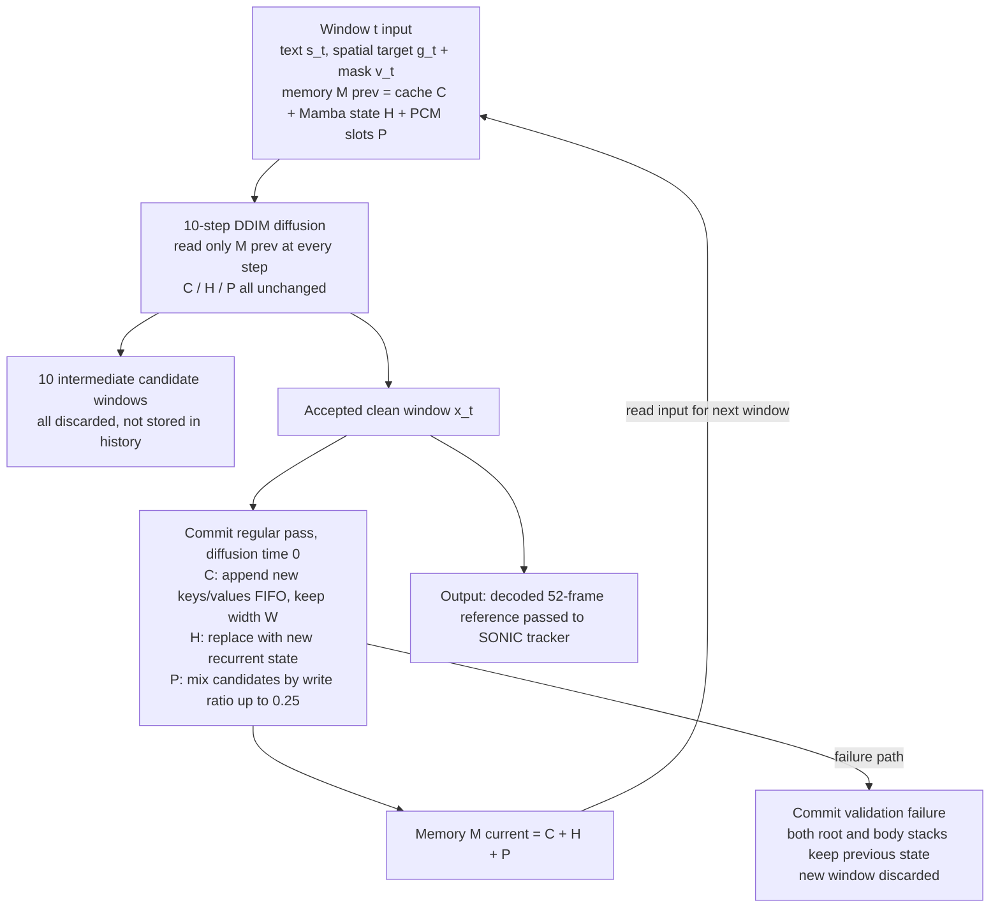

[Paper](https://arxiv.org/abs/2611.29897)
## Motion Mamba 2.0: Realtime Long-Horizon Humanoid Control with Autoregressive Diffusion Mamba

Paper: *Motion Mamba 2.0: Autoregressive Diffusion Mamba for Long-Horizon Humanoid Control*, IEEE TPAMI submission (arXiv:2611.29897).
Code: https://github.com/AIGeeksGroup/MotionMamba2.0 · Project: https://aigeeksgroup.github.io/MotionMamba2.0

## Introduction

For a robot to change commands mid-stride and travel to a distant goal, the generator must reflect the new command immediately without losing the motion it has already produced. Compressing the past into memory and finishing the same computation quickly every time are two different problems; this paper addresses the former with a recurrent state space model (Mamba) and content slots (PCM), and the latter with CUDA Graph replay. With both in place, goal-reaching error stays low even over a roughly 40 s (39.52 s) horizon, and the execution path produces a single window in 276.14 ms.

## Terms to read first

- **Diffusion model**: a generative model that starts from noise and estimates a clean motion through multiple denoising steps. The ability to re-apply the condition across many steps is what pairs well with spatial goal conditions.
- **Autoregressive window generation**: the model produces and commits one 52-frame (2.08 s) "window" at a time, appends the committed window as history, and generates the next window. That is why a mid-stream command change can continue the motion already underway.
- **Attention cache**: a mechanism that keeps only the most recent few windows as key/value instead of storing every past token. Its limit becomes the constraint that "old information gets evicted."
- **Recurrent state space model (SSM, Mamba)**: a model that, instead of storing tokens, updates a fixed-size state per token and compresses the past as it goes. "Resumable" means the state can be saved and reused in the next segment without recomputing from scratch, and the state size is independent of the length processed.
- **Root–body decomposition**: a design that splits whole-body motion into position/orientation (root) and joints (body). The "go there" constraint can be fed directly as a condition on the root, while the body side can be compressed into a low-dimensional latent vector.
- **Spatial target condition**: an input that specifies a root trajectory, waypoints, keyframes, joint positions/rotations, and so on, together with when they must be reached. Future goals are passed only as conditions, not generated in advance.
- **Tracking controller (SONIC)**: the execution layer that converts the produced kinematic reference into joint commands for the real robot and follows it. This paper is the "reference producer"; balance and contact are the tracker's job.
- **CUDA Graph**: a GPU feature that captures a fixed kernel launch sequence ahead of time and replays it in one go. It reduces the host dispatch cost of invoking kernels one by one.

## Problem: the two difficulties live on different layers

Interactive robot control imposes two requirements at once. One is that a new command must affect future motion even after execution has already begun; the other is that the result must be fast enough to hand to a downstream tracking system (§1, p.2).

The first difficulty is **memory**. The attention cache has a fixed size and evicts old features; conversely, growing the cache without bound makes both storage and compute grow along with the horizon. The second difficulty is **speed**. Repeatedly denoising short windows means that even if a single evaluation is cheap, the number of iterations dominates. The two requirements sit on different layers. Reducing the number of sampling steps does not lengthen the history the model can consult, and compressing the history does not remove the denoising cost.

A third distinction sits on top of this. The intermediate results produced during diffusion denoising are not temporally consecutive motions but **multiple alternatives for the same output window** (§1, p.2). Storing those intermediate candidates as history would mix sampling iterations with physical time. This paper therefore treats the boundary between prediction and history commit as part of the model design.

## A small example: what survives and what is discarded when building one window

**Illustrative example** (not an experimental value from the paper, but an example for understanding the structure. The number of tokens per window and frames per token are not reported in the paper; the frame counts and rates below match the paper).

Suppose a robot running at 25 Hz produces one 52-frame (2.08 s) window at a time. The input to window `t` is a text command `s_t` ("wave your right hand"), a spatial target `g_t` (e.g., the right wrist reaches a particular position at a particular time) with its validity mask `v_t`, and the memory `M_{t-1}` built from previously **accepted** motion. The memory has three pieces.

| Component | What it stores and how it changes | Size | Reader |
|---|---|---|---|
| Attention cache `C` | Appends key/value/validity mask of the accepted window; when width `W` is exceeded, drops the key/value of the oldest window | Most recent `W` windows (4 windows = 208 frames at inference) | Attention queries |
| Mamba recurrent state `H` | Passes the accepted window's tokens through the scan, updating the recurrent matrix, accumulated phase, and previous vector | Fixed regardless of accepted sequence length | Mamba-3 scan (not attention tokens) |
| PCM slots `P` | Builds candidates from the state summary, state change, and text condition, mixes them with previous slots, and overwrites | `S` slots (actual `S` not reported in the paper) | Extra key/value for attention queries |

Diffusion runs 10-step DDIM. Each step reads only the **same** `M_{t-1}` snapshot, and all 10 intermediate candidates are discarded. Only after the window is committed does a regular pass at diffusion time 0 run, applying cache append, state replacement, and slot writes to the root stack and body stack **together**. If this pass fails, both stacks keep their previous state. Future spatial targets are condition inputs only and never enter the history.

| Stage | What is read | State that changes | What stays | What is discarded |
|---|---|---|---|---|
| Window input | `s_t`, `g_t`, `v_t`, `M_{t-1}` | none | cache `C`, state `H`, slots `P` all | — |
| 10 diffusion steps | the same `M_{t-1}` at every step | none (read-only) | all of `C`, `H`, `P` | the 10 intermediate candidate windows produced per step, temporary state proposals |
| Regular pass after acceptance | the committed clean window | append new keys/values to `C` FIFO (keeping width `W`), replace `H` with the new state, update `P` by at most a 0.25 write ratio | cache width, state size, slot count fixed | keys/values of the oldest window beyond width `W` |
| On commit failure | — | none (both root and body stacks keep previous state) | previous `C`, `H`, `P` | the newly produced window |
| Output | the committed window | — | — | — |

Each box in the diagram represents "what state the memory is in at that point." Arrows show the direction in which state flows, and the back arrow (`F`→`A`) is the autoregressive loop. Numbers inside the boxes are values fixed at that point. 52 frames / 2.08 s is the time one window covers at 25 Hz, 10 is the number of DDIM steps, 4 windows / 208 frames is the cache width kept at inference, and 0.25 is the maximum fraction of PCM slots that can be overwritten at once. `C` and `H` do not grow in size over time: as a new window's keys/values enter the cache, the oldest window's keys/values are evicted.

## Method

### 1. Represent motion with root–body decomposition

The authors follow ARDY's hybrid representation (§4.1, p.5). The root is represented by position `p` and orientation `ψ`, and the body — joint rotations, joint positions and velocities, contact indicators — is compressed by a codec into a low-dimensional latent vector `b`. A token is the concatenation of a root patch and a body latent, and the root expands orientation into trigonometric functions as follows.

$$m_r = [\,p;\ \cos\psi;\ \sin\psi\,],\qquad x_i = [\,r_i;\ b_i\,]$$

The codec encoder `E` maps explicit motion to body latents, and the decoder `D` combines the latent with local root features to reconstruct joint placement. Coordinates are expressed in the current canonical frame, and cumulative translation is kept separately to restore the world trajectory.

Generation has two stages. At each diffusion evaluation, the root is predicted first, and the body is predicted conditioned on that root's local features (§4.2, Eq. 5). Because the root prediction is refreshed at every step, root and body stay coupled throughout diffusion, and the two stacks have separate parameters and per-layer memory.

### 2. Mix attention and Mamba in one layer

Each stack consists of diffusion transformer layers, and inside the sequence mixer attention and Mamba process the same condition-normalized features `U` together, after which a learned per-layer gate mixes the outputs.

- **Attention** reads recent features from the sliding cache. Within the current window everything can see everything bidirectionally, because denoising proceeds over the whole window at once.
- **Mamba-3** inherits the state from the previously accepted prefix and resumes the scan. Instead of storing all tokens, it updates a fixed-size state `H` per token; "resumable" means that after processing window `t` the state is saved and reused in window `t+1` without recomputing from scratch (§4.2, p.6).

A gap appears here. `H` is a compressed summary of the entire past, but it is not itself a key/value that attention can look up. The cache, conversely, keeps only recent items and discards old ones. Merely placing the two branches side by side in the network leaves the compressed recurrent history invisible to attention (§1, p.2). A learned interface is needed, and that is PCM, the core of this paper.

### 3. PCM: turn the recurrent state into slots that attention can read

PCM keeps `S` slots `P` per layer, initialized to zero. Each time a window is accepted, four steps run (§4.3, p.6–7).

1. **Summarize**: pool, project, and normalize the recurrent matrix to produce a state summary `s_t`.
2. **Change**: compute the difference from the previous accepted window's summary, `d_t = s_t - s_{t-1}`, capturing "what changed in the latest window."
3. **Text condition**: project the embedding `e_t` of the active command and apply a scale and shift to the normalized state difference. This is the mechanism that makes the same state transition produce different memory updates depending on the command. The text condition does not include embeddings of diffusion time or initial orientation.
4. **Write gate**: build a candidate by concatenating summary, change, and text, read the previous slots alongside it, and predict the write ratio `w_t`. The cap `η = 0.25` prevents overwriting too much at once.

$$P_t = (1-w_t)\odot P_{t-1} + w_t \odot Z_t$$

`Z_t` is the candidate slot content and `w_t` is a gate between 0 and 0.25. A small `w_t` keeps the previous slots almost intact; a large one reflects the candidate more. The resulting slots are inserted as key/value immediately after the sink token, so attention reads the compressed past context directly (§4.3, Eq. 7·13). The sink token itself is a static model parameter and does not store the past motion of an episode.

The final mixer output mixes base attention `A_0`, attention with slots `A_P`, and the Mamba output `M` with learned scalars.

$$Y = A_0 + \tanh(\rho)(A_P - A_0) + \sigma(\zeta)M$$

Initializing `ρ` to zero restores exactly the existing Native mixer output even with slots added. This differs from setting slot values to zero, because adding one key can change attention normalization (§4.3, p.7). This initialization suppresses PCM's extra attention contribution early in training, and PCM is trained jointly from scratch without separate pretraining or fine-tuning (App. B.1). PCM also does not change the query construction; the state summary enters through content writes rather than a separate state-dependent query.

### 4. Commit only accepted history

When memory updates is also part of the design. Each diffusion evaluation may produce temporary state proposals, but they are not committed during sampling (§4.3, Eq. 14). Each denoising step reads only an unchanging history snapshot. When sampling ends, the accepted window is re-centered in a regular pass at diffusion time 0 and turned into clean history. Only in this pass are cache append, Mamba state replacement, and PCM writes applied together across the root and body stacks; if the pass fails, both stacks keep their previous state (App. B.2, Algorithm 1). Future spatial targets are condition inputs only and never enter the history.

Thanks to this structure, with the same output window and condition budget, the memory and compute per new window do not grow as generation time increases. That said, this is only an upper bound on the **computational context**, not a guarantee of error-free motion over arbitrarily long durations.

### 5. Accelerate execution while preserving state

The state-preserving property is the premise for inference optimization. The authors add three optimizations (§4.4, p.8).

1. **Read-only execution**: during denoising, no state proposals or diagnostics are produced that are not used for prediction or later commit. Clean history commit is performed entirely in the separate regular pass.
2. **Fused kernel**: Mamba transition preprocessing (decay activation, decay lower bound, step size conversion, `∆A` product) is merged into a single pass. Intermediates stay in FP32 registers and are output in the layout the scan requires.
3. **CUDA Graph replay**: the root and body stacks each use a separate graph, capturing and replaying the text, spatial, and unconditional CFG branches together. Input projection, condition preparation, root output processing, root→local conversion, and body input construction stay outside the graph, as do sampling, RNG, re-centering, and commit.

None of the three optimizations changes the sampling procedure or memory structure. Attention stays FP32, the BF16 boundary inside Mamba, FP32 state accumulation, and TF32 disabled are all preserved, so outputs and committed state are bit-identical to the validated rollout (§5.4, App. B.3). In other words, this speedup is not "a different, faster computation" but "reducing the repetition cost of the same computation."

### 6. Training objective

Four terms are summed (§4.5, Eq. 15). `L_hyb` applies Smooth L1 to root patches and body latents, and `L_body` applies L1 to reconstructed joints. `L_goal` applies L1 only to observed coordinates inside the generated window; later goals remain condition inputs only until the goal frame falls inside the output window. `L_FK` measures the Euclidean mismatch between joint positions obtained by forward kinematics from reconstructed rotations and joint positions implied by reconstructed position features. The codec is frozen during denoiser training.

## Evaluation setup

- **Data**: BONES Seed, HumanML3D, and HiPHI are combined into a 29-DoF G1 representation (414 physical features, 25 Hz), yielding a training pool of 156,819 sequences and 588.92 hours. For HiPHI only the high-precision human motion subset is used; the object-interaction subset is excluded.
- **Retargeting consistency**: in mapping goal residuals, the median ankle error is 0.93 cm for HiPHI and 1.49 cm for HumanML3D, and the median pelvis error is 0.56 cm and 0.99 cm. All 38,028 admitted human motion sources passed a round-trip check between the storage format and the 414-dimensional representation, with a maximum position error of 1.31 × 10⁻⁶ m (App. A).
- **Training**: 100,000 updates with AdamW, global batch 512. Text and spatial condition dropout are 0.1 each, and the probability that the spatial condition is empty is 0.2. History and future condition lengths are sampled randomly, with a maximum history of 196 frames (7.84 s). All comparison methods and architectural variants were trained independently on the same G1 corpus with the same 100,000-update budget, without original pretrained weights (App. C.2).
- **Evaluation**: 25 Hz, 52-frame windows. Retargeted HiPHI is evaluated at 1, 4, 9, and 19 windows (2.08–39.52 s), and BONES Seed and retargeted HumanML3D at 1 and 4 windows. Each horizon runs 384 rollouts from 128 initializations × 3 noise seeds. Each trial specifies one root goal and one wrist or ankle goal together with a deadline. Sampling is 10-step deterministic DDIM (η=0), and guidance is (2, 2) for text and spatial.
- **Metrics**: Root CE is horizontal root position error in the world X–Z plane, End CE is 3D wrist/ankle position error at the deadline (cm), Cmd. is coarse root state agreement, R@3 is text-to-motion retrieval, L2-FID is distribution similarity over 256-dim features, and Lat. is latency per accepted window (ms).

## Results

### 1. Does it reach goals over long rollouts?

Root and end error on HiPHI (§5.2, Table 1, only some methods shown). Units are cm; lower is better.

| Method | 2.08 s (1 window) | 8.32 s (4 windows) | 18.72 s (9 windows) | 39.52 s (19 windows) |
|---|---|---|---|---|
| ARDY | 5.89 / 9.70 | 7.44 / 10.27 | 8.15 / 11.06 | 10.09 / 14.84 |
| MotionStreamer | 17.89 / 23.56 | 16.93 / 25.31 | 6.17 / 18.07 | 7.78 / 21.67 |
| Motion Mamba (ECCV'24) | 50.58 / 53.39 | 56.81 / 59.83 | 78.67 / 82.37 | 125.74 / 130.17 |
| **Motion Mamba 2.0** | **2.78 / 7.19** | **2.53 / 7.11** | **2.87 / 8.45** | **7.55 / 13.64** |

The proposed method has the lowest Root CE at every horizon and the lowest or tied End CE. At 18.72 s it reaches 2.87 / 8.45 cm, ahead of MotionStreamer's 6.17 / 18.07 cm and ARDY's 8.15 / 11.06 cm. At 39.52 s, Root CE is 7.55 cm, 3.0% lower than the best competitor MotionStreamer's 7.78 cm, and End CE is 13.64 cm, 8.1% lower than ARDY's 14.84 cm (§5.2, p.9).

In the same table, command agreement (Cmd.) and text-to-motion retrieval (R@3) are also best at all four horizons. At 39.52 s, Cmd. is 46.05%, higher than MoLingo's 41.34%, and R@3 is 23.68%, higher than OMG's 19.61%. Distribution similarity (L2-FID), by contrast, is lowest at 8.32, 18.72, and 39.52 s with 0.401, 0.402, and 0.409 respectively, but at a single window (2.08 s) CMDM (0.337) beats the proposed method (0.410). At 8.32 s the gap to DreamControl (0.402) is only 0.001. In short, precise spatial control and single-window distribution quality do not always improve together.

One notable point in the comparison table is the ECCV'24 version of Motion Mamba. Its error widens sharply as the horizon lengthens, reaching Root CE 125.74 cm at 39.52 s. The two versions differ in architecture and training setup, so this is not a direct comparison, but it suggests that this paper's memory design — accept-only commit, fixed-size state, and PCM — may have contributed to long-horizon control.

A qualitative comparison with a single distant goal is also included (App. C.6). With an 18 m goal and a 33.40 s deadline, the proposed method advanced to 9.91 m at 16.68 s and 15.05 m at 25.04 s, while ARDY reached only 6.97 m and 9.36 m at the same times. ARDY had stationary intervals of roughly 6.7–13.6 s and 18.7–22.8 s where planar root speed fell below 0.1 m/s, and the average root speed over the final 1 s was 1.99 m/s for ARDY and 0.71 m/s for the proposed method. Because this is a single selected example, it should be read as evidence of a trend, not a statistical comparison.

### 2. Are spatial control and retrieval maintained over short horizons?

On **BONES Seed**, Root/End CE is lowest and R@3 highest at both horizons (1 and 4 windows) (§5.2, Table 2). At 8.32 s, Root CE is 1.86 cm, 62.5% lower than ARDY's 4.96 cm, and End CE drops from 10.16 cm to 6.86 cm. R@3 is 35.58% and Cmd. is 51.42%. Cmd. is not the best, however, and at 2.08 s L2-FID favors OMG (0.345) over the proposed method (0.573). DartControl is the fastest method.

On **retargeted HumanML3D**, Root/End CE is also lowest at both horizons (§5.2, Table 3). At 8.32 s it is 2.17 / 7.03 cm, with Root CE 54.3% lower than ARDY's 4.75 / 9.82 cm. 4-window R@3 is highest at 49.72% (DartControl 48.35%), while 2.08 s R@3 of 84.29% is lower than MotionStreamer's 96.40%. L2-FID favors OMG at 2.08 s (0.319), and at 8.32 s the proposed method's 0.490 ties TACD for the lowest value, essentially level with ARDY (0.491).

Across the two benchmarks, the conclusion "precise spatial control together with better retrieval and distribution quality" does not hold. What is common across the three datasets is an **advantage in root and end error**; semantic metrics vary from benchmark to benchmark.

### 3. Which component contributes what

Five architectural variants were trained with the same budget and compared (§5.3, Tables 4–6). HiPHI 39.52 s results are as follows.

| Variant | Root CE | End CE | Cmd. | R@3 | L2-FID | Lat. (ms) |
|---|---|---|---|---|---|---|
| Minimal (no Mamba) | 60.00 | 64.86 | 35.27 | 17.26 | 0.439 | 552.9 |
| Native (Mamba, no PCM) | 9.36 | 15.54 | 32.20 | 17.44 | 0.416 | 258.7 |
| Native + PCM (no text condition) | 8.62 | 14.62 | 33.34 | 21.18 | 0.467 | 336.5 |
| Native + PCM (no state change) | 8.30 | 14.18 | 32.65 | 21.11 | 0.488 | 329.8 |
| **Motion Mamba 2.0** | **7.55** | **13.64** | **46.05** | **23.68** | **0.409** | **333.4** |

**The effect of recurrent modeling grows with horizon length.** At 39.52 s, adding Mamba to Minimal drops Root CE from 60.00 to 9.36 cm and End CE from 64.86 to 15.54 cm. The gap at a single window is much smaller. At 8.32 s on BONES Seed and HumanML3D, error improvements point the same way. The gains are not uniform across metrics, though: at 39.52 s, Native has lower Cmd. than Minimal (32.20% vs. 35.27%).

**PCM consistently lowers Root/End CE on all three benchmarks.** On HiPHI at 39.52 s, Root CE falls from 9.36 to 7.55 cm (19.3%) and End CE from 15.54 to 13.64 cm (12.2%), while Cmd. moves from 32.20% to 46.05%, R@3 from 17.44% to 23.68%, and L2-FID from 0.416 to 0.409. Removing the text condition gives 8.62 / 14.62 cm with 33.34% / 21.18%, and removing the state-change term gives 8.30 / 14.18 cm with 32.65% / 21.11%. At 18.72 s the full version's Cmd. of 47.11% is also higher than either partial version (38.10%, 37.18%). At 8.32 s on BONES Seed and HumanML3D, the full model lowers Root CE from Native's 5.46 to 1.86 cm and from 6.25 to 2.17 cm. The authors interpret this as evidence that state change and text-conditioned writes play complementary roles, but they stop short of claiming it demonstrates exact reproduction of evicted events.

One caution is needed when reading the table. The latency column here is not a speed comparison. Minimal uses the FP32 SDPA path without the fused kernel and CUDA Graph, while the Native variants use the accelerated path, so the latency column describes each implementation as a whole (App. C.2).

### 4. Where does the speedup come from?

Speed was measured as the latency to produce one completed window (§5.4, Table 7). Conditions are one RTX 4090, batch 1, 10-step DDIM, CFG with 3 branches at guidance (2, 2), and 4 windows of history, and the timing includes the full window from state restoration through sampling, commit, decoding, and CPU snapshot. Text embeddings are preloaded, and loading, warm-up, and graph capture time are excluded. Each configuration was measured with 30 pairs in 5 independent processes, with confidence intervals from a 10,000-sample process-block bootstrap.

| Optimization combination (Flow / Fusion / Graph) | p50 (ms) | p95 (ms) | Median paired speedup |
|---|---|---|---|
| — / — / — | 1685.35 | 2471.65 | 1.000× |
| ✓ / — / — | 1102.82 | 1647.52 | 1.525× |
| ✓ / ✓ / — | 1069.52 | 1588.74 | 1.578× |
| ✓ / — / ✓ | 285.20 | 352.22 | 5.943× |
| ✓ / ✓ / ✓ | 276.14 | 345.82 | 6.138× |

Most of the speedup comes from CUDA Graph replay. Simplifying the execution flow alone gives 1.525x, adding the fused kernel gives 1.578x, but adding graph replay jumps to 5.943x. The fused kernel's additional contribution is from 285.20 to 276.14 ms, only 1.029x on a paired basis. Full optimization reduces p50 by 83.6% and p95 by 86.0%, with a median paired speedup of 6.138x and a 95% confidence interval of [6.094, 6.290].

The profile (Fig. 7) supports this reading. Generic host launches drop from 83,777 to 5,519 (93.4%), GPU kernels from 86,849 to 44,877 (48.3%), and synchronization calls from 10,194 to 1,330. The host-launch reduction is overwhelmingly larger, consistent with the bottleneck being host dispatch cost from launching many small kernels rather than the arithmetic of a single kernel. The optimized p50 of 276.14 ms corresponds to a real-time factor of 0.133 for a 2.08 s window.

Two things must be kept clearly separate. First, this 276.14 ms is **steady-state generation time**, not cold start or "command → visible motion" latency. Second, in the comparison table of Table 1, the proposed method's per-window latency is 267.5–333.4 ms, slower than ARDY (90.1–105.1 ms). The 6.138x is measured against the proposed method's own execution path before optimization, not a claim of being ahead of other methods. Numerical identity is confirmed to the level where outputs and committed state are bit-identical across four 100-window rollouts with different seeds.

### 5. Does it carry over to a real robot?

The setup has three tiers: a remote RTX 4090 server (text encoding and generation), an intermediate workstation handling communication and interaction, and the G1 onboard controller handling motion tracking (§6, p.12–13). Generated references are sent via the workstation at 50 Hz over ZeroMQ and SSH tunneling (a transport frequency different from the model's 25 Hz motion representation). Tracking is done by SONIC, and the generator does not run on the robot.

There are four tasks: T1 sequential behavior composition, 20 trials; T2 expressive motion, 20 trials; T3 keyboard control, 30 trials; T4 mouse control, 30 trials. Full-task success means completing every stage without falls, protective stops, or human intervention.

| Task | Full-task success | Completed stages | Text switch success | Stable | Falls |
|---|---|---|---|---|---|
| T1 behavior composition | 18/20 (90.0%) | 136/140 | 117/120 | 19/20 | 0 |
| T2 expressive motion | 19/20 (95.0%) | 99/100 | 78/80 | 20/20 | 0 |
| T3 keyboard | 29/30 (96.7%) | 59/60 | 30/30 | 29/30 | 0 |
| T4 mouse | 28/30 (93.3%) | 58/60 | 29/30 | 29/30 | 0 |

Across the four tasks, 94 of 100 trials achieved full-task success and 97 met the stability criterion, with no falls. There were 3 cases that were stable but did not complete the task requirements and 3 cases that missed the stability criterion (Tab. 8).

Latency must be reported as two distinct kinds (§6, Tab. 9). **Handoff latency** is from the moment the system receives a command to when the corresponding motion reference is completed on the GPU server, including generation, decoding, history update, and text encoding when new text arrives, but excluding network transport and robot-side processing. **Physical response latency** is from the same command receipt to when the robot begins a sustained motion that satisfies the command tolerance, including communication, buffering, and physical execution.

| Measurement | Keyboard | Mouse |
|---|---|---|
| Handoff p50 / p95 (ms) | 246 / 302 | 251 / 310 |
| Physical response p50 / p95 (ms) | 351 / 504 | 360 / 525 |
| Speed RMSE (m/s) | 0.041 ± 0.012 | 0.045 ± 0.014 |
| Heading MAE (°) | 4.6 ± 1.5 | 5.1 ± 1.7 |
| Foot slip (cm/s) | 1.5 ± 0.5 | 1.7 ± 0.6 |
| Successful events within 1.5 s deadline | 296/300 (98.7%) | 292/300 (97.3%) |

These numbers are a different measurement from the cached text inference time in §5.4. The response time a user perceives corresponds to physical response. Qualitatively, T1 shows a visible bow at 11.61 s and a 28.83 s arm raise, and T2 shows motion continuing to 32.48 s, confirming motion categories beyond gait repetition (§6.2).

## Limitations and deployment judgment

There is one limitation the authors acknowledge directly. The framework focuses on controllable humanoid motion generation and **does not handle object manipulation**. They name whole-body loco-manipulation, covering locomotion and manipulation together, as future work (§7, p.13).

The rest are constraints to check while reading the results.

- **Compressed memory is not exact reproduction.** Fixed-size state, cache, and slots bound the context but do not guarantee remembering the details of an arbitrarily distant past. PCM is designed to help long-horizon spatial control and command-conditioned generation, not to reproduce old instructions verbatim (§1 p.2, §4.3 p.6, §5.3 p.11).
- **Training does not directly supervise long-horizon retrieval.** The maximum history during training is 196 frames (7.84 s), shorter than the 208-frame local cache of 4 windows. Nor does training rewind generated history or backpropagate across windows. The ability to retrieve beyond the local attention range is therefore evaluated only at autoregressive inference (App. B.2, C.2).
- **Comparisons across evaluation horizons do not isolate the effect of duration.** Command stage composition, the number of windows allocated per stage, and deadlines differ by horizon. This includes the fact that the single-window (2.08 s) evaluation uses only instruction phase 4 (App. C.4).
- **Metrics must be interpreted within a benchmark.** The R@3 candidate set differs between HiPHI (32 generated) and BONES Seed/HumanML3D (1 generated + 31 real motions), so cross-benchmark comparison is impossible, and L2-FID is likewise read only within each benchmark. The real-motion calibration values in Tab. 12 (HiPHI 44.44–53.59%, etc.) are evaluator diagnostics, not model performance or upper bounds. Cmd. is coarse root state agreement, not a metric of whether the full natural-language instruction was carried out (App. C.1, C.5).
- **The scope of the speed and stability measurements is narrow.** The 6.138x is for one RTX 4090, batch 1, steady state, and excludes cold start and command→visible latency. The real-world evaluation is limited to one robot (Unitree G1) and one tracker (SONIC), and does not guarantee that the generated kinematic reference is physically executable (§2.3, p.4).
- **Comparison targets are retrained checkpoints, not original weights.** Every method was trained independently on the same G1 corpus with the same 100,000-update budget. The table values are therefore relative comparisons under a controlled budget, and differ from the performance of each method's originally released weights (App. C.2).

In summary, this method suits settings that must "connect kinematic motion references for a specific humanoid robot to a downstream tracker and generate them in real time over long horizons." Conditions not yet validated are object manipulation, other embodiments, cold-start latency, and cases requiring exact reproduction of arbitrary past instructions.

<!-- verbatim-tables -->

Tables from the paper

> Tables converted mechanically from the arXiv e-print LaTeX source. The numbers are the paper's own and did not pass through a model.

**Table 1. **Short- and Long-Horizon Motion Generation on Retargeted HiPHI.** CE is reported in cm, Cmd. and R@3 in percentages, and latency in ms per accepted window at batch size 1. R@3 uses 32 generated motion candidates. See App. C for details.**

| Method | 52 frames / 1 window Root CE$\downarrow$ | 52 frames / 1 window End CE$\downarrow$ | 52 frames / 1 window Cmd.$\uparrow$ | 52 frames / 1 window R@3$\uparrow$ | 52 frames / 1 window L2-FID$\downarrow$ | 52 frames / 1 window Lat.$\downarrow$ | 8.32 s / 4 windows Root CE$\downarrow$ | 8.32 s / 4 windows End CE$\downarrow$ | 8.32 s / 4 windows Cmd.$\uparrow$ | 8.32 s / 4 windows R@3$\uparrow$ | 8.32 s / 4 windows L2-FID$\downarrow$ | 8.32 s / 4 windows Lat.$\downarrow$ | 18.72 s / 9 windows Root CE$\downarrow$ | 18.72 s / 9 windows End CE$\downarrow$ | 18.72 s / 9 windows Cmd.$\uparrow$ | 18.72 s / 9 windows R@3$\uparrow$ | 18.72 s / 9 windows L2-FID$\downarrow$ | 18.72 s / 9 windows Lat.$\downarrow$ | 39.52 s / 19 windows Root CE$\downarrow$ | 39.52 s / 19 windows End CE$\downarrow$ | 39.52 s / 19 windows Cmd.$\uparrow$ | 39.52 s / 19 windows R@3$\uparrow$ | 39.52 s / 19 windows L2-FID$\downarrow$ | 39.52 s / 19 windows Lat.$\downarrow$ |
|---|---|---|---|---|---|---|---|---|---|---|---|---|---|---|---|---|---|---|---|---|---|---|---|---|
| DiP | 57.07 | 60.45 | 40.78 | 25.66 | 0.402 | 73.6 | 62.58 | 66.16 | 31.59 | 11.08 | 0.444 | 68.7 | 77.69 | 80.88 | 20.50 | 12.84 | 0.487 | 68.7 | 96.99 | 99.26 | 18.45 | 12.45 | 0.490 | 66.8 |
| Go-to-Zero | 29.14 | 29.53 | 71.79 | 26.27 | 0.480 | 12344.9 | 39.65 | 40.19 | 40.63 | 18.17 | 0.514 | 12564.3 | 56.36 | 59.76 | 32.89 | 13.09 | 0.631 | 12403.2 | 86.47 | 88.91 | 25.03 | 12.11 | 0.743 | 12478.5 |
| DreamControl | 31.43 | 35.85 | 75.39 | 22.62 | 0.457 | 94.2 | 40.46 | 43.99 | 38.80 | 16.22 | 0.402 | 90.8 | 56.89 | 60.84 | 26.66 | 13.97 | 0.472 | 90.5 | 61.92 | 67.43 | 20.00 | 14.40 | 0.532 | 89.5 |
| MoLingo | 99.24 | 102.67 | 47.77 | 8.86 | 1.241 | 868.3 | 137.47 | 140.71 | 34.79 | 7.46 | 1.299 | 847.7 | 205.38 | 207.00 | 41.14 | 8.72 | 1.261 | 840.4 | 270.71 | 273.42 | 41.34 | 8.81 | 1.260 | 908.7 |
| HY-Motion | 30.76 | 33.54 | 55.70 | 16.67 | 0.400 | 324.1 | 43.94 | 45.97 | 37.37 | 12.47 | 0.492 | 274.0 | 65.06 | 66.75 | 31.96 | 14.52 | 0.629 | 290.5 | 95.53 | 96.63 | 27.61 | 13.47 | 0.760 | 346.8 |
| OMG | 58.18 | 60.59 | 46.76 | 25.93 | 0.448 | 173.9 | 82.83 | 85.97 | 36.41 | 18.84 | 0.428 | 170.2 | 115.50 | 118.11 | 29.85 | 20.96 | 0.443 | 168.3 | 161.76 | 163.49 | 24.52 | 19.61 | 0.473 | 167.8 |
| TACD | 21.81 | 25.55 | 77.27 | 28.44 | 0.428 | 203.0 | 30.49 | 34.66 | 43.71 | 18.26 | 0.422 | 224.9 | 40.19 | 44.16 | 34.88 | 20.63 | 0.418 | 191.6 | 54.43 | 59.40 | 28.03 | 17.81 | 0.496 | 208.0 |
| PCMDM | 63.86 | 66.65 | 28.71 | 17.59 | 0.434 | 58.4 | 61.17 | 63.96 | 26.73 | 10.43 | 0.457 | 51.6 | 62.41 | 64.93 | 16.12 | 10.28 | 0.512 | 53.0 | 65.18 | 66.99 | 14.27 | 10.96 | 0.544 | 51.4 |
| FlowMDM | 56.67 | 58.01 | 46.25 | 14.29 | 0.400 | 109.9 | 72.80 | 73.93 | 35.00 | 10.61 | 0.437 | 105.2 | 112.44 | 113.81 | 26.35 | 10.57 | 0.443 | 107.2 | 154.71 | 156.35 | 24.12 | 11.07 | 0.454 | 105.7 |
| DartControl | 44.84 | 48.37 | 71.88 | 13.49 | 0.387 | **34.7** | 64.66 | 68.24 | 34.24 | 16.52 | 0.471 | **30.3** | 91.05 | 95.51 | 41.17 | 16.35 | 0.493 | **29.1** | 291.58 | 295.86 | 40.32 | 15.53 | 0.511 | **28.2** |
| Motion-Agent | 20.72 | 24.09 | 22.22 | 23.17 | 0.437 | 13806.4 | 31.76 | 33.25 | 26.69 | 12.36 | 0.496 | 13694.5 | 43.15 | 46.34 | 14.97 | 12.14 | 0.542 | 13319.4 | 61.36 | 62.49 | 15.15 | 12.02 | 0.745 | 13511.1 |
| MG-MotionLLM | 63.77 | 67.99 | 22.39 | 23.02 | 0.434 | 5632.7 | 98.31 | 99.67 | 25.48 | 9.22 | 0.455 | 5783.3 | 204.32 | 203.35 | 12.14 | 10.60 | 0.451 | 5861.8 | 340.84 | 341.01 | 11.52 | 11.60 | 0.431 | 5772.3 |
| IRG-MotionLLM | 43.58 | 46.97 | 24.58 | 21.74 | 0.447 | 13329.8 | 70.64 | 72.89 | 23.86 | 11.93 | 0.472 | 13295.7 | 92.71 | 95.16 | 13.53 | 15.95 | 0.535 | 13198.4 | 113.23 | 131.52 | 13.04 | 13.15 | 0.751 | 12912.6 |
| MotionStreamer | 17.89 | 23.56 | 80.32 | 22.62 | 0.388 | 99.0 | 16.93 | 25.31 | 46.00 | 17.54 | 0.444 | 109.8 | 6.17 | 18.07 | 26.87 | 15.83 | 0.542 | 119.2 | 7.78 | 21.67 | 18.85 | 13.02 | 0.645 | 159.8 |
| CMDM | 24.65 | 27.16 | 84.02 | 23.41 | **0.337** | 157.8 | 38.93 | 42.65 | 34.30 | 14.65 | 0.454 | 186.7 | 49.35 | 53.04 | 22.80 | 14.49 | 0.549 | 230.4 | 54.68 | 59.68 | 15.36 | 12.10 | 0.657 | 311.9 |
| ActionPlan | 69.72 | 83.69 | 52.79 | 9.13 | 0.862 | 72.4 | 93.89 | 106.81 | 36.76 | 4.70 | 1.047 | 68.8 | 281.64 | 279.40 | 40.38 | 6.43 | 1.067 | 85.3 | 799.60 | 790.99 | 40.21 | 6.16 | 1.120 | 110.1 |
| FloodDiffusion 2 | 39.12 | 41.54 | 63.51 | 20.63 | 0.403 | 196.8 | 67.72 | 70.42 | 36.03 | 12.44 | 0.433 | 190.8 | 90.70 | 93.48 | 26.95 | 13.55 | 0.465 | 186.9 | 115.02 | 117.86 | 22.34 | 12.14 | 0.497 | 183.7 |
| ARDY | 5.89 | 9.70 | 86.77 | 23.54 | 0.425 | 95.6 | 7.44 | 10.27 | 45.83 | 13.76 | 0.438 | 90.1 | 8.15 | 11.06 | 30.89 | 17.14 | 0.467 | 91.5 | 10.09 | 14.84 | 23.53 | 15.32 | 0.489 | 105.1 |
| Motion Mamba | 50.58 | 53.39 | 54.75 | 19.84 | 0.406 | 309.2 | 56.81 | 59.83 | 44.06 | 17.98 | 0.414 | 317.3 | 78.67 | 82.37 | 31.46 | 17.29 | 0.420 | 315.1 | 125.74 | 130.17 | 25.77 | 17.18 | 0.482 | 310.5 |
| **Motion Mamba 2.0** | **2.78** | **7.19** | **86.96** | **35.58** | 0.410 | 283.7 | **2.53** | **7.11** | **48.82** | **21.35** | **0.401** | 267.5 | **2.87** | **8.45** | **47.11** | **23.05** | **0.402** | 284.7 | **7.55** | **13.64** | **46.05** | **23.68** | **0.409** | 333.4 |

**Table 2. **Short-Horizon Motion Generation on BONES Seed.** CE is reported in cm, Cmd. and R@3 in percentages, and latency in ms per accepted window at batch size 1. R@3 uses one matched generated motion and 31 fixed real-motion distractors. Full protocol: App. C.**

| Method | 52 frames (1 window) Root CE$\downarrow$ | 52 frames (1 window) End CE$\downarrow$ | 52 frames (1 window) Cmd.$\uparrow$ | 52 frames (1 window) $R@3\uparrow$ | 52 frames (1 window) L2-FID$\downarrow$ | 52 frames (1 window) Lat.$\downarrow$ | 8.32 s (4 windows) Root CE$\downarrow$ | 8.32 s (4 windows) End CE$\downarrow$ | 8.32 s (4 windows) Cmd.$\uparrow$ | 8.32 s (4 windows) $R@3\uparrow$ | 8.32 s (4 windows) L2-FID$\downarrow$ | 8.32 s (4 windows) Lat.$\downarrow$ |
|---|---|---|---|---|---|---|---|---|---|---|---|---|
| DiP | 60.28 | 63.68 | 44.61 | 18.84 | 0.461 | 74.7 | 61.21 | 63.68 | 36.02 | 32.30 | 0.640 | 70.3 |
| Go-to-Zero | 30.80 | 32.50 | 72.39 | 17.55 | 0.487 | 12275.5 | 43.19 | 41.27 | 39.46 | 12.23 | 0.613 | 12316.8 |
| DreamControl | 22.70 | 27.33 | 96.64 | 40.60 | 0.608 | 93.1 | 36.06 | 40.20 | 54.93 | 26.49 | 0.522 | 92.1 |
| MoLingo | 93.85 | 95.66 | 97.50 | 32.64 | 1.283 | 846.7 | 122.43 | 124.64 | 47.82 | 15.15 | 1.207 | 841.7 |
| HY-Motion | 38.94 | 31.32 | 59.93 | 18.51 | 0.456 | 282.3 | 51.94 | 54.12 | 32.85 | 11.80 | 0.583 | 276.9 |
| OMG | 76.58 | 77.97 | 46.18 | 26.39 | **0.345** | 173.4 | 123.93 | 125.52 | 31.48 | 30.24 | 0.544 | 173.9 |
| TACD | 32.70 | 35.43 | 68.36 | 35.72 | 0.483 | 201.7 | 35.86 | 39.61 | 40.50 | 28.80 | 0.555 | 192.3 |
| PCMDM | 65.98 | 67.49 | 41.00 | 14.97 | 0.437 | 58.8 | 66.77 | 68.26 | 29.77 | 24.85 | 0.600 | 53.5 |
| FlowMDM | 76.32 | 77.72 | 38.10 | 16.19 | 0.382 | 113.6 | 92.96 | 94.37 | 30.62 | 24.56 | 0.518 | 107.3 |
| DartControl | 46.51 | 46.25 | 96.60 | 48.66 | 0.602 | **35.2** | 272.86 | 272.43 | **61.79** | 27.90 | 0.668 | **30.8** |
| Motion-Agent | 33.79 | 35.23 | 32.37 | 36.90 | 0.538 | 13461.2 | 48.05 | 50.89 | 26.53 | 25.98 | 0.517 | 13624.0 |
| MG-MotionLLM | 82.91 | 86.77 | 54.57 | 37.50 | 0.460 | 5623.9 | 328.11 | 329.51 | 25.83 | 30.01 | 0.469 | 5745.0 |
| IRG-MotionLLM | 49.68 | 42.81 | 36.62 | 38.61 | 0.501 | 14497.4 | 69.05 | 76.78 | 29.16 | 30.38 | 0.621 | 13868.3 |
| MotionStreamer | 15.08 | 22.29 | 88.32 | 53.99 | 0.570 | 102.7 | 12.97 | 19.54 | 43.01 | 26.63 | 0.542 | 106.2 |
| CMDM | 32.66 | 34.71 | 85.90 | 48.65 | 0.439 | 182.1 | 48.56 | 52.06 | 37.15 | 25.07 | 0.579 | 197.3 |
| ActionPlan | 77.76 | 89.85 | **100.00** | 44.08 | 1.237 | 71.8 | 223.18 | 223.45 | 54.59 | 12.76 | 1.405 | 68.5 |
| FloodDiffusion 2 | 52.50 | 54.09 | 62.26 | 34.98 | 0.409 | 199.4 | 71.05 | 73.28 | 35.62 | 26.64 | 0.565 | 191.3 |
| ARDY | 5.57 | 9.63 | 83.14 | 48.74 | 0.596 | 98.1 | 4.96 | 10.16 | 45.10 | 34.26 | 0.568 | 102.7 |
| Motion Mamba | 43.29 | 44.65 | 77.35 | 56.47 | 0.560 | 315.4 | 58.64 | 60.83 | 42.31 | 29.15 | 0.591 | 301.8 |
| **Motion Mamba 2.0** | **2.10** | **7.09** | 86.92 | **59.38** | 0.573 | 290.1 | **1.86** | **6.86** | 51.42 | **35.58** | **0.459** | 271.1 |

**Table 3. **Short-Horizon Motion Generation on Retargeted HumanML3D.** CE is reported in cm, Cmd. and R@3 in percentages, and latency in ms per accepted window at batch size 1. R@3 uses one matched generated motion and 31 fixed real-motion distractors. Full protocol: App. C.**

| Method | 52 frames (1 window) Root CE$\downarrow$ | 52 frames (1 window) End CE$\downarrow$ | 52 frames (1 window) Cmd.$\uparrow$ | 52 frames (1 window) $R@3\uparrow$ | 52 frames (1 window) L2-FID$\downarrow$ | 52 frames (1 window) Lat.$\downarrow$ | 8.32 s (4 windows) Root CE$\downarrow$ | 8.32 s (4 windows) End CE$\downarrow$ | 8.32 s (4 windows) Cmd.$\uparrow$ | 8.32 s (4 windows) $R@3\uparrow$ | 8.32 s (4 windows) L2-FID$\downarrow$ | 8.32 s (4 windows) Lat.$\downarrow$ |
|---|---|---|---|---|---|---|---|---|---|---|---|---|
| DiP | 49.72 | 54.03 | 64.59 | 84.46 | 0.623 | 76.1 | 52.78 | 55.17 | 41.04 | 47.95 | 0.706 | 69.4 |
| Go-to-Zero | 29.11 | 21.71 | 52.30 | 66.90 | 0.462 | 12272.0 | 34.78 | 31.96 | 34.15 | 40.31 | 0.541 | 12351.6 |
| DreamControl | 22.06 | 27.14 | 97.24 | 87.98 | 1.100 | 98.1 | 36.02 | 39.27 | 57.48 | 45.76 | 0.737 | 94.1 |
| MoLingo | 93.94 | 99.88 | 97.82 | 79.90 | 1.551 | 881.4 | 130.90 | 135.04 | 47.82 | 43.55 | 1.514 | 862.7 |
| HY-Motion | 35.46 | 37.00 | 51.78 | 61.83 | 0.383 | 317.5 | 47.05 | 48.94 | 33.24 | 31.78 | 0.579 | 292.0 |
| OMG | 75.87 | 76.51 | 72.36 | 72.70 | **0.319** | 175.6 | 136.38 | 137.49 | 36.37 | 32.52 | 0.564 | 170.8 |
| TACD | 25.75 | 27.84 | 78.68 | 11.98 | 0.329 | 204.3 | 34.66 | 37.32 | 42.67 | 17.42 | 0.490 | 195.6 |
| PCMDM | 51.98 | 54.63 | 64.60 | 74.74 | 0.592 | 60.1 | 51.09 | 53.63 | 35.84 | 40.38 | 0.729 | 54.8 |
| FlowMDM | 67.89 | 68.95 | 65.54 | 70.40 | 0.364 | 109.8 | 104.39 | 105.96 | 38.20 | 40.90 | 0.554 | 104.0 |
| DartControl | 67.17 | 64.09 | 96.96 | 87.50 | 0.528 | **39.3** | 238.78 | 235.93 | **61.04** | 48.35 | 0.732 | **29.7** |
| Motion-Agent | 22.20 | 25.39 | 52.55 | 65.49 | 0.574 | 13661.4 | 34.60 | 35.43 | 26.81 | 44.63 | 0.611 | 13264.4 |
| MG-MotionLLM | 60.45 | 64.31 | 53.16 | 67.06 | 0.558 | 5590.8 | 160.42 | 159.49 | 25.71 | 40.33 | 0.554 | 5743.3 |
| IRG-MotionLLM | 45.69 | 43.30 | 51.31 | 63.82 | 0.490 | 13556.0 | 65.03 | 67.18 | 24.09 | 42.15 | 0.618 | 13468.2 |
| MotionStreamer | 15.24 | 20.23 | 91.32 | **96.40** | 0.463 | 106.7 | 12.16 | 18.28 | 47.63 | 44.39 | 0.557 | 105.4 |
| CMDM | 32.61 | 34.20 | 92.80 | 89.76 | 0.375 | 129.0 | 47.30 | 49.82 | 44.37 | 46.08 | 0.572 | 129.9 |
| ActionPlan | 76.26 | 90.77 | **100.00** | 40.13 | 1.737 | 74.8 | 221.90 | 222.02 | 55.11 | 40.27 | 2.005 | 70.2 |
| FloodDiffusion 2 | 52.15 | 53.78 | 82.43 | 77.86 | 0.334 | 164.1 | 71.64 | 74.09 | 42.51 | 42.08 | 0.593 | 153.9 |
| ARDY | 5.22 | 8.85 | 87.55 | 86.85 | 0.430 | 100.6 | 4.75 | 9.82 | 52.28 | 48.21 | 0.491 | 91.1 |
| Motion Mamba | 38.42 | 40.17 | 85.74 | 84.57 | 0.747 | 309.8 | 59.26 | 61.31 | 54.47 | 40.14 | 0.653 | 313.9 |
| **Motion Mamba 2.0** | **2.18** | **6.73** | 88.07 | 84.29 | 0.459 | 286.0 | **2.17** | **7.03** | 58.81 | **49.72** | **0.490** | 271.2 |

**Table 4. **Architectural Ablation on Retargeted HiPHI.** Training budgets and execution paths are specified in App. C. Metrics and units follow Tab. 1.**

| Method | 52 frames / 1 window Root CE$\downarrow$ | 52 frames / 1 window End CE$\downarrow$ | 52 frames / 1 window Cmd.$\uparrow$ | 52 frames / 1 window R@3$\uparrow$ | 52 frames / 1 window L2-FID$\downarrow$ | 52 frames / 1 window Lat.$\downarrow$ | 8.32 s / 4 windows Root CE$\downarrow$ | 8.32 s / 4 windows End CE$\downarrow$ | 8.32 s / 4 windows Cmd.$\uparrow$ | 8.32 s / 4 windows R@3$\uparrow$ | 8.32 s / 4 windows L2-FID$\downarrow$ | 8.32 s / 4 windows Lat.$\downarrow$ | 18.72 s / 9 windows Root CE$\downarrow$ | 18.72 s / 9 windows End CE$\downarrow$ | 18.72 s / 9 windows Cmd.$\uparrow$ | 18.72 s / 9 windows R@3$\uparrow$ | 18.72 s / 9 windows L2-FID$\downarrow$ | 18.72 s / 9 windows Lat.$\downarrow$ | 39.52 s / 19 windows Root CE$\downarrow$ | 39.52 s / 19 windows End CE$\downarrow$ | 39.52 s / 19 windows Cmd.$\uparrow$ | 39.52 s / 19 windows R@3$\uparrow$ | 39.52 s / 19 windows L2-FID$\downarrow$ | 39.52 s / 19 windows Lat.$\downarrow$ |
|---|---|---|---|---|---|---|---|---|---|---|---|---|---|---|---|---|---|---|---|---|---|---|---|---|
| Minimal | 3.86 | 12.44 | **89.69** | 34.62 | 0.371 | 509.0 | 5.92 | 13.52 | **52.27** | 20.14 | 0.414 | 536.5 | 18.70 | 23.58 | 38.27 | 18.07 | 0.427 | 557.6 | 60.00 | 64.86 | 35.27 | 17.26 | 0.439 | 552.9 |
| Native | 4.49 | 10.88 | 88.14 | 32.67 | **0.368** | **233.4** | 4.60 | 9.84 | 51.69 | 19.64 | 0.462 | **200.6** | 6.21 | 11.44 | 38.21 | 19.08 | 0.441 | **212.5** | 9.36 | 15.54 | 32.20 | 17.44 | 0.416 | **258.7** |
| Native + PCM (w/o text) | 3.19 | 7.65 | 87.01 | 32.01 | 0.423 | 286.5 | 3.05 | 7.81 | 47.60 | 19.41 | 0.419 | 267.8 | 2.99 | 9.02 | 38.10 | 21.06 | 0.437 | 292.8 | 8.62 | 14.62 | 33.34 | 21.18 | 0.467 | 336.5 |
| Native + PCM (w/o delta) | 3.06 | 7.41 | 86.36 | 32.67 | 0.433 | 287.6 | 2.97 | 7.19 | 47.39 | 19.76 | 0.421 | 263.1 | 3.08 | 8.99 | 37.18 | 20.35 | 0.459 | 284.7 | 8.30 | 14.18 | 32.65 | 21.11 | 0.488 | 329.8 |
| Motion Mamba 2.0 | **2.78** | **7.19** | 86.96 | **35.58** | 0.410 | 283.7 | **2.53** | **7.11** | 48.82 | **21.35** | **0.401** | 267.5 | **2.87** | **8.45** | **47.11** | **23.05** | **0.402** | 284.7 | **7.55** | **13.64** | **46.05** | **23.68** | **0.409** | 333.4 |

**Table 5. **Architectural ablation on BONES Seed.** Training budgets and execution paths are specified in App. C. Units and $R@3$ follow Tab. 2.**

| Method | 52 frames (1 window) Root CE$\downarrow$ | 52 frames (1 window) End CE$\downarrow$ | 52 frames (1 window) Cmd.$\uparrow$ | 52 frames (1 window) $R@3\uparrow$ | 52 frames (1 window) L2-FID$\downarrow$ | 52 frames (1 window) Lat.$\downarrow$ | 8.32 s (4 windows) Root CE$\downarrow$ | 8.32 s (4 windows) End CE$\downarrow$ | 8.32 s (4 windows) Cmd.$\uparrow$ | 8.32 s (4 windows) $R@3 \uparrow$ | 8.32 s (4 windows) L2-FID$\downarrow$ | 8.32 s (4 windows) Lat.$\downarrow$ |
|---|---|---|---|---|---|---|---|---|---|---|---|---|
| Minimal | 6.76 | 12.82 | **88.09** | 57.21 | 0.561 | 490.8 | 11.10 | 17.17 | 48.02 | 31.66 | 0.656 | 539.1 |
| Native | 5.17 | 10.75 | 87.16 | 56.93 | **0.552** | **219.8** | 5.46 | 11.29 | **52.06** | 35.15 | 0.516 | **210.5** |
| Native + PCM (w/o text) | 3.34 | 8.48 | 87.25 | 54.82 | 0.568 | 286.2 | 3.53 | 8.21 | 44.16 | 30.71 | 0.473 | 270.4 |
| Native + PCM (w/o delta) | 3.22 | 8.61 | 86.58 | 54.56 | 0.575 | 290.2 | 3.61 | 8.74 | 43.75 | 30.47 | 0.481 | 268.6 |
| Motion Mamba 2.0 | **2.10** | **7.09** | 86.92 | **59.38** | 0.573 | 290.1 | **1.86** | **6.86** | 51.42 | **35.58** | **0.459** | 271.1 |

**Table 6. **Architectural ablation on Retargeted HumanML3D.** Training budgets and execution paths are specified in App. C. Units and $R@3$ follow Tab. 3.**

| Method | 52 frames (1 window) Root CE$\downarrow$ | 52 frames (1 window) End CE$\downarrow$ | 52 frames (1 window) Cmd.$\uparrow$ | 52 frames (1 window) $R@3\uparrow$ | 52 frames (1 window) L2-FID$\downarrow$ | 52 frames (1 window) Lat.$\downarrow$ | 8.32 s (4 windows) Root CE$\downarrow$ | 8.32 s (4 windows) End CE$\downarrow$ | 8.32 s (4 windows) Cmd.$\uparrow$ | 8.32 s (4 windows) $R@3 \uparrow$ | 8.32 s (4 windows) L2-FID$\downarrow$ | 8.32 s (4 windows) Lat.$\downarrow$ |
|---|---|---|---|---|---|---|---|---|---|---|---|---|
| Minimal | 8.31 | 13.05 | **90.56** | **92.97** | **0.410** | 512.0 | 14.31 | 17.49 | 55.56 | **53.42** | 0.583 | 544.8 |
| Native | 6.58 | 11.48 | 89.37 | 88.72 | 0.448 | **230.4** | 6.25 | 11.07 | 55.86 | 53.27 | 0.579 | **219.1** |
| Native + PCM (w/o text) | 3.29 | 8.37 | 88.54 | 85.24 | 0.444 | 287.9 | 3.40 | 8.67 | 51.04 | 43.07 | **0.462** | 273.1 |
| Native + PCM (w/o delta) | 3.87 | 8.36 | 88.63 | 83.59 | 0.442 | 288.8 | 3.82 | 8.54 | 51.18 | 42.43 | 0.477 | 267.1 |
| Motion Mamba 2.0 | **2.18** | **6.73** | 88.07 | 84.29 | 0.459 | 286.0 | **2.17** | **7.03** | **58.81** | 49.72 | 0.490 | 271.2 |

**Table 7. **Inference Optimization Component Ablation for PCM.** Flow, Fusion, and Graph denote execution-flow simplification, fused Mamba A/DT transition preprocessing, and CUDA Graph replay, respectively. Latencies are in ms ($\downarrow$); speedup is the median paired ratio ($\uparrow$).**

| Flow | Fusion | Graph | p50 | p95 | Speedup |
|---|---|---|---|---|---|
| --- | --- | --- | 1685.35 | 2471.65 | $1.000\times$ |
| $\checkmark$ | --- | --- | 1102.82 | 1647.52 | $1.525\times$ |
| $\checkmark$ | $\checkmark$ | --- | 1069.52 | 1588.74 | $1.578\times$ |
| $\checkmark$ | --- | $\checkmark$ | 285.20 | 352.22 | $5.943\times$ |
| $\checkmark$ | $\checkmark$ | $\checkmark$ | **276.14** | **345.82** | $\mathbf{6.138\times}$ |

**Table 8. **Task Completion and Execution Stability.** Stable denotes execution without a fall, protective stop, or human intervention. Text switches measure successful transitions between scheduled text instructions across all four tasks, while spatial-control events are evaluated separately.**

| Task | Full success $\uparrow$ | SR (%) [95% CI] $\uparrow$ | Stages $\uparrow$ | Text switches $\uparrow$ | Stable $\uparrow$ | Falls $\downarrow$ |
|---|---|---|---|---|---|---|
| T1: action composition | 18/20 | 90.0 [69.9, 97.2] | 136/140 | 117/120 | 19/20 | 0 |
| T2: expressive motion | 19/20 | 95.0 [76.4, 99.1] | 99/100 | 78/80 | 20/20 | 0 |
| T3: keyboard control | 29/30 | 96.7 [83.3, 99.4] | 59/60 | 30/30 | 29/30 | 0 |
| T4: mouse control | 28/30 | 93.3 [78.7, 98.2] | 58/60 | 29/30 | 29/30 | 0 |

