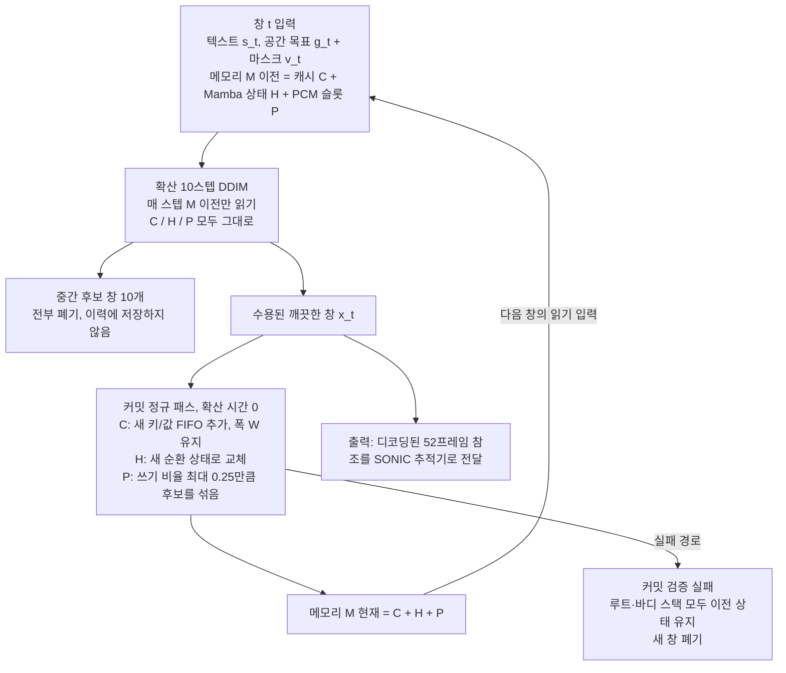

[논문 링크](https://arxiv.org/abs/2611.29897)
## Motion Mamba 2.0: 자기회귀 확산 Mamba로 긴 구간을 실시간 제어하는 인간형 로봇

논문: *Motion Mamba 2.0: Autoregressive Diffusion Mamba for Long-Horizon Humanoid Control*, IEEE TPAMI 제출본 (arXiv:2611.29897).
코드: https://github.com/AIGeeksGroup/MotionMamba2.0 · 프로젝트: https://aigeeksgroup.github.io/MotionMamba2.0

## 도입

로봇이 걷는 도중 명령을 바꾸고 멀리 있는 목표 지점까지 이동하려면, 생성기는 지금까지 만든 동작을 잃지 않으면서 새 명령을 즉시 반영해야 한다. 과거를 압축해서 기억하는 일과 매번 같은 계산을 빠르게 끝내는 일은 서로 다른 문제이며, 이 논문은 앞을 순환 상태 공간 모델(Mamba)과 내용 슬롯(PCM)으로, 뒤를 CUDA Graph 재생으로 다룬다. 두 방식을 함께 쓸 때 약 40초(39.52초) 구간에서도 목표 도달 오차가 낮게 유지되고, 창 하나를 276.14 ms에 만드는 실행 경로가 확보된다.

## 먼저 읽어야 할 용어

- **확산 모델(diffusion model)**: 잡음에서 시작해 여러 번의 잡음 제거(denoising) 단계를 거쳐 깨끗한 동작을 추정하는 생성 모델. 여러 단계에 걸쳐 조건을 반복해서 반영할 수 있다는 점이 공간 목표 조건과 맞물린다.
- **자기회귀(autoregressive) 창(window) 생성**: 한 번에 52프레임(2.08초)짜리 "창"을 만들어 확정하고, 확정한 창을 이력으로 붙여 다음 창을 만든다. 명령이 도중에 바뀌어도 이미 시작된 흐름을 이어 갈 수 있는 이유다.
- **어텐션 캐시(attention cache)**: 과거 토큰을 전부 보관하지 않고 최근 몇 개의 창만 key/value로 남겨 조회하는 장치. 한계가 곧 "오래된 정보가 밀려난다"는 제약이 된다.
- **순환 상태 공간 모델(SSM, Mamba)**: 토큰을 저장하는 대신 고정 크기의 상태를 토큰마다 갱신해 과거를 압축해 가는 모델. "재개 가능(resumable)"은 상태를 저장해 두었다가 다음 구간에서 처음부터 다시 계산하지 않고 이어 쓸 수 있다는 뜻이며, 상태 크기는 처리한 길이와 무관하다.
- **루트-바디 분해**: 전신 동작을 위치·방향(루트)과 관절(바디)로 나누어 표현하는 설계. "어디로 가라"는 제약을 루트에 직접 조건으로 넣을 수 있고, 관절 쪽은 차원을 낮춰 잠재 벡터로 압축할 수 있다.
- **공간 목표 조건(spatial target)**: 루트 궤적, 웨이포인트, 키프레임, 관절 위치·회전 등을 "언제 도달해야 하는지"와 함께 지정하는 입력. 미래의 목표 지점도 미리 생성하지 않고 조건으로만 넘긴다.
- **추적 컨트롤러(SONIC)**: 만들어진 운동학 참조를 실제 로봇의 관절 명령으로 바꿔 따라가는 실행 계층. 이 논문은 "참조를 만드는 쪽"이고, 균형과 접촉은 추적기의 몫이다.
- **CUDA Graph**: 정해진 커널 실행 순서를 미리 캡처해 한 번에 재실행하는 GPU 기능. 커널 하나하나를 반복 호출할 때 드는 호스트 디스패치 비용을 줄여 준다.

## 문제: 두 가지 어려움은 서로 다른 층에 있다

대화형 로봇 제어에는 두 요구가 동시에 붙는다. 하나는 실행이 이미 시작된 뒤에도 새 명령이 앞으로의 동작에 반영되어야 한다는 점이고, 다른 하나는 결과가 하류 추적 시스템에 넘어갈 만큼 빨라야 한다는 점이다(§1, p.2).

첫 번째 어려움은 **기억**이다. 어텐션 캐시는 크기가 정해져 있어 오래된 특징을 밀어내고, 반대로 캐시를 무한히 키우면 저장량과 계산량이 구간이 늘어날수록 함께 커진다. 두 번째 어려움은 **속도**다. 짧은 창을 반복해서 잡음 제거하면 한 번의 평가가 작아도 반복 횟수가 지배한다. 두 요구는 서로 다른 층에 놓여 있다. 샘플링 스텝 수를 줄여도 모델이 참조할 수 있는 이력은 길어지지 않고, 이력을 압축해도 잡음 제거 비용은 그대로 남는다.

여기에 세 번째 구분이 얹힌다. 확산의 잡음 제거 단계에서 나오는 중간 결과들은 시간상 연속된 동작이 아니라 **같은 출력 창에 대한 여러 대안**이다(§1, p.2). 그 중간 후보를 이력으로 저장해 버리면 샘플링 반복과 물리적 시간이 섞여 들어간다. 이 논문은 그래서 예측과 이력 반영(커밋) 사이의 경계를 모델 설계의 일부로 다룬다.

## 작은 예시: 한 창을 만들 때 무엇이 남고 무엇이 버려지는가

**설명용 예시**(논문 실험값이 아니라 구조를 이해하기 위한 예시다. 창당 토큰 수 `C`와 토큰당 프레임 `P`의 값은 원문 미보고이며, 아래의 프레임·주기는 논문과 같다).

25 Hz로 동작하는 로봇이 52프레임(2.08초)짜리 창을 하나씩 만든다고 하자. 창 `t`의 입력은 텍스트 명령 `s_t`("오른손을 흔들어"), 공간 목표 `g_t`(예: 오른손목이 특정 시각에 특정 위치 도달)와 그 유효 마스크 `v_t`, 그리고 이전에 **수용된** 동작에서 만들어진 메모리 `M_{t-1}`이다. 메모리는 세 조각으로 이루어진다.

| 구성 요소 | 언제 무엇을 저장하고 어떻게 바뀌는가 | 크기 | 읽는 쪽 |
|---|---|---|---|
| 어텐션 캐시 `C` | 수용된 창의 key/value/유효 마스크를 덧붙이고, 폭 `W`을 넘으면 가장 오래된 창의 key/value를 버린다 | 최근 `W`개 창 (추론에서는 4창 = 208프레임) | 어텐션 쿼리 |
| Mamba 순환 상태 `H` | 수용된 창의 토큰을 스캔에 통과시켜 순환 행렬·누적 위상·직전 벡터를 갱신한다 | 수용 시퀀스 길이와 무관하게 고정 | Mamba-3 스캔 (어텐션 토큰은 아님) |
| PCM 슬롯 `P` | 상태 요약·상태 변화·텍스트 조건을 후보로 만들어 이전 슬롯과 섞어 덮어쓴다 | `S`개 슬롯 (실제 `S` 값은 원문 미보고) | 어텐션 쿼리의 추가 key/value |

확산은 10스텝 DDIM으로 진행된다. 각 스텝은 **같은** `M_{t-1}` 스냅샷만 읽고, 10개의 중간 후보는 전부 폐기된다. 확정한 창이 나온 뒤에야 확산 시간 0의 정규 패스가 돌면서 캐시 추가·상태 교체·슬롯 쓰기가 루트 스택과 바디 스택에 **함께** 반영된다. 이 패스가 실패하면 두 스택 모두 이전 상태를 유지한다. 미래 공간 목표는 조건 입력일 뿐 이력에 들어가지 않는다.

| 단계 | 읽어들이는 것 | 바뀌는 상태 | 그대로 남는 것 | 버려지는 것 |
|---|---|---|---|---|
| 창 입력 | `s_t`, `g_t`, `v_t`, `M_{t-1}` | 없음 | 캐시 `C`, 상태 `H`, 슬롯 `P` 전부 | — |
| 확산 10스텝 | 매 스텝 동일한 `M_{t-1}` | 없음 (읽기 전용) | `C`, `H`, `P` 모두 | 스텝마다 나오는 중간 후보 창 10개, 임시 상태 제안 |
| 수용 후 정규 패스 | 확정한 깨끗한 창 | `C`에 새 키/값을 FIFO로 추가(폭 `W` 유지), `H`를 새 상태로 교체, `P`를 쓰기 비율 최대 0.25만큼 갱신 | 캐시 폭, 상태 크기, 슬롯 개수는 고정 | 정규화 과정에서 사라진 잡음 |
| 커밋 실패 시 | — | 없음 (루트·바디 스택 모두 이전 상태 유지) | 이전 `C`, `H`, `P` | 새로 만들어진 창 |
| 출력 | 확정된 창 | — | — | — |

도식의 각 상자는 "그 시점에 메모리가 어떤 상태인가"를 나타낸다. 화살표는 상태가 전달되는 방향이고, 되돌아가는 화살표(`F`→`A`)가 자동회귀의 순환을 뜻한다. 상자 안의 숫자는 그 시점에 고정된 값이다. 52프레임·2.08초는 25 Hz에서 한 창이 담는 시간이고, 10은 DDIM 스텝 수, 4창/208프레임은 추론 때 유지하는 캐시 폭, 0.25는 PCM 슬롯이 한 번에 덮어쓸 수 있는 최대 비율이다. `C`와 `H`는 시간이 지나도 크기가 늘지 않고, 늘어나는 것은 캐시에 새로 들어오는 키/값뿐이다.

## 방법

### 1. 루트-바디 분해로 동작을 표현한다

저자들은 ARDY의 하이브리드 표현을 따른다(§4.1, p.5). 루트는 위치 `p`와 방향 `ψ`로 나타내고, 바디는 관절 회전·관절 위치와 속도·접촉 지표를 넣어 코덱이 저차원 잠재 벡터 `b`로 압축한다. 한 토큰은 루트 패치와 바디 잠재를 이어 붙인 것이고, 루트는 다음과 같이 방향을 삼각함수로 펼친다.

$$m_r = [\,p;\ \cos\psi;\ \sin\psi\,],\qquad x_i = [\,r_i;\ b_i\,]$$

코덱의 인코더 `E`는 명시적 동작을 바디 잠재로 옮기고, 디코더 `D`는 잠재와 루트의 지역 특징을 합쳐 관절 배치를 복원한다. 좌표는 현재 정규 프레임으로 표현하고 누적 이동은 따로 보관해 월드 궤적을 되살린다.

생성은 두 단계다. 각 확산 평가마다 먼저 루트를 예측하고, 그 루트의 지역 특징을 조건으로 바디를 예측한다(§4.2, Eq. 5). 루트 예측이 매 단계 새로고침되므로 루트와 바디는 확산 내내 결합된 상태를 유지하며, 두 스택은 파라미터와 층별 메모리를 따로 갖는다.

### 2. 어텐션과 Mamba를 한 층에 섞는다

각 스택은 확산 트랜스포머 층으로 구성되고, 시퀀스 믹서 안에서 어텐션과 Mamba가 같은 조건 정규화 특징 `U`를 함께 처리한 뒤 학습된 층별 게이트로 출력을 섞는다.

- **어텐션**은 슬라이딩 캐시에서 최근 특징을 꺼내 읽는다. 현재 창 내부는 양방향으로 서로 볼 수 있는데, 잡음 제거가 창 전체를 한꺼번에 진행하기 때문이다.
- **Mamba-3**는 이전에 수용된 접두사에서 상태를 이어받아 스캔을 재개한다. 토큰을 모두 저장하는 대신 고정 크기 상태 `H`를 토큰마다 갱신하고, 재개 가능하다는 말은 창 `t`를 처리한 뒤 상태를 저장해 두었다가 창 `t+1`에서 처음부터 다시 계산하지 않고 이어 쓰는 뜻이다(§4.2, p.6).

여기서 간극이 생긴다. `H`는 과거 전체를 압축한 요약이지만 그 자체로는 어텐션이 조회할 key/value가 아니다. 반대로 캐시는 최근 것만 남기고 오래된 것을 버린다. 두 갈래를 네트워크에 나란히 두기만 해서는 압축된 순환 이력이 어텐션에게 보이지 않는다(§1, p.2). 그래서 학습된 인터페이스가 필요하고, 그것이 이 논문의 핵심인 PCM이다.

### 3. PCM: 순환 상태를 어텐션이 읽을 수 있는 슬롯으로 바꾼다

PCM은 각 층에 `S`개의 슬롯 `P`를 두고 0으로 초기화한다. 창이 수용될 때마다 네 단계를 거친다(§4.3, p.6~7).

1. **요약**: 순환 행렬을 풀링·투영·정규화해 상태 요약 `s_t`를 만든다.
2. **변화**: 이전 수용 창의 요약과의 차이 `d_t = s_t - s_{t-1}`를 계산해 "방금 창에서 무엇이 바뀌었는가"를 담는다.
3. **텍스트 조건**: 활성 명령의 임베딩 `e_t`를 투영해 정규화된 상태 차이에 스케일과 이동을 가한다. 같은 상태 전이가 명령에 따라 다른 메모리 갱신이 되도록 하는 장치다. 이 텍스트 조건에는 확산 시간과 초기 방향의 임베딩이 들어가지 않는다.
4. **쓰기 게이트**: 요약·변화·텍스트를 이어 붙인 후보를 만들고 이전 슬롯을 함께 읽어 쓰기 비율 `w_t`를 예측한다. 상한 `η = 0.25`로 한 번에 너무 많이 덮어쓰지 않게 한다.

$$P_t = (1-w_t)\odot P_{t-1} + w_t \odot Z_t$$

`Z_t`는 후보 슬롯 내용이고 `w_t`는 0~0.25 사이의 게이트다. `w_t`가 작으면 이전 슬롯을 거의 유지하고 크면 후보를 더 반영한다. 이렇게 만든 슬롯은 싱크 토큰 바로 뒤에 key/value로 끼워 넣어져, 어텐션이 압축된 과거 맥락을 직접 읽게 된다(§4.3, Eq. 7·13). 싱크 토큰 자체는 정적 모델 파라미터이며 한 에피소드의 과거 동작을 저장하지 않는다.

최종 믹서 출력은 기본 어텐션 `A_0`, 슬롯을 더한 어텐션 `A_P`, Mamba 출력 `M`을 학습된 스칼라로 섞는다.

$$Y = A_0 + \tanh(\rho)(A_P - A_0) + \sigma(\zeta)M$$

`ρ`를 0으로 초기화하면 슬롯을 추가해도 정확히 기존 Native 믹서 출력이 복원된다. 이는 슬롯 값을 0으로 두는 것과 다른데, key가 하나 늘면 어텐션의 정규화가 달라질 수 있기 때문이다(§4.3, p.7). 이 초기화는 학습 초기에 PCM의 추가 어텐션 기여를 억제하며, PCM은 별도 사전 학습이나 미세조정 없이 처음부터 공동 학습된다(App. B.1). 또한 PCM은 쿼리 구성을 바꾸지 않고, 상태 요약은 별도 상태 의존 쿼리가 아니라 콘텐츠 쓰기를 통해 들어온다.

### 4. 수용된 이력만 커밋한다

메모리 갱신 시점도 설계의 일부다. 확산 평가마다 임시 상태 제안이 생길 수 있지만 샘플링 중에 커밋되지 않는다(§4.3, Eq. 14). 각 잡음 제거는 변하지 않는 이력 스냅샷만 읽는다. 샘플링이 끝나면 수용된 창을 확산 시간 0의 정규 패스에서 재중심을 맞추고 깨끗한 이력으로 만든다. 이 패스에서만 캐시 추가·Mamba 상태 교체·PCM 쓰기가 루트와 바디 스택에 걸쳐 함께 반영되고, 패스가 실패하면 두 스택 모두 이전 상태를 유지한다(App. B.2, Algorithm 1). 미래 공간 목표는 조건 입력일 뿐 이력에 들어가지 않는다.

이 구조 덕분에 출력 창과 조건 예산이 같으면 새 창 하나마다 드는 메모리와 계산량이 생성 시간이 늘어도 커지지 않는다. 다만 이는 **계산 맥락**의 상한일 뿐, 임의로 긴 시간 동안 오류 없는 동작을 보장하지 않는다.

### 5. 상태를 보존한 채 실행을 가속한다

상태를 보존한다는 성질이 추론 최적화의 전제가 된다. 저자들은 세 가지 최적화를 더한다(§4.4, p.8).

1. **읽기 전용 실행**: 잡음 제거 중에는 예측이나 이후 커밋에 쓰이지 않는 상태 제안·진단값을 만들지 않는다. 깨끗한 이력 커밋은 별도의 정규 패스에서 온전히 수행한다.
2. **융합 커널**: Mamba 전이 전처리(감쇠 활성화, 감쇠 하한, 스텝 크기 변환, `∆A` 곱)를 한 번의 순회로 합친다. 중간값은 FP32 레지스터에 두고 스캔이 요구하는 배치로 출력한다.
3. **CUDA Graph 재생**: 루트와 바디 스택이 각각 별도 그래프를 쓰고, 텍스트·공간·무조건 세 갈래의 CFG 분기를 함께 캡처해서 재생한다. 입력 투영·조건 준비·루트 출력 처리·루트→로컬 변환·바디 입력 구성은 그래프 밖에 남고, 샘플링·난수·재중심화·커밋도 밖에 있다.

세 최적화 모두 샘플링 절차나 메모리 구조를 바꾸지 않는다. 어텐션은 FP32, Mamba 내부의 BF16 경계, 상태 누적의 FP32, TF32 비활성화를 그대로 유지하므로 검증된 롤아웃에서 출력과 커밋된 상태가 비트 단위로 동일하게 보존된다(§5.4, App. B.3). 즉 이 가속은 "더 빠른 다른 계산"이 아니라 "같은 계산의 반복 비용을 줄이는 것"이다.

### 6. 학습 목표

네 항을 더한다(§4.5, Eq. 15). `L_hyb`는 루트 패치와 바디 잠재에 Smooth L1을 적용하고, `L_body`는 복원된 관절에 L1을 적용한다. `L_goal`은 생성 창 안의 관측 좌표에만 L1을 적용하며, 이후 시점의 목표는 목표 프레임이 출력 창에 들어올 때까지 조건 입력으로만 남는다. `L_FK`는 복원된 회전에서 순방향 운동학으로 얻은 관절 위치와, 복원된 위치 특징이 나타내는 관절 위치 사이의 유클리드 불일치를 잰다. 코덱은 디노이저 학습 동안 동결된다.

## 평가 조건

- **데이터**: BONES Seed·HumanML3D·HiPHI를 29-DoF G1 표현(414개 물리 특징, 25 Hz)으로 합쳐 156,819건, 588.92시간의 학습 풀을 만든다. HiPHI는 고정밀 인간 동작 부분집합만 쓰고 물체 상호작용 부분집합은 제외한다.
- **리타기팅 정합성**: 매핑 목표 잔차에서 발목 중앙값은 HiPHI 0.93 cm, HumanML3D 1.49 cm이고 골반 중앙값은 0.56 cm, 0.99 cm이다. 어드미티드 인간 소스 38,028건 모두 저장 포맷과 414차원 표현의 왕복 점검을 통과했고 최대 위치 오차는 1.31 × 10⁻⁶ m였다(App. A).
- **학습**: AdamW로 100,000 업데이트, 글로벌 배치 512. 텍스트·공간 조건 드롭아웃은 각각 0.1이고 공간 조건이 비어 있을 확률은 0.2다. 이력·미래 조건 길이는 무작위로 뽑히며 최대 이력은 196프레임(7.84초)이다. 모든 비교 방법과 구조 변형은 같은 G1 코퍼스에서 같은 100,000 업데이트 예산으로 독립 학습했고, 원본 사전학습 가중치는 쓰지 않았다(App. C.2).
- **평가**: 25 Hz, 52프레임 창. retargeted HiPHI는 1·4·9·19창(2.08~39.52초), BONES Seed와 retargeted HumanML3D는 1·4창을 본다. 초기화 128개와 노이즈 시드 3개 조합으로 구간마다 384개 롤아웃을 돌린다. 각 시행은 루트 목표 하나와 손목 또는 발목 목표 하나를 마감 시각과 함께 지정한다. 샘플링은 10스텝 결정론적 DDIM(η=0), 가이드는 텍스트·공간 (2, 2)다.
- **지표**: Root CE는 월드 X–Z 평면의 수평 루트 위치 오차, End CE는 마감 시각의 손목·발목 3D 위치 오차(cm), Cmd.는 거친 루트 상태 일치율, R@3은 텍스트-동작 검색, L2-FID는 256차원 특징의 분포 유사도, Lat.은 수용 창 하나당 지연(ms)이다.

## 결과

### 1. 긴 롤아웃에서 목표를 도달시키는가

HiPHI에서 루트·종료 오차를 비교한 결과다(§5.2, Table 1, 일부 방법만 발췌). 단위는 cm이며 낮을수록 좋다.

| 방법 | 2.08 s (1창) | 8.32 s (4창) | 18.72 s (9창) | 39.52 s (19창) |
|---|---|---|---|---|
| ARDY | 5.89 / 9.70 | 7.44 / 10.27 | 8.15 / 11.06 | 10.09 / 14.84 |
| MotionStreamer | 17.89 / 23.56 | 16.93 / 25.31 | 6.17 / 18.07 | 7.78 / 21.67 |
| Motion Mamba (ECCV'24) | 50.58 / 53.39 | 56.81 / 59.83 | 78.67 / 82.37 | 125.74 / 130.17 |
| **Motion Mamba 2.0** | **2.78 / 7.19** | **2.53 / 7.11** | **2.87 / 8.45** | **7.55 / 13.64** |

제안 방법은 모든 구간에서 Root CE가 가장 낮고 End CE도 가장 낮거나 동률이다. 18.72초에서는 2.87 / 8.45 cm로, MotionStreamer의 6.17 / 18.07 cm와 ARDY의 8.15 / 11.06 cm를 앞선다. 39.52초에서는 Root CE 7.55 cm로 최선의 경쟁자인 MotionStreamer의 7.78 cm보다 3.0% 낮고, End CE 13.64 cm로 ARDY의 14.84 cm보다 8.1% 낮다(§5.2, p.9).

같은 표에서 명령 일치도(Cmd.)와 텍스트-동작 검색(R@3)도 네 구간 모두 최고다. 39.52초에서 Cmd.는 46.05%로 MoLingo의 41.34%보다 높고, R@3는 23.68%로 OMG의 19.61%보다 높다. 반면 분포 유사도(L2-FID)는 8.32·18.72·39.52초에서 각각 0.401, 0.402, 0.409로 가장 낮지만, 단일 창(2.08초)에서는 CMDM(0.337)이 제안 방법(0.410)보다 좋다. 8.32초에서 DreamControl(0.402)과의 차이는 0.001에 불과하다. 즉 정확한 공간 제어와 단일 창의 분포 품질은 항상 함께 좋아지지 않는다.

비교표에서 눈에 띄는 점은 ECCV'24 버전의 Motion Mamba다. 이 버전은 구간이 길어질수록 오차가 크게 벌어져 39.52초에서 Root CE가 125.74 cm에 이른다. 두 버전은 구조와 학습 설정이 달라 직접 비교는 아니지만, 수용 전용 커밋·고정 크기 상태·PCM으로 이루어진 이번 메모리 설계가 장기 제어에 기여했을 가능성을 시사한다.

거리가 먼 목표 하나를 준 정성 비교도 붙는다(App. C.6). 18 m 목표와 33.40초 마감 조건에서 제안 방법은 16.68초에 9.91 m, 25.04초에 15.05 m까지 전진했고, ARDY는 같은 시각에 6.97 m와 9.36 m에 그쳤다. ARDY에는 평면 루트 속도가 0.1 m/s 아래로 떨어지는 정지 구간이 약 6.7~13.6초와 18.7~22.8초에 있었고, 마지막 1초 평균 루트 속도는 ARDY 1.99 m/s, 제안 방법 0.71 m/s였다. 선택된 단일 예시이므로 통계적 비교가 아니라 경향의 증거로 읽어야 한다.

### 2. 짧은 구간에서도 공간 제어와 검색이 유지되는가

**BONES Seed**에서는 네 구간 모두 Root/End CE 최저, R@3 최고다(§5.2, Table 2). 8.32초에서 Root CE는 1.86 cm로 ARDY의 4.96 cm보다 62.5% 낮고, End CE는 6.86 cm로 10.16 cm에서 낮아졌다. R@3는 35.58%, Cmd.는 51.42%다. 다만 Cmd.는 최고가 아니고, 2.08초의 L2-FID는 OMG(0.345) 우세(제안 방법 0.573)다. DartControl이 가장 빠른 방법이다.

**retargeted HumanML3D**에서도 두 구간 모두 Root/End CE가 최저다(§5.2, Table 3). 8.32초에서 2.17 / 7.03 cm로, ARDY의 4.75 / 9.82 cm 대비 Root CE가 54.3% 낮다. 4창 R@3는 49.72%로 가장 높고(DartControl 48.35%), 2.08초의 R@3 84.29%는 MotionStreamer의 96.40%보다 낮다. L2-FID는 2.08초에서 OMG(0.319) 우세, 8.32초에서 제안 방법 0.490이 ARDY(0.491)를 미세하게 앞선다.

두 벤치마크를 통틀어 "공간 제어를 정확히 지켜내면서도 검색과 분포 품질까지 높였다"는 결론은 나오지 않는다. 세 데이터셋에서 공통된 것은 **루트·종료 오차의 우위**이고, 의미 기반 지표는 벤치마크마다 편차가 있다는 점이다.

### 3. 어떤 부품이 무엇을 기여하는가

구조 변형 다섯 개를 같은 예산으로 학습해 비교했다(§5.3, Tables 4~6). HiPHI 39.52초 결과는 다음과 같다.

| 변형 | Root CE | End CE | Cmd. | R@3 | L2-FID | Lat. (ms) |
|---|---|---|---|---|---|---|
| Minimal (Mamba 없음) | 60.00 | 64.86 | 35.27 | 17.26 | 0.439 | 552.9 |
| Native (Mamba, PCM 없음) | 9.36 | 15.54 | 32.20 | 17.44 | 0.416 | 258.7 |
| Native + PCM (텍스트 조건 제외) | 8.62 | 14.62 | 33.34 | 21.18 | 0.467 | 336.5 |
| Native + PCM (상태 변화 제외) | 8.30 | 14.18 | 32.65 | 21.11 | 0.488 | 329.8 |
| **Motion Mamba 2.0** | **7.55** | **13.64** | **46.05** | **23.68** | **0.409** | **333.4** |

**순환 모델링의 효과는 구간이 길수록 커진다.** 39.52초에서 Minimal에 Mamba를 넣으면 Root CE가 60.00에서 9.36 cm로, End CE가 64.86에서 15.54 cm로 떨어진다. 단일 창의 차이는 훨씬 작다. BONES Seed와 HumanML3D의 8.32초에서도 오차 개선이 같은 방향으로 나타난다. 다만 지표별로 이득이 고르지 않다. Native는 39.52초에서 Minimal보다 Cmd.가 낮다(32.20% 대 35.27%).

**PCM은 세 벤치마크에서 Root/End CE를 일관되게 낮춘다.** HiPHI 39.52초에서 Root CE는 9.36에서 7.55 cm로(19.3%), End CE는 15.54에서 13.64 cm로(12.2%) 낮아지고, Cmd.는 32.20%에서 46.05%로, R@3는 17.44%에서 23.68%로, L2-FID는 0.416에서 0.409로 움직인다. 텍스트 조건을 빼면 8.62 / 14.62 cm에 33.34% / 21.18%, 상태 변화 항을 빼면 8.30 / 14.18 cm에 32.65% / 21.11%로 떨어진다. 18.72초에서 완전 버전의 Cmd. 47.11%는 두 부분 버전(38.10%, 37.18%)보다도 높다. BONES Seed와 HumanML3D의 8.32초에서는 완전 모델이 Root CE를 Native의 5.46에서 1.86 cm로, 6.25에서 2.17 cm로 낮춘다. 저자들은 이 결과를 상태 변화와 텍스트 조건 쓰기가 보완적 역할을 한다는 근거로 해석하되, 밀려난 사건의 정확한 재현을 입증한 것은 아니라고 선을 긋는다.

표를 읽을 때 한 가지 주의가 필요하다. 이 표의 지연 열은 속도 비교가 아니다. Minimal은 융합 커널과 CUDA Graph 없이 FP32 SDPA 경로를 쓰고 Native 계열은 가속 경로를 쓰므로, 지연 열은 각 구현 전체의 기술이다(App. C.2).

### 4. 속도 배수는 어디에서 나오는가

속도는 완성된 창 하나를 만드는 지연으로 측정했다(§5.4, Table 7). 조건은 RTX 4090 1대, 배치 1, 10스텝 DDIM, CFG 3분기 가이드 (2, 2), 이력 4창이며, 상태 복원부터 샘플링·커밋·디코딩·CPU 스냅샷까지 창 전체 시간을 포함한다. 텍스트 임베딩은 사전 로드되며 로딩·워밍업·그래프 캡처 시간은 제외된다. 5개 독립 프로세스에서 30쌍씩 재고, 신뢰구간은 10,000회 프로세스 블록 부트스트랩으로 잡았다.

| 최적화 조합 (Flow / Fusion / Graph) | p50 (ms) | p95 (ms) | 중앙 paired speedup |
|---|---|---|---|
| — / — / — | 1685.35 | 2471.65 | 1.000× |
| ✓ / — / — | 1102.82 | 1647.52 | 1.525× |
| ✓ / ✓ / — | 1069.52 | 1588.74 | 1.578× |
| ✓ / — / ✓ | 285.20 | 352.22 | 5.943× |
| ✓ / ✓ / ✓ | 276.14 | 345.82 | 6.138× |

배율의 대부분은 CUDA Graph 재생에서 나온다. 실행 흐름 단순화만으로 1.525배, 융합 커널을 더해 1.578배인 반면 그래프 재생을 더하면 5.943배로 뛴다. 융합 커널이 추가로 주는 몫은 285.20에서 276.14 ms로, paired 기준 1.029배에 그친다. 전체 최적화는 p50를 83.6%, p95를 86.0% 줄였고 중앙 paired speedup은 6.138배이며 95% 신뢰구간은 [6.094, 6.290]이다.

프로파일(Fig. 7)이 이 해석을 뒷받침한다. 일반 호스트 실행은 83,777회에서 5,519회로 93.4% 줄고, GPU 커널은 86,849회에서 44,877회로 48.3% 줄며, 동기화 호출은 10,194회에서 1,330회로 줄었다. 호스트 실행 감소폭이 압도적으로 커서, 병목이 단일 커널의 연산이 아니라 작은 커널을 여럿 띄우는 호스트 디스패치 비용이었음과 부합한다. 최적화된 p50 276.14 ms는 2.08초 창에 대해 실시간 계수 0.133에 해당한다.

두 가지는 분명히 구분해야 한다. 첫째, 이 276.14 ms는 **정상 상태 생성 시간**이고 콜드 스타트나 "명령 → 보이는 움직임" 지연이 아니다. 둘째, Table 1의 비교표를 보면 제안 방법의 창당 지연은 283.7~333.4 ms로 ARDY(90.1~105.1 ms)보다 느리다. 6.138배는 제안 방법의 실행 경로 자체를 개선하기 전과 비교한 값이지, 다른 방법을 앞섰다는 뜻이 아니다. 수치적 동일성은 시드가 다른 4개의 100창 롤아웃에서 출력과 커밋된 상태가 비트 단위로 같아지는 수준까지 확인된다.

### 5. 실제 로봇에서 이어지는가

배치는 원격 RTX 4090 서버(텍스트 인코딩·생성), 통신·인터랙션을 담당하는 중간 워크스테이션, 그리고 모션 추적을 담당하는 G1 onboard 컨트롤러의 세 층이다(§6, p.12~13). 생성 참조는 워크스테이션을 경유해 ZeroMQ와 SSH 터널링으로 50 Hz에 전송된다(모델의 25 Hz 동작 표현과는 다른 전송 주파수다). 추적은 SONIC이 수행하며 생성기는 로봇에서 돌지 않는다.

과제는 네 개다. T1 순차 행동 조합 20회, T2 표현적 동작 20회, T3 키보드 제어 30회, T4 마우스 제어 30회. 전 과제 성공은 낙상·보호 정지·사람 개입 없이 모든 단계를 완료하는 것을 뜻한다.

| 과제 | 전 과제 성공 | 완료 단계 | 텍스트 전환 성공 | 안정 | 낙상 |
|---|---|---|---|---|---|
| T1 행동 조합 | 18/20 (90.0%) | 136/140 | 117/120 | 19/20 | 0 |
| T2 표현적 동작 | 19/20 (95.0%) | 99/100 | 78/80 | 20/20 | 0 |
| T3 키보드 | 29/30 (96.7%) | 59/60 | 30/30 | 29/30 | 0 |
| T4 마우스 | 28/30 (93.3%) | 58/60 | 29/30 | 29/30 | 0 |

네 과제를 합치면 100회 중 94회가 전 과제 성공, 97회가 안정성 기준을 충족했고 낙상은 한 번도 없었다. 안정적이면서도 과제 요구를 끝내지 못한 경우가 3회, 안정성 기준을 놓친 경우가 3회였다(Tab. 8).

지연은 두 종류를 구분해 보고해야 한다(§6, Tab. 9). **핸드오프 지연**은 명령을 시스템이 받은 순간부터 GPU 서버에서 해당 동작 참조가 완성될 때까지로, 생성·디코딩·이력 갱신과 새 텍스트가 들어올 때의 텍스트 인코딩을 포함하고 네트워크 전송과 로봇 측 처리는 제외한다. **물리 응답 지연**은 같은 명령 수신 시점부터 로봇이 명령 허용 오차를 만족하는 지속 동작을 시작할 때까지로, 통신·버퍼링·물리 실행까지 포함한다.

| 측정 | 키보드 | 마우스 |
|---|---|---|
| 핸드오프 p50 / p95 (ms) | 246 / 302 | 251 / 310 |
| 물리 응답 p50 / p95 (ms) | 351 / 504 | 360 / 525 |
| 속도 RMSE (m/s) | 0.041 ± 0.012 | 0.045 ± 0.014 |
| 방향 MAE (°) | 4.6 ± 1.5 | 5.1 ± 1.7 |
| 발 미끄럼 (cm/s) | 1.5 ± 0.5 | 1.7 ± 0.6 |
| 1.5초 기한 내 성공 이벤트 | 296/300 (98.7%) | 292/300 (97.3%) |

이 수치는 §5.4의 캐시된 텍스트 추론 시간과 다른 측정이다. 사용자가 체감하는 반응 시간은 물리 응답 쪽에 해당한다. 정성적으로는 T1에서 11.61초의 경례와 28.83초의 팔 들어 동작, T2에서 32.48초까지 이어지는 동작이 관찰되어 보행 반복을 넘어서는 동작 범주가 확인된다(§6.2).

## 한계와 적용 판단

저자가 직접 인정한 한계는 하나다. 이 프레임워크는 제어 가능한 인간형 동작 생성에 초점을 맞추고 있어 **물체 조작을 다루지 못한다**. 향후 과제로 이동과 조작을 함께 다루는 전신 조작(loco-manipulation)을 꼽는다(§7, p.13).

나머지는 결과를 읽으면서 확인해야 할 제약이다.

- **압축된 기억은 완전한 재현이 아니다.** 고정 크기의 상태·캐시·슬롯은 맥락을 유계로 만들 뿐, 임의로 먼 과거의 세부를 모두 기억한다고 보장하지 않는다. PCM은 오래전 지시를 글자 그대로 재현하기 위한 장치가 아니라 장기 공간 제어와 명령 조건 생성을 돕는 장치로 설계되었다(§1 p.2, §4.3 p.6, §5.3 p.11).
- **학습이 장기 검색을 직접 감독하지 않는다.** 학습 때 최대 이력은 196프레임(7.84초)으로, 4창 로컬 캐시 208프레임보다 짧다. 생성 이력을 되감아 학습하지도 않고 창을 넘긴 역전파도 하지 않는다. 따라서 로컬 어텐션 범위 너머를 꺼내 쓰는 능력은 자동회귀 추론 단계에서만 평가된다(App. B.2, C.2).
- **평가 수평선 간 비교는 지속 시간의 효과를 분리하지 못한다.** 구간마다 명령 단계의 구성, 단계별 할당 창 수, 마감 시각이 다르다. 2.08초 구간은 4단계 구성만 평가한다는 점도 여기에 포함된다(App. C.4).
- **지표는 벤치마크 안에서만 해석해야 한다.** R@3의 후보 구성이 HiPHI(생성 32개)와 BONES Seed·HumanML3D(생성 1개 + 실제 동작 31개)로 달라 벤치마크 간 비교가 불가능하며, L2-FID도 같은 이유로 각 벤치마크 안에서만 본다. Tab. 12의 실제 동작 보정값(HiPHI 44.44~53.59% 등)은 평가기 진단치이지 모델 성능이나 상한이 아니다. Cmd.는 거친 루트 상태 일치율이지 전체 자연어 지시의 이행 여부를 재는 지표가 아니다(App. C.1, C.5).
- **속도와 안정성의 측정 범위가 좁다.** 6.138배는 RTX 4090 1대, 배치 1, 정상 상태의 값이고 콜드 스타트와 명령→보이는 지연은 포함하지 않는다. 실제 평가는 한 기종(Unitree G1)과 한 추적기(SONIC)에 한정되며, 생성된 운동학적 참조가 물리적으로 실행 가능함을 보장하지는 않는다(§2.3, p.4).
- **비교 대상은 원본 가중치가 아니라 재학습된 체크포인트다.** 모든 방법이 같은 G1 코퍼스에서 같은 100,000 업데이트 예산으로 독립 학습했다. 따라서 표의 값은 통제된 예산 아래의 상대 비교이며, 각 방법의 원본 배포 가중치가 가진 성능과는 다르다(App. C.2).

정리하면 이 방법은 "특정 인간형 로봇의 운동학적 동작 참조를 하류 추적기와 연결해 실시간으로 길게 생성"해야 하는 환경에 적합하다. 아직 검증되지 않은 조건은 물체 조작, 다른 기구, 콜드 스타트 지연, 그리고 임의의 과거 지시를 정확히 재현해야 하는 경우다.

<!-- verbatim-tables -->

논문 원문의 표

> arXiv e-print 의 LaTeX 원본에서 기계적으로 옮긴 표입니다. 숫자는 논문의 값이며 모델을 거치지 않았습니다.

**표 1. **Short- and Long-Horizon Motion Generation on Retargeted HiPHI.** CE is reported in cm, Cmd.\ and R@3 in percentages, and latency in ms per accepted window at batch size 1. R@3 uses 32 generated motion candidates. See App. C for details.**

| Method | 52 frames / 1 window Root CE$\downarrow$ | 52 frames / 1 window End CE$\downarrow$ | 52 frames / 1 window Cmd.$\uparrow$ | 52 frames / 1 window R@3$\uparrow$ | 52 frames / 1 window L2-FID$\downarrow$ | 52 frames / 1 window Lat.$\downarrow$ | 8.32 s / 4 windows Root CE$\downarrow$ | 8.32 s / 4 windows End CE$\downarrow$ | 8.32 s / 4 windows Cmd.$\uparrow$ | 8.32 s / 4 windows R@3$\uparrow$ | 8.32 s / 4 windows L2-FID$\downarrow$ | 8.32 s / 4 windows Lat.$\downarrow$ | 18.72 s / 9 windows Root CE$\downarrow$ | 18.72 s / 9 windows End CE$\downarrow$ | 18.72 s / 9 windows Cmd.$\uparrow$ | 18.72 s / 9 windows R@3$\uparrow$ | 18.72 s / 9 windows L2-FID$\downarrow$ | 18.72 s / 9 windows Lat.$\downarrow$ | 39.52 s / 19 windows Root CE$\downarrow$ | 39.52 s / 19 windows End CE$\downarrow$ | 39.52 s / 19 windows Cmd.$\uparrow$ | 39.52 s / 19 windows R@3$\uparrow$ | 39.52 s / 19 windows L2-FID$\downarrow$ | 39.52 s / 19 windows Lat.$\downarrow$ |
|---|---|---|---|---|---|---|---|---|---|---|---|---|---|---|---|---|---|---|---|---|---|---|---|---|
| DiP | 57.07 | 60.45 | 40.78 | 25.66 | 0.402 | 73.6 | 62.58 | 66.16 | 31.59 | 11.08 | 0.444 | 68.7 | 77.69 | 80.88 | 20.50 | 12.84 | 0.487 | 68.7 | 96.99 | 99.26 | 18.45 | 12.45 | 0.490 | 66.8 |
| Go-to-Zero | 29.14 | 29.53 | 71.79 | 26.27 | 0.480 | 12344.9 | 39.65 | 40.19 | 40.63 | 18.17 | 0.514 | 12564.3 | 56.36 | 59.76 | 32.89 | 13.09 | 0.631 | 12403.2 | 86.47 | 88.91 | 25.03 | 12.11 | 0.743 | 12478.5 |
| DreamControl | 31.43 | 35.85 | 75.39 | 22.62 | 0.457 | 94.2 | 40.46 | 43.99 | 38.80 | 16.22 | 0.402 | 90.8 | 56.89 | 60.84 | 26.66 | 13.97 | 0.472 | 90.5 | 61.92 | 67.43 | 20.00 | 14.40 | 0.532 | 89.5 |
| MoLingo | 99.24 | 102.67 | 47.77 | 8.86 | 1.241 | 868.3 | 137.47 | 140.71 | 34.79 | 7.46 | 1.299 | 847.7 | 205.38 | 207.00 | 41.14 | 8.72 | 1.261 | 840.4 | 270.71 | 273.42 | 41.34 | 8.81 | 1.260 | 908.7 |
| HY-Motion | 30.76 | 33.54 | 55.70 | 16.67 | 0.400 | 324.1 | 43.94 | 45.97 | 37.37 | 12.47 | 0.492 | 274.0 | 65.06 | 66.75 | 31.96 | 14.52 | 0.629 | 290.5 | 95.53 | 96.63 | 27.61 | 13.47 | 0.760 | 346.8 |
| OMG | 58.18 | 60.59 | 46.76 | 25.93 | 0.448 | 173.9 | 82.83 | 85.97 | 36.41 | 18.84 | 0.428 | 170.2 | 115.50 | 118.11 | 29.85 | 20.96 | 0.443 | 168.3 | 161.76 | 163.49 | 24.52 | 19.61 | 0.473 | 167.8 |
| TACD | 21.81 | 25.55 | 77.27 | 28.44 | 0.428 | 203.0 | 30.49 | 34.66 | 43.71 | 18.26 | 0.422 | 224.9 | 40.19 | 44.16 | 34.88 | 20.63 | 0.418 | 191.6 | 54.43 | 59.40 | 28.03 | 17.81 | 0.496 | 208.0 |
| PCMDM | 63.86 | 66.65 | 28.71 | 17.59 | 0.434 | 58.4 | 61.17 | 63.96 | 26.73 | 10.43 | 0.457 | 51.6 | 62.41 | 64.93 | 16.12 | 10.28 | 0.512 | 53.0 | 65.18 | 66.99 | 14.27 | 10.96 | 0.544 | 51.4 |
| FlowMDM | 56.67 | 58.01 | 46.25 | 14.29 | 0.400 | 109.9 | 72.80 | 73.93 | 35.00 | 10.61 | 0.437 | 105.2 | 112.44 | 113.81 | 26.35 | 10.57 | 0.443 | 107.2 | 154.71 | 156.35 | 24.12 | 11.07 | 0.454 | 105.7 |
| DartControl | 44.84 | 48.37 | 71.88 | 13.49 | 0.387 | **34.7** | 64.66 | 68.24 | 34.24 | 16.52 | 0.471 | **30.3** | 91.05 | 95.51 | 41.17 | 16.35 | 0.493 | **29.1** | 291.58 | 295.86 | 40.32 | 15.53 | 0.511 | **28.2** |
| Motion-Agent | 20.72 | 24.09 | 22.22 | 23.17 | 0.437 | 13806.4 | 31.76 | 33.25 | 26.69 | 12.36 | 0.496 | 13694.5 | 43.15 | 46.34 | 14.97 | 12.14 | 0.542 | 13319.4 | 61.36 | 62.49 | 15.15 | 12.02 | 0.745 | 13511.1 |
| MG-MotionLLM | 63.77 | 67.99 | 22.39 | 23.02 | 0.434 | 5632.7 | 98.31 | 99.67 | 25.48 | 9.22 | 0.455 | 5783.3 | 204.32 | 203.35 | 12.14 | 10.60 | 0.451 | 5861.8 | 340.84 | 341.01 | 11.52 | 11.60 | 0.431 | 5772.3 |
| IRG-MotionLLM | 43.58 | 46.97 | 24.58 | 21.74 | 0.447 | 13329.8 | 70.64 | 72.89 | 23.86 | 11.93 | 0.472 | 13295.7 | 92.71 | 95.16 | 13.53 | 15.95 | 0.535 | 13198.4 | 113.23 | 131.52 | 13.04 | 13.15 | 0.751 | 12912.6 |
| MotionStreamer | 17.89 | 23.56 | 80.32 | 22.62 | 0.388 | 99.0 | 16.93 | 25.31 | 46.00 | 17.54 | 0.444 | 109.8 | 6.17 | 18.07 | 26.87 | 15.83 | 0.542 | 119.2 | 7.78 | 21.67 | 18.85 | 13.02 | 0.645 | 159.8 |
| CMDM | 24.65 | 27.16 | 84.02 | 23.41 | **0.337** | 157.8 | 38.93 | 42.65 | 34.30 | 14.65 | 0.454 | 186.7 | 49.35 | 53.04 | 22.80 | 14.49 | 0.549 | 230.4 | 54.68 | 59.68 | 15.36 | 12.10 | 0.657 | 311.9 |
| ActionPlan | 69.72 | 83.69 | 52.79 | 9.13 | 0.862 | 72.4 | 93.89 | 106.81 | 36.76 | 4.70 | 1.047 | 68.8 | 281.64 | 279.40 | 40.38 | 6.43 | 1.067 | 85.3 | 799.60 | 790.99 | 40.21 | 6.16 | 1.120 | 110.1 |
| FloodDiffusion 2 | 39.12 | 41.54 | 63.51 | 20.63 | 0.403 | 196.8 | 67.72 | 70.42 | 36.03 | 12.44 | 0.433 | 190.8 | 90.70 | 93.48 | 26.95 | 13.55 | 0.465 | 186.9 | 115.02 | 117.86 | 22.34 | 12.14 | 0.497 | 183.7 |
| ARDY | 5.89 | 9.70 | 86.77 | 23.54 | 0.425 | 95.6 | 7.44 | 10.27 | 45.83 | 13.76 | 0.438 | 90.1 | 8.15 | 11.06 | 30.89 | 17.14 | 0.467 | 91.5 | 10.09 | 14.84 | 23.53 | 15.32 | 0.489 | 105.1 |
| Motion Mamba | 50.58 | 53.39 | 54.75 | 19.84 | 0.406 | 309.2 | 56.81 | 59.83 | 44.06 | 17.98 | 0.414 | 317.3 | 78.67 | 82.37 | 31.46 | 17.29 | 0.420 | 315.1 | 125.74 | 130.17 | 25.77 | 17.18 | 0.482 | 310.5 |
| **Motion Mamba 2.0** | **2.78** | **7.19** | **86.96** | **35.58** | 0.410 | 283.7 | **2.53** | **7.11** | **48.82** | **21.35** | **0.401** | 267.5 | **2.87** | **8.45** | **47.11** | **23.05** | **0.402** | 284.7 | **7.55** | **13.64** | **46.05** | **23.68** | **0.409** | 333.4 |

**표 2. **Short-Horizon Motion Generation on BONES Seed.** CE is reported in cm, Cmd.\ and R@3 in percentages, and latency in ms per accepted window at batch size 1. R@3 uses one matched generated motion and 31 fixed real-motion distractors. Full protocol: App. C.**

| Method | 52 frames (1 window) Root CE$\downarrow$ | 52 frames (1 window) End CE$\downarrow$ | 52 frames (1 window) Cmd.$\uparrow$ | 52 frames (1 window) $R@3\uparrow$ | 52 frames (1 window) L2-FID$\downarrow$ | 52 frames (1 window) Lat.$\downarrow$ | 8.32 s (4 windows) Root CE$\downarrow$ | 8.32 s (4 windows) End CE$\downarrow$ | 8.32 s (4 windows) Cmd.$\uparrow$ | 8.32 s (4 windows) $R@3\uparrow$ | 8.32 s (4 windows) L2-FID$\downarrow$ | 8.32 s (4 windows) Lat.$\downarrow$ |
|---|---|---|---|---|---|---|---|---|---|---|---|---|
| DiP | 60.28 | 63.68 | 44.61 | 18.84 | 0.461 | 74.7 | 61.21 | 63.68 | 36.02 | 32.30 | 0.640 | 70.3 |
| Go-to-Zero | 30.80 | 32.50 | 72.39 | 17.55 | 0.487 | 12275.5 | 43.19 | 41.27 | 39.46 | 12.23 | 0.613 | 12316.8 |
| DreamControl | 22.70 | 27.33 | 96.64 | 40.60 | 0.608 | 93.1 | 36.06 | 40.20 | 54.93 | 26.49 | 0.522 | 92.1 |
| MoLingo | 93.85 | 95.66 | 97.50 | 32.64 | 1.283 | 846.7 | 122.43 | 124.64 | 47.82 | 15.15 | 1.207 | 841.7 |
| HY-Motion | 38.94 | 31.32 | 59.93 | 18.51 | 0.456 | 282.3 | 51.94 | 54.12 | 32.85 | 11.80 | 0.583 | 276.9 |
| OMG | 76.58 | 77.97 | 46.18 | 26.39 | **0.345** | 173.4 | 123.93 | 125.52 | 31.48 | 30.24 | 0.544 | 173.9 |
| TACD | 32.70 | 35.43 | 68.36 | 35.72 | 0.483 | 201.7 | 35.86 | 39.61 | 40.50 | 28.80 | 0.555 | 192.3 |
| PCMDM | 65.98 | 67.49 | 41.00 | 14.97 | 0.437 | 58.8 | 66.77 | 68.26 | 29.77 | 24.85 | 0.600 | 53.5 |
| FlowMDM | 76.32 | 77.72 | 38.10 | 16.19 | 0.382 | 113.6 | 92.96 | 94.37 | 30.62 | 24.56 | 0.518 | 107.3 |
| DartControl | 46.51 | 46.25 | 96.60 | 48.66 | 0.602 | **35.2** | 272.86 | 272.43 | **61.79** | 27.90 | 0.668 | **30.8** |
| Motion-Agent | 33.79 | 35.23 | 32.37 | 36.90 | 0.538 | 13461.2 | 48.05 | 50.89 | 26.53 | 25.98 | 0.517 | 13624.0 |
| MG-MotionLLM | 82.91 | 86.77 | 54.57 | 37.50 | 0.460 | 5623.9 | 328.11 | 329.51 | 25.83 | 30.01 | 0.469 | 5745.0 |
| IRG-MotionLLM | 49.68 | 42.81 | 36.62 | 38.61 | 0.501 | 14497.4 | 69.05 | 76.78 | 29.16 | 30.38 | 0.621 | 13868.3 |
| MotionStreamer | 15.08 | 22.29 | 88.32 | 53.99 | 0.570 | 102.7 | 12.97 | 19.54 | 43.01 | 26.63 | 0.542 | 106.2 |
| CMDM | 32.66 | 34.71 | 85.90 | 48.65 | 0.439 | 182.1 | 48.56 | 52.06 | 37.15 | 25.07 | 0.579 | 197.3 |
| ActionPlan | 77.76 | 89.85 | **100.00** | 44.08 | 1.237 | 71.8 | 223.18 | 223.45 | 54.59 | 12.76 | 1.405 | 68.5 |
| FloodDiffusion 2 | 52.50 | 54.09 | 62.26 | 34.98 | 0.409 | 199.4 | 71.05 | 73.28 | 35.62 | 26.64 | 0.565 | 191.3 |
| ARDY | 5.57 | 9.63 | 83.14 | 48.74 | 0.596 | 98.1 | 4.96 | 10.16 | 45.10 | 34.26 | 0.568 | 102.7 |
| Motion Mamba | 43.29 | 44.65 | 77.35 | 56.47 | 0.560 | 315.4 | 58.64 | 60.83 | 42.31 | 29.15 | 0.591 | 301.8 |
| **Motion Mamba 2.0** | **2.10** | **7.09** | 86.92 | **59.38** | 0.573 | 290.1 | **1.86** | **6.86** | 51.42 | **35.58** | **0.459** | 271.1 |

**표 3. **Short-Horizon Motion Generation on Retargeted HumanML3D.** CE is reported in cm, Cmd.\ and R@3 in percentages, and latency in ms per accepted window at batch size 1. R@3 uses one matched generated motion and 31 fixed real-motion distractors. Full protocol: App. C.**

| Method | 52 frames (1 window) Root CE$\downarrow$ | 52 frames (1 window) End CE$\downarrow$ | 52 frames (1 window) Cmd.$\uparrow$ | 52 frames (1 window) $R@3\uparrow$ | 52 frames (1 window) L2-FID$\downarrow$ | 52 frames (1 window) Lat.$\downarrow$ | 8.32 s (4 windows) Root CE$\downarrow$ | 8.32 s (4 windows) End CE$\downarrow$ | 8.32 s (4 windows) Cmd.$\uparrow$ | 8.32 s (4 windows) $R@3\uparrow$ | 8.32 s (4 windows) L2-FID$\downarrow$ | 8.32 s (4 windows) Lat.$\downarrow$ |
|---|---|---|---|---|---|---|---|---|---|---|---|---|
| DiP | 49.72 | 54.03 | 64.59 | 84.46 | 0.623 | 76.1 | 52.78 | 55.17 | 41.04 | 47.95 | 0.706 | 69.4 |
| Go-to-Zero | 29.11 | 21.71 | 52.30 | 66.90 | 0.462 | 12272.0 | 34.78 | 31.96 | 34.15 | 40.31 | 0.541 | 12351.6 |
| DreamControl | 22.06 | 27.14 | 97.24 | 87.98 | 1.100 | 98.1 | 36.02 | 39.27 | 57.48 | 45.76 | 0.737 | 94.1 |
| MoLingo | 93.94 | 99.88 | 97.82 | 79.90 | 1.551 | 881.4 | 130.90 | 135.04 | 47.82 | 43.55 | 1.514 | 862.7 |
| HY-Motion | 35.46 | 37.00 | 51.78 | 61.83 | 0.383 | 317.5 | 47.05 | 48.94 | 33.24 | 31.78 | 0.579 | 292.0 |
| OMG | 75.87 | 76.51 | 72.36 | 72.70 | **0.319** | 175.6 | 136.38 | 137.49 | 36.37 | 32.52 | 0.564 | 170.8 |
| TACD | 25.75 | 27.84 | 78.68 | 11.98 | 0.329 | 204.3 | 34.66 | 37.32 | 42.67 | 17.42 | 0.490 | 195.6 |
| PCMDM | 51.98 | 54.63 | 64.60 | 74.74 | 0.592 | 60.1 | 51.09 | 53.63 | 35.84 | 40.38 | 0.729 | 54.8 |
| FlowMDM | 67.89 | 68.95 | 65.54 | 70.40 | 0.364 | 109.8 | 104.39 | 105.96 | 38.20 | 40.90 | 0.554 | 104.0 |
| DartControl | 67.17 | 64.09 | 96.96 | 87.50 | 0.528 | **39.3** | 238.78 | 235.93 | **61.04** | 48.35 | 0.732 | **29.7** |
| Motion-Agent | 22.20 | 25.39 | 52.55 | 65.49 | 0.574 | 13661.4 | 34.60 | 35.43 | 26.81 | 44.63 | 0.611 | 13264.4 |
| MG-MotionLLM | 60.45 | 64.31 | 53.16 | 67.06 | 0.558 | 5590.8 | 160.42 | 159.49 | 25.71 | 40.33 | 0.554 | 5743.3 |
| IRG-MotionLLM | 45.69 | 43.30 | 51.31 | 63.82 | 0.490 | 13556.0 | 65.03 | 67.18 | 24.09 | 42.15 | 0.618 | 13468.2 |
| MotionStreamer | 15.24 | 20.23 | 91.32 | **96.40** | 0.463 | 106.7 | 12.16 | 18.28 | 47.63 | 44.39 | 0.557 | 105.4 |
| CMDM | 32.61 | 34.20 | 92.80 | 89.76 | 0.375 | 129.0 | 47.30 | 49.82 | 44.37 | 46.08 | 0.572 | 129.9 |
| ActionPlan | 76.26 | 90.77 | **100.00** | 40.13 | 1.737 | 74.8 | 221.90 | 222.02 | 55.11 | 40.27 | 2.005 | 70.2 |
| FloodDiffusion 2 | 52.15 | 53.78 | 82.43 | 77.86 | 0.334 | 164.1 | 71.64 | 74.09 | 42.51 | 42.08 | 0.593 | 153.9 |
| ARDY | 5.22 | 8.85 | 87.55 | 86.85 | 0.430 | 100.6 | 4.75 | 9.82 | 52.28 | 48.21 | 0.491 | 91.1 |
| Motion Mamba | 38.42 | 40.17 | 85.74 | 84.57 | 0.747 | 309.8 | 59.26 | 61.31 | 54.47 | 40.14 | 0.653 | 313.9 |
| **Motion Mamba 2.0** | **2.18** | **6.73** | 88.07 | 84.29 | 0.459 | 286.0 | **2.17** | **7.03** | 58.81 | **49.72** | **0.490** | 271.2 |

**표 4. **Architectural Ablation on Retargeted HiPHI.** Training budgets and execution paths are specified in App. C. Metrics and units follow Tab. .**

| Method | 52 frames / 1 window Root CE$\downarrow$ | 52 frames / 1 window End CE$\downarrow$ | 52 frames / 1 window Cmd.$\uparrow$ | 52 frames / 1 window R@3$\uparrow$ | 52 frames / 1 window L2-FID$\downarrow$ | 52 frames / 1 window Lat.$\downarrow$ | 8.32 s / 4 windows Root CE$\downarrow$ | 8.32 s / 4 windows End CE$\downarrow$ | 8.32 s / 4 windows Cmd.$\uparrow$ | 8.32 s / 4 windows R@3$\uparrow$ | 8.32 s / 4 windows L2-FID$\downarrow$ | 8.32 s / 4 windows Lat.$\downarrow$ | 18.72 s / 9 windows Root CE$\downarrow$ | 18.72 s / 9 windows End CE$\downarrow$ | 18.72 s / 9 windows Cmd.$\uparrow$ | 18.72 s / 9 windows R@3$\uparrow$ | 18.72 s / 9 windows L2-FID$\downarrow$ | 18.72 s / 9 windows Lat.$\downarrow$ | 39.52 s / 19 windows Root CE$\downarrow$ | 39.52 s / 19 windows End CE$\downarrow$ | 39.52 s / 19 windows Cmd.$\uparrow$ | 39.52 s / 19 windows R@3$\uparrow$ | 39.52 s / 19 windows L2-FID$\downarrow$ | 39.52 s / 19 windows Lat.$\downarrow$ |
|---|---|---|---|---|---|---|---|---|---|---|---|---|---|---|---|---|---|---|---|---|---|---|---|---|
| Minimal | 3.86 | 12.44 | **89.69** | 34.62 | 0.371 | 509.0 | 5.92 | 13.52 | **52.27** | 20.14 | 0.414 | 536.5 | 18.70 | 23.58 | 38.27 | 18.07 | 0.427 | 557.6 | 60.00 | 64.86 | 35.27 | 17.26 | 0.439 | 552.9 |
| Native | 4.49 | 10.88 | 88.14 | 32.67 | **0.368** | **233.4** | 4.60 | 9.84 | 51.69 | 19.64 | 0.462 | **200.6** | 6.21 | 11.44 | 38.21 | 19.08 | 0.441 | **212.5** | 9.36 | 15.54 | 32.20 | 17.44 | 0.416 | **258.7** |
| Native + PCM (w/o text) | 3.19 | 7.65 | 87.01 | 32.01 | 0.423 | 286.5 | 3.05 | 7.81 | 47.60 | 19.41 | 0.419 | 267.8 | 2.99 | 9.02 | 38.10 | 21.06 | 0.437 | 292.8 | 8.62 | 14.62 | 33.34 | 21.18 | 0.467 | 336.5 |
| Native + PCM (w/o delta) | 3.06 | 7.41 | 86.36 | 32.67 | 0.433 | 287.6 | 2.97 | 7.19 | 47.39 | 19.76 | 0.421 | 263.1 | 3.08 | 8.99 | 37.18 | 20.35 | 0.459 | 284.7 | 8.30 | 14.18 | 32.65 | 21.11 | 0.488 | 329.8 |
| Motion Mamba 2.0 | **2.78** | **7.19** | 86.96 | **35.58** | 0.410 | 283.7 | **2.53** | **7.11** | 48.82 | **21.35** | **0.401** | 267.5 | **2.87** | **8.45** | **47.11** | **23.05** | **0.402** | 284.7 | **7.55** | **13.64** | **46.05** | **23.68** | **0.409** | 333.4 |

**표 5. **Architectural ablation on BONES Seed.** Training budgets and execution paths are specified in App. C. Units and $R@3$ follow Tab. .**

| Method | 52 frames (1 window) Root CE$\downarrow$ | 52 frames (1 window) End CE$\downarrow$ | 52 frames (1 window) Cmd.$\uparrow$ | 52 frames (1 window) $R@3\uparrow$ | 52 frames (1 window) L2-FID$\downarrow$ | 52 frames (1 window) Lat.$\downarrow$ | 8.32 s (4 windows) Root CE$\downarrow$ | 8.32 s (4 windows) End CE$\downarrow$ | 8.32 s (4 windows) Cmd.$\uparrow$ | 8.32 s (4 windows) $R@3 \uparrow$ | 8.32 s (4 windows) L2-FID$\downarrow$ | 8.32 s (4 windows) Lat.$\downarrow$ |
|---|---|---|---|---|---|---|---|---|---|---|---|---|
| Minimal | 6.76 | 12.82 | **88.09** | 57.21 | 0.561 | 490.8 | 11.10 | 17.17 | 48.02 | 31.66 | 0.656 | 539.1 |
| Native | 5.17 | 10.75 | 87.16 | 56.93 | **0.552** | **219.8** | 5.46 | 11.29 | **52.06** | 35.15 | 0.516 | **210.5** |
| Native + PCM (w/o text) | 3.34 | 8.48 | 87.25 | 54.82 | 0.568 | 286.2 | 3.53 | 8.21 | 44.16 | 30.71 | 0.473 | 270.4 |
| Native + PCM (w/o delta) | 3.22 | 8.61 | 86.58 | 54.56 | 0.575 | 290.2 | 3.61 | 8.74 | 43.75 | 30.47 | 0.481 | 268.6 |
| Motion Mamba 2.0 | **2.10** | **7.09** | 86.92 | **59.38** | 0.573 | 290.1 | **1.86** | **6.86** | 51.42 | **35.58** | **0.459** | 271.1 |

**표 6. **Architectural ablation on Retargeted HumanML3D.** Training budgets and execution paths are specified in App. C. Units and $R@3$ follow Tab. .**

| Method | 52 frames (1 window) Root CE$\downarrow$ | 52 frames (1 window) End CE$\downarrow$ | 52 frames (1 window) Cmd.$\uparrow$ | 52 frames (1 window) $R@3\uparrow$ | 52 frames (1 window) L2-FID$\downarrow$ | 52 frames (1 window) Lat.$\downarrow$ | 8.32 s (4 windows) Root CE$\downarrow$ | 8.32 s (4 windows) End CE$\downarrow$ | 8.32 s (4 windows) Cmd.$\uparrow$ | 8.32 s (4 windows) $R@3 \uparrow$ | 8.32 s (4 windows) L2-FID$\downarrow$ | 8.32 s (4 windows) Lat.$\downarrow$ |
|---|---|---|---|---|---|---|---|---|---|---|---|---|
| Minimal | 8.31 | 13.05 | **90.56** | **92.97** | **0.410** | 512.0 | 14.31 | 17.49 | 55.56 | **53.42** | 0.583 | 544.8 |
| Native | 6.58 | 11.48 | 89.37 | 88.72 | 0.448 | **230.4** | 6.25 | 11.07 | 55.86 | 53.27 | 0.579 | **219.1** |
| Native + PCM (w/o text) | 3.29 | 8.37 | 88.54 | 85.24 | 0.444 | 287.9 | 3.40 | 8.67 | 51.04 | 43.07 | **0.462** | 273.1 |
| Native + PCM (w/o delta) | 3.87 | 8.36 | 88.63 | 83.59 | 0.442 | 288.8 | 3.82 | 8.54 | 51.18 | 42.43 | 0.477 | 267.1 |
| Motion Mamba 2.0 | **2.18** | **6.73** | 88.07 | 84.29 | 0.459 | 286.0 | **2.17** | **7.03** | **58.81** | 49.72 | 0.490 | 271.2 |

**표 7. **Inference Optimization Component Ablation for PCM.** Flow, Fusion, and Graph denote execution-flow simplification, fused Mamba A/DT transition preprocessing, and CUDA Graph replay, respectively. Latencies are in ms ($\downarrow$); speedup is the median paired ratio ($\uparrow$).**

| Flow | Fusion | Graph | p50 | p95 | Speedup |
|---|---|---|---|---|---|
| --- | --- | --- | 1685.35 | 2471.65 | $1.000\times$ |
| $\checkmark$ | --- | --- | 1102.82 | 1647.52 | $1.525\times$ |
| $\checkmark$ | $\checkmark$ | --- | 1069.52 | 1588.74 | $1.578\times$ |
| $\checkmark$ | --- | $\checkmark$ | 285.20 | 352.22 | $5.943\times$ |
| $\checkmark$ | $\checkmark$ | $\checkmark$ | **276.14** | **345.82** | $\mathbf{6.138\times}$ |

**표 8. **Task Completion and Execution Stability.** Stable denotes execution without a fall, protective stop, or human intervention. Text switches measure successful transitions between scheduled text instructions across all four tasks, while spatial-control events are evaluated separately.**

| Task | Full success $\uparrow$ | SR (%) [95% CI] $\uparrow$ | Stages $\uparrow$ | Text switches $\uparrow$ | Stable $\uparrow$ | Falls $\downarrow$ |
|---|---|---|---|---|---|---|
| T1: action composition | 18/20 | 90.0 [69.9, 97.2] | 136/140 | 117/120 | 19/20 | 0 |
| T2: expressive motion | 19/20 | 95.0 [76.4, 99.1] | 99/100 | 78/80 | 20/20 | 0 |
| T3: keyboard control | 29/30 | 96.7 [83.3, 99.4] | 59/60 | 30/30 | 29/30 | 0 |
| T4: mouse control | 28/30 | 93.3 [78.7, 98.2] | 58/60 | 29/30 | 29/30 | 0 |

