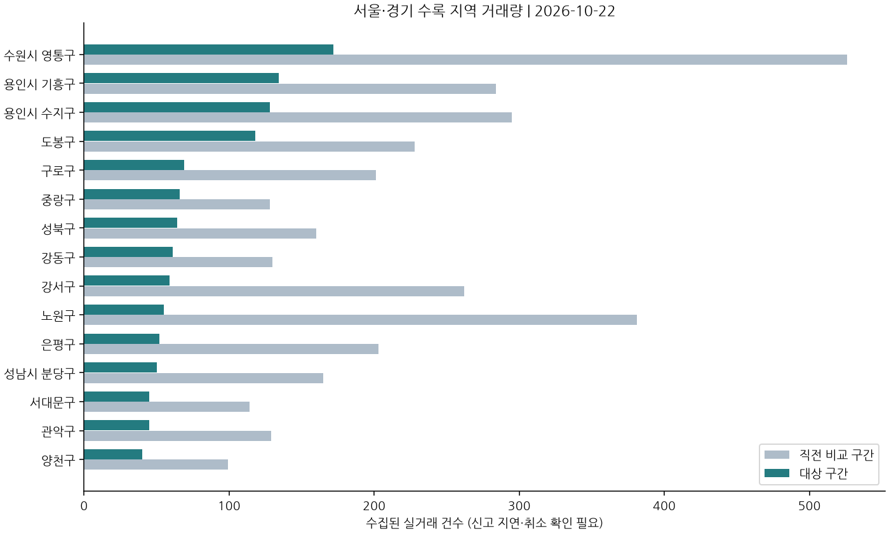

> 관측 대상: 2026-10-22 이상 2026-10-23 미만(KST). 현재 수집본을 활용한 참고 자료이며 투자 권유·수익 예측이 아닙니다.

## 핵심 흐름

- 서울 대부분 자치구에서 직전 비교 기간보다 실거래 건수가 큰 폭으로 줄었지만, 신고 지연과 취소·정정 검증 미확보 탓에 이를 수요 위축으로 단정할 수는 없다. [성동구](#region-11200) [송파구](#region-11710) [금천구](#region-11545)
- 지역별 중위 거래가격에는 차이가 있지만 거래 구성의 영향을 받습니다. 서로 다른 지역의 중위가격만으로 가격 상승·하락이나 투자 우위를 판단하기 어렵습니다. [강남구](#region-11680) [도봉구](#region-11320) [중랑구](#region-11260)

## 한눈에 보는 지표

| 지표 | 값 | 관측 기준일 | 비교 기준 저장값 | 출처 |
|---|---:|---|---:|---|
| 한국은행 기준금리 | 3.0 percent_annual | 2026-10-22 | [ecos](https://ecos.bok.or.kr/api/) |
| 국고채 3년 금리 | 3.84 percent_annual | 2026-10-22 | [ecos](https://ecos.bok.or.kr/api/) |

비교 기준 저장값은 리포트 시작 전 마지막 저장값이며 전월 평균이 아닙니다. 관측일이 서로 다를 수 있습니다.

## 지역별 실거래 흐름

지역별 표·차트 펼쳐보기

비교 구간: 2026-09-25~2026-10-23(미만), 직전 동일 길이 구간 2026-08-28~2026-09-25(미만). 일간·주간 거래 표는 최근 사 주의 배경 정보입니다. 거래 중위가격은 지역 거래 구성의 영향을 받습니다.

| 지역 | 거래 건수 | 직전 건수 | 동일 단지·면적 가격 변화 | 비교 셀 수 |
|---|---:|---:|---:|---:|
| 종로구 | 3 | 29 | 표본 부족/미확보 | 0 |
| 중구 | 12 | 34 | 표본 부족/미확보 | 0 |
| 용산구 | 7 | 34 | 표본 부족/미확보 | 0 |
| 성동구 | 10 | 54 | 표본 부족/미확보 | 0 |
| 광진구 | 16 | 54 | 표본 부족/미확보 | 0 |
| 동대문구 | 32 | 116 | 표본 부족/미확보 | 0 |
| 중랑구 | 66 | 128 | 표본 부족/미확보 | 0 |
| 성북구 | 64 | 160 | 표본 부족/미확보 | 0 |
| 강북구 | 32 | 90 | 표본 부족/미확보 | 0 |
| 도봉구 | 118 | 228 | 표본 부족/미확보 | 0 |
| 노원구 | 55 | 381 | 표본 부족/미확보 | 0 |
| 은평구 | 52 | 203 | 표본 부족/미확보 | 0 |
| 서대문구 | 45 | 114 | 표본 부족/미확보 | 0 |
| 마포구 | 22 | 85 | 표본 부족/미확보 | 0 |
| 양천구 | 40 | 99 | 표본 부족/미확보 | 0 |
| 강서구 | 59 | 262 | 표본 부족/미확보 | 0 |
| 구로구 | 69 | 201 | 표본 부족/미확보 | 0 |
| 금천구 | 9 | 84 | 표본 부족/미확보 | 0 |
| 영등포구 | 29 | 140 | 표본 부족/미확보 | 0 |
| 동작구 | 24 | 85 | 표본 부족/미확보 | 0 |
| 관악구 | 45 | 129 | 표본 부족/미확보 | 0 |
| 서초구 | 19 | 110 | 표본 부족/미확보 | 0 |
| 강남구 | 29 | 111 | 표본 부족/미확보 | 0 |
| 송파구 | 40 | 316 | 표본 부족/미확보 | 0 |
| 강동구 | 61 | 130 | 표본 부족/미확보 | 0 |
| 수원시 영통구 | 172 | 526 | 2.0% | 4 |
| 성남시 수정구 | 13 | 65 | 표본 부족/미확보 | 0 |
| 성남시 분당구 | 50 | 165 | 표본 부족/미확보 | 0 |
| 용인시 기흥구 | 134 | 284 | 표본 부족/미확보 | 0 |
| 용인시 수지구 | 128 | 295 | 표본 부족/미확보 | 0 |

## 추가 검토할 지역

가격 변화가 관측된 지역입니다. 취소·정정과 현재 호가를 확인하기 전에는 저평가 또는 투자 우위로 판단할 수 없습니다.

현재 조건에서 제시할 추가 검토 지역이 없습니다.

## 분당 상세

성남시 분당구의 비교 기간 거래는 50건, 직전 구간은 165건입니다. 동일 단지·면적 가격 변화는 표본 부족/미확보입니다. 판교 생활권은 분당구와 중복 합산하지 않습니다.

## 부동산 뉴스와 이슈

제목·RSS 제공 메타데이터를 정리했습니다. 정책 확정·시행 여부는 각 원문에서 확인해야 합니다.

### 시장·지역 동향

- [서울 아파트값 0.13%↑···성북·서대문 뛰고 강남·서초 내렸다 - 스마트비즈](https://news.google.com/rss/articles/CBMibEFVX3lxTE5tSjFKTG9CSUtsQ1hzWUFCS1h0S0ZYUkZrREVYUVpBSkx0eWxtVnh4dUlkWXhqYUhKTWVhbjRIdlRGWEJTbWNhb3ZYSjBacnV1d0tzUmRVUUpBWWlyQm5od1ItU2FzZmM5TG5kbw?oc=5) — Google 뉴스 서울·경기 부동산, 2026-10-22T21:19. 보도 내용 확인 필요.
- [서울 아파트값 상승폭 3주만에 축소…경기 남부는 &#x27;키 맞추기&#x27; 확산[부동산AtoZ] - 아시아경제](https://news.google.com/rss/articles/CBMiYEFVX3lxTE8yS3ZsOUFtWHlkeGhuOTB0bUJxeTIzSlNqMGpWWW9hQjNaTERVR3cwRFFTMldmM3Z4ZGZ1UUw0RnByY3NGazYzTHVrUTRmTFFQLW5ETXNGSmNoeENscHJJVA?oc=5) — Google 뉴스 서울·경기 부동산, 2026-10-22T17:21. 보도 내용 확인 필요.
- [서울 아파트값 89주 연속 상승…경기 남부 강세 - 더팩트](https://news.google.com/rss/articles/CBMiWkFVX3lxTFBpQnlrWmEyajQ1bDlwdm5qeTNFVC1YVUduQ1BYVWl2SWhhMEZFZDRkem56RkwtSy1ybFRsb0F4cnVVc25qVW9aeUUwemU4TUEzUTdNa2ZlM2VKZ9IBVEFVX3lxTE82ZnExcVQzUU5JUVVUOXFYZDhKN19SX3I4V052LXhuV3Zhc2djQW11VVY2Z1RtV3FXc29pM0J0NzFpckdtUmlqVVhfUHBlVzl4b1Jjbg?oc=5) — Google 뉴스 서울·경기 부동산, 2026-10-22T16:54. 보도 내용 확인 필요.
- [서울 아파트 매맷값 오름폭 3주 만에 둔화…경기 남부권은 강세 - 한겨레](https://news.google.com/rss/articles/CBMiaEFVX3lxTE9veUVKNEtQOHFDX09zTEZ1bEhqLTdmWmRxRnFqWmsyT3dYajBORVppdElaN2YtN1o3RDFRMXpFeUVmUmVJVXFOMFRkZ25nUUg5QllHMXRrR0RSanlhVUQzbmdXT3FtTGts?oc=5) — Google 뉴스 서울·경기 부동산, 2026-10-22T16:28. 보도 내용 확인 필요.
- [서울 아파트값 89주 연속 상승…오름세 3주 만에 둔화 - 매일일보](https://news.google.com/rss/articles/CBMiZEFVX3lxTFA2d3kxSHZZNFZrQzRfSVp0ZkZfVUo0c0hPX0NQMXZRMU9BanAxWUJTN3hNbDVoRWR2bW5YT05rQXN0WkRJbTY2cG5ZcEZ0c195QXUtdmowRENocnpSMy15d0NUMmc?oc=5) — Google 뉴스 서울·경기 부동산, 2026-10-22T16:24. 보도 내용 확인 필요.

서울 아파트 매매가 상승폭이 최근 몇 주 만에 둔화됐다는 보도가 여러 매체에서 동시에 나왔다. 모두 보도 내용 확인 필요 상태로, 원문 확인 전에는 보도된 내용으로만 한정한다. [관련 기사](#news-4160449e7b33) [관련 기사](#news-2de4cb0ed7a0) [관련 기사](#news-f82e17582f6a)

상승폭 둔화 보도와 함께 장기 연속 상승 흐름 자체는 이어졌다는 보도가 병존한다. 두 흐름을 함께 봐야 하며, 어느 한쪽만으로 방향을 단정하지 않는다. [관련 기사](#news-edb03faffbb0) [관련 기사](#news-f82e17582f6a)

## 다음에 확인할 점

- 실거래 거래량 급감과 매매가 상승 보도가 어긋난다. 신고 지연분이 반영된 뒤 거래량 추이가 유지되는지 다시 확인할 필요가 있다. [성동구](#region-11200) [금천구](#region-11545)
- 거래 취소·정정 반영 여부가 확인되지 않아 가격과 거래량 해석을 유보한다. 원문 실거래 확인이 선행돼야 한다. [동대문구](#region-11230) [영등포구](#region-11560)

## 데이터 범위와 한계

분석에 포함된 지역은 30개, 대상 구간 거래는 1,455건입니다. 최근 실거래일은 2026-10-16, 실거래 수집 갱신은 2026-10-18T11:00:08+00:00입니다. 서울·경기 전체의 완전한 수록을 보장하지 않습니다.

- 실거래는 현재 수집본 기준 재구성입니다. 신고 지연·취소/정정 반영 여부를 확인해야 합니다.
- 최근 실거래는 신고 지연으로 추가될 수 있으며 거래량 감소를 수요 감소로 단정하지 않습니다.
- 실거래 취소·정정 검증 미확보: 투자 판단 전 원문 확인이 필요합니다.
- 매물 증감 분석 미제공: 현재 매물 데이터의 최신성·전체 수집 여부를 확인하지 못했습니다.
- 지역 전체 중위가격은 거래 구성에 따라 변합니다. 가격 변화율은 동일 단지·면적 비교만 사용합니다.

미확보 영향 지표: 주택담보대출 금리·규모, 입주 예정 물량, 미분양, 인구·가구 이동, 청약 경쟁률, 교통·정비사업 단계 검증.

실거래 원천: [국토교통부 실거래가 공개시스템](https://rt.molit.go.kr/). 공식 지표는 real_est_analysis, 실거래는 naver/apt_signal의 수집 자료를 활용했습니다. 표와 차트는 코드로 계산하고 해설은 LLM으로 작성한 뒤 구조·수치·출처를 검사했습니다.
