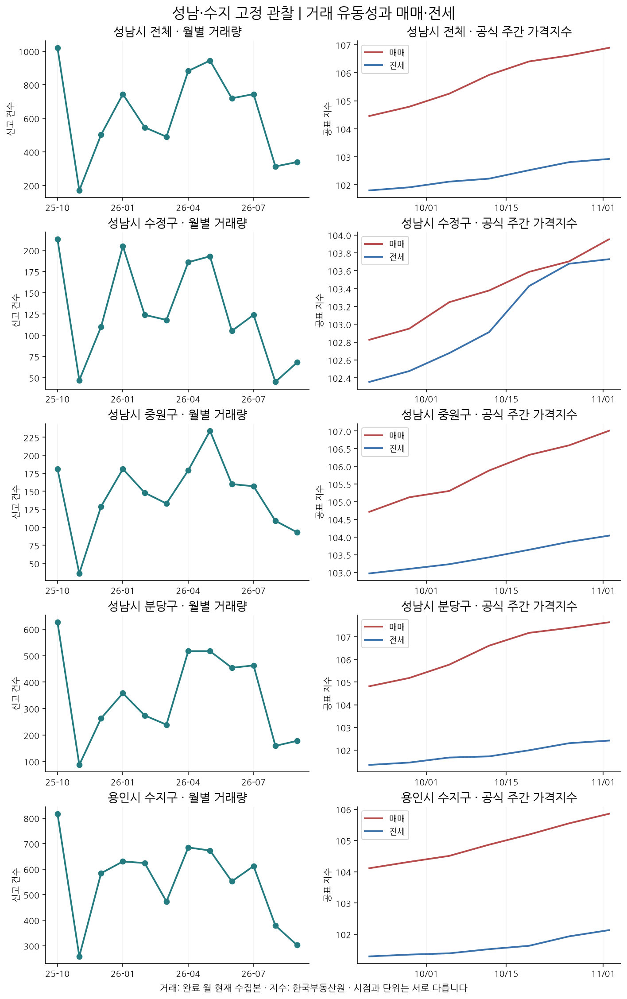
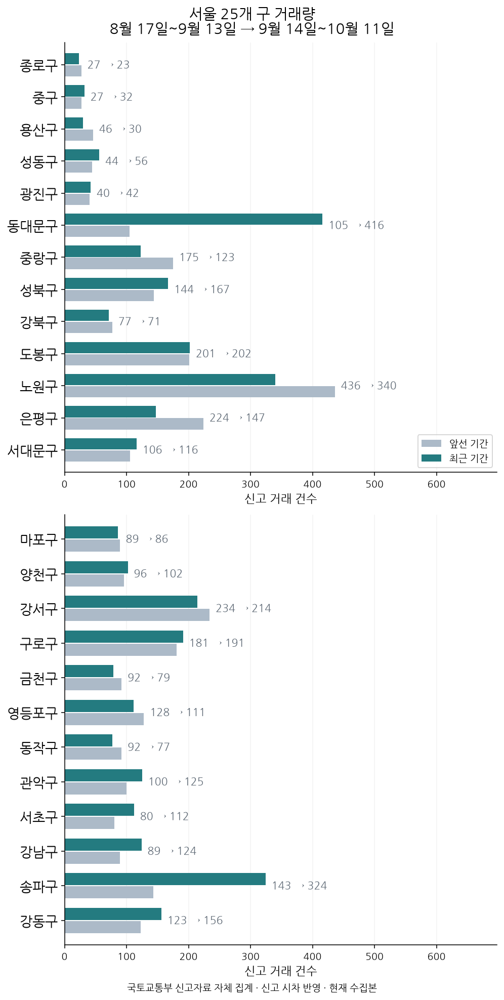
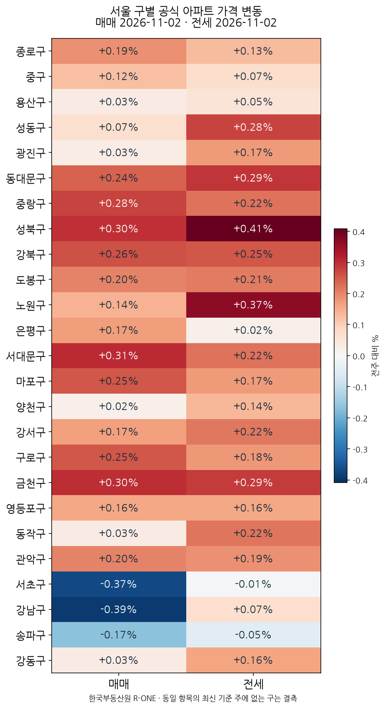

새 공식 지표와 주요 뉴스를 짧게 짚고, 과거 실거래는 배경으로 구분합니다.

수집본 확인: 2026-11-11 (한국시간). 실거래는 현재 수집본으로 기간을 재구성한 값입니다.

## 새로 확인한 변화

이번에 새로 확인된 변화는 국고채 금리의 소폭 하락 하나이고, 시장 판단을 바꿀 정도는 아닙니다. 국고채 3년 금리는 11월 9일 연 3.639%에서 11월 10일 연 3.633%로 내렸고, 한국은행 기준금리는 11월 8일 기준 연 3.0%로 같았습니다. 직전 글에서 다시 내리면 변동으로 보겠다고 한 경우에 해당하지만, 폭이 작아 흐름이 바뀌었다고 보기는 이릅니다.[^1][^2]

서두르지 않는다는 판단은 유지합니다. 배경 실거래인 매화마을공무원2 58㎡대 6층 이상 구간은 기간 중간가격 10억 9,500만원이고, 표본은 직전 30건에서 24건으로 줄었습니다. 다만 전국 아파트 매매가격지수는 11월 2일 기준 +0.07%로, 상승 압력이 더 커지면 이 판단을 다시 봅니다.[^3][^4]

## 다음 평일 확인할 점

다음 평일에는 국고채 3년 금리가 연 3.633%에서 더 내리는지, 되돌아 오르는지를 먼저 봅니다. 이어서 내리면 이번 하락이 추세인지 판단할 근거가 늘고, 다시 오르면 하루 변동으로 남습니다. 실거주자는 은행이 제시하는 주담대 금리가 전국 예금은행 2026년 9월 신규취급 평균 연 4.88%보다 낮은지, 1억원·30년 원리금균등 가정 상환액 529,512원과 얼마나 차이 나는지 비교해 보세요. 투자자는 관심 단지의 거래 건수와 신규 전세 보증금이 함께 움직이는지, 성남 수정·중원·분당과 용인 수지 중 어디에서 그 신호가 먼저 나타나는지 보시면 됩니다.[^1][^5]

지역별 배경과 직전 보고서 비교

## 성남·수지 고정 점검

거래량: 8월 17일~9월 13일 → 9월 14일~10월 11일. 신고 시차를 둔 현재 수집본 비교입니다.

공식 매매 기준 주: 2026-11-02 · 전세 기준 주: 2026-11-02. 두 지표의 주기가 같을 때만 함께 비교합니다.

| 관심 지역 | 앞선 거래 | 최근 거래 | 공식 매매 전주비 | 공식 전세 전주비 |
| --- | ---: | ---: | ---: | ---: |
| 성남시 전체[^6] | 283건 | 288건 | +0.26% | +0.11% |
| 성남시 수정구[^7] | 48건 | 52건 | +0.24% | +0.05% |
| 성남시 중원구[^8] | 84건 | 86건 | +0.39% | +0.17% |
| 성남시 분당구[^9] | 151건 | 150건 | +0.23% | +0.11% |
| 용인시 수지구[^10] | 262건 | 313건 | +0.29% | +0.20% |

성남 전체 거래량은 수정·중원·분당의 수집이 모두 확인된 기간만 합산합니다. 공식 가격지수는 구별 값의 평균이 아닙니다.

### 성남시 수정구

수정구는 실거래 52건(직전 48건)에 매매지수 +0.24%로, 실거주는 산성역포레스티아 59㎡대 6층 이상 기간 중간가격 14억 9,250만원(직전 13억 4,000만원, 현재 12건·직전 11건), 투자는 74㎡대 전세 7억 5,000만원·전세가율 47.9%입니다.[^7][^11][^12][^13]

비교 범위: 단일 거래 제외 시 가격 방향 변화

### 성남시 중원구

중원구는 실거래 86건(직전 84건)에 매매지수 +0.39%로, 실거주는 산들마을2단지 51㎡대 6층 이상 기간 중간가격 9억 6,500만원(직전 9억 2,000만원, 현재 17건·직전 14건), 투자는 선경2차 49㎡대 전세 3억 1,000만원·전세가율 56.7%입니다.[^8][^14][^15][^16]

### 성남시 분당구

분당구는 실거래 150건(직전 151건)에 매매지수 +0.23%로, 실거주는 한솔마을(4단지)(주공) 35㎡대 6층 이상 기간 중간가격 10억 9,000만원(직전 10억원), 현재 9건·직전 12건으로 표본이 적고, 투자는 전세지수 +0.11%입니다.[^9][^17][^18][^19]

비교 범위: 공식 가격과 과거 거래량 방향 차이 · 비교 기간 다름

### 용인시 수지구

수지구는 실거래 313건(직전 262건)에 매매지수 +0.29%로, 실거주는 동부 59㎡대 6층 이상 기간 중간가격 8억 4,000만원(직전 8억원, 현재 27건·직전 21건), 투자는 성복역롯데캐슬골드타운 84㎡대 전세 9억 5,000만원·전세가율 51.9%입니다.[^10][^20][^21][^22]

비교 범위: 단일 거래 제외 시 가격 방향 변화

## 서울 25개 구 비교

서울 25개 구 수치 전체 보기

| 자치구 | 앞선 거래 | 최근 거래 | 공식 매매 전주비 | 공식 전세 전주비 |
| --- | ---: | ---: | ---: | ---: |
| 종로구 | 27건 | 23건 | +0.19% | +0.13% |
| 중구 | 27건 | 32건 | +0.12% | +0.07% |
| 용산구 | 46건 | 30건 | +0.03% | +0.05% |
| 성동구 | 44건 | 56건 | +0.07% | +0.28% |
| 광진구 | 40건 | 42건 | +0.03% | +0.17% |
| 동대문구 | 105건 | 416건 | +0.24% | +0.29% |
| 중랑구 | 175건 | 123건 | +0.28% | +0.22% |
| 성북구 | 144건 | 167건 | +0.30% | +0.41% |
| 강북구 | 77건 | 71건 | +0.26% | +0.25% |
| 도봉구 | 201건 | 202건 | +0.20% | +0.21% |
| 노원구 | 436건 | 340건 | +0.14% | +0.37% |
| 은평구 | 224건 | 147건 | +0.17% | +0.02% |
| 서대문구 | 106건 | 116건 | +0.31% | +0.22% |
| 마포구 | 89건 | 86건 | +0.25% | +0.17% |
| 양천구 | 96건 | 102건 | +0.02% | +0.14% |
| 강서구 | 234건 | 214건 | +0.17% | +0.22% |
| 구로구 | 181건 | 191건 | +0.25% | +0.18% |
| 금천구 | 92건 | 79건 | +0.30% | +0.29% |
| 영등포구 | 128건 | 111건 | +0.16% | +0.16% |
| 동작구 | 92건 | 77건 | +0.03% | +0.22% |
| 관악구 | 100건 | 125건 | +0.20% | +0.19% |
| 서초구 | 80건 | 112건 | -0.37% | -0.01% |
| 강남구 | 89건 | 124건 | -0.39% | +0.07% |
| 송파구 | 143건 | 324건 | -0.17% | -0.05% |
| 강동구 | 123건 | 156건 | +0.03% | +0.16% |

공식 지수: [한국부동산원 R-ONE](https://www.reb.or.kr/r-one/portal/main/indexPage.do). 거래량: [국토교통부 실거래가](https://rt.molit.go.kr/) 신고 자료 자체 집계. 수집되지 않은 구간은 0건으로 표시하지 않습니다.

## 직전 리포트와 달라진 이유

수록 거래량은 4,779건에서 4,749건으로 -30건 달라졌습니다.[^23]

| 같은 기간 수집본 차이 | 비교 기간 이동 | 지역 범위 차이 |
|---:|---:|---:|
| +0건 | -30건 | +0건 |

수집본 차이는 신고 추가·원천 갱신·자료 범위 차이를 포함할 수 있습니다. 개별 계약의 취소·정정을 확인한 수치가 아닙니다.

선정 가격 사례는 직전 대비 유지 10개, 추가 0개, 제외 0개입니다. 사례 교체를 시장 가격 변화로 해석하지 않습니다.

동일 가격 사례의 수집본 변화와 기간 이동

| 사례 | 직전 중간가격 | 현재 중간가격 | 같은 기간 수집본 차이 | 기간 이동 차이 |
|---|---:|---:|---:|---:|
| 성남시 분당구 매화마을공무원2 58㎡대 6층 이상[^24] | 10억 9,500만원 | 10억 9,500만원 | +0만원 | +0만원 |
| 성남시 수정구 산성역포레스티아 59㎡대 6층 이상[^25] | 14억 9,250만원 | 14억 9,250만원 | +0만원 | +0만원 |
| 성남시 중원구 산들마을2단지 51㎡대 6층 이상[^26] | 9억 6,500만원 | 9억 6,500만원 | +0만원 | +0만원 |

수집본 차이는 직전 비교 창을 현재 자료로 다시 계산한 차이입니다. 동일 세대의 재거래 가격이나 시장 전체의 가격지수가 아닙니다.

## 분당 고정 관찰 단지

동일 단지·면적대·층 구간을 계속 추적합니다. 표본 부족 사례를 다른 단지로 바꾸지 않습니다.

| 고정 관찰 구간 | 최근 중간가격 | 앞선/최근 건수 | 표본 확인 |
|---|---:|---:|---|
| 야탑동 매화마을공무원2 58㎡대 6층 이상[^3] | 10억 9,500만원 | 30/24건 | 표본·가격 퍼짐 함께 확인 |
| 정자동 한솔마을(4단지)(주공) 35㎡대 6층 이상[^18] | 10억 9,000만원 | 12/9건 | 표본 수 제한 |
| 이매동 이매촌(한신) 50㎡대 6층 이상[^27] | 15억원 | 10/5건 | 표본 수 제한 |
| 수내동 양지마을(5단지)(한양501-514) 35㎡대 6층 이상 | — | — | 표본 부족 |
| 정자동 한솔마을(5단지)(주공) 41㎡대 1~5층 | — | — | 표본 부족 |
| 서현동 시범한양 35㎡대 6층 이상[^28] | 12억 9,000만원 | 6/5건 | 표본 수 제한 |

가격 표본의 퍼짐과 단일 거래 제외 민감도

| 사례 | 최근 가격 중앙 절반 범위 | 앞선/최근 건수 | 변화율 민감도 |
|---|---:|---:|---:|
| 매화마을공무원2 58㎡대 6층 이상[^3] | 10억 7,875만원~11억 1,900만원 | 30/24건 | +5.10%~+5.48% |
| 산성역포레스티아 59㎡대 6층 이상[^12] | 14억 4,500만원~15억원 | 11/12건 | +10.97%~+11.57% |
| 산들마을2단지 51㎡대 6층 이상[^15] | 9억 4,000만원~9억 9,000만원 | 14/17건 | +4.62%~+5.16% |
| 동부 59㎡대 6층 이상[^21] | 8억 2,250만원~8억 4,600만원 | 21/27건 | +4.88%~+5.00% |
| 황골마을주공1 59㎡대 6층 이상[^29] | 6억원~6억 4,500만원 | 40/36건 | +19.23%~+19.23% |
| 더트루엘마곡HQ 48㎡대 6층 이상[^30] | 6억 3,300만원~6억 6,625만원 | 21/18건 | -0.31%~-0.16% |
| 잠실엘스 84㎡대 6층 이상[^31] | 33억 2,250만원~34억 5,000만원 | 25/16건 | +2.42%~+2.42% |
| 주공2 44㎡대 6층 이상[^32] | 3억 8,000만원~4억 200만원 | 19/16건 | +8.33%~+9.17% |
| 한신 84㎡대 6층 이상[^33] | 6억 3,500만원~6억 7,650만원 | 24/15건 | +6.45%~+6.45% |
| 금천롯데캐슬골드파크3차 59㎡대 6층 이상[^34] | 10억 5,500만원~11억 750만원 | 14/14건 | +3.81%~+3.81% |
| 한솔마을(4단지)(주공) 35㎡대 6층 이상[^18] | 10억 7,700만원~11억원 | 12/9건 | +8.50%~+9.00% |
| 이매촌(한신) 50㎡대 6층 이상[^27] | 14억 9,600만원~15억 6,000만원 | 10/5건 | +0.67%~+2.86% |
| 시범한양 35㎡대 6층 이상[^28] | 12억 6,000만원~13억원 | 6/5건 | +14.09%~+16.74% |

민감도는 앞선 기간 또는 최근 기간에서 거래 한 건씩을 제외해 중간가격 변화율을 다시 계산한 범위입니다. 신뢰구간·예측 확률·동일 세대 가격 변화가 아니며, 집 상태와 동·층 차이는 남습니다.

## 앞서 정한 관찰 조건 점검

직전 보고서에 사전에 고정한 조건이 없어 소급 판정하지 않았습니다.

공식 지표·전월세·금리·공급과 상세 비교 자료

<section class="report-overview" aria-label="핵심 지표"> 
 국고채 3년 금리 <strong class="report-kpi-value">연 3.633% <a href="#fn:1" aria-label="출처 1">1</a>  </strong>  -0.006%p 이전 연 3.639%  국채시장 지표 기준일 2026-11-10 
 </section>

<dl class="report-periods"> 
 <dt>리포트 기간</dt> <dd>11월 10일</dd> 
 
 <dt>거래량 비교</dt> <dd>9월 14일~10월 11일 / 이전 8월 17일~9월 13일</dd> 
 
 <dt>단지 가격 비교</dt> <dd>7월 14일~10월 11일 / 이전 4월 15일~7월 13일</dd> 
 </dl>

## 공식 주간 매매·전세 동향

한국부동산원 주간 아파트 통계입니다. 가격은 전주 대비 변화율, 수급은 조사 응답 지수와 전주 대비 포인트 차이입니다.

| 지역 | 공식 지표 | 기준일 | 지수 | 전주 대비 |
|---|---|---|---:|---:|
| 전국 | 매매가격[^4] | 2026-11-02 | 101.43 | +0.07% |
| 서울 | 매매가격[^35] | 2026-11-02 | 103.21 | +0.07% |
| 경기 | 매매가격[^36] | 2026-11-02 | 103.24 | +0.20% |
| 성남시 분당구 | 매매가격[^17] | 2026-11-02 | 107.64 | +0.23% |
| 성남시 전체 | 매매가격[^37] | 2026-11-02 | 106.89 | +0.26% |
| 성남시 수정구 | 매매가격[^11] | 2026-11-02 | 103.95 | +0.24% |
| 성남시 중원구 | 매매가격[^14] | 2026-11-02 | 107.01 | +0.39% |
| 용인시 수지구 | 매매가격[^20] | 2026-11-02 | 105.86 | +0.29% |
| 종로구 | 매매가격[^38] | 2026-11-02 | 104.85 | +0.19% |
| 중구 | 매매가격[^39] | 2026-11-02 | 105.3 | +0.12% |
| 용산구 | 매매가격[^40] | 2026-11-02 | 101.28 | +0.03% |
| 성동구 | 매매가격[^41] | 2026-11-02 | 102.21 | +0.07% |
| 광진구 | 매매가격[^42] | 2026-11-02 | 102.19 | +0.03% |
| 동대문구 | 매매가격[^43] | 2026-11-02 | 105.62 | +0.24% |
| 중랑구 | 매매가격[^44] | 2026-11-02 | 107.05 | +0.28% |
| 성북구 | 매매가격[^45] | 2026-11-02 | 107.42 | +0.30% |
| 강북구 | 매매가격[^46] | 2026-11-02 | 106.17 | +0.26% |
| 도봉구 | 매매가격[^47] | 2026-11-02 | 105.61 | +0.20% |
| 노원구 | 매매가격[^48] | 2026-11-02 | 106.2 | +0.14% |
| 은평구 | 매매가격[^49] | 2026-11-02 | 103.68 | +0.17% |
| 서대문구 | 매매가격[^50] | 2026-11-02 | 107 | +0.31% |
| 마포구 | 매매가격[^51] | 2026-11-02 | 104.25 | +0.25% |
| 양천구 | 매매가격[^52] | 2026-11-02 | 102.01 | +0.02% |
| 강서구 | 매매가격[^53] | 2026-11-02 | 105.09 | +0.17% |
| 구로구 | 매매가격[^54] | 2026-11-02 | 105.32 | +0.25% |
| 금천구 | 매매가격[^55] | 2026-11-02 | 105.39 | +0.30% |
| 영등포구 | 매매가격[^56] | 2026-11-02 | 103.8 | +0.16% |
| 동작구 | 매매가격[^57] | 2026-11-02 | 102.23 | +0.03% |
| 관악구 | 매매가격[^58] | 2026-11-02 | 105.25 | +0.20% |
| 서초구 | 매매가격[^59] | 2026-11-02 | 97.08 | -0.37% |
| 강남구 | 매매가격[^60] | 2026-11-02 | 96.35 | -0.39% |
| 송파구 | 매매가격[^61] | 2026-11-02 | 99.9 | -0.17% |
| 강동구 | 매매가격[^62] | 2026-11-02 | 102.7 | +0.03% |
| 전국 | 전세가격[^63] | 2026-11-02 | 101.73 | +0.10% |
| 서울 | 전세가격[^64] | 2026-11-02 | 103.49 | +0.17% |
| 경기 | 전세가격[^65] | 2026-11-02 | 102.77 | +0.16% |
| 성남시 분당구 | 전세가격[^19] | 2026-11-02 | 102.42 | +0.11% |
| 성남시 전체 | 전세가격[^66] | 2026-11-02 | 102.92 | +0.11% |
| 성남시 수정구 | 전세가격[^67] | 2026-11-02 | 103.73 | +0.05% |
| 성남시 중원구 | 전세가격[^68] | 2026-11-02 | 104.04 | +0.17% |
| 용인시 수지구 | 전세가격[^69] | 2026-11-02 | 102.13 | +0.20% |
| 종로구 | 전세가격[^70] | 2026-11-02 | 104.01 | +0.13% |
| 중구 | 전세가격[^71] | 2026-11-02 | 102.89 | +0.07% |
| 용산구 | 전세가격[^72] | 2026-11-02 | 101.53 | +0.05% |
| 성동구 | 전세가격[^73] | 2026-11-02 | 103.59 | +0.28% |
| 광진구 | 전세가격[^74] | 2026-11-02 | 102.62 | +0.17% |
| 동대문구 | 전세가격[^75] | 2026-11-02 | 104.47 | +0.29% |
| 중랑구 | 전세가격[^76] | 2026-11-02 | 105.02 | +0.22% |
| 성북구 | 전세가격[^77] | 2026-11-02 | 106.58 | +0.41% |
| 강북구 | 전세가격[^78] | 2026-11-02 | 104.95 | +0.25% |
| 도봉구 | 전세가격[^79] | 2026-11-02 | 104.94 | +0.21% |
| 노원구 | 전세가격[^80] | 2026-11-02 | 106.6 | +0.37% |
| 은평구 | 전세가격[^81] | 2026-11-02 | 102.79 | +0.02% |
| 서대문구 | 전세가격[^82] | 2026-11-02 | 104.78 | +0.22% |
| 마포구 | 전세가격[^83] | 2026-11-02 | 103.28 | +0.17% |
| 양천구 | 전세가격[^84] | 2026-11-02 | 102.67 | +0.14% |
| 강서구 | 전세가격[^85] | 2026-11-02 | 103.44 | +0.22% |
| 구로구 | 전세가격[^86] | 2026-11-02 | 103.69 | +0.18% |
| 금천구 | 전세가격[^87] | 2026-11-02 | 105.87 | +0.29% |
| 영등포구 | 전세가격[^88] | 2026-11-02 | 103.73 | +0.16% |
| 동작구 | 전세가격[^89] | 2026-11-02 | 102.65 | +0.22% |
| 관악구 | 전세가격[^90] | 2026-11-02 | 103.75 | +0.19% |
| 서초구 | 전세가격[^91] | 2026-11-02 | 98.49 | -0.01% |
| 강남구 | 전세가격[^92] | 2026-11-02 | 99.95 | +0.07% |
| 송파구 | 전세가격[^93] | 2026-11-02 | 103.44 | -0.05% |
| 강동구 | 전세가격[^94] | 2026-11-02 | 104.01 | +0.16% |
| 전국 | 매매수급[^95] | 2026-11-02 | 99.65 | -0.30포인트 |
| 서울 | 매매수급[^96] | 2026-11-02 | 109.45 | -1.06포인트 |
| 경기 | 매매수급[^97] | 2026-11-02 | 103.23 | -0.45포인트 |
| 전국 | 전세수급[^98] | 2026-11-02 | 106.95 | +0.01포인트 |
| 서울 | 전세수급[^99] | 2026-11-02 | 121.26 | -0.12포인트 |
| 경기 | 전세수급[^100] | 2026-11-02 | 110.13 | +0.33포인트 |

전주 값이 없거나 두 기준일이 연속된 주가 아니면 변화는 표시하지 않습니다. 가격지수와 개별 단지의 실거래 중간가격은 다른 지표입니다.

분당구 수급동향은 이번 수집 자료에 없어 경기 값으로 대체하지 않았습니다.

## 신규 전세 실거래와 임대차 계약 구성

7월 14일~10월 11일의 수집 완료 31개 지역 신고 계약 59,556건입니다. 전세 29,089건·월세 30,467건이며, 월세 계약 비중은 51.2%입니다.[^101]

신규 30,388건·갱신 28,008건·구분 미확인 1,160건입니다. 미확인을 신규로 추정하지 않습니다. 지역별 거래 구성과 신고 지연의 영향을 받으며 서울·경기 전체의 완전한 수록 통계는 아닙니다.

지역별 임대차 계약 구성

| 지역 | 계약 | 신규 | 갱신 | 미확인 | 월세 비중 |
|---|---:|---:|---:|---:|---:|
| 성남시 수정구 | 1,007 | 501 | 488 | 18 | 54.4% |
| 성남시 중원구 | 743 | 373 | 352 | 18 | 45.2% |
| 성남시 분당구 | 2,947 | 1,433 | 1,439 | 75 | 45.7% |
| 용인시 수지구 | 2,090 | 1,028 | 1,018 | 44 | 40.6% |
| 종로구 | 435 | 311 | 121 | 3 | 70.3% |
| 중구 | 760 | 475 | 276 | 9 | 59.9% |
| 용산구 | 1,174 | 646 | 506 | 22 | 54.1% |
| 성동구 | 1,749 | 965 | 750 | 34 | 51.9% |
| 광진구 | 833 | 480 | 353 | 0 | 55.0% |
| 동대문구 | 1,705 | 1,034 | 636 | 35 | 57.2% |
| 중랑구 | 2,287 | 1,435 | 817 | 35 | 73.0% |
| 성북구 | 1,468 | 738 | 702 | 28 | 47.3% |
| 강북구 | 609 | 348 | 260 | 1 | 51.4% |
| 도봉구 | 1,050 | 542 | 486 | 22 | 46.1% |
| 노원구 | 3,470 | 1,704 | 1,699 | 67 | 46.8% |
| 은평구 | 2,118 | 931 | 1,150 | 37 | 47.8% |
| 서대문구 | 1,465 | 722 | 711 | 32 | 49.7% |
| 마포구 | 2,369 | 1,199 | 1,125 | 45 | 50.6% |
| 양천구 | 2,097 | 1,042 | 999 | 56 | 41.6% |
| 강서구 | 3,165 | 1,321 | 1,783 | 61 | 42.5% |
| 구로구 | 2,711 | 1,057 | 1,597 | 57 | 73.1% |
| 금천구 | 830 | 586 | 244 | 0 | 73.1% |
| 영등포구 | 2,451 | 1,153 | 1,210 | 88 | 53.1% |
| 동작구 | 1,769 | 1,031 | 700 | 38 | 50.6% |
| 관악구 | 1,198 | 737 | 428 | 33 | 59.5% |
| 서초구 | 2,867 | 1,407 | 1,409 | 51 | 44.8% |
| 강남구 | 3,751 | 1,875 | 1,827 | 49 | 54.5% |
| 송파구 | 3,650 | 1,682 | 1,893 | 75 | 48.5% |
| 강동구 | 2,667 | 1,349 | 1,279 | 39 | 48.7% |
| 수원시 영통구 | 2,052 | 1,144 | 866 | 42 | 44.3% |
| 용인시 기흥구 | 2,069 | 1,139 | 884 | 46 | 43.6% |

확인된 신규 전세만 같은 단지·면적대·층 구간으로 맞춰, 매매 단지 비교와 같은 두 기간을 비교했습니다.

| 단지·면적·층 | 이전 보증금 | 최근 보증금 | 차이 | 신규 전세 건수(전→후) | 매매 대비 비율 |
|---|---:|---:|---:|---:|---:|
| 성남시 분당구 금곡동 청솔마을(주공9단지) · 36㎡대 · 6층 이상[^102] | 3억 6,000만원 | 3억 5,000만원 | -2.8% | 9→6 | — |
| 성남시 수정구 신흥동 산성역포레스티아 · 74㎡대 · 6층 이상[^13] | 7억 3,000만원 | 7억 5,000만원 | +2.7% | 17→26 | 47.9% |
| 성남시 중원구 상대원동 선경2차 · 49㎡대 · 6층 이상[^16] | 3억원 | 3억 1,000만원 | +3.3% | 15→11 | 56.7% |
| 용인시 수지구 성복동 성복역롯데캐슬골드타운 · 84㎡대 · 6층 이상[^22] | 9억원 | 9억 5,000만원 | +5.6% | 13→17 | 51.9% |
| 송파구 잠실동 잠실엘스 · 84㎡대 · 6층 이상[^103] | 13억 5,000만원 | 13억 6,500만원 | +1.1% | 27→28 | 40.4% |
| 은평구 신사동 은평자이더스타 · 49㎡대 · 6층 이상[^104] | 4억 5,000만원 | 4억 5,000만원 | +0.0% | 32→25 | — |
| 수원시 영통구 영통동 황골마을주공1 · 59㎡대 · 6층 이상[^105] | 3억 5,000만원 | 3억 7,000만원 | +5.7% | 24→21 | 59.7% |
| 관악구 신림동 힐스테이트뉴포레 · 59㎡대 · 6층 이상[^106] | 7억 4,000만원 | 7억 5,000만원 | +1.4% | 16→19 | 53.6% |

매매 대비 비율은 같은 기간·동일 비교 구간의 전세와 매매 중간가격 비율입니다. 서로 다른 거래를 비교한 값이며 동일 세대 평가액이나 투자 수익률이 아닙니다. 조건이 맞지 않으면 표시하지 않습니다.

## 실제 주담대 금리와 상환액 비교

예금은행 주담대 신규취급액 평균금리입니다. 전국 예금은행의 신규취급 월평균으로, 개인에게 제시되는 금리와 다릅니다.[^5]

| 기준 월 | 평균금리 | 가정 월 상환액 |
|---|---:|---:|
| 2026년 8월 | 연 4.93% | 532,552원 |
| 2026년 9월 | 연 4.88% | 529,512원 |

원금 1억원·30년·원리금균등 상환을 가정했습니다. 해당 금리가 만기까지 유지되는 단순 비교이며 수수료·중도상환·금리 재산정은 반영하지 않습니다. 소득 기반 부담지수나 개인 DSR·대출 승인 가능성을 계산한 값이 아닙니다.

## 전체주택 공급과 미분양

인허가는 전체주택 연초 누계(다가구는 동수 기준), 착공·준공은 전체주택 월별 실적, 미분양은 월말 재고입니다. 인허가 누계 차이를 월간 증가율로 계산하지 않습니다. 아파트만의 공급이나 확정 입주 예정 물량이 아닙니다.

| 지역·지표 | 이전 월 | 이전 값 | 최근 월 | 최근 값 | 차이 |
|---|---|---:|---|---:|---:|
| 전국 전체주택 인허가 연초 누계[^107] | 2026년 1~8월 누계 | 163,935호 | 2026년 1~9월 누계 | 189,873호 | — |
| 서울 전체주택 인허가 연초 누계[^108] | 2026년 1~8월 누계 | 39,940호 | 2026년 1~9월 누계 | 44,371호 | — |
| 경기 전체주택 인허가 연초 누계[^109] | 2026년 1~8월 누계 | 46,060호 | 2026년 1~9월 누계 | 55,062호 | — |
| 전국 전체주택 착공[^110] | 2026년 8월 | 18,013호 | 2026년 9월 | 16,046호 | -1,967호 |
| 서울 전체주택 착공[^111] | 2026년 8월 | 1,172호 | 2026년 9월 | 1,176호 | +4호 |
| 경기 전체주택 착공[^112] | 2026년 8월 | 4,068호 | 2026년 9월 | 6,598호 | +2,530호 |
| 전국 전체주택 준공[^113] | 2026년 8월 | 15,151호 | 2026년 9월 | 18,449호 | +3,298호 |
| 서울 전체주택 준공[^114] | 2026년 8월 | 4,714호 | 2026년 9월 | 1,251호 | -3,463호 |
| 경기 전체주택 준공[^115] | 2026년 8월 | 3,967호 | 2026년 9월 | 6,530호 | +2,563호 |
| 서울 미분양주택[^116] | 2026년 8월 | 898호 | 2026년 9월 | 996호 | +98호 |
| 경기 미분양주택[^117] | 2026년 8월 | 14,509호 | 2026년 9월 | 13,802호 | -707호 |

미분양 총계와 준공 후 미분양은 다릅니다. 분당구 세부 물량과 준공 후 미분양은 확보하지 못했으며 경기 값을 분당에 대체하지 않습니다.

전국 미분양 총계는 제공된 자료에 없어 표시하지 않았습니다.

## 금리와 시장 지표

| 지표 | 이전 관측 | 이전 기준일 | 최근 관측 | 최근 기준일 |
|---|---:|---|---:|---|
| 한국은행 기준금리[^2] | 연 3.0% | 11월 7일 | 연 3.0% | 11월 8일 |
| 국고채 3년 금리[^1] | 연 3.639% | 11월 9일 | 연 3.633% | 11월 10일 |

이전 관측은 이번 리포트 시작 전에 확인한 값입니다. 지표마다 발표 주기와 관측일이 다릅니다.

과거 실거래 배경: 단지·지역 비교

## 단지 가격의 전체 분포

비교 가능한 전체 324개 단지·면적·층 구간 중 상승 302개, 보합 19개, 하락 3개입니다. ±1% 이내를 보합으로 구분한 설명용 분포이며, 전체 시장 가격지수는 아닙니다.[^118]

## 실제 거래로 비교해 본 단지

7월 14일~10월 11일 거래를 4월 15일~7월 13일 거래와 비교했습니다. 같은 단지·면적대·층 구간에서 양쪽 모두 다섯 건 이상 거래된 경우만 골랐습니다. 신고가 뒤늦게 들어오는 영향을 줄이려고 최근 한 달은 비교에서 뺐습니다.

<strong>매화마을공무원2<a href="#fn:3" aria-label="출처 3">3</a></strong>10억 9,500만원

성남시 분당구 야탑동 · 58㎡대 · 6층 이상

이전 10억 4,000만원<strong class="report-up">+5.3%</strong>

거래 30 → 24건가격↑ · 건수↓

<strong>산성역포레스티아<a href="#fn:12" aria-label="출처 12">12</a></strong>14억 9,250만원

성남시 수정구 신흥동 · 59㎡대 · 6층 이상

이전 13억 4,000만원<strong class="report-up">+11.4%</strong>

거래 11 → 12건가격↑ · 건수↑

<strong>산들마을2단지<a href="#fn:15" aria-label="출처 15">15</a></strong>9억 6,500만원

성남시 중원구 여수동 · 51㎡대 · 6층 이상

이전 9억 2,000만원<strong class="report-up">+4.9%</strong>

거래 14 → 17건가격↑ · 건수↑

비교 가능한 324개 중 지역 분산과 표본 수를 고려해 고른 사례입니다. 3개 선정 사례 중 3개를 먼저 표시했습니다. 막대의 가운데는 0%, 양끝은 ±11.4%이며 상승률 순위가 아닙니다.

단지별 정확한 가격·거래 건수 표

| 단지·면적 | 앞선 기간 중간가격 | 최근 기간 중간가격 | 차이 | 거래 건수(전→후) |
|---|---:|---:|---:|---:|
| 성남시 분당구 야탑동 매화마을공무원2 · 58㎡대 · 6층 이상[^3] | 10억 4,000만원 | 10억 9,500만원 | +5.3% | 30→24 |
| 성남시 수정구 신흥동 산성역포레스티아 · 59㎡대 · 6층 이상[^12] | 13억 4,000만원 | 14억 9,250만원 | +11.4% | 11→12 |
| 성남시 중원구 여수동 산들마을2단지 · 51㎡대 · 6층 이상[^15] | 9억 2,000만원 | 9억 6,500만원 | +4.9% | 14→17 |

이 가격은 실제 거래의 가운데 값입니다. 현재 매물 가격과 비교할 때는 동·층·수리 상태도 함께 보세요.

## 거래가 늘고 줄어든 곳

9월 14일~10월 11일의 거래 건수입니다. 바로 앞선 같은 길이의 기간과 비교했습니다. 양쪽 기간에 거래가 각각 5건 이상인 지역 중 변화가 눈에 띄는 곳을 추렸습니다.

위 막대는 이전, 아래 막대는 최근 건수입니다. 모든 지역은 같은 건수 축을 사용합니다.

<strong>동대문구<a href="#fn:119" aria-label="출처 119">119</a></strong>+311건 <small>(+296.2%)</small>

이전 105건<strong>최근 416건</strong>

<strong>송파구<a href="#fn:120" aria-label="출처 120">120</a></strong>+181건 <small>(+126.6%)</small>

이전 143건<strong>최근 324건</strong>

<strong>노원구<a href="#fn:121" aria-label="출처 121">121</a></strong>-96건 <small>(-22.0%)</small>

이전 436건<strong>최근 340건</strong>

<strong>은평구<a href="#fn:122" aria-label="출처 122">122</a></strong>-77건 <small>(-34.4%)</small>

이전 224건<strong>최근 147건</strong>

<strong>중랑구<a href="#fn:123" aria-label="출처 123">123</a></strong>-52건 <small>(-29.7%)</small>

이전 175건<strong>최근 123건</strong>

<strong>용인시 수지구<a href="#fn:124" aria-label="출처 124">124</a></strong>+51건 <small>(+19.5%)</small>

이전 262건<strong>최근 313건</strong>

<strong>강남구<a href="#fn:125" aria-label="출처 125">125</a></strong>+35건 <small>(+39.3%)</small>

이전 89건<strong>최근 124건</strong>

<strong>성남시 분당구<a href="#fn:126" aria-label="출처 126">126</a></strong>-1건 <small>(-0.7%)</small>

이전 151건<strong>최근 150건</strong>

지역별 정확한 거래 건수 표

| 지역 | 앞선 기간 | 최근 기간 | 차이 |
|---|---:|---:|---:|
| 동대문구[^119] | 105건 | 416건 | +311건 |
| 송파구[^120] | 143건 | 324건 | +181건 |
| 노원구[^121] | 436건 | 340건 | -96건 |
| 은평구[^122] | 224건 | 147건 | -77건 |
| 중랑구[^123] | 175건 | 123건 | -52건 |
| 용인시 수지구[^124] | 262건 | 313건 | +51건 |
| 강남구[^125] | 89건 | 124건 | +35건 |
| 성남시 분당구[^126] | 151건 | 150건 | -1건 |

[거래량 비교 차트 PNG 보기](volume.png)

## 핵심 뉴스와 변화의 맥락

금리 보도 세 건은 같은 주제로 묶어 읽습니다. 금통위원들이 지난달 기준금리를 동결하면서 앞선 선제 인상 효과를 점검할 필요가 있다고 언급했다는 보도와, 이날 국고채 금리가 대체로 하락했다는 보도가 함께 나왔습니다. 방향은 이번에 새로 확인한 국고채 금리 하락과 맞지만, 하루 흐름이라 추세 근거로 쓰지 않습니다. 부동산 정책을 둘러싼 당청 이견 기사는 제목과 요약 범위에서만 읽고, 정책 확정이나 시행 시점으로 해석하지 않습니다. 평촌 샛별한양 통합재건축 협약 소식은 성남·용인 고정 지역 밖이라 이번 지역 판단에는 넣지 않습니다.[^127][^128][^129][^130][^131]

- [당청 &#x27;엇박자&#x27; 경계에도 與는 부동산 이견…내홍 타개 첩첩산중(종합)](https://www.yna.co.kr/view/AKR20261110074151001) — 연합뉴스 경제 RSS, 11월 10일
- [금리 동결한 금통위원들 &quot;연속 금리인상 효과 점검&quot;](https://www.yna.co.kr/view/AKR20261110148100002) — 연합뉴스 경제 RSS, 11월 10일
- [국고채 금리 대체로 하락…주가 급등에도 외인 선물 매수(종합)](https://www.yna.co.kr/view/AKR20261110148451008) — 연합뉴스 경제 RSS, 11월 10일
- [국고채 금리 대체로 하락…3년물 연 3.633%](https://www.yna.co.kr/view/AKR20261110148400008) — 연합뉴스 경제 RSS, 11월 10일
- [\[게시판\] 우리자산신탁, 평촌 샛별한양 통합재건축 주민대표단과 업무협약](https://www.yna.co.kr/view/AKR20261110124600002) — 연합뉴스 경제 RSS, 11월 10일

자료별 기준 시점과 수집 시각

| 자료 | 기준 | 수집 확인 (한국시간) |
|---|---|---|
| 한국부동산원 주간 | 2026-11-02 | 2026-11-11 08:00:20 |
| 전월세 | 각 표의 비교 기간 | 2026-11-11 08:00:21 |
| 주담대 평균금리 | 2026-09 | 2026-11-11 08:00:20 |
| 주택 공급 | 2026-09 | 2026-11-11 08:00:21 |

수집 시각은 발표 시각과 다릅니다. 전월세 캐시는 월·지역별 시각이 달라 가장 이른 확인 시각을 표시하며, 실거래·공식 통계는 후속 신고나 원천 개정으로 달라질 수 있습니다.

---

자료와 비교 기준

이번 글은 수록 지역 31곳의 공개 신고 자료를 바탕으로 작성했습니다. 가장 최근 거래일은 11월 7일입니다. 서울·경기 전체를 빠짐없이 담은 자료는 아닙니다.

거래 신고는 나중에 추가되거나 취소·정정될 수 있습니다. 지역별 거래 건수는 가격 비교와 별개이며, 단지 가격도 층과 집 상태에 따라 달라집니다. 현재 호가와 입주·미분양 등 확인하지 못한 자료를 대신 추정하지 않았습니다.

이번 집계에 쓰지 않은 지표: 주택담보대출 규모, 입주 예정 물량, 인구·가구 이동, 청약 경쟁률, 교통·정비사업 단계 검증, 준공 후 미분양.

해제 상태 확인: 명시적 해제 4,162건은 집계에서 제외했고, 명시적 비해제 0건 · 상태 미확인 116,015건입니다. 현재 조회 범위의 원천 표지이며 취소·정정 전체를 검증한 이력이 아닙니다.

완전 응답 확인: 496개 지역·계약월. 응답 이력이 없는 누적 수집본 0건은 별도로 남겼습니다. 응답 차이를 개별 계약의 취소·정정 건수로 판정하지 않습니다.

- 실거래는 현재 수집본 기준 재구성입니다. 신고 지연·취소/정정 반영 여부를 확인해야 합니다.
- 최근 실거래는 신고 지연으로 추가될 수 있으며 거래량 감소를 수요 감소로 단정하지 않습니다.
- 실거래 취소·정정 검증 미확보: 투자 판단 전 원문 확인이 필요합니다.
- 매물 증감 분석 미제공: 현재 매물 데이터의 최신성·전체 수집 여부를 확인하지 못했습니다.
- 지역 전체 중위가격은 거래 구성에 따라 변합니다. 가격 변화율은 동일 단지·면적·층 구간 비교만 사용합니다.

뉴스는 제목과 제공된 요약을 바탕으로 정리했습니다. 정책의 시행 여부와 세부 조건은 연결된 원문에서 확인할 수 있습니다.

시장 흐름을 살펴보기 위한 자료이며 매수·매도 권유가 아닙니다.

[^1]: 국고채 3년 금리 · [한국은행 ECOS](https://ecos.bok.or.kr/api/), 관측일 11월 10일
[^2]: 한국은행 기준금리 · [한국은행 ECOS](https://ecos.bok.or.kr/api/), 관측일 11월 8일
[^3]: 성남시 분당구 야탑동 매화마을공무원2, 58㎡대·6층 이상. [국토교통부 실거래가 공개시스템](https://rt.molit.go.kr/) 신고 거래 자체 집계. 앞선 30건·최근 24건의 기간 중간가격.
[^4]: 전국 아파트 매매가격지수 · [한국부동산원 R-ONE](https://www.reb.or.kr/r-one/portal/stat/easyStatPage.do?statblId=T244183132827305), 통계표 T244183132827305, 기준일 2026-11-02. 연속된 주간 관측만 비교하며 실거래 중간가격과 다른 통계입니다.
[^5]: 예금은행 주담대 신규취급액 평균금리 · [한국은행 ECOS](https://ecos.bok.or.kr/), 통계 121Y007/BEDBMG21, 기준 월 2026-09. 가정 상환액은 코드가 계산했으며 실제 제시 금리·대출 승인 지표가 아닙니다.
[^6]: 성남시 전체 거래 건수 · [국토교통부 실거래가 공개시스템](https://rt.molit.go.kr/).
[^7]: 성남시 수정구 거래 건수 · [국토교통부 실거래가 공개시스템](https://rt.molit.go.kr/).
[^8]: 성남시 중원구 거래 건수 · [국토교통부 실거래가 공개시스템](https://rt.molit.go.kr/).
[^9]: 성남시 분당구 거래 건수 · [국토교통부 실거래가 공개시스템](https://rt.molit.go.kr/).
[^10]: 용인시 수지구 거래 건수 · [국토교통부 실거래가 공개시스템](https://rt.molit.go.kr/).
[^11]: 성남시 수정구 아파트 매매가격지수 · [한국부동산원 R-ONE](https://www.reb.or.kr/r-one/portal/stat/easyStatPage.do?statblId=T244183132827305), 통계표 T244183132827305, 기준일 2026-11-02. 연속된 주간 관측만 비교하며 실거래 중간가격과 다른 통계입니다.
[^12]: 성남시 수정구 신흥동 산성역포레스티아, 59㎡대·6층 이상. [국토교통부 실거래가 공개시스템](https://rt.molit.go.kr/) 신고 거래 자체 집계. 앞선 11건·최근 12건의 기간 중간가격.
[^13]: [국토교통부 아파트 전월세 실거래](https://www.data.go.kr/data/15126474/openapi.do) 현재 신고 수집본. 비교 구간 7월 14일~10월 11일. 보증금 비교는 확인된 신규 전세만 동일 단지·면적대·층 구간으로 집계합니다. 신규·갱신 미확인은 별도 집계하며 개별 세대 식별·계약 해제 검증 자료는 아닙니다.
[^14]: 성남시 중원구 아파트 매매가격지수 · [한국부동산원 R-ONE](https://www.reb.or.kr/r-one/portal/stat/easyStatPage.do?statblId=T244183132827305), 통계표 T244183132827305, 기준일 2026-11-02. 연속된 주간 관측만 비교하며 실거래 중간가격과 다른 통계입니다.
[^15]: 성남시 중원구 여수동 산들마을2단지, 51㎡대·6층 이상. [국토교통부 실거래가 공개시스템](https://rt.molit.go.kr/) 신고 거래 자체 집계. 앞선 14건·최근 17건의 기간 중간가격.
[^16]: [국토교통부 아파트 전월세 실거래](https://www.data.go.kr/data/15126474/openapi.do) 현재 신고 수집본. 비교 구간 7월 14일~10월 11일. 보증금 비교는 확인된 신규 전세만 동일 단지·면적대·층 구간으로 집계합니다. 신규·갱신 미확인은 별도 집계하며 개별 세대 식별·계약 해제 검증 자료는 아닙니다.
[^17]: 성남시 분당구 아파트 매매가격지수 · [한국부동산원 R-ONE](https://www.reb.or.kr/r-one/portal/stat/easyStatPage.do?statblId=T244183132827305), 통계표 T244183132827305, 기준일 2026-11-02. 연속된 주간 관측만 비교하며 실거래 중간가격과 다른 통계입니다.
[^18]: 성남시 분당구 정자동 한솔마을(4단지)(주공), 35㎡대·6층 이상. [국토교통부 실거래가 공개시스템](https://rt.molit.go.kr/) 신고 거래 자체 집계. 앞선 12건·최근 9건의 기간 중간가격.
[^19]: 성남시 분당구 아파트 전세가격지수 · [한국부동산원 R-ONE](https://www.reb.or.kr/r-one/portal/stat/easyStatPage.do?statblId=T247713133046872), 통계표 T247713133046872, 기준일 2026-11-02. 연속된 주간 관측만 비교하며 실거래 중간가격과 다른 통계입니다.
[^20]: 용인시 수지구 아파트 매매가격지수 · [한국부동산원 R-ONE](https://www.reb.or.kr/r-one/portal/stat/easyStatPage.do?statblId=T244183132827305), 통계표 T244183132827305, 기준일 2026-11-02. 연속된 주간 관측만 비교하며 실거래 중간가격과 다른 통계입니다.
[^21]: 용인시 수지구 풍덕천동 동부, 59㎡대·6층 이상. [국토교통부 실거래가 공개시스템](https://rt.molit.go.kr/) 신고 거래 자체 집계. 앞선 21건·최근 27건의 기간 중간가격.
[^22]: [국토교통부 아파트 전월세 실거래](https://www.data.go.kr/data/15126474/openapi.do) 현재 신고 수집본. 비교 구간 7월 14일~10월 11일. 보증금 비교는 확인된 신규 전세만 동일 단지·면적대·층 구간으로 집계합니다. 신규·갱신 미확인은 별도 집계하며 개별 세대 식별·계약 해제 검증 자료는 아닙니다.
[^23]: 현재 신고 수집본과 직전 승인 보고서의 비교. 동일 기간 재계산·비교 창 이동·지역 범위를 구분한 계산이며 개별 계약 취소·정정 검증이 아닙니다.
[^24]: 현재 신고 수집본과 직전 승인 보고서의 비교. 동일 기간 재계산·비교 창 이동·지역 범위를 구분한 계산이며 개별 계약 취소·정정 검증이 아닙니다.
[^25]: 현재 신고 수집본과 직전 승인 보고서의 비교. 동일 기간 재계산·비교 창 이동·지역 범위를 구분한 계산이며 개별 계약 취소·정정 검증이 아닙니다.
[^26]: 현재 신고 수집본과 직전 승인 보고서의 비교. 동일 기간 재계산·비교 창 이동·지역 범위를 구분한 계산이며 개별 계약 취소·정정 검증이 아닙니다.
[^27]: 성남시 분당구 이매동 이매촌(한신), 50㎡대·6층 이상. [국토교통부 실거래가 공개시스템](https://rt.molit.go.kr/) 신고 거래 자체 집계. 앞선 10건·최근 5건의 기간 중간가격.
[^28]: 성남시 분당구 서현동 시범한양, 35㎡대·6층 이상. [국토교통부 실거래가 공개시스템](https://rt.molit.go.kr/) 신고 거래 자체 집계. 앞선 6건·최근 5건의 기간 중간가격.
[^29]: 수원시 영통구 영통동 황골마을주공1, 59㎡대·6층 이상. [국토교통부 실거래가 공개시스템](https://rt.molit.go.kr/) 신고 거래 자체 집계. 앞선 40건·최근 36건의 기간 중간가격.
[^30]: 강서구 공항동 더트루엘마곡HQ, 48㎡대·6층 이상. [국토교통부 실거래가 공개시스템](https://rt.molit.go.kr/) 신고 거래 자체 집계. 앞선 21건·최근 18건의 기간 중간가격.
[^31]: 송파구 잠실동 잠실엘스, 84㎡대·6층 이상. [국토교통부 실거래가 공개시스템](https://rt.molit.go.kr/) 신고 거래 자체 집계. 앞선 25건·최근 16건의 기간 중간가격.
[^32]: 노원구 중계동 주공2, 44㎡대·6층 이상. [국토교통부 실거래가 공개시스템](https://rt.molit.go.kr/) 신고 거래 자체 집계. 앞선 19건·최근 16건의 기간 중간가격.
[^33]: 도봉구 도봉동 한신, 84㎡대·6층 이상. [국토교통부 실거래가 공개시스템](https://rt.molit.go.kr/) 신고 거래 자체 집계. 앞선 24건·최근 15건의 기간 중간가격.
[^34]: 금천구 독산동 금천롯데캐슬골드파크3차, 59㎡대·6층 이상. [국토교통부 실거래가 공개시스템](https://rt.molit.go.kr/) 신고 거래 자체 집계. 앞선 14건·최근 14건의 기간 중간가격.
[^35]: 서울 아파트 매매가격지수 · [한국부동산원 R-ONE](https://www.reb.or.kr/r-one/portal/stat/easyStatPage.do?statblId=T244183132827305), 통계표 T244183132827305, 기준일 2026-11-02. 연속된 주간 관측만 비교하며 실거래 중간가격과 다른 통계입니다.
[^36]: 경기 아파트 매매가격지수 · [한국부동산원 R-ONE](https://www.reb.or.kr/r-one/portal/stat/easyStatPage.do?statblId=T244183132827305), 통계표 T244183132827305, 기준일 2026-11-02. 연속된 주간 관측만 비교하며 실거래 중간가격과 다른 통계입니다.
[^37]: 성남시 전체 아파트 매매가격지수 · [한국부동산원 R-ONE](https://www.reb.or.kr/r-one/portal/stat/easyStatPage.do?statblId=T244183132827305), 통계표 T244183132827305, 기준일 2026-11-02. 연속된 주간 관측만 비교하며 실거래 중간가격과 다른 통계입니다.
[^38]: 종로구 아파트 매매가격지수 · [한국부동산원 R-ONE](https://www.reb.or.kr/r-one/portal/stat/easyStatPage.do?statblId=T244183132827305), 통계표 T244183132827305, 기준일 2026-11-02. 연속된 주간 관측만 비교하며 실거래 중간가격과 다른 통계입니다.
[^39]: 중구 아파트 매매가격지수 · [한국부동산원 R-ONE](https://www.reb.or.kr/r-one/portal/stat/easyStatPage.do?statblId=T244183132827305), 통계표 T244183132827305, 기준일 2026-11-02. 연속된 주간 관측만 비교하며 실거래 중간가격과 다른 통계입니다.
[^40]: 용산구 아파트 매매가격지수 · [한국부동산원 R-ONE](https://www.reb.or.kr/r-one/portal/stat/easyStatPage.do?statblId=T244183132827305), 통계표 T244183132827305, 기준일 2026-11-02. 연속된 주간 관측만 비교하며 실거래 중간가격과 다른 통계입니다.
[^41]: 성동구 아파트 매매가격지수 · [한국부동산원 R-ONE](https://www.reb.or.kr/r-one/portal/stat/easyStatPage.do?statblId=T244183132827305), 통계표 T244183132827305, 기준일 2026-11-02. 연속된 주간 관측만 비교하며 실거래 중간가격과 다른 통계입니다.
[^42]: 광진구 아파트 매매가격지수 · [한국부동산원 R-ONE](https://www.reb.or.kr/r-one/portal/stat/easyStatPage.do?statblId=T244183132827305), 통계표 T244183132827305, 기준일 2026-11-02. 연속된 주간 관측만 비교하며 실거래 중간가격과 다른 통계입니다.
[^43]: 동대문구 아파트 매매가격지수 · [한국부동산원 R-ONE](https://www.reb.or.kr/r-one/portal/stat/easyStatPage.do?statblId=T244183132827305), 통계표 T244183132827305, 기준일 2026-11-02. 연속된 주간 관측만 비교하며 실거래 중간가격과 다른 통계입니다.
[^44]: 중랑구 아파트 매매가격지수 · [한국부동산원 R-ONE](https://www.reb.or.kr/r-one/portal/stat/easyStatPage.do?statblId=T244183132827305), 통계표 T244183132827305, 기준일 2026-11-02. 연속된 주간 관측만 비교하며 실거래 중간가격과 다른 통계입니다.
[^45]: 성북구 아파트 매매가격지수 · [한국부동산원 R-ONE](https://www.reb.or.kr/r-one/portal/stat/easyStatPage.do?statblId=T244183132827305), 통계표 T244183132827305, 기준일 2026-11-02. 연속된 주간 관측만 비교하며 실거래 중간가격과 다른 통계입니다.
[^46]: 강북구 아파트 매매가격지수 · [한국부동산원 R-ONE](https://www.reb.or.kr/r-one/portal/stat/easyStatPage.do?statblId=T244183132827305), 통계표 T244183132827305, 기준일 2026-11-02. 연속된 주간 관측만 비교하며 실거래 중간가격과 다른 통계입니다.
[^47]: 도봉구 아파트 매매가격지수 · [한국부동산원 R-ONE](https://www.reb.or.kr/r-one/portal/stat/easyStatPage.do?statblId=T244183132827305), 통계표 T244183132827305, 기준일 2026-11-02. 연속된 주간 관측만 비교하며 실거래 중간가격과 다른 통계입니다.
[^48]: 노원구 아파트 매매가격지수 · [한국부동산원 R-ONE](https://www.reb.or.kr/r-one/portal/stat/easyStatPage.do?statblId=T244183132827305), 통계표 T244183132827305, 기준일 2026-11-02. 연속된 주간 관측만 비교하며 실거래 중간가격과 다른 통계입니다.
[^49]: 은평구 아파트 매매가격지수 · [한국부동산원 R-ONE](https://www.reb.or.kr/r-one/portal/stat/easyStatPage.do?statblId=T244183132827305), 통계표 T244183132827305, 기준일 2026-11-02. 연속된 주간 관측만 비교하며 실거래 중간가격과 다른 통계입니다.
[^50]: 서대문구 아파트 매매가격지수 · [한국부동산원 R-ONE](https://www.reb.or.kr/r-one/portal/stat/easyStatPage.do?statblId=T244183132827305), 통계표 T244183132827305, 기준일 2026-11-02. 연속된 주간 관측만 비교하며 실거래 중간가격과 다른 통계입니다.
[^51]: 마포구 아파트 매매가격지수 · [한국부동산원 R-ONE](https://www.reb.or.kr/r-one/portal/stat/easyStatPage.do?statblId=T244183132827305), 통계표 T244183132827305, 기준일 2026-11-02. 연속된 주간 관측만 비교하며 실거래 중간가격과 다른 통계입니다.
[^52]: 양천구 아파트 매매가격지수 · [한국부동산원 R-ONE](https://www.reb.or.kr/r-one/portal/stat/easyStatPage.do?statblId=T244183132827305), 통계표 T244183132827305, 기준일 2026-11-02. 연속된 주간 관측만 비교하며 실거래 중간가격과 다른 통계입니다.
[^53]: 강서구 아파트 매매가격지수 · [한국부동산원 R-ONE](https://www.reb.or.kr/r-one/portal/stat/easyStatPage.do?statblId=T244183132827305), 통계표 T244183132827305, 기준일 2026-11-02. 연속된 주간 관측만 비교하며 실거래 중간가격과 다른 통계입니다.
[^54]: 구로구 아파트 매매가격지수 · [한국부동산원 R-ONE](https://www.reb.or.kr/r-one/portal/stat/easyStatPage.do?statblId=T244183132827305), 통계표 T244183132827305, 기준일 2026-11-02. 연속된 주간 관측만 비교하며 실거래 중간가격과 다른 통계입니다.
[^55]: 금천구 아파트 매매가격지수 · [한국부동산원 R-ONE](https://www.reb.or.kr/r-one/portal/stat/easyStatPage.do?statblId=T244183132827305), 통계표 T244183132827305, 기준일 2026-11-02. 연속된 주간 관측만 비교하며 실거래 중간가격과 다른 통계입니다.
[^56]: 영등포구 아파트 매매가격지수 · [한국부동산원 R-ONE](https://www.reb.or.kr/r-one/portal/stat/easyStatPage.do?statblId=T244183132827305), 통계표 T244183132827305, 기준일 2026-11-02. 연속된 주간 관측만 비교하며 실거래 중간가격과 다른 통계입니다.
[^57]: 동작구 아파트 매매가격지수 · [한국부동산원 R-ONE](https://www.reb.or.kr/r-one/portal/stat/easyStatPage.do?statblId=T244183132827305), 통계표 T244183132827305, 기준일 2026-11-02. 연속된 주간 관측만 비교하며 실거래 중간가격과 다른 통계입니다.
[^58]: 관악구 아파트 매매가격지수 · [한국부동산원 R-ONE](https://www.reb.or.kr/r-one/portal/stat/easyStatPage.do?statblId=T244183132827305), 통계표 T244183132827305, 기준일 2026-11-02. 연속된 주간 관측만 비교하며 실거래 중간가격과 다른 통계입니다.
[^59]: 서초구 아파트 매매가격지수 · [한국부동산원 R-ONE](https://www.reb.or.kr/r-one/portal/stat/easyStatPage.do?statblId=T244183132827305), 통계표 T244183132827305, 기준일 2026-11-02. 연속된 주간 관측만 비교하며 실거래 중간가격과 다른 통계입니다.
[^60]: 강남구 아파트 매매가격지수 · [한국부동산원 R-ONE](https://www.reb.or.kr/r-one/portal/stat/easyStatPage.do?statblId=T244183132827305), 통계표 T244183132827305, 기준일 2026-11-02. 연속된 주간 관측만 비교하며 실거래 중간가격과 다른 통계입니다.
[^61]: 송파구 아파트 매매가격지수 · [한국부동산원 R-ONE](https://www.reb.or.kr/r-one/portal/stat/easyStatPage.do?statblId=T244183132827305), 통계표 T244183132827305, 기준일 2026-11-02. 연속된 주간 관측만 비교하며 실거래 중간가격과 다른 통계입니다.
[^62]: 강동구 아파트 매매가격지수 · [한국부동산원 R-ONE](https://www.reb.or.kr/r-one/portal/stat/easyStatPage.do?statblId=T244183132827305), 통계표 T244183132827305, 기준일 2026-11-02. 연속된 주간 관측만 비교하며 실거래 중간가격과 다른 통계입니다.
[^63]: 전국 아파트 전세가격지수 · [한국부동산원 R-ONE](https://www.reb.or.kr/r-one/portal/stat/easyStatPage.do?statblId=T247713133046872), 통계표 T247713133046872, 기준일 2026-11-02. 연속된 주간 관측만 비교하며 실거래 중간가격과 다른 통계입니다.
[^64]: 서울 아파트 전세가격지수 · [한국부동산원 R-ONE](https://www.reb.or.kr/r-one/portal/stat/easyStatPage.do?statblId=T247713133046872), 통계표 T247713133046872, 기준일 2026-11-02. 연속된 주간 관측만 비교하며 실거래 중간가격과 다른 통계입니다.
[^65]: 경기 아파트 전세가격지수 · [한국부동산원 R-ONE](https://www.reb.or.kr/r-one/portal/stat/easyStatPage.do?statblId=T247713133046872), 통계표 T247713133046872, 기준일 2026-11-02. 연속된 주간 관측만 비교하며 실거래 중간가격과 다른 통계입니다.
[^66]: 성남시 전체 아파트 전세가격지수 · [한국부동산원 R-ONE](https://www.reb.or.kr/r-one/portal/stat/easyStatPage.do?statblId=T247713133046872), 통계표 T247713133046872, 기준일 2026-11-02. 연속된 주간 관측만 비교하며 실거래 중간가격과 다른 통계입니다.
[^67]: 성남시 수정구 아파트 전세가격지수 · [한국부동산원 R-ONE](https://www.reb.or.kr/r-one/portal/stat/easyStatPage.do?statblId=T247713133046872), 통계표 T247713133046872, 기준일 2026-11-02. 연속된 주간 관측만 비교하며 실거래 중간가격과 다른 통계입니다.
[^68]: 성남시 중원구 아파트 전세가격지수 · [한국부동산원 R-ONE](https://www.reb.or.kr/r-one/portal/stat/easyStatPage.do?statblId=T247713133046872), 통계표 T247713133046872, 기준일 2026-11-02. 연속된 주간 관측만 비교하며 실거래 중간가격과 다른 통계입니다.
[^69]: 용인시 수지구 아파트 전세가격지수 · [한국부동산원 R-ONE](https://www.reb.or.kr/r-one/portal/stat/easyStatPage.do?statblId=T247713133046872), 통계표 T247713133046872, 기준일 2026-11-02. 연속된 주간 관측만 비교하며 실거래 중간가격과 다른 통계입니다.
[^70]: 종로구 아파트 전세가격지수 · [한국부동산원 R-ONE](https://www.reb.or.kr/r-one/portal/stat/easyStatPage.do?statblId=T247713133046872), 통계표 T247713133046872, 기준일 2026-11-02. 연속된 주간 관측만 비교하며 실거래 중간가격과 다른 통계입니다.
[^71]: 중구 아파트 전세가격지수 · [한국부동산원 R-ONE](https://www.reb.or.kr/r-one/portal/stat/easyStatPage.do?statblId=T247713133046872), 통계표 T247713133046872, 기준일 2026-11-02. 연속된 주간 관측만 비교하며 실거래 중간가격과 다른 통계입니다.
[^72]: 용산구 아파트 전세가격지수 · [한국부동산원 R-ONE](https://www.reb.or.kr/r-one/portal/stat/easyStatPage.do?statblId=T247713133046872), 통계표 T247713133046872, 기준일 2026-11-02. 연속된 주간 관측만 비교하며 실거래 중간가격과 다른 통계입니다.
[^73]: 성동구 아파트 전세가격지수 · [한국부동산원 R-ONE](https://www.reb.or.kr/r-one/portal/stat/easyStatPage.do?statblId=T247713133046872), 통계표 T247713133046872, 기준일 2026-11-02. 연속된 주간 관측만 비교하며 실거래 중간가격과 다른 통계입니다.
[^74]: 광진구 아파트 전세가격지수 · [한국부동산원 R-ONE](https://www.reb.or.kr/r-one/portal/stat/easyStatPage.do?statblId=T247713133046872), 통계표 T247713133046872, 기준일 2026-11-02. 연속된 주간 관측만 비교하며 실거래 중간가격과 다른 통계입니다.
[^75]: 동대문구 아파트 전세가격지수 · [한국부동산원 R-ONE](https://www.reb.or.kr/r-one/portal/stat/easyStatPage.do?statblId=T247713133046872), 통계표 T247713133046872, 기준일 2026-11-02. 연속된 주간 관측만 비교하며 실거래 중간가격과 다른 통계입니다.
[^76]: 중랑구 아파트 전세가격지수 · [한국부동산원 R-ONE](https://www.reb.or.kr/r-one/portal/stat/easyStatPage.do?statblId=T247713133046872), 통계표 T247713133046872, 기준일 2026-11-02. 연속된 주간 관측만 비교하며 실거래 중간가격과 다른 통계입니다.
[^77]: 성북구 아파트 전세가격지수 · [한국부동산원 R-ONE](https://www.reb.or.kr/r-one/portal/stat/easyStatPage.do?statblId=T247713133046872), 통계표 T247713133046872, 기준일 2026-11-02. 연속된 주간 관측만 비교하며 실거래 중간가격과 다른 통계입니다.
[^78]: 강북구 아파트 전세가격지수 · [한국부동산원 R-ONE](https://www.reb.or.kr/r-one/portal/stat/easyStatPage.do?statblId=T247713133046872), 통계표 T247713133046872, 기준일 2026-11-02. 연속된 주간 관측만 비교하며 실거래 중간가격과 다른 통계입니다.
[^79]: 도봉구 아파트 전세가격지수 · [한국부동산원 R-ONE](https://www.reb.or.kr/r-one/portal/stat/easyStatPage.do?statblId=T247713133046872), 통계표 T247713133046872, 기준일 2026-11-02. 연속된 주간 관측만 비교하며 실거래 중간가격과 다른 통계입니다.
[^80]: 노원구 아파트 전세가격지수 · [한국부동산원 R-ONE](https://www.reb.or.kr/r-one/portal/stat/easyStatPage.do?statblId=T247713133046872), 통계표 T247713133046872, 기준일 2026-11-02. 연속된 주간 관측만 비교하며 실거래 중간가격과 다른 통계입니다.
[^81]: 은평구 아파트 전세가격지수 · [한국부동산원 R-ONE](https://www.reb.or.kr/r-one/portal/stat/easyStatPage.do?statblId=T247713133046872), 통계표 T247713133046872, 기준일 2026-11-02. 연속된 주간 관측만 비교하며 실거래 중간가격과 다른 통계입니다.
[^82]: 서대문구 아파트 전세가격지수 · [한국부동산원 R-ONE](https://www.reb.or.kr/r-one/portal/stat/easyStatPage.do?statblId=T247713133046872), 통계표 T247713133046872, 기준일 2026-11-02. 연속된 주간 관측만 비교하며 실거래 중간가격과 다른 통계입니다.
[^83]: 마포구 아파트 전세가격지수 · [한국부동산원 R-ONE](https://www.reb.or.kr/r-one/portal/stat/easyStatPage.do?statblId=T247713133046872), 통계표 T247713133046872, 기준일 2026-11-02. 연속된 주간 관측만 비교하며 실거래 중간가격과 다른 통계입니다.
[^84]: 양천구 아파트 전세가격지수 · [한국부동산원 R-ONE](https://www.reb.or.kr/r-one/portal/stat/easyStatPage.do?statblId=T247713133046872), 통계표 T247713133046872, 기준일 2026-11-02. 연속된 주간 관측만 비교하며 실거래 중간가격과 다른 통계입니다.
[^85]: 강서구 아파트 전세가격지수 · [한국부동산원 R-ONE](https://www.reb.or.kr/r-one/portal/stat/easyStatPage.do?statblId=T247713133046872), 통계표 T247713133046872, 기준일 2026-11-02. 연속된 주간 관측만 비교하며 실거래 중간가격과 다른 통계입니다.
[^86]: 구로구 아파트 전세가격지수 · [한국부동산원 R-ONE](https://www.reb.or.kr/r-one/portal/stat/easyStatPage.do?statblId=T247713133046872), 통계표 T247713133046872, 기준일 2026-11-02. 연속된 주간 관측만 비교하며 실거래 중간가격과 다른 통계입니다.
[^87]: 금천구 아파트 전세가격지수 · [한국부동산원 R-ONE](https://www.reb.or.kr/r-one/portal/stat/easyStatPage.do?statblId=T247713133046872), 통계표 T247713133046872, 기준일 2026-11-02. 연속된 주간 관측만 비교하며 실거래 중간가격과 다른 통계입니다.
[^88]: 영등포구 아파트 전세가격지수 · [한국부동산원 R-ONE](https://www.reb.or.kr/r-one/portal/stat/easyStatPage.do?statblId=T247713133046872), 통계표 T247713133046872, 기준일 2026-11-02. 연속된 주간 관측만 비교하며 실거래 중간가격과 다른 통계입니다.
[^89]: 동작구 아파트 전세가격지수 · [한국부동산원 R-ONE](https://www.reb.or.kr/r-one/portal/stat/easyStatPage.do?statblId=T247713133046872), 통계표 T247713133046872, 기준일 2026-11-02. 연속된 주간 관측만 비교하며 실거래 중간가격과 다른 통계입니다.
[^90]: 관악구 아파트 전세가격지수 · [한국부동산원 R-ONE](https://www.reb.or.kr/r-one/portal/stat/easyStatPage.do?statblId=T247713133046872), 통계표 T247713133046872, 기준일 2026-11-02. 연속된 주간 관측만 비교하며 실거래 중간가격과 다른 통계입니다.
[^91]: 서초구 아파트 전세가격지수 · [한국부동산원 R-ONE](https://www.reb.or.kr/r-one/portal/stat/easyStatPage.do?statblId=T247713133046872), 통계표 T247713133046872, 기준일 2026-11-02. 연속된 주간 관측만 비교하며 실거래 중간가격과 다른 통계입니다.
[^92]: 강남구 아파트 전세가격지수 · [한국부동산원 R-ONE](https://www.reb.or.kr/r-one/portal/stat/easyStatPage.do?statblId=T247713133046872), 통계표 T247713133046872, 기준일 2026-11-02. 연속된 주간 관측만 비교하며 실거래 중간가격과 다른 통계입니다.
[^93]: 송파구 아파트 전세가격지수 · [한국부동산원 R-ONE](https://www.reb.or.kr/r-one/portal/stat/easyStatPage.do?statblId=T247713133046872), 통계표 T247713133046872, 기준일 2026-11-02. 연속된 주간 관측만 비교하며 실거래 중간가격과 다른 통계입니다.
[^94]: 강동구 아파트 전세가격지수 · [한국부동산원 R-ONE](https://www.reb.or.kr/r-one/portal/stat/easyStatPage.do?statblId=T247713133046872), 통계표 T247713133046872, 기준일 2026-11-02. 연속된 주간 관측만 비교하며 실거래 중간가격과 다른 통계입니다.
[^95]: 전국 아파트 매매수급동향 · [한국부동산원 R-ONE](https://www.reb.or.kr/r-one/portal/stat/easyStatPage.do?statblId=T248163133074619), 통계표 T248163133074619, 기준일 2026-11-02. 연속된 주간 관측만 비교하며 실거래 중간가격과 다른 통계입니다.
[^96]: 서울 아파트 매매수급동향 · [한국부동산원 R-ONE](https://www.reb.or.kr/r-one/portal/stat/easyStatPage.do?statblId=T248163133074619), 통계표 T248163133074619, 기준일 2026-11-02. 연속된 주간 관측만 비교하며 실거래 중간가격과 다른 통계입니다.
[^97]: 경기 아파트 매매수급동향 · [한국부동산원 R-ONE](https://www.reb.or.kr/r-one/portal/stat/easyStatPage.do?statblId=T248163133074619), 통계표 T248163133074619, 기준일 2026-11-02. 연속된 주간 관측만 비교하며 실거래 중간가격과 다른 통계입니다.
[^98]: 전국 아파트 전세수급동향 · [한국부동산원 R-ONE](https://www.reb.or.kr/r-one/portal/stat/easyStatPage.do?statblId=T245423133086632), 통계표 T245423133086632, 기준일 2026-11-02. 연속된 주간 관측만 비교하며 실거래 중간가격과 다른 통계입니다.
[^99]: 서울 아파트 전세수급동향 · [한국부동산원 R-ONE](https://www.reb.or.kr/r-one/portal/stat/easyStatPage.do?statblId=T245423133086632), 통계표 T245423133086632, 기준일 2026-11-02. 연속된 주간 관측만 비교하며 실거래 중간가격과 다른 통계입니다.
[^100]: 경기 아파트 전세수급동향 · [한국부동산원 R-ONE](https://www.reb.or.kr/r-one/portal/stat/easyStatPage.do?statblId=T245423133086632), 통계표 T245423133086632, 기준일 2026-11-02. 연속된 주간 관측만 비교하며 실거래 중간가격과 다른 통계입니다.
[^101]: [국토교통부 아파트 전월세 실거래](https://www.data.go.kr/data/15126474/openapi.do) 현재 신고 수집본. 비교 구간 7월 14일~10월 11일. 보증금 비교는 확인된 신규 전세만 동일 단지·면적대·층 구간으로 집계합니다. 신규·갱신 미확인은 별도 집계하며 개별 세대 식별·계약 해제 검증 자료는 아닙니다.
[^102]: [국토교통부 아파트 전월세 실거래](https://www.data.go.kr/data/15126474/openapi.do) 현재 신고 수집본. 비교 구간 7월 14일~10월 11일. 보증금 비교는 확인된 신규 전세만 동일 단지·면적대·층 구간으로 집계합니다. 신규·갱신 미확인은 별도 집계하며 개별 세대 식별·계약 해제 검증 자료는 아닙니다.
[^103]: [국토교통부 아파트 전월세 실거래](https://www.data.go.kr/data/15126474/openapi.do) 현재 신고 수집본. 비교 구간 7월 14일~10월 11일. 보증금 비교는 확인된 신규 전세만 동일 단지·면적대·층 구간으로 집계합니다. 신규·갱신 미확인은 별도 집계하며 개별 세대 식별·계약 해제 검증 자료는 아닙니다.
[^104]: [국토교통부 아파트 전월세 실거래](https://www.data.go.kr/data/15126474/openapi.do) 현재 신고 수집본. 비교 구간 7월 14일~10월 11일. 보증금 비교는 확인된 신규 전세만 동일 단지·면적대·층 구간으로 집계합니다. 신규·갱신 미확인은 별도 집계하며 개별 세대 식별·계약 해제 검증 자료는 아닙니다.
[^105]: [국토교통부 아파트 전월세 실거래](https://www.data.go.kr/data/15126474/openapi.do) 현재 신고 수집본. 비교 구간 7월 14일~10월 11일. 보증금 비교는 확인된 신규 전세만 동일 단지·면적대·층 구간으로 집계합니다. 신규·갱신 미확인은 별도 집계하며 개별 세대 식별·계약 해제 검증 자료는 아닙니다.
[^106]: [국토교통부 아파트 전월세 실거래](https://www.data.go.kr/data/15126474/openapi.do) 현재 신고 수집본. 비교 구간 7월 14일~10월 11일. 보증금 비교는 확인된 신규 전세만 동일 단지·면적대·층 구간으로 집계합니다. 신규·갱신 미확인은 별도 집계하며 개별 세대 식별·계약 해제 검증 자료는 아닙니다.
[^107]: 전국 전체주택 인허가 연초 누계 · [국토교통부·R-ONE](https://www.reb.or.kr/r-one/portal/stat/easyStatPage.do?statblId=T235263129553687), 통계표 T235263129553687, 기준 월 2026-09. 세부 항목을 더한 값이 아닌 공식 지역 총계이며 전체주택 실적입니다.
[^108]: 서울 전체주택 인허가 연초 누계 · [국토교통부·R-ONE](https://www.reb.or.kr/r-one/portal/stat/easyStatPage.do?statblId=T235263129553687), 통계표 T235263129553687, 기준 월 2026-09. 세부 항목을 더한 값이 아닌 공식 지역 총계이며 전체주택 실적입니다.
[^109]: 경기 전체주택 인허가 연초 누계 · [국토교통부·R-ONE](https://www.reb.or.kr/r-one/portal/stat/easyStatPage.do?statblId=T235263129553687), 통계표 T235263129553687, 기준 월 2026-09. 세부 항목을 더한 값이 아닌 공식 지역 총계이며 전체주택 실적입니다.
[^110]: 전국 전체주택 착공 · [국토교통부·R-ONE](https://www.reb.or.kr/r-one/portal/stat/easyStatPage.do?statblId=T233033129823134), 통계표 T233033129823134, 기준 월 2026-09. 세부 항목을 더한 값이 아닌 공식 지역 총계이며 전체주택 실적입니다.
[^111]: 서울 전체주택 착공 · [국토교통부·R-ONE](https://www.reb.or.kr/r-one/portal/stat/easyStatPage.do?statblId=T233033129823134), 통계표 T233033129823134, 기준 월 2026-09. 세부 항목을 더한 값이 아닌 공식 지역 총계이며 전체주택 실적입니다.
[^112]: 경기 전체주택 착공 · [국토교통부·R-ONE](https://www.reb.or.kr/r-one/portal/stat/easyStatPage.do?statblId=T233033129823134), 통계표 T233033129823134, 기준 월 2026-09. 세부 항목을 더한 값이 아닌 공식 지역 총계이며 전체주택 실적입니다.
[^113]: 전국 전체주택 준공 · [국토교통부·R-ONE](https://www.reb.or.kr/r-one/portal/stat/easyStatPage.do?statblId=T237273130004614), 통계표 T237273130004614, 기준 월 2026-09. 세부 항목을 더한 값이 아닌 공식 지역 총계이며 전체주택 실적입니다.
[^114]: 서울 전체주택 준공 · [국토교통부·R-ONE](https://www.reb.or.kr/r-one/portal/stat/easyStatPage.do?statblId=T237273130004614), 통계표 T237273130004614, 기준 월 2026-09. 세부 항목을 더한 값이 아닌 공식 지역 총계이며 전체주택 실적입니다.
[^115]: 경기 전체주택 준공 · [국토교통부·R-ONE](https://www.reb.or.kr/r-one/portal/stat/easyStatPage.do?statblId=T237273130004614), 통계표 T237273130004614, 기준 월 2026-09. 세부 항목을 더한 값이 아닌 공식 지역 총계이며 전체주택 실적입니다.
[^116]: 서울 미분양주택 · [국토교통부·R-ONE](https://www.reb.or.kr/r-one/portal/stat/easyStatPage.do?statblId=T237973129847263), 통계표 T237973129847263, 기준 월 2026-09. 세부 항목을 더한 값이 아닌 공식 지역 총계이며 전체주택 실적입니다.
[^117]: 경기 미분양주택 · [국토교통부·R-ONE](https://www.reb.or.kr/r-one/portal/stat/easyStatPage.do?statblId=T237973129847263), 통계표 T237973129847263, 기준 월 2026-09. 세부 항목을 더한 값이 아닌 공식 지역 총계이며 전체주택 실적입니다.
[^118]: 비교 가능한 모든 단지·면적대·층 구간의 기간 중간가격 분포. ±1% 이내를 보합으로 분류하며 통계적 유의성을 뜻하지 않습니다. 지역별·단지별 가중치를 부여한 가격지수가 아닙니다.
[^119]: 동대문구 거래 건수 · [국토교통부 실거래가 공개시스템](https://rt.molit.go.kr/).
[^120]: 송파구 거래 건수 · [국토교통부 실거래가 공개시스템](https://rt.molit.go.kr/).
[^121]: 노원구 거래 건수 · [국토교통부 실거래가 공개시스템](https://rt.molit.go.kr/).
[^122]: 은평구 거래 건수 · [국토교통부 실거래가 공개시스템](https://rt.molit.go.kr/).
[^123]: 중랑구 거래 건수 · [국토교통부 실거래가 공개시스템](https://rt.molit.go.kr/).
[^124]: 용인시 수지구 거래 건수 · [국토교통부 실거래가 공개시스템](https://rt.molit.go.kr/).
[^125]: 강남구 거래 건수 · [국토교통부 실거래가 공개시스템](https://rt.molit.go.kr/).
[^126]: 성남시 분당구 거래 건수 · [국토교통부 실거래가 공개시스템](https://rt.molit.go.kr/).
[^127]: [금리 동결한 금통위원들 &quot;연속 금리인상 효과 점검&quot;](https://www.yna.co.kr/view/AKR20261110148100002) · 연합뉴스 경제 RSS, 11월 10일
[^128]: [국고채 금리 대체로 하락…주가 급등에도 외인 선물 매수(종합)](https://www.yna.co.kr/view/AKR20261110148451008) · 연합뉴스 경제 RSS, 11월 10일
[^129]: [국고채 금리 대체로 하락…3년물 연 3.633%](https://www.yna.co.kr/view/AKR20261110148400008) · 연합뉴스 경제 RSS, 11월 10일
[^130]: [당청 &#x27;엇박자&#x27; 경계에도 與는 부동산 이견…내홍 타개 첩첩산중(종합)](https://www.yna.co.kr/view/AKR20261110074151001) · 연합뉴스 경제 RSS, 11월 10일
[^131]: [\[게시판\] 우리자산신탁, 평촌 샛별한양 통합재건축 주민대표단과 업무협약](https://www.yna.co.kr/view/AKR20261110124600002) · 연합뉴스 경제 RSS, 11월 10일

