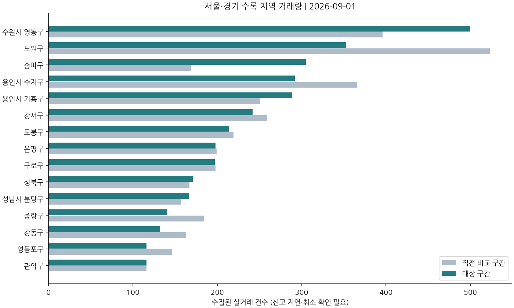

> - 리포트 기간: 9월 1일~9월 30일
> - 지역 거래량: 9월 1일~9월 30일 / 비교 대상 8월 2일~8월 31일
> - 단지 중간가격: 6월 3일~8월 31일 / 비교 대상 3월 5일~6월 2일

이번 월간 집계에서 거래 증감은 지역별로 엇갈렸습니다. 같은 길이의 앞선 구간과 비교하면 송파구는 169건에서 305건으로, 수원 영통구는 396건에서 500건으로 늘었습니다. 반면 노원구는 523건에서 353건으로 줄었습니다. 이 수치는 거래가 어느 지역에서 늘었는지를 보여주며, 지역 전체 가격의 변화율을 뜻하지는 않습니다.[^1][^2][^3]

단지 가격에서는 상승을 동반한 거래 건수의 차이가 눈에 띕니다. 야탑동 매화마을공무원2 58㎡대 6층 이상의 기간 중간가격은 10억 1,750만원에서 10억 7,500만원으로, 거래는 22건에서 31건으로 함께 늘었습니다. 같은 가격 비교 구간의 기흥역센트럴푸르지오 84㎡대 6층 이상은 중간가격이 9억 2,000만원에서 9억 9,250만원으로 높아졌지만 거래는 39건에서 30건으로 줄었습니다. 두 사례를 모두 가격과 거래가 함께 늘어난 경우로 설명할 수는 없습니다.[^4][^5]

금리에서는 정책금리와 차입 비용을 구분해 보겠습니다. 한국은행 기준금리는 연 3.0%로 이전 관측 연 3.0%와 같았습니다. 한편 예금은행 주택담보대출 금리는 연 4.93%로 이전 관측 연 4.77%보다 높았습니다. 대출금리의 기준일은 8월 1일, 기준금리는 9월 28일로 서로 다릅니다. 기준금리가 그대로라는 사실만으로 실제 대출 조건도 그대로라고 볼 수는 없습니다.[^6][^7]

국고채 3년 금리도 연 4.011%로 이전 관측 연 3.788%보다 높았습니다. 이전 관측값과의 비교이며 월평균끼리 비교한 수치는 아닙니다. 금리 관측과 단지 가격 비교의 시점이 다르므로, 이 금리 변화가 위 단지 가격을 올렸거나 내렸다고 연결하지 않겠습니다.[^8]

## 금리와 시장 지표

| 지표 | 최근 관측 | 이전 관측 | 기준일 |
|---|---:|---:|---|
| 한국은행 기준금리[^6] | 연 3.0% | 연 3.0% | 9월 28일 |
| 예금은행 정기예금 금리[^9] | 연 3.14% | 연 3.15% | 8월 1일 |
| 예금은행 주택담보대출 금리[^7] | 연 4.93% | 연 4.77% | 8월 1일 |
| 국고채 3년 금리[^8] | 연 4.011% | 연 3.788% | 9월 30일 |

이전 관측은 이번 리포트 시작 전에 확인한 값입니다. 지표마다 발표 주기와 관측일이 다릅니다.

## 실제 거래로 비교해 본 단지

6월 3일~8월 31일 거래를 3월 5일~6월 2일 거래와 비교했습니다. 같은 단지·면적대·층 구간에서 양쪽 모두 다섯 건 이상 거래된 경우만 골랐습니다. 신고가 뒤늦게 들어오는 영향을 줄이려고 최근 한 달은 비교에서 뺐습니다.

| 단지·면적 | 앞선 기간 중간가격 | 최근 기간 중간가격 | 차이 | 거래 건수(전→후) |
|---|---:|---:|---:|---:|
| 성남시 분당구 야탑동 매화마을공무원2 · 58㎡대 · 6층 이상[^4] | 10억 1,750만원 | 10억 7,500만원 | +5.7% | 22→31 |
| 수원시 영통구 영통동 벽적골한신 · 59㎡대 · 6층 이상[^10] | 4억 9,000만원 | 5억 500만원 | +3.1% | 33→37 |
| 용인시 기흥구 구갈동 기흥역센트럴푸르지오 · 84㎡대 · 6층 이상[^5] | 9억 2,000만원 | 9억 9,250만원 | +7.9% | 39→30 |
| 강서구 공항동 더트루엘마곡HQ · 48㎡대 · 6층 이상[^11] | 6억 4,400만원 | 6억 4,300만원 | -0.2% | 25→25 |
| 용인시 수지구 풍덕천동 현대성우8차 · 59㎡대 · 6층 이상[^12] | 10억 5,600만원 | 11억 2,000만원 | +6.1% | 26→22 |
| 도봉구 도봉동 한신 · 84㎡대 · 6층 이상[^13] | 6억 1,000만원 | 6억 3,250만원 | +3.7% | 22→20 |
| 성남시 수정구 신흥동 산성역포레스티아 · 74㎡대 · 6층 이상[^14] | 14억 5,000만원 | 15억 1,000만원 | +4.1% | 28→19 |
| 송파구 잠실동 잠실엘스 · 84㎡대 · 6층 이상[^15] | 32억 8,000만원 | 33억 8,250만원 | +3.1% | 38→18 |

이 가격은 실제 거래의 가운데 값입니다. 현재 매물 가격과 비교할 때는 동·층·수리 상태도 함께 보세요.

## 거래가 늘고 줄어든 곳

9월 1일~9월 30일의 거래 건수입니다. 바로 앞선 같은 길이의 기간과 비교했습니다. 거래가 다섯 건 이상인 지역 중 변화가 눈에 띄는 곳을 추렸습니다.

| 지역 | 앞선 기간 | 최근 기간 | 차이 |
|---|---:|---:|---:|
| 노원구[^3] | 523건 | 353건 | -170건 |
| 송파구[^1] | 169건 | 305건 | +136건 |
| 수원시 영통구[^2] | 396건 | 500건 | +104건 |
| 용인시 수지구[^16] | 366건 | 292건 | -74건 |
| 중랑구[^17] | 184건 | 140건 | -44건 |
| 동작구[^18] | 118건 | 75건 | -43건 |
| 마포구[^19] | 115건 | 77건 | -38건 |
| 성남시 분당구[^20] | 157건 | 166건 | +9건 |

## 다음에는 이 부분을 보겠습니다

거래 측면의 다음 질문은 증가 범위가 더 넓어지는지입니다. 같은 길이의 후속 구간에서 송파·영통의 증가가 이어지고, 감소했던 노원·수지의 거래도 늘어난다면 수록 지역 안에서 거래 증가의 범위가 넓어졌다는 근거가 됩니다. 특정 지역만 늘고 다른 지역의 감소가 이어진다면 전반적인 거래 증가라는 해석은 약해집니다.[^1][^2][^3][^16]

단지별로는 매화마을공무원2에서 중간가격과 거래 건수의 동반 증가가 이어지는지, 기흥역센트럴푸르지오에서는 가격 상승에 거래 건수의 증가도 뒤따르는지를 나눠 보겠습니다. 금리는 다음 공식 관측에서 대출금리와 국고채 금리의 방향을 각각 확인하겠습니다. 입주·미분양 자료가 없는 현재는 거래와 금리까지를 판단 범위로 두겠습니다.[^4][^5][^7][^8]

---

자료와 비교 기준

이번 글은 수록 지역 30곳의 공개 신고 자료를 바탕으로 작성했습니다. 가장 최근 거래일은 9월 30일입니다. 서울·경기 전체를 빠짐없이 담은 자료는 아닙니다.

거래 신고는 나중에 추가되거나 취소·정정될 수 있습니다. 지역별 거래 건수는 가격 비교와 별개이며, 단지 가격도 층과 집 상태에 따라 달라집니다. 현재 호가와 입주·미분양 등 확인하지 못한 자료를 대신 추정하지 않았습니다.

- 실거래는 현재 수집본 기준 재구성입니다. 신고 지연·취소/정정 반영 여부를 확인해야 합니다.
- 최근 실거래는 신고 지연으로 추가될 수 있으며 거래량 감소를 수요 감소로 단정하지 않습니다.
- 실거래 취소·정정 검증 미확보: 투자 판단 전 원문 확인이 필요합니다.
- 매물 증감 분석 미제공: 현재 매물 데이터의 최신성·전체 수집 여부를 확인하지 못했습니다.
- 지역 전체 중위가격은 거래 구성에 따라 변합니다. 가격 변화율은 동일 단지·면적 비교만 사용합니다.

뉴스는 제목과 제공된 요약을 바탕으로 정리했습니다. 정책의 시행 여부와 세부 조건은 연결된 원문에서 확인할 수 있습니다.

시장 흐름을 살펴보기 위한 자료이며 매수·매도 권유가 아닙니다.

[^1]: 송파구 거래 건수 · [국토교통부 실거래가 공개시스템](https://rt.molit.go.kr/).
[^2]: 수원시 영통구 거래 건수 · [국토교통부 실거래가 공개시스템](https://rt.molit.go.kr/).
[^3]: 노원구 거래 건수 · [국토교통부 실거래가 공개시스템](https://rt.molit.go.kr/).
[^4]: 성남시 분당구 야탑동 매화마을공무원2, 58㎡대·6층 이상. 국토교통부 신고 거래의 기간별 중간가격.
[^5]: 용인시 기흥구 구갈동 기흥역센트럴푸르지오, 84㎡대·6층 이상. 국토교통부 신고 거래의 기간별 중간가격.
[^6]: 한국은행 기준금리 · [ecos](https://ecos.bok.or.kr/api/), 관측일 9월 28일
[^7]: 예금은행 주택담보대출 금리 · [ecos](https://ecos.bok.or.kr/api/), 관측일 8월 1일
[^8]: 국고채 3년 금리 · [ecos](https://ecos.bok.or.kr/api/), 관측일 9월 30일
[^9]: 예금은행 정기예금 금리 · [ecos](https://ecos.bok.or.kr/api/), 관측일 8월 1일
[^10]: 수원시 영통구 영통동 벽적골한신, 59㎡대·6층 이상. 국토교통부 신고 거래의 기간별 중간가격.
[^11]: 강서구 공항동 더트루엘마곡HQ, 48㎡대·6층 이상. 국토교통부 신고 거래의 기간별 중간가격.
[^12]: 용인시 수지구 풍덕천동 현대성우8차, 59㎡대·6층 이상. 국토교통부 신고 거래의 기간별 중간가격.
[^13]: 도봉구 도봉동 한신, 84㎡대·6층 이상. 국토교통부 신고 거래의 기간별 중간가격.
[^14]: 성남시 수정구 신흥동 산성역포레스티아, 74㎡대·6층 이상. 국토교통부 신고 거래의 기간별 중간가격.
[^15]: 송파구 잠실동 잠실엘스, 84㎡대·6층 이상. 국토교통부 신고 거래의 기간별 중간가격.
[^16]: 용인시 수지구 거래 건수 · [국토교통부 실거래가 공개시스템](https://rt.molit.go.kr/).
[^17]: 중랑구 거래 건수 · [국토교통부 실거래가 공개시스템](https://rt.molit.go.kr/).
[^18]: 동작구 거래 건수 · [국토교통부 실거래가 공개시스템](https://rt.molit.go.kr/).
[^19]: 마포구 거래 건수 · [국토교통부 실거래가 공개시스템](https://rt.molit.go.kr/).
[^20]: 성남시 분당구 거래 건수 · [국토교통부 실거래가 공개시스템](https://rt.molit.go.kr/).
