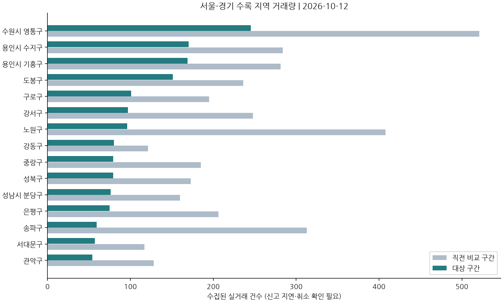

> 관측 대상: 2026-10-12 이상 2026-10-19 미만(KST). 현재 수집본을 활용한 참고 자료이며 투자 권유·수익 예측이 아닙니다.

## 핵심 흐름

- 서울 아파트값 상승폭이 다시 확대되고 경기 남부와 외곽 지역이 강세를 보인다는 보도가 이어졌다. 강남은 상대적으로 주춤하다는 분석도 함께 제시됐다. [관련 기사](#news-135e4fcbba09) [관련 기사](#news-499efcfe0b82) [관련 기사](#news-378f5d4582a4)
- 분당·영통·동탄 등 경기 남부는 재건축과 반도체 호재가 거론되며 수도권 상승을 주도한다는 보도가 나왔다. 다만 정비사업 단계와 교통 계획은 원문 확인이 필요하다. [관련 기사](#news-398c19ab5aa1) [관련 기사](#news-8080962f002b) [관련 기사](#news-61e263c9cf7f)
- 경기 분양가가 역대 최고 수준에 이르렀고 구리 등 일부 지역의 분양가 부담이 커졌다는 보도가 있었다. 공급 비용 상승이 인근 시장 가격 기대에 미치는 영향은 추가 확인이 필요하다. [관련 기사](#news-274ef1e3e292) [관련 기사](#news-0a1dc98f4027) [관련 기사](#news-cc754af31cc0)
- 실거래 표본에서는 서울·경기 조사 지역 전반의 거래 건수가 직전 집계보다 줄었다. 송파·금천·노원 등에서 감소가 두드러졌으나 신고 지연과 취소·정정 미검증으로 수요 감소로 단정할 수 없다. [송파구](#region-11710) [금천구](#region-11545) [노원구](#region-11350)

## 한눈에 보는 지표

| 지표 | 값 | 관측 기준일 | 비교 기준 저장값 | 출처 |
|---|---:|---|---:|---|
| 국고채 3년 금리 | 3.854 percent_annual | 2026-10-16 | [ecos](https://ecos.bok.or.kr/api/) |

비교 기준 저장값은 리포트 시작 전 마지막 저장값이며 전월 평균이 아닙니다. 관측일이 서로 다를 수 있습니다.

## 지역별 실거래 흐름

비교 구간: 2026-09-21~2026-10-19(미만), 직전 동일 길이 구간 2026-08-24~2026-09-21(미만). 일간·주간 거래 표는 최근 사 주의 배경 정보입니다. 거래 중위가격은 지역 거래 구성의 영향을 받습니다.

| 지역 | 거래 건수 | 직전 건수 | 동일 단지·면적 가격 변화 | 비교 셀 수 |
|---|---:|---:|---:|---:|
| 종로구 | 6 | 30 | 표본 부족/미확보 | 0 |
| 중구 | 21 | 29 | 표본 부족/미확보 | 0 |
| 용산구 | 10 | 39 | 표본 부족/미확보 | 0 |
| 성동구 | 16 | 54 | 표본 부족/미확보 | 0 |
| 광진구 | 23 | 50 | 표본 부족/미확보 | 0 |
| 동대문구 | 46 | 107 | 표본 부족/미확보 | 0 |
| 중랑구 | 79 | 185 | 표본 부족/미확보 | 0 |
| 성북구 | 79 | 173 | 표본 부족/미확보 | 0 |
| 강북구 | 41 | 88 | 표본 부족/미확보 | 0 |
| 도봉구 | 151 | 236 | 6.2% | 1 |
| 노원구 | 96 | 408 | 표본 부족/미확보 | 0 |
| 은평구 | 75 | 206 | 표본 부족/미확보 | 0 |
| 서대문구 | 57 | 117 | 표본 부족/미확보 | 0 |
| 마포구 | 30 | 91 | 표본 부족/미확보 | 0 |
| 양천구 | 50 | 113 | 표본 부족/미확보 | 0 |
| 강서구 | 97 | 248 | 12.5% | 1 |
| 구로구 | 101 | 195 | 표본 부족/미확보 | 0 |
| 금천구 | 17 | 88 | 표본 부족/미확보 | 0 |
| 영등포구 | 50 | 144 | 표본 부족/미확보 | 0 |
| 동작구 | 36 | 88 | 표본 부족/미확보 | 0 |
| 관악구 | 54 | 128 | 표본 부족/미확보 | 0 |
| 서초구 | 29 | 107 | 표본 부족/미확보 | 0 |
| 강남구 | 46 | 103 | 표본 부족/미확보 | 0 |
| 송파구 | 59 | 313 | 표본 부족/미확보 | 0 |
| 강동구 | 80 | 121 | 표본 부족/미확보 | 0 |
| 수원시 영통구 | 245 | 521 | 2.5% | 6 |
| 성남시 수정구 | 19 | 64 | 표본 부족/미확보 | 0 |
| 성남시 분당구 | 76 | 160 | 표본 부족/미확보 | 0 |
| 용인시 기흥구 | 169 | 281 | 0.7% | 2 |
| 용인시 수지구 | 170 | 284 | 0.4% | 1 |

## 추가 검토할 지역

가격 변화가 관측된 지역입니다. 취소·정정과 현재 호가를 확인하기 전에는 저평가 또는 투자 우위로 판단할 수 없습니다.

- 도봉구: 동일 단지·면적 가격 변화 +6.2%, 비교 셀 1개. 신고 지연·취소/정정·현재 호가 확인 필요.
- 강서구: 동일 단지·면적 가격 변화 +12.5%, 비교 셀 1개. 신고 지연·취소/정정·현재 호가 확인 필요.

## 분당 상세

성남시 분당구의 비교 기간 거래는 76건, 직전 구간은 160건입니다. 동일 단지·면적 가격 변화는 표본 부족/미확보입니다. 판교 생활권은 분당구와 중복 합산하지 않습니다.

## 부동산 뉴스와 이슈

제목·RSS 제공 메타데이터를 정리했습니다. 정책 확정·시행 여부는 각 원문에서 확인해야 합니다.

### 정비사업·교통

- [재건축·반도체 호재… 분당·영통·동탄, 수도권 집값 주도 - 경기신문](https://news.google.com/rss/articles/CBMiZEFVX3lxTE1ydGRvRjhNWmhEb09IMkJNbzZ2RzV4Qmx1b0c3YW9yN1I0WlI0UE81X2hHWEFjckZmYnA4M2dfT3dKNmtWZDJXd05OUHM4TDdrckZmdGVZV2h1TkpjMUxTaFd2QXQ?oc=5) — Google 뉴스 서울·경기 부동산, 2026-10-18T15:12. 보도 내용 확인 필요.
### 시장·지역 동향

- [“저렴하니 넓은 곳으로”… 인천 아파트, 서울·경기보다 대형 평형 인기 - 중부일보](https://news.google.com/rss/articles/CBMib0FVX3lxTE01ZTUwYURnU0xQVXhDNDhKZHJGd1FHTzdtVWlnVmhCdEh5NndNLWRsYTM4LUtiYWthYl9kaUh1RlFYbFFTQkcyVmVQY2JmbmJWdEFXbUs5NXNEUFRzaEZrVzN1LWpoNTF4QWFobTVtOA?oc=5) — Google 뉴스 서울·경기 부동산, 2026-10-18T13:47. 보도 내용 확인 필요.
- [서울 아파트값 상승 다시 확대…강남 대신 외곽·경기남부 - TopStarNews](https://news.google.com/rss/articles/CBMickFVX3lxTE1wTmhCOU1LMERnS3FGOENBaENrWFlYZUlKV1Rwal82Z1JpZ0R5OFExZUQwajNXS1VJQXdITHpUUnI4NmFYVVR1UGxROGdWR0gtSjNoVFRJNWJuRnZzWnQwLUhZVmNHVzRfSjNHS3pzQjhBdw?oc=5) — Google 뉴스 서울·경기 부동산, 2026-10-17T11:06. 보도 내용 확인 필요.
- [[통계로 보는 부동산] 서울보다 더 오른 경기 아파트값… 분당·영통·동탄 등 강세 - 아주경제](https://news.google.com/rss/articles/CBMiWkFVX3lxTE1MZXNtRVlsdnZoRV9DNEluLVVrV0lGWEFQNEFiU19seGkyUzlicHpOYjBRSHNTU2JkLW42WmJTZ0gzT3JZSEhQTlltVUIzVW1kUXYwMmt4U0dVUdIBWEFVX3lxTE1mWGxqMEtqaXZZUW9IdEc4azFpNmpGMXY3SmRfYVhuX2xmc2ZMbnJsRzBVWDZjbXRjS2gyNmoyOFJVNXZ2UFIwcmI3WXQwdlpqZ2xfZUdaWGo?oc=5) — Google 뉴스 서울·경기 부동산, 2026-10-17T08:00. 보도 내용 확인 필요.
- [서울 아파트값 오름폭 2주째 확대…경기 ‘반도체 벨트’도 강세 - 한겨레](https://news.google.com/rss/articles/CBMiaEFVX3lxTE9wTnpmb0d6bnhGQnJQMGtVand0Q19fSjB2dHJSVGRJalFVLWtscVRrR19scjBxMjZlTWpGU3hyNXF1QW9oQVlKWmdudVNIV2hjSkI3NWVTVE90YVZ5Y1JCdlRzVkpYamxz?oc=5) — Google 뉴스 서울·경기 부동산, 2026-10-15T19:33. 보도 내용 확인 필요.
- [숨고르던 서울 아파트값 다시 상승폭 커져… 분당·군포 등 경기 남부 강세 - 서울신문](https://news.google.com/rss/articles/CBMieEFVX3lxTE56OS1VSVJKTW5DTi1BeGdxVHl2U1FtSHRvSmlEZGg0WFNET1NrXzFCT1pQRHBGOEpnckpQQnNHbXpsT3FJYUNIY0VOaEtURncwT1N6Y0FMYk5VSkg3U0ZicUJZVHAzNmprZ0dpNW9KRW5sdUl4bWdJMw?oc=5) — Google 뉴스 서울·경기 부동산, 2026-10-15T16:11. 보도 내용 확인 필요.
- [서울 아파트값 88주 연속 상승, 최장 기록 경신 - 센트럴경제](https://news.google.com/rss/articles/CBMiZkFVX3lxTFBwa1c0TnBpMVFCdEpvRWRiczJ1RXphaG1UMDdreF9qOUdHU3ZZU3UyRkJCS0xHLTlzVDdKZ1ZkX0hOakIzNEFmX3FCc2RrejFjQVJEdUpRSmRMYjFBRFZPZlB3VzJvQdIBakFVX3lxTE9EaGJoTlV5QnE3eEtBWDJJVDlnNEhzUFFKRTBhNzZjbXIyc29FOUtoTzdTN0tUMm9kUUtIZXdaYlNtWGJTdGM1RU9lZGF5WFVpSlBMVGx0U1dXcGRYWV9wVGV5a2czR3Jzb2c?oc=5) — Google 뉴스 서울·경기 부동산, 2026-10-15T15:58. 보도 내용 확인 필요.
- [서울 아파트값 88주째 상승 랠리…강남 주춤한 사이 경기 남부 ‘불장’ - 와이드경제](https://news.google.com/rss/articles/CBMibEFVX3lxTE5iVTR3TE9DVGx1ZWhKdm40TEJwa0dEeTJZUWNHVGxrcVVfcmo5ckNXUkZOVjNIa2pWMFdKb0RJSTlfMUgtVmZRd3pJYkRySWg4RDI5SEZFby1vdUVPZ0F2bmN4NFhTdzRaYWd1WA?oc=5) — Google 뉴스 서울·경기 부동산, 2026-10-15T15:38. 보도 내용 확인 필요.
### 공급·청약

- [서울도 아닌데 평당 4000만원…경기 아파트 분양가의 역습 - 핀포인트뉴스](https://news.google.com/rss/articles/CBMic0FVX3lxTE44TGFVV3FfbFBQOFNGLXNkODJDSkhGdW9yM0NKSWlvUXZ5NG82Z0ZEbEJsWTRVc21yZGVlR2JkX29oT3JXazRvNXJLeHdINDROVUxfdFJEZm5wVG8zZmpQY056RWZZamZJb20wWHA4OEVRVkHSAXdBVV95cUxNUnlYeXlRc3dpWWc5eTNhcHFFYkV2OTZXcXhGZ2lGakkxZ1JBTWJ1MXBETVJ0TVY3b0h6RVhnS3hXMy1fN00xYVBuWmRIeUpNSEVBUkhyT0xOYjk4MW55ak1lRkZFSEszWjk4RzRBdmNtMnFVSE5TZw?oc=5) — Google 뉴스 서울·경기 부동산, 2026-10-17T11:48. 보도 내용 확인 필요.
- [“구리가 4천만원?”…‘또 역대 최고’ 찍은 경기도 아파트 분양가 - 경기일보](https://news.google.com/rss/articles/CBMiW0FVX3lxTFBIdzZPZ3piQWptM0pPZXRLYTd3cUppTFlEVnFOeVo1TnQ1c3FncTJ2dUJ6LXExaHJqTmVLWWNUOXY0MjVWc2c1VWY0Mm5hSlJBME1OTV80WHUxVlE?oc=5) — Google 뉴스 서울·경기 부동산, 2026-10-17T07:09. 보도 내용 확인 필요.
- [경기 분양가 3.3㎡당 2256만원 &#x27;역대 최고&#x27;…구리 4000만원 육박 - 뉴시스](https://news.google.com/rss/articles/CBMiYEFVX3lxTE56YWpBaFJMTm1jTlpyVHFiMVNrMFduUUlGZkJURTlLVXlSZzZVWGJaTE1qbzVYZml2RUt6NXpzNTF1bjlFYWZ0WnpaanZHb2dubEoxU3F1M2lVejZxYldteNIBeEFVX3lxTE03R2I5b0hlZ1kzOFBxbHU1Q1FtNnoxMV90Wm9zNktLRkJoVUVRUFF2dnlCSFU0Nlg3azhNcnNfRVp5Q3JXZTVRU1pBdTlWd3AzQ1FYcUJkMnBqblZNYXh3bTl2SEd5XzRwZXZoSVhMZXc4N1BGbTN6aA?oc=5) — Google 뉴스 서울·경기 부동산, 2026-10-17T05:30. 보도 내용 확인 필요.
### 금리·대출

- [대출 조이고 거래 막아도…서울 아파트 &#x27;마이웨이&#x27; &gt; 뉴스 - 지데일리](https://news.google.com/rss/articles/CBMiZ0FVX3lxTE9QSkNRNjk3d0NIT0ZfWUcwWVZKaml1TWJUQXNpbnZvQmVjOWdLT1RzN0FDOVZFcjN6QmFQSktMWjJoSEViWmJJWHNEdjQ2RmdEV3VhMVk5WExPVkJDdVlBVUVTbGhYS3M?oc=5) — Google 뉴스 서울·경기 부동산, 2026-10-15T20:51. 보도 내용 확인 필요.

서울 아파트값 오름폭이 확대되고 장기 상승 흐름이 이어져 최장 기록을 경신했다는 보도가 여러 매체에서 나왔다. 강남보다 외곽과 경기 남부가 상대적으로 강하다는 진단이 공통적으로 제시됐다. [관련 기사](#news-135e4fcbba09) [관련 기사](#news-a5a59708a77c) [관련 기사](#news-61e263c9cf7f) [관련 기사](#news-378f5d4582a4) [관련 기사](#news-499efcfe0b82)

분당·영통·동탄은 재건축과 반도체 산업 호재가 거론되며 수도권 집값을 주도한다는 보도가 있었다. 기대 요인 중심의 보도이므로 정비사업 진행 단계와 실제 입주 수요는 별도 검증이 필요하다. [관련 기사](#news-398c19ab5aa1) [관련 기사](#news-8080962f002b)

경기 아파트 분양가가 역대 최고를 기록하고 구리 등지의 분양가 수준이 높아졌다는 보도가 이어졌다. 분양가 상승이 기존 주택 가격 기대와 실수요 부담에 어떻게 작용하는지는 엇갈릴 수 있다. [관련 기사](#news-274ef1e3e292) [관련 기사](#news-0a1dc98f4027) [관련 기사](#news-cc754af31cc0)

인천 아파트가 서울·경기보다 대형 평형 인기를 끈다는 보도가 있었다. 상대적 저렴함이 수요를 인천으로 분산시킬 수 있다는 해석이지만, 거래 표본으로 확인된 결론은 아니다. [관련 기사](#news-9eaec8c73260)

## 다음에 확인할 점

- 서울·경기 조사 지역 전반에서 거래 건수가 줄어든 점은 가격 상승 보도와 반대되는 신호다. 신고 지연으로 최근 거래가 추가될 수 있고 취소·정정도 확인되지 않아 거래 위축으로 단정하지 않는다. [송파구](#region-11710) [노원구](#region-11350) [금천구](#region-11545)
- 동일 단지·면적 기준 가격 변화가 확인된 지역은 도봉과 강서 등으로 제한적이다. 소수 표본의 변화율을 지역 전체 가격 추세로 일반화하지 말고 추가 거래를 확인해야 한다. [도봉구](#region-11320) [강서구](#region-11500)
- 지역 중위가격은 거래 구성에 따라 달라질 수 있다. 고가·저가 거래 비중과 면적 구성이 바뀌었는지 확인하기 전에는 지역별 가격 비교를 해석하지 않는다. [강남구](#region-11680) [서초구](#region-11650) [성남시 분당구](#region-41135)
- 주택담보대출 금리·규모, 입주 예정 물량, 미분양, 인구·가구 이동, 청약 경쟁률, 교통·정비사업 단계가 빠져 있다. 이 지표를 보완해야 공급과 수요 압력을 함께 판단할 수 있다. [국고채 3년 금리](#metric-0) [관련 기사](#news-398c19ab5aa1) [관련 기사](#news-274ef1e3e292)

## 데이터 범위와 한계

분석에 포함된 지역은 30개, 대상 구간 거래는 2,028건입니다. 최근 실거래일은 2026-10-16, 실거래 수집 갱신은 2026-10-18T11:00:08+00:00입니다. 서울·경기 전체의 완전한 수록을 보장하지 않습니다.

- 실거래는 현재 수집본 기준 재구성입니다. 신고 지연·취소/정정 반영 여부를 확인해야 합니다.
- 최근 실거래는 신고 지연으로 추가될 수 있으며 거래량 감소를 수요 감소로 단정하지 않습니다.
- 실거래 취소·정정 검증 미확보: 투자 판단 전 원문 확인이 필요합니다.
- 매물 증감 분석 미제공: 현재 매물 데이터의 최신성·전체 수집 여부를 확인하지 못했습니다.
- 지역 전체 중위가격은 거래 구성에 따라 변합니다. 가격 변화율은 동일 단지·면적 비교만 사용합니다.

미확보 영향 지표: 주택담보대출 금리·규모, 입주 예정 물량, 미분양, 인구·가구 이동, 청약 경쟁률, 교통·정비사업 단계 검증.

실거래 원천: [국토교통부 실거래가 공개시스템](https://rt.molit.go.kr/). 공식 지표는 real_est_analysis, 실거래는 naver/apt_signal의 수집 자료를 활용했습니다. 표와 차트는 코드로 계산하고 해설은 LLM으로 작성한 뒤 구조·수치·출처를 검사했습니다.
