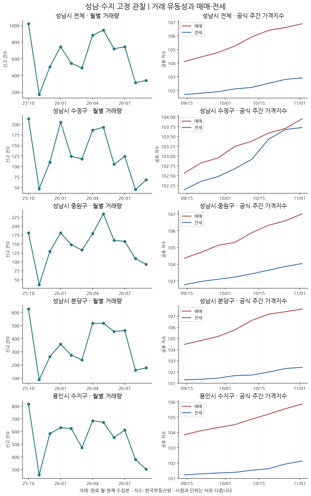
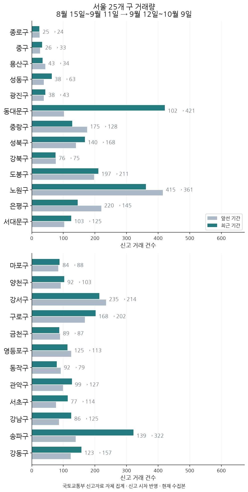
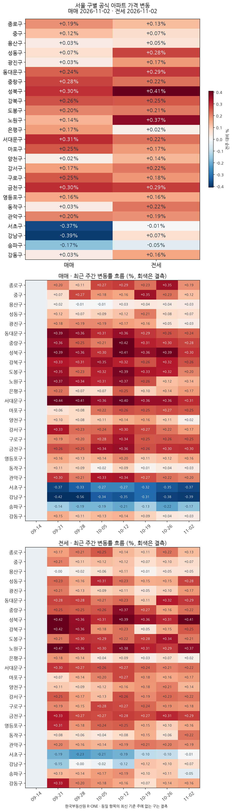

한 주의 주요 사건과 지역별 거래·단지 사례를 비교해 변화의 폭과 반례를 살펴봅니다.

수집본 확인: 2026-11-09 (한국시간). 실거래는 현재 수집본으로 기간을 재구성한 값입니다.

## 이번 주 시장 판단과 지역 차이

상승이 경기 남부로 번지는 흐름이 이번 주에도 이어졌지만, 서울 안에서는 갈렸습니다. 경기 아파트 매매가격지수는 전주 대비 +0.20% 올라 서울 +0.07%보다 컸고, 분당 +0.23%·성남 중원 +0.39%·용인 수지 +0.29%도 서울을 웃돌았습니다. 반대로 강남 -0.39%, 서초 -0.37%로 강남권은 반대 방향이었습니다.[^1][^2][^3][^4][^5][^6][^7]

가격 분포는 상승 쪽으로 크게 기울었습니다. 장기 비교 구간의 333개 단지·면적·층 조합 중 상승 311개, 보합 17개, 하락 5개입니다. 신고 시차가 있는 거래는 수록 31개 지역 합계 4,893건으로 앞선 구간 4,261건 대비 +14.8% 늘었지만, 증가 19곳과 감소 12곳으로 갈렸습니다.[^8][^9]

다만 확산 판단의 한계는 지역별 편차입니다. 강서구 더트루엘마곡HQ 48㎡대 6층 이상 구간은 기간 중간가격이 6억 4,250만원으로 앞선 구간 6억 4,400만원 대비 -0.2%에 그쳤고, 거래도 18건으로 22건보다 줄었습니다.[^10]

## 성남·수지 고정 점검

거래량: 8월 15일~9월 11일 → 9월 12일~10월 9일. 신고 시차를 둔 현재 수집본 비교입니다.

공식 매매 기준 주: 2026-11-02 · 전세 기준 주: 2026-11-02. 두 지표의 주기가 같을 때만 함께 비교합니다.

| 관심 지역 | 앞선 거래 | 최근 거래 | 공식 매매 전주비 | 공식 전세 전주비 |
| --- | ---: | ---: | ---: | ---: |
| 성남시 전체[^11] | 285건 | 300건 | +0.26% | +0.11% |
| 성남시 수정구[^12] | 42건 | 58건 | +0.24% | +0.05% |
| 성남시 중원구[^13] | 84건 | 88건 | +0.39% | +0.17% |
| 성남시 분당구[^14] | 159건 | 154건 | +0.23% | +0.11% |
| 용인시 수지구[^15] | 271건 | 326건 | +0.29% | +0.20% |

성남 전체 거래량은 수정·중원·분당의 수집이 모두 확인된 기간만 합산합니다. 공식 가격지수는 구별 값의 평균이 아닙니다.

### 성남시 수정구

수정구는 거래가 58건으로 앞선 구간 42건 대비 +38.1%로 집계됐습니다. 별도 관측인 주간 매매지수는 +0.24% 올랐습니다. 산성역포레스티아 59㎡대 6층 이상 구간은 기간 중간가격이 14억 9,250만원이고, 앞선 구간 대비 +11.4%, 거래는 12건이었습니다. 같은 단지 74㎡대 6층 이상 신규 전세 보증금은 7억 5,000만원, 전세가율은 47.9%입니다. 실거주는 이 보증금과 매매 기간 중간가격을 같은 단지에서 견주고, 투자는 거래가 늘어도 가격 방향이 단일 거래에 흔들리는지 확인하세요.[^12][^16][^17][^18]

비교 범위: 단일 거래 제외 시 가격 방향 변화

### 성남시 중원구

중원구는 거래가 88건으로 앞선 84건 대비 +4.8%로 집계됐습니다. 별도 관측인 주간 매매지수는 +0.39%, 전세지수는 +0.17% 올랐습니다. 산들마을2단지 51㎡대 6층 이상 구간은 기간 중간가격이 9억 6,500만원이고, 앞선 구간 대비 +4.9%, 거래는 17건이었습니다. 선경2차 49㎡대 6층 이상 신규 전세 보증금은 3억 1,000만원, 전세가율은 56.5%입니다. 실거주는 전세가율이 높은 구간의 보증금 부담을, 투자는 매매 거래가 늘어난 만큼 전세 수요도 함께 붙는지 확인하세요.[^13][^4][^19][^20][^21]

### 성남시 분당구

분당구는 거래가 154건으로 앞선 159건 대비 -3.1%로 집계됐습니다. 별도 관측인 주간 매매지수는 +0.23%, 전세지수는 +0.11% 올랐습니다. 매화마을공무원2 58㎡대 6층 이상 구간은 기간 중간가격이 10억 9,500만원, 앞선 구간 대비 +5.3%였고 거래는 24건으로 31건보다 줄었습니다. 한솔마을(4단지)(주공) 35㎡대 6층 이상 신규 전세 보증금은 3억 3,000만원으로 변화가 +0.0%이고, 같은 구간 거래가 6건이라 이를 추세로 읽지 않습니다. 실거주는 소형 면적대 전세 보증금을, 투자는 가격 상승과 거래 감소가 겹친 구간을 확산 신호로 단정하지 말고 따로 보세요.[^14][^3][^22][^23][^24]

비교 범위: 공식 가격과 과거 거래량 방향 차이 · 비교 기간 다름

### 용인시 수지구

수지구는 거래가 326건으로 앞선 271건 대비 +20.3%로 집계됐습니다. 별도 관측인 주간 매매지수는 +0.29%, 전세지수는 +0.20% 올랐습니다. 동부 59㎡대 6층 이상 구간은 기간 중간가격이 8억 3,900만원이고, 앞선 구간 대비 +4.9%, 거래는 28건으로 20건보다 많았습니다. 성복역롯데캐슬골드타운 84㎡대 6층 이상 신규 전세 보증금은 9억 5,000만원, 전세가율은 51.9%입니다. 실거주는 전세가율이 높은 대형 면적대의 갈아타기 부담을, 투자는 거래 증가가 매매와 전세 양쪽에서 함께 나타나는지 확인하세요.[^15][^5][^25][^26][^27]

## 서울 25개 구 비교

서울 25개 구 수치 전체 보기

| 자치구 | 앞선 거래 | 최근 거래 | 공식 매매 전주비 | 공식 전세 전주비 |
| --- | ---: | ---: | ---: | ---: |
| 종로구 | 25건 | 24건 | +0.19% | +0.13% |
| 중구 | 26건 | 33건 | +0.12% | +0.07% |
| 용산구 | 43건 | 34건 | +0.03% | +0.05% |
| 성동구 | 38건 | 63건 | +0.07% | +0.28% |
| 광진구 | 38건 | 43건 | +0.03% | +0.17% |
| 동대문구 | 102건 | 421건 | +0.24% | +0.29% |
| 중랑구 | 175건 | 128건 | +0.28% | +0.22% |
| 성북구 | 140건 | 168건 | +0.30% | +0.41% |
| 강북구 | 76건 | 75건 | +0.26% | +0.25% |
| 도봉구 | 197건 | 211건 | +0.20% | +0.21% |
| 노원구 | 415건 | 361건 | +0.14% | +0.37% |
| 은평구 | 220건 | 145건 | +0.17% | +0.02% |
| 서대문구 | 103건 | 125건 | +0.31% | +0.22% |
| 마포구 | 84건 | 88건 | +0.25% | +0.17% |
| 양천구 | 92건 | 103건 | +0.02% | +0.14% |
| 강서구 | 235건 | 214건 | +0.17% | +0.22% |
| 구로구 | 168건 | 202건 | +0.25% | +0.18% |
| 금천구 | 89건 | 87건 | +0.30% | +0.29% |
| 영등포구 | 125건 | 113건 | +0.16% | +0.16% |
| 동작구 | 92건 | 79건 | +0.03% | +0.22% |
| 관악구 | 99건 | 127건 | +0.20% | +0.19% |
| 서초구 | 77건 | 114건 | -0.37% | -0.01% |
| 강남구 | 86건 | 125건 | -0.39% | +0.07% |
| 송파구 | 139건 | 322건 | -0.17% | -0.05% |
| 강동구 | 123건 | 157건 | +0.03% | +0.16% |

공식 지수: [한국부동산원 R-ONE](https://www.reb.or.kr/r-one/portal/main/indexPage.do). 거래량: [국토교통부 실거래가](https://rt.molit.go.kr/) 신고 자료 자체 집계. 수집되지 않은 구간은 0건으로 표시하지 않습니다.

## 직전 리포트와 달라진 이유

수록 거래량은 4,606건에서 4,893건으로 +287건 달라졌습니다.[^28]

| 같은 기간 수집본 차이 | 비교 기간 이동 | 지역 범위 차이 |
|---:|---:|---:|
| -74건 | +273건 | +88건 |

수집본 차이는 신고 추가·원천 갱신·자료 범위 차이를 포함할 수 있습니다. 개별 계약의 취소·정정을 확인한 수치가 아닙니다.

선정 가격 사례는 직전 대비 유지 7개, 추가 3개, 제외 3개입니다. 사례 교체를 시장 가격 변화로 해석하지 않습니다.

동일 가격 사례의 수집본 변화와 기간 이동

| 사례 | 직전 중간가격 | 현재 중간가격 | 같은 기간 수집본 차이 | 기간 이동 차이 |
|---|---:|---:|---:|---:|
| 성남시 분당구 매화마을공무원2 58㎡대 6층 이상[^29] | 10억 9,300만원 | 10억 9,500만원 | +0만원 | +200만원 |
| 수원시 영통구 황골마을주공1 59㎡대 6층 이상[^30] | 6억 2,000만원 | 6억 2,000만원 | +0만원 | +0만원 |
| 도봉구 한신 84㎡대 6층 이상[^31] | 6억 5,250만원 | 6억 6,000만원 | +0만원 | +750만원 |

수집본 차이는 직전 비교 창을 현재 자료로 다시 계산한 차이입니다. 동일 세대의 재거래 가격이나 시장 전체의 가격지수가 아닙니다.

## 분당 고정 관찰 단지

동일 단지·면적대·층 구간을 계속 추적합니다. 표본 부족 사례를 다른 단지로 바꾸지 않습니다.

| 고정 관찰 구간 | 최근 중간가격 | 앞선/최근 건수 | 표본 확인 |
|---|---:|---:|---|
| 야탑동 매화마을공무원2 58㎡대 6층 이상[^23] | 10억 9,500만원 | 31/24건 | 표본·가격 퍼짐 함께 확인 |
| 정자동 한솔마을(4단지)(주공) 35㎡대 6층 이상[^32] | 10억 9,000만원 | 12/9건 | 표본 수 제한 |
| 이매동 이매촌(한신) 50㎡대 6층 이상[^33] | 14억 9,950만원 | 9/6건 | 표본 수 제한 |
| 수내동 양지마을(5단지)(한양501-514) 35㎡대 6층 이상 | — | — | 표본 부족 |
| 정자동 한솔마을(5단지)(주공) 41㎡대 1~5층 | — | — | 표본 부족 |
| 서현동 시범한양 35㎡대 6층 이상[^34] | 12억 9,000만원 | 6/5건 | 표본 수 제한 |

가격 표본의 퍼짐과 단일 거래 제외 민감도

| 사례 | 최근 가격 중앙 절반 범위 | 앞선/최근 건수 | 변화율 민감도 |
|---|---:|---:|---:|
| 매화마을공무원2 58㎡대 6층 이상[^23] | 10억 7,875만원~11억 1,900만원 | 31/24건 | +5.10%~+5.48% |
| 산성역포레스티아 59㎡대 6층 이상[^17] | 14억 4,500만원~15억원 | 11/12건 | +10.97%~+11.57% |
| 산들마을2단지 51㎡대 6층 이상[^20] | 9억 4,000만원~9억 9,000만원 | 14/17건 | +4.62%~+5.16% |
| 동부 59㎡대 6층 이상[^26] | 8억 2,000만원~8억 4,550만원 | 20/28건 | +4.75%~+5.00% |
| 황골마을주공1 59㎡대 6층 이상[^35] | 6억원~6억 4,500만원 | 42/36건 | +19.23%~+19.69% |
| 더트루엘마곡HQ 48㎡대 6층 이상[^10] | 6억 3,300만원~6억 6,625만원 | 22/18건 | -0.31%~-0.16% |
| 한신 84㎡대 6층 이상[^36] | 6억 2,750만원~6억 7,575만원 | 24/16건 | +6.45%~+6.45% |
| 잠실엘스 84㎡대 6층 이상[^37] | 33억 2,250만원~34억 5,000만원 | 27/16건 | +2.42%~+2.42% |
| 주공2 44㎡대 6층 이상[^38] | 3억 8,000만원~4억 200만원 | 20/16건 | +8.33%~+9.17% |
| 금천롯데캐슬골드파크3차 59㎡대 6층 이상[^39] | 10억 5,500만원~11억 750만원 | 14/14건 | +3.81%~+3.81% |
| 한솔마을(4단지)(주공) 35㎡대 6층 이상[^32] | 10억 7,700만원~11억원 | 12/9건 | +8.50%~+9.00% |
| 이매촌(한신) 50㎡대 6층 이상[^33] | 14억 9,675만원~15억 4,500만원 | 9/6건 | +0.81%~+1.49% |
| 시범한양 35㎡대 6층 이상[^34] | 12억 6,000만원~13억원 | 6/5건 | +14.09%~+16.74% |

민감도는 앞선 기간 또는 최근 기간에서 거래 한 건씩을 제외해 중간가격 변화율을 다시 계산한 범위입니다. 신뢰구간·예측 확률·동일 세대 가격 변화가 아니며, 집 상태와 동·층 차이는 남습니다.

## 앞서 정한 관찰 조건 점검

충족 1개 · 미충족 0개 · 관측 대기 1개 · 판정 불가 1개. 조건 점검 결과이며 전망 적중률이 아닙니다.

| 관찰 조건 | 목표 기준일·월 | 기준 | 관측 결과 |
|---|---|---:|---|
| 거래 증가 지역 수가 유지되는가[^40] | 2026-10-31 | &gt;= 17곳 | 판정 불가 · 비교 지역·기간 기준 변경 |
| 분당 주간 상승률이 서울을 웃도는가[^41] | 2026-11-02 | &gt; 0%p | 조건 충족 · 0.161%p |
| 관찰 대상 월 주담대 평균금리가 기준 이상인가[^42] | 2026-10 | &gt;= 연 4.93% | 관측 대기 · 목표 시점 자료 대기 |

기준일·비교 범위가 맞는 후속 자료만 판정합니다. 관측 대기·판정 불가는 실패나 성공으로 세지 않으며 예측 적중률을 뜻하지 않습니다.

공식 지표·전월세·금리·공급과 상세 비교 자료

<section class="report-overview" aria-label="핵심 지표"> 
 거래량 · 수록 31개 지역  <a href="#fn:9" aria-label="출처 9">9</a>   <strong class="report-kpi-value">4,893<small>건</small> </strong>  +14.8% · 이전 4,261건 증가 19곳 · 감소 12곳 · 동일 0곳 9월 12일~10월 9일 
 
 단지 사례 · 성남시 분당구 <strong class="report-kpi-value">10억 9,500만원 <a href="#fn:23" aria-label="출처 23">23</a>  </strong>  +5.3% 이전 10억 4,000만원  매화마을공무원2 · 58㎡대 · 6층 이상 7월 12일~10월 9일 · 중간가격 
 
 한국은행 기준금리 <strong class="report-kpi-value">연 3.0% <a href="#fn:43" aria-label="출처 43">43</a>  </strong>  0%p 이전 연 3.0%  이전 관측과 비교 기준일 2026-11-06 
 </section>

<dl class="report-periods"> 
 <dt>리포트 기간</dt> <dd>11월 2일~11월 8일</dd> 
 
 <dt>거래량 비교</dt> <dd>9월 12일~10월 9일 / 이전 8월 15일~9월 11일</dd> 
 
 <dt>단지 가격 비교</dt> <dd>7월 12일~10월 9일 / 이전 4월 13일~7월 11일</dd> 
 </dl>

## 공식 주간 매매·전세 동향

한국부동산원 주간 아파트 통계입니다. 가격은 전주 대비 변화율, 수급은 조사 응답 지수와 전주 대비 포인트 차이입니다.

| 지역 | 공식 지표 | 기준일 | 지수 | 전주 대비 |
|---|---|---|---:|---:|
| 전국 | 매매가격[^44] | 2026-11-02 | 101.43 | +0.07% |
| 서울 | 매매가격[^2] | 2026-11-02 | 103.21 | +0.07% |
| 경기 | 매매가격[^1] | 2026-11-02 | 103.24 | +0.20% |
| 성남시 분당구 | 매매가격[^3] | 2026-11-02 | 107.64 | +0.23% |
| 성남시 전체 | 매매가격[^45] | 2026-11-02 | 106.89 | +0.26% |
| 성남시 수정구 | 매매가격[^16] | 2026-11-02 | 103.95 | +0.24% |
| 성남시 중원구 | 매매가격[^4] | 2026-11-02 | 107.01 | +0.39% |
| 용인시 수지구 | 매매가격[^5] | 2026-11-02 | 105.86 | +0.29% |
| 종로구 | 매매가격[^46] | 2026-11-02 | 104.85 | +0.19% |
| 중구 | 매매가격[^47] | 2026-11-02 | 105.3 | +0.12% |
| 용산구 | 매매가격[^48] | 2026-11-02 | 101.28 | +0.03% |
| 성동구 | 매매가격[^49] | 2026-11-02 | 102.21 | +0.07% |
| 광진구 | 매매가격[^50] | 2026-11-02 | 102.19 | +0.03% |
| 동대문구 | 매매가격[^51] | 2026-11-02 | 105.62 | +0.24% |
| 중랑구 | 매매가격[^52] | 2026-11-02 | 107.05 | +0.28% |
| 성북구 | 매매가격[^53] | 2026-11-02 | 107.42 | +0.30% |
| 강북구 | 매매가격[^54] | 2026-11-02 | 106.17 | +0.26% |
| 도봉구 | 매매가격[^55] | 2026-11-02 | 105.61 | +0.20% |
| 노원구 | 매매가격[^56] | 2026-11-02 | 106.2 | +0.14% |
| 은평구 | 매매가격[^57] | 2026-11-02 | 103.68 | +0.17% |
| 서대문구 | 매매가격[^58] | 2026-11-02 | 107 | +0.31% |
| 마포구 | 매매가격[^59] | 2026-11-02 | 104.25 | +0.25% |
| 양천구 | 매매가격[^60] | 2026-11-02 | 102.01 | +0.02% |
| 강서구 | 매매가격[^61] | 2026-11-02 | 105.09 | +0.17% |
| 구로구 | 매매가격[^62] | 2026-11-02 | 105.32 | +0.25% |
| 금천구 | 매매가격[^63] | 2026-11-02 | 105.39 | +0.30% |
| 영등포구 | 매매가격[^64] | 2026-11-02 | 103.8 | +0.16% |
| 동작구 | 매매가격[^65] | 2026-11-02 | 102.23 | +0.03% |
| 관악구 | 매매가격[^66] | 2026-11-02 | 105.25 | +0.20% |
| 서초구 | 매매가격[^7] | 2026-11-02 | 97.08 | -0.37% |
| 강남구 | 매매가격[^6] | 2026-11-02 | 96.35 | -0.39% |
| 송파구 | 매매가격[^67] | 2026-11-02 | 99.9 | -0.17% |
| 강동구 | 매매가격[^68] | 2026-11-02 | 102.7 | +0.03% |
| 전국 | 전세가격[^69] | 2026-11-02 | 101.73 | +0.10% |
| 서울 | 전세가격[^70] | 2026-11-02 | 103.49 | +0.17% |
| 경기 | 전세가격[^71] | 2026-11-02 | 102.77 | +0.16% |
| 성남시 분당구 | 전세가격[^22] | 2026-11-02 | 102.42 | +0.11% |
| 성남시 전체 | 전세가격[^72] | 2026-11-02 | 102.92 | +0.11% |
| 성남시 수정구 | 전세가격[^73] | 2026-11-02 | 103.73 | +0.05% |
| 성남시 중원구 | 전세가격[^19] | 2026-11-02 | 104.04 | +0.17% |
| 용인시 수지구 | 전세가격[^25] | 2026-11-02 | 102.13 | +0.20% |
| 종로구 | 전세가격[^74] | 2026-11-02 | 104.01 | +0.13% |
| 중구 | 전세가격[^75] | 2026-11-02 | 102.89 | +0.07% |
| 용산구 | 전세가격[^76] | 2026-11-02 | 101.53 | +0.05% |
| 성동구 | 전세가격[^77] | 2026-11-02 | 103.59 | +0.28% |
| 광진구 | 전세가격[^78] | 2026-11-02 | 102.62 | +0.17% |
| 동대문구 | 전세가격[^79] | 2026-11-02 | 104.47 | +0.29% |
| 중랑구 | 전세가격[^80] | 2026-11-02 | 105.02 | +0.22% |
| 성북구 | 전세가격[^81] | 2026-11-02 | 106.58 | +0.41% |
| 강북구 | 전세가격[^82] | 2026-11-02 | 104.95 | +0.25% |
| 도봉구 | 전세가격[^83] | 2026-11-02 | 104.94 | +0.21% |
| 노원구 | 전세가격[^84] | 2026-11-02 | 106.6 | +0.37% |
| 은평구 | 전세가격[^85] | 2026-11-02 | 102.79 | +0.02% |
| 서대문구 | 전세가격[^86] | 2026-11-02 | 104.78 | +0.22% |
| 마포구 | 전세가격[^87] | 2026-11-02 | 103.28 | +0.17% |
| 양천구 | 전세가격[^88] | 2026-11-02 | 102.67 | +0.14% |
| 강서구 | 전세가격[^89] | 2026-11-02 | 103.44 | +0.22% |
| 구로구 | 전세가격[^90] | 2026-11-02 | 103.69 | +0.18% |
| 금천구 | 전세가격[^91] | 2026-11-02 | 105.87 | +0.29% |
| 영등포구 | 전세가격[^92] | 2026-11-02 | 103.73 | +0.16% |
| 동작구 | 전세가격[^93] | 2026-11-02 | 102.65 | +0.22% |
| 관악구 | 전세가격[^94] | 2026-11-02 | 103.75 | +0.19% |
| 서초구 | 전세가격[^95] | 2026-11-02 | 98.49 | -0.01% |
| 강남구 | 전세가격[^96] | 2026-11-02 | 99.95 | +0.07% |
| 송파구 | 전세가격[^97] | 2026-11-02 | 103.44 | -0.05% |
| 강동구 | 전세가격[^98] | 2026-11-02 | 104.01 | +0.16% |
| 전국 | 매매수급[^99] | 2026-11-02 | 99.65 | -0.30포인트 |
| 서울 | 매매수급[^100] | 2026-11-02 | 109.45 | -1.06포인트 |
| 경기 | 매매수급[^101] | 2026-11-02 | 103.23 | -0.45포인트 |
| 전국 | 전세수급[^102] | 2026-11-02 | 106.95 | +0.01포인트 |
| 서울 | 전세수급[^103] | 2026-11-02 | 121.26 | -0.12포인트 |
| 경기 | 전세수급[^104] | 2026-11-02 | 110.13 | +0.33포인트 |

전주 값이 없거나 두 기준일이 연속된 주가 아니면 변화는 표시하지 않습니다. 가격지수와 개별 단지의 실거래 중간가격은 다른 지표입니다.

분당구 수급동향은 이번 수집 자료에 없어 경기 값으로 대체하지 않았습니다.

## 신규 전세 실거래와 임대차 계약 구성

7월 12일~10월 9일의 수집 완료 31개 지역 신고 계약 59,688건입니다. 전세 28,986건·월세 30,702건이며, 월세 계약 비중은 51.4%입니다.[^105]

신규 30,599건·갱신 27,933건·구분 미확인 1,156건입니다. 미확인을 신규로 추정하지 않습니다. 지역별 거래 구성과 신고 지연의 영향을 받으며 서울·경기 전체의 완전한 수록 통계는 아닙니다.

지역별 임대차 계약 구성

| 지역 | 계약 | 신규 | 갱신 | 미확인 | 월세 비중 |
|---|---:|---:|---:|---:|---:|
| 성남시 수정구 | 1,006 | 500 | 488 | 18 | 55.0% |
| 성남시 중원구 | 718 | 362 | 340 | 16 | 45.0% |
| 성남시 분당구 | 2,974 | 1,455 | 1,446 | 73 | 45.6% |
| 용인시 수지구 | 2,057 | 1,004 | 1,010 | 43 | 41.3% |
| 종로구 | 436 | 312 | 121 | 3 | 70.6% |
| 중구 | 753 | 473 | 271 | 9 | 59.9% |
| 용산구 | 1,170 | 644 | 504 | 22 | 54.0% |
| 성동구 | 1,732 | 956 | 742 | 34 | 51.9% |
| 광진구 | 829 | 481 | 348 | 0 | 55.4% |
| 동대문구 | 1,709 | 1,054 | 621 | 34 | 57.3% |
| 중랑구 | 2,313 | 1,459 | 820 | 34 | 73.1% |
| 성북구 | 1,462 | 735 | 700 | 27 | 47.3% |
| 강북구 | 611 | 356 | 254 | 1 | 51.9% |
| 도봉구 | 1,058 | 548 | 489 | 21 | 46.3% |
| 노원구 | 3,455 | 1,696 | 1,688 | 71 | 46.7% |
| 은평구 | 2,144 | 954 | 1,152 | 38 | 48.6% |
| 서대문구 | 1,469 | 726 | 712 | 31 | 50.2% |
| 마포구 | 2,372 | 1,208 | 1,120 | 44 | 50.8% |
| 양천구 | 2,153 | 1,093 | 1,003 | 57 | 42.6% |
| 강서구 | 3,152 | 1,319 | 1,772 | 61 | 42.9% |
| 구로구 | 2,774 | 1,082 | 1,631 | 61 | 73.5% |
| 금천구 | 822 | 579 | 243 | 0 | 73.4% |
| 영등포구 | 2,469 | 1,168 | 1,213 | 88 | 53.4% |
| 동작구 | 1,766 | 1,031 | 697 | 38 | 50.3% |
| 관악구 | 1,204 | 746 | 427 | 31 | 59.6% |
| 서초구 | 2,892 | 1,424 | 1,417 | 51 | 44.8% |
| 강남구 | 3,749 | 1,884 | 1,815 | 50 | 54.8% |
| 송파구 | 3,615 | 1,680 | 1,862 | 73 | 48.7% |
| 강동구 | 2,701 | 1,392 | 1,270 | 39 | 49.8% |
| 수원시 영통구 | 2,056 | 1,144 | 870 | 42 | 44.1% |
| 용인시 기흥구 | 2,067 | 1,134 | 887 | 46 | 43.7% |

확인된 신규 전세만 같은 단지·면적대·층 구간으로 맞춰, 매매 단지 비교와 같은 두 기간을 비교했습니다.

| 단지·면적·층 | 이전 보증금 | 최근 보증금 | 차이 | 신규 전세 건수(전→후) | 매매 대비 비율 |
|---|---:|---:|---:|---:|---:|
| 성남시 분당구 정자동 한솔마을(4단지)(주공) · 35㎡대 · 6층 이상[^24] | 3억 3,000만원 | 3억 3,000만원 | +0.0% | 5→6 | 30.3% |
| 성남시 수정구 신흥동 산성역포레스티아 · 74㎡대 · 6층 이상[^18] | 7억 3,000만원 | 7억 5,000만원 | +2.7% | 17→25 | 47.9% |
| 성남시 중원구 상대원동 선경2차 · 49㎡대 · 6층 이상[^21] | 3억원 | 3억 1,000만원 | +3.3% | 15→10 | 56.5% |
| 용인시 수지구 성복동 성복역롯데캐슬골드타운 · 84㎡대 · 6층 이상[^27] | 9억원 | 9억 5,000만원 | +5.6% | 13→16 | 51.9% |
| 송파구 잠실동 잠실엘스 · 84㎡대 · 6층 이상[^106] | 13억 5,000만원 | 13억 6,500만원 | +1.1% | 27→28 | 40.4% |
| 은평구 신사동 은평자이더스타 · 49㎡대 · 6층 이상[^107] | 4억 5,000만원 | 4억 5,000만원 | +0.0% | 29→27 | — |
| 수원시 영통구 영통동 황골마을주공1 · 59㎡대 · 6층 이상[^108] | 3억 5,000만원 | 3억 7,500만원 | +7.1% | 24→20 | 60.5% |
| 관악구 신림동 힐스테이트뉴포레 · 59㎡대 · 6층 이상[^109] | 7억 4,000만원 | 7억 5,000만원 | +1.4% | 16→19 | 53.6% |

매매 대비 비율은 같은 기간·동일 비교 구간의 전세와 매매 중간가격 비율입니다. 서로 다른 거래를 비교한 값이며 동일 세대 평가액이나 투자 수익률이 아닙니다. 조건이 맞지 않으면 표시하지 않습니다.

## 실제 주담대 금리와 상환액 비교

예금은행 주담대 신규취급액 평균금리입니다. 전국 예금은행의 신규취급 월평균으로, 개인에게 제시되는 금리와 다릅니다.[^110]

| 기준 월 | 평균금리 | 가정 월 상환액 |
|---|---:|---:|
| 2026년 8월 | 연 4.93% | 532,552원 |
| 2026년 9월 | 연 4.88% | 529,512원 |

원금 1억원·30년·원리금균등 상환을 가정했습니다. 해당 금리가 만기까지 유지되는 단순 비교이며 수수료·중도상환·금리 재산정은 반영하지 않습니다. 소득 기반 부담지수나 개인 DSR·대출 승인 가능성을 계산한 값이 아닙니다.

## 전체주택 공급과 미분양

인허가는 전체주택 연초 누계(다가구는 동수 기준), 착공·준공은 전체주택 월별 실적, 미분양은 월말 재고입니다. 인허가 누계 차이를 월간 증가율로 계산하지 않습니다. 아파트만의 공급이나 확정 입주 예정 물량이 아닙니다.

| 지역·지표 | 이전 월 | 이전 값 | 최근 월 | 최근 값 | 차이 |
|---|---|---:|---|---:|---:|
| 전국 전체주택 인허가 연초 누계[^111] | 2026년 1~8월 누계 | 163,935호 | 2026년 1~9월 누계 | 189,873호 | — |
| 서울 전체주택 인허가 연초 누계[^112] | 2026년 1~8월 누계 | 39,940호 | 2026년 1~9월 누계 | 44,371호 | — |
| 경기 전체주택 인허가 연초 누계[^113] | 2026년 1~8월 누계 | 46,060호 | 2026년 1~9월 누계 | 55,062호 | — |
| 전국 전체주택 착공[^114] | 2026년 8월 | 18,013호 | 2026년 9월 | 16,046호 | -1,967호 |
| 서울 전체주택 착공[^115] | 2026년 8월 | 1,172호 | 2026년 9월 | 1,176호 | +4호 |
| 경기 전체주택 착공[^116] | 2026년 8월 | 4,068호 | 2026년 9월 | 6,598호 | +2,530호 |
| 전국 전체주택 준공[^117] | 2026년 8월 | 15,151호 | 2026년 9월 | 18,449호 | +3,298호 |
| 서울 전체주택 준공[^118] | 2026년 8월 | 4,714호 | 2026년 9월 | 1,251호 | -3,463호 |
| 경기 전체주택 준공[^119] | 2026년 8월 | 3,967호 | 2026년 9월 | 6,530호 | +2,563호 |
| 서울 미분양주택[^120] | 2026년 8월 | 898호 | 2026년 9월 | 996호 | +98호 |
| 경기 미분양주택[^121] | 2026년 8월 | 14,509호 | 2026년 9월 | 13,802호 | -707호 |

미분양 총계와 준공 후 미분양은 다릅니다. 분당구 세부 물량과 준공 후 미분양은 확보하지 못했으며 경기 값을 분당에 대체하지 않습니다.

전국 미분양 총계는 제공된 자료에 없어 표시하지 않았습니다.

## 금리와 시장 지표

| 지표 | 이전 관측 | 이전 기준일 | 최근 관측 | 최근 기준일 |
|---|---:|---|---:|---|
| 한국은행 기준금리[^43] | 연 3.0% | 10월 30일 | 연 3.0% | 11월 6일 |

이전 관측은 이번 리포트 시작 전에 확인한 값입니다. 지표마다 발표 주기와 관측일이 다릅니다.

## 단지 가격의 전체 분포

비교 가능한 전체 333개 단지·면적·층 구간 중 상승 311개, 보합 17개, 하락 5개입니다. ±1% 이내를 보합으로 구분한 설명용 분포이며, 전체 시장 가격지수는 아닙니다.[^8]

## 실제 거래로 비교해 본 단지

7월 12일~10월 9일 거래를 4월 13일~7월 11일 거래와 비교했습니다. 같은 단지·면적대·층 구간에서 양쪽 모두 다섯 건 이상 거래된 경우만 골랐습니다. 신고가 뒤늦게 들어오는 영향을 줄이려고 최근 한 달은 비교에서 뺐습니다.

<strong>매화마을공무원2<a href="#fn:23" aria-label="출처 23">23</a></strong>10억 9,500만원

성남시 분당구 야탑동 · 58㎡대 · 6층 이상

이전 10억 4,000만원<strong class="report-up">+5.3%</strong>

거래 31 → 24건가격↑ · 건수↓

<strong>산성역포레스티아<a href="#fn:17" aria-label="출처 17">17</a></strong>14억 9,250만원

성남시 수정구 신흥동 · 59㎡대 · 6층 이상

이전 13억 4,000만원<strong class="report-up">+11.4%</strong>

거래 11 → 12건가격↑ · 건수↑

<strong>산들마을2단지<a href="#fn:20" aria-label="출처 20">20</a></strong>9억 6,500만원

성남시 중원구 여수동 · 51㎡대 · 6층 이상

이전 9억 2,000만원<strong class="report-up">+4.9%</strong>

거래 14 → 17건가격↑ · 건수↑

<strong>동부<a href="#fn:26" aria-label="출처 26">26</a></strong>8억 3,900만원

용인시 수지구 풍덕천동 · 59㎡대 · 6층 이상

이전 8억원<strong class="report-up">+4.9%</strong>

거래 20 → 28건가격↑ · 건수↑

비교 가능한 333개 중 지역 분산과 표본 수를 고려해 고른 사례입니다. 8개 선정 사례 중 4개를 먼저 표시했습니다. 막대의 가운데는 0%, 양끝은 ±19.5%이며 상승률 순위가 아닙니다.

단지별 정확한 가격·거래 건수 표

| 단지·면적 | 앞선 기간 중간가격 | 최근 기간 중간가격 | 차이 | 거래 건수(전→후) |
|---|---:|---:|---:|---:|
| 성남시 분당구 야탑동 매화마을공무원2 · 58㎡대 · 6층 이상[^23] | 10억 4,000만원 | 10억 9,500만원 | +5.3% | 31→24 |
| 성남시 수정구 신흥동 산성역포레스티아 · 59㎡대 · 6층 이상[^17] | 13억 4,000만원 | 14억 9,250만원 | +11.4% | 11→12 |
| 성남시 중원구 여수동 산들마을2단지 · 51㎡대 · 6층 이상[^20] | 9억 2,000만원 | 9억 6,500만원 | +4.9% | 14→17 |
| 용인시 수지구 풍덕천동 동부 · 59㎡대 · 6층 이상[^26] | 8억원 | 8억 3,900만원 | +4.9% | 20→28 |
| 수원시 영통구 영통동 황골마을주공1 · 59㎡대 · 6층 이상[^35] | 5억 1,900만원 | 6억 2,000만원 | +19.5% | 42→36 |
| 강서구 공항동 더트루엘마곡HQ · 48㎡대 · 6층 이상[^10] | 6억 4,400만원 | 6억 4,250만원 | -0.2% | 22→18 |
| 도봉구 도봉동 한신 · 84㎡대 · 6층 이상[^36] | 6억 2,000만원 | 6억 6,000만원 | +6.5% | 24→16 |
| 송파구 잠실동 잠실엘스 · 84㎡대 · 6층 이상[^37] | 33억원 | 33억 8,000만원 | +2.4% | 27→16 |

이 가격은 실제 거래의 가운데 값입니다. 현재 매물 가격과 비교할 때는 동·층·수리 상태도 함께 보세요.

## 거래가 늘고 줄어든 곳

9월 12일~10월 9일의 거래 건수입니다. 바로 앞선 같은 길이의 기간과 비교했습니다. 양쪽 기간에 거래가 각각 5건 이상인 지역 중 변화가 눈에 띄는 곳을 추렸습니다.

위 막대는 이전, 아래 막대는 최근 건수입니다. 모든 지역은 같은 건수 축을 사용합니다.

<strong>동대문구<a href="#fn:122" aria-label="출처 122">122</a></strong>+319건 <small>(+312.7%)</small>

이전 102건<strong>최근 421건</strong>

<strong>송파구<a href="#fn:123" aria-label="출처 123">123</a></strong>+183건 <small>(+131.7%)</small>

이전 139건<strong>최근 322건</strong>

<strong>은평구<a href="#fn:124" aria-label="출처 124">124</a></strong>-75건 <small>(-34.1%)</small>

이전 220건<strong>최근 145건</strong>

<strong>용인시 수지구<a href="#fn:125" aria-label="출처 125">125</a></strong>+55건 <small>(+20.3%)</small>

이전 271건<strong>최근 326건</strong>

<strong>노원구<a href="#fn:126" aria-label="출처 126">126</a></strong>-54건 <small>(-13.0%)</small>

이전 415건<strong>최근 361건</strong>

<strong>중랑구<a href="#fn:127" aria-label="출처 127">127</a></strong>-47건 <small>(-26.9%)</small>

이전 175건<strong>최근 128건</strong>

<strong>강남구<a href="#fn:128" aria-label="출처 128">128</a></strong>+39건 <small>(+45.3%)</small>

이전 86건<strong>최근 125건</strong>

<strong>성남시 분당구<a href="#fn:129" aria-label="출처 129">129</a></strong>-5건 <small>(-3.1%)</small>

이전 159건<strong>최근 154건</strong>

지역별 정확한 거래 건수 표

| 지역 | 앞선 기간 | 최근 기간 | 차이 |
|---|---:|---:|---:|
| 동대문구[^122] | 102건 | 421건 | +319건 |
| 송파구[^123] | 139건 | 322건 | +183건 |
| 은평구[^124] | 220건 | 145건 | -75건 |
| 용인시 수지구[^125] | 271건 | 326건 | +55건 |
| 노원구[^126] | 415건 | 361건 | -54건 |
| 중랑구[^127] | 175건 | 128건 | -47건 |
| 강남구[^128] | 86건 | 125건 | +39건 |
| 성남시 분당구[^129] | 159건 | 154건 | -5건 |

[거래량 비교 차트 PNG 보기](volume.png)

## 이번 주 주요 사건과 영향

이번 주 보도에서는 경기 아파트값 상승률이 서울을 앞섰다는 해석이 반복됐습니다. 여러 제목이 같은 주간 통계를 옮긴 것으로 보이므로 매체 수를 독립 근거로 세지 않고, 공식 지표로 확인되는 범위만 보겠습니다. 실제로 경기 매매지수는 전주 대비 +0.20%, 서울은 +0.07%로 제목이 말한 방향과 맞습니다.[^130][^131][^1][^2]

다만 같은 주간 지표에서 강남 -0.39%, 서초 -0.37%로 강남권은 반대 방향이었습니다. 서울 아파트 매물이 세제개편안 이후 늘었다는 보도도 같은 시기의 배경이지만, 제목·요약만 제공돼 매물 증가가 가격을 눌렀다고 연결하기는 이릅니다. KB경영연구소도 월간 리뷰에서 경기 남부·서울 외곽 상승과 강남권 약세를 함께 짚었는데, 발표 시점이 달라 이번 주 수치의 확인으로 쓰지 않습니다.[^6][^7][^132][^133]

군포시의 급등을 다룬 보도는 수록 지역 밖 사례이므로 이번 집계의 합계나 단지별 분포를 그 기사로 넓혀 읽지 않습니다. 경기 지역이 상승률 상위를 휩쓸었다는 기사는 제목·요약에 구체 시군이 확인되지 않아, 수록 지역이 포함됐는지 이번 집계로 연결하지 않습니다. 경기 안에서도 수정·중원·분당·수지처럼 수록된 구 단위 비교로만 판단합니다.[^134][^135]

채권금리가 빠르게 내렸다는 기사는 국고채 이야기로, 주담대 금리 인하를 뜻하지 않습니다. 2026년 9월 신규취급 주담대 평균금리는 연 4.88%였고, 이후 금리 조건은 관측 대기 상태입니다. 의왕 교통·정비사업 기대도 수록 지역 밖 이야기라 이번 판단에는 넣지 않았습니다.[^136][^110][^137][^138]

- [경기도 아파트값 ‘고공행진’…군포시 한 달간 2.24% 급등 - 경기일보](https://news.google.com/rss/articles/CBMiW0FVX3lxTE0yRV9BaV9PbVp2cUNDZmphRnliYm43U2dadnFHdHpFemN6NVBBYm5aakZvelRPTGQ4ZGw3UVljTlVSSVNMeTUxVWtsbkhSd3pLMEJ5ZHJZR0xocEk?oc=5) — 경기일보, 11월 8일
- [서울 아파트값 상승폭 주춤… 경기, 8주째 서울 추월 - 대한경제](https://news.google.com/rss/articles/CBMidEFVX3lxTE5kOXhNOGlzWXY1RVN0TERCbjJXeldobzREUU95OG1BamJzeW9mYjBrcE03ZVFtajNjTm14Qmlhbl9DRG9iX19uaDFQS1MzemRzc096X1k3RXR0dUxJcUFCUWhDd3VTT0hPb3ZLY2NMNzU2Y1hO?oc=5) — 대한경제, 11월 8일
- [경기도 부동산이 뜨겁다... 집값 상승률 톱10 싹쓸이 - 조선일보](https://news.google.com/rss/articles/CBMiiAFBVV95cUxQVmVfdERLTGM4TGU3cDVJLXVtbl9oZnRWTGZSbUJCWkpwWkhvcFI1ZjRaemVSbXFGSjg1SGdRUHJ4YVh5WnpZaGt4cFBSeGRaVEhyNGFqaWJGNWVhVkFwUUlzNEllQ2EzOWs0RWQ4VUc5T1M1WkpPY0NSNmM5S2UwdGxRMnhnVWFp?oc=5) — 조선일보, 11월 8일
- [경기 아파트값 상승률 8주째 서울 상회…주도지역 서울→경기 - 연합뉴스](https://news.google.com/rss/articles/CBMiW0FVX3lxTE1Vbk1HVDNzWTVOV0djX1RBWnlKUnRyNkNhU2g0eEpxT19jREFBeG5BYW5KanFxZHpkLU5rbnhrcFV4eDRFRllBSDg4NFJYdGp6OFFLOEY1NkNjUknSAWBBVV95cUxQbzkyLW5pa3gxcjBzUTNobXNmZUZTOVBfOWR4eHpUMTU5VHNQVGxSY3NCcmxSbFh1bmpWMXFOaThFeHRwZjg0QzAydFRvZU91cWd5cFIxdkF4VEFSV0Mzc3g?oc=5) — 연합뉴스, 11월 8일
- [채권금리 빠르게 내렸지만…&#x27;추격 매수냐 관망이냐&#x27; 채권시장 신중](https://www.yna.co.kr/view/AKR20261106190600008) — 연합뉴스 경제 RSS, 11월 8일
- [서울 아파트 매물 석달 새 33%↑…집값 안정으로 이어질까](https://www.yna.co.kr/view/AKR20261107050300003) — 연합뉴스 경제 RSS, 11월 8일
- [\[경기 부동산 핫플①\] 의왕, 아파트값 상승세에 교통·정비사업 기대 - 뷰어스](https://news.google.com/rss/articles/CBMiWEFVX3lxTE56QVFtb0pmNGVPUVZCbHp6UmVXLXVUTFN0ZV9zcGhxd2JoUjZrUldVSmxJeFdFcW13QUZ4R2NSTDd4dTZOdUQ0eDR0MkFhVTNPZ1FCM0E3OVg?oc=5) — 뷰어스, 11월 7일

## 다음 주 확인할 조건

다음 주 핵심 가설은 거래 확산이 경기 남부에서 서울 외곽으로 넓어지는지입니다. 직전 주간 판단에서는 증가 지역이 감소 지역보다 적어 확산 우세를 유지하지 않았는데, 이번 집계는 증가 19곳이 감소 12곳보다 많아 판단을 거래 확산 쪽으로 옮깁니다. 강화 조건은 거래 증가 지역 수가 19곳 이상 유지되고 분당 주간 상승률이 서울을 다시 웃도는 것입니다. 분당 조건의 직전 평가는 조건 충족, 거래 증가 지역 조건은 판정 불가이며, 이는 조건 판정일 뿐 집값 전망의 적중을 뜻하지 않습니다. 약화 조건은 증가 지역이 다시 줄거나 단지 분포의 하락 구간이 5개에서 늘어나는 경우입니다.[^9][^139][^41][^40][^8]

실거주 목적이라면 수정·중원·분당·수지에서 같은 면적대 신규 전세 보증금과 매매 기간 중간가격을 나란히 놓고 주거비 부담이 커지는지 보세요. 수지구 성복역롯데캐슬골드타운 84㎡대 6층 이상의 전세가율은 51.9%로, 보증금과 매매 기간 중간가격의 간격을 같은 조건에서 견주는 것이 출발점입니다. 투자 목적이라면 거래 증가가 특정 지역에 머무는지 다음 집계의 증가 지역 수와 단지별 거래 건수로 확인하세요. 이번 집계에서도 송파구는 322건으로 앞선 139건보다 늘었지만 영통구는 427건으로 앞선 456건보다 줄어, 거래 증가가 한 방향으로 모이지 않았습니다. 2026년 9월 주담대 평균금리는 연 4.88%였고 이후 조건은 관측 대기이라, 금리 변화를 전제로 한 판단은 미룹니다.[^27][^110][^137][^123][^140]

## 다음 자료에서 확인할 수치 조건

| 관찰 조건 | 목표 기준일·월 | 기준 | 관측 결과 |
|---|---|---:|---|
| 관찰 대상 월 주담대 평균금리가 기준 이상인가[^137] | 2026-10 | &gt;= 연 4.93% | 관측 대기 |
| 거래 증가 지역 수가 유지되는가[^139] | 2026-11-14 | &gt;= 19곳 | 관측 예정 |
| 분당 주간 상승률이 서울을 웃도는가[^141] | 2026-11-16 | &gt; 0%p | 관측 예정 |

거래 증가 지역 수가 유지되는가: 강화 관측은 증가 지역 수가 선언 기준 이상, 반증 관측은 증가 지역 수가 선언 기준 미만입니다.

분당 주간 상승률이 서울을 웃도는가: 강화 관측은 분당 전주비가 서울 전주비를 초과, 반증 관측은 분당 전주비가 서울 전주비 이하입니다.

기준일·비교 범위가 맞는 후속 자료만 판정합니다. 관측 대기·판정 불가는 실패나 성공으로 세지 않으며 예측 적중률을 뜻하지 않습니다.

자료별 기준 시점과 수집 시각

| 자료 | 기준 | 수집 확인 (한국시간) |
|---|---|---|
| 한국부동산원 주간 | 2026-11-02 | 2026-11-09 08:16:00 |
| 전월세 | 각 표의 비교 기간 | 2026-11-09 08:00:57 |
| 주담대 평균금리 | 2026-09 | 2026-11-09 08:16:00 |
| 주택 공급 | 2026-09 | 2026-11-09 08:16:01 |

수집 시각은 발표 시각과 다릅니다. 전월세 캐시는 월·지역별 시각이 달라 가장 이른 확인 시각을 표시하며, 실거래·공식 통계는 후속 신고나 원천 개정으로 달라질 수 있습니다.

## 참고 리포트와 해석의 범위

기관의 진단·구조적 배경·작성방법을 참고했습니다. 아래 자료를 이번 기간의 새 시장 지표로 합산하지 않았습니다.

### KB경영연구소 · 기관 시장 해석

[\[미리보기\] KB주택시장 리뷰 2026년 10월호 &#124; KB의 생각](https://kbthink.com/realestate/insights/research/261015-1.html) · 기관 공식 게시문 · 2026-10-15[^133]

◦ 매매시장은 수도권의 가격 상승세가 지속되나, 강남권의 약세 속에 서울 외곽·경기 지역이 상승폭 확대를 견인. 세제 개편과 금리 인상으로 매물이 늘었으나 매수 관망세가 점차 확대 ◦ 전월세시장은 신규 입주물량 감소와 계약 갱신 증가에 따른 매물 부족, 월세화 영향으로 전세가격 상승 압력이 지속되면서 임차인의 주거비 부담이 가중될 것으로 우려 ◦ \[매매시장\] 9월 전국 주택 매매가격은 수도권 중심으로 가격 상승세 지속 (가격) 수도권(+0.68%)은 전월 대비 상승폭이 커졌으며, 비수도권(5개광역시 +0.01%, 기타지방 +0.04%)은 보합 지속 - 경기 남부(수원 영통구 +3.96%, 화성 병점구 +2.72%)와 서울 외곽 지역(노원구 +2.32%, 도봉구 +1.95%)을 중심으로 상승폭 확대 - 부동산 세제 개편안 발표(9월 1일 확정) 이후 고가 단지의 세 부담 우려 속에 KB부동산전망지수는 상승세 주춤 (거래) 8월 전국 주택 매매 거래량은 4.8만 건으로 전월 대비 23.5% 감소 - 세제 개편안 발표와 금리 인상 이후 매물은 늘었으나 시장 내 관망세가 확대되며 거래 위축 기조가 뚜렷 ◦ \[전월세시장\] 임대물량 부족에 따른 시장 불안이 지속되는 가운데, 이사철 수요 증가로 상승 압력 가중 (전세) 9월 전국 주택 전세가격은 전월 대비 0.32% 오르며 상승폭 확대 - 수도권(서울 0.64%, 경기 0.59%)과 비수도권(5개광역시 +0.17%, 기타지방 +0.09%) 모두 상승세를 이어감 - 전세수급지수는 120.7을 기록하며 2020년 임대차3법 시행 이후 최고치를 기록 - 부동산 세제 개편안 발표 이후 비거주 집주인의 실거주 전환과 매물 출회, 기존 세입자의 계약 갱신 등의 증가로 매물 부족 현상이 지속되며 전세가격 상승을 견인 (월세) 9월 수도권 아파트 월세가격지수는 11개월 연속 오름세를 이어갔으나 상승폭은 축소(8월 +1.3%→9월 +0.4%) (거래) 8월 전국 주택 전월세 거래량은 19.9만 건(최근 5년 월평균 22.6만 건)으로 전월 대비 5.6% 감소. 전세 거래량(-12.7%)이 크게 줄면서 월세 거래 비중은 70.0%까지 상승 ◦ \[주택 분양\] 비수도권의 분양물량이 크게 증가하고 청약경쟁률도 하락 9월 전국 아파트 분양물량은 2.4만 호(최근 5년 월평균 2.3만 호)로 전월 대비 25.2% 증가. 분양물량의 88.1%가 비수도권에 집중되었으며 대부분의 지역에서 낮은 청약경쟁률 기관의 발표 당시 해석입니다. 현재 지역 자료와 시점·범위를 대조하며 기관 전망을 확인된 사실로 쓰지 않습니다.

---

자료와 비교 기준

이번 글은 수록 지역 31곳의 공개 신고 자료를 바탕으로 작성했습니다. 가장 최근 거래일은 11월 7일입니다. 서울·경기 전체를 빠짐없이 담은 자료는 아닙니다.

거래 신고는 나중에 추가되거나 취소·정정될 수 있습니다. 지역별 거래 건수는 가격 비교와 별개이며, 단지 가격도 층과 집 상태에 따라 달라집니다. 현재 호가와 입주·미분양 등 확인하지 못한 자료를 대신 추정하지 않았습니다.

이번 집계에 쓰지 않은 지표: 주택담보대출 규모, 입주 예정 물량, 인구·가구 이동, 청약 경쟁률, 교통·정비사업 단계 검증, 준공 후 미분양.

해제 상태 확인: 명시적 해제 4,162건은 집계에서 제외했고, 명시적 비해제 0건 · 상태 미확인 116,015건입니다. 현재 조회 범위의 원천 표지이며 취소·정정 전체를 검증한 이력이 아닙니다.

완전 응답 확인: 496개 지역·계약월. 응답 이력이 없는 누적 수집본 0건은 별도로 남겼습니다. 응답 차이를 개별 계약의 취소·정정 건수로 판정하지 않습니다.

- 실거래는 현재 수집본 기준 재구성입니다. 신고 지연·취소/정정 반영 여부를 확인해야 합니다.
- 최근 실거래는 신고 지연으로 추가될 수 있으며 거래량 감소를 수요 감소로 단정하지 않습니다.
- 실거래 취소·정정 검증 미확보: 투자 판단 전 원문 확인이 필요합니다.
- 매물 증감 분석 미제공: 현재 매물 데이터의 최신성·전체 수집 여부를 확인하지 못했습니다.
- 지역 전체 중위가격은 거래 구성에 따라 변합니다. 가격 변화율은 동일 단지·면적·층 구간 비교만 사용합니다.

뉴스는 제목과 제공된 요약을 바탕으로 정리했습니다. 정책의 시행 여부와 세부 조건은 연결된 원문에서 확인할 수 있습니다.

시장 흐름을 살펴보기 위한 자료이며 매수·매도 권유가 아닙니다.

[^1]: 경기 아파트 매매가격지수 · [한국부동산원 R-ONE](https://www.reb.or.kr/r-one/portal/stat/easyStatPage.do?statblId=T244183132827305), 통계표 T244183132827305, 기준일 2026-11-02. 연속된 주간 관측만 비교하며 실거래 중간가격과 다른 통계입니다.
[^2]: 서울 아파트 매매가격지수 · [한국부동산원 R-ONE](https://www.reb.or.kr/r-one/portal/stat/easyStatPage.do?statblId=T244183132827305), 통계표 T244183132827305, 기준일 2026-11-02. 연속된 주간 관측만 비교하며 실거래 중간가격과 다른 통계입니다.
[^3]: 성남시 분당구 아파트 매매가격지수 · [한국부동산원 R-ONE](https://www.reb.or.kr/r-one/portal/stat/easyStatPage.do?statblId=T244183132827305), 통계표 T244183132827305, 기준일 2026-11-02. 연속된 주간 관측만 비교하며 실거래 중간가격과 다른 통계입니다.
[^4]: 성남시 중원구 아파트 매매가격지수 · [한국부동산원 R-ONE](https://www.reb.or.kr/r-one/portal/stat/easyStatPage.do?statblId=T244183132827305), 통계표 T244183132827305, 기준일 2026-11-02. 연속된 주간 관측만 비교하며 실거래 중간가격과 다른 통계입니다.
[^5]: 용인시 수지구 아파트 매매가격지수 · [한국부동산원 R-ONE](https://www.reb.or.kr/r-one/portal/stat/easyStatPage.do?statblId=T244183132827305), 통계표 T244183132827305, 기준일 2026-11-02. 연속된 주간 관측만 비교하며 실거래 중간가격과 다른 통계입니다.
[^6]: 강남구 아파트 매매가격지수 · [한국부동산원 R-ONE](https://www.reb.or.kr/r-one/portal/stat/easyStatPage.do?statblId=T244183132827305), 통계표 T244183132827305, 기준일 2026-11-02. 연속된 주간 관측만 비교하며 실거래 중간가격과 다른 통계입니다.
[^7]: 서초구 아파트 매매가격지수 · [한국부동산원 R-ONE](https://www.reb.or.kr/r-one/portal/stat/easyStatPage.do?statblId=T244183132827305), 통계표 T244183132827305, 기준일 2026-11-02. 연속된 주간 관측만 비교하며 실거래 중간가격과 다른 통계입니다.
[^8]: 비교 가능한 모든 단지·면적대·층 구간의 기간 중간가격 분포. ±1% 이내를 보합으로 분류하며 통계적 유의성을 뜻하지 않습니다. 지역별·단지별 가중치를 부여한 가격지수가 아닙니다.
[^9]: 수록 31개 지역 합계 · [국토교통부 실거래가 공개시스템](https://rt.molit.go.kr/) 신고 거래 자체 집계. 서울·경기 전체 통계가 아닙니다.
[^10]: 강서구 공항동 더트루엘마곡HQ, 48㎡대·6층 이상. [국토교통부 실거래가 공개시스템](https://rt.molit.go.kr/) 신고 거래 자체 집계. 앞선 22건·최근 18건의 기간 중간가격.
[^11]: 성남시 전체 거래 건수 · [국토교통부 실거래가 공개시스템](https://rt.molit.go.kr/).
[^12]: 성남시 수정구 거래 건수 · [국토교통부 실거래가 공개시스템](https://rt.molit.go.kr/).
[^13]: 성남시 중원구 거래 건수 · [국토교통부 실거래가 공개시스템](https://rt.molit.go.kr/).
[^14]: 성남시 분당구 거래 건수 · [국토교통부 실거래가 공개시스템](https://rt.molit.go.kr/).
[^15]: 용인시 수지구 거래 건수 · [국토교통부 실거래가 공개시스템](https://rt.molit.go.kr/).
[^16]: 성남시 수정구 아파트 매매가격지수 · [한국부동산원 R-ONE](https://www.reb.or.kr/r-one/portal/stat/easyStatPage.do?statblId=T244183132827305), 통계표 T244183132827305, 기준일 2026-11-02. 연속된 주간 관측만 비교하며 실거래 중간가격과 다른 통계입니다.
[^17]: 성남시 수정구 신흥동 산성역포레스티아, 59㎡대·6층 이상. [국토교통부 실거래가 공개시스템](https://rt.molit.go.kr/) 신고 거래 자체 집계. 앞선 11건·최근 12건의 기간 중간가격.
[^18]: [국토교통부 아파트 전월세 실거래](https://www.data.go.kr/data/15126474/openapi.do) 현재 신고 수집본. 비교 구간 7월 12일~10월 9일. 보증금 비교는 확인된 신규 전세만 동일 단지·면적대·층 구간으로 집계합니다. 신규·갱신 미확인은 별도 집계하며 개별 세대 식별·계약 해제 검증 자료는 아닙니다.
[^19]: 성남시 중원구 아파트 전세가격지수 · [한국부동산원 R-ONE](https://www.reb.or.kr/r-one/portal/stat/easyStatPage.do?statblId=T247713133046872), 통계표 T247713133046872, 기준일 2026-11-02. 연속된 주간 관측만 비교하며 실거래 중간가격과 다른 통계입니다.
[^20]: 성남시 중원구 여수동 산들마을2단지, 51㎡대·6층 이상. [국토교통부 실거래가 공개시스템](https://rt.molit.go.kr/) 신고 거래 자체 집계. 앞선 14건·최근 17건의 기간 중간가격.
[^21]: [국토교통부 아파트 전월세 실거래](https://www.data.go.kr/data/15126474/openapi.do) 현재 신고 수집본. 비교 구간 7월 12일~10월 9일. 보증금 비교는 확인된 신규 전세만 동일 단지·면적대·층 구간으로 집계합니다. 신규·갱신 미확인은 별도 집계하며 개별 세대 식별·계약 해제 검증 자료는 아닙니다.
[^22]: 성남시 분당구 아파트 전세가격지수 · [한국부동산원 R-ONE](https://www.reb.or.kr/r-one/portal/stat/easyStatPage.do?statblId=T247713133046872), 통계표 T247713133046872, 기준일 2026-11-02. 연속된 주간 관측만 비교하며 실거래 중간가격과 다른 통계입니다.
[^23]: 성남시 분당구 야탑동 매화마을공무원2, 58㎡대·6층 이상. [국토교통부 실거래가 공개시스템](https://rt.molit.go.kr/) 신고 거래 자체 집계. 앞선 31건·최근 24건의 기간 중간가격.
[^24]: [국토교통부 아파트 전월세 실거래](https://www.data.go.kr/data/15126474/openapi.do) 현재 신고 수집본. 비교 구간 7월 12일~10월 9일. 보증금 비교는 확인된 신규 전세만 동일 단지·면적대·층 구간으로 집계합니다. 신규·갱신 미확인은 별도 집계하며 개별 세대 식별·계약 해제 검증 자료는 아닙니다.
[^25]: 용인시 수지구 아파트 전세가격지수 · [한국부동산원 R-ONE](https://www.reb.or.kr/r-one/portal/stat/easyStatPage.do?statblId=T247713133046872), 통계표 T247713133046872, 기준일 2026-11-02. 연속된 주간 관측만 비교하며 실거래 중간가격과 다른 통계입니다.
[^26]: 용인시 수지구 풍덕천동 동부, 59㎡대·6층 이상. [국토교통부 실거래가 공개시스템](https://rt.molit.go.kr/) 신고 거래 자체 집계. 앞선 20건·최근 28건의 기간 중간가격.
[^27]: [국토교통부 아파트 전월세 실거래](https://www.data.go.kr/data/15126474/openapi.do) 현재 신고 수집본. 비교 구간 7월 12일~10월 9일. 보증금 비교는 확인된 신규 전세만 동일 단지·면적대·층 구간으로 집계합니다. 신규·갱신 미확인은 별도 집계하며 개별 세대 식별·계약 해제 검증 자료는 아닙니다.
[^28]: 현재 신고 수집본과 직전 승인 보고서의 비교. 동일 기간 재계산·비교 창 이동·지역 범위를 구분한 계산이며 개별 계약 취소·정정 검증이 아닙니다.
[^29]: 현재 신고 수집본과 직전 승인 보고서의 비교. 동일 기간 재계산·비교 창 이동·지역 범위를 구분한 계산이며 개별 계약 취소·정정 검증이 아닙니다.
[^30]: 현재 신고 수집본과 직전 승인 보고서의 비교. 동일 기간 재계산·비교 창 이동·지역 범위를 구분한 계산이며 개별 계약 취소·정정 검증이 아닙니다.
[^31]: 현재 신고 수집본과 직전 승인 보고서의 비교. 동일 기간 재계산·비교 창 이동·지역 범위를 구분한 계산이며 개별 계약 취소·정정 검증이 아닙니다.
[^32]: 성남시 분당구 정자동 한솔마을(4단지)(주공), 35㎡대·6층 이상. [국토교통부 실거래가 공개시스템](https://rt.molit.go.kr/) 신고 거래 자체 집계. 앞선 12건·최근 9건의 기간 중간가격.
[^33]: 성남시 분당구 이매동 이매촌(한신), 50㎡대·6층 이상. [국토교통부 실거래가 공개시스템](https://rt.molit.go.kr/) 신고 거래 자체 집계. 앞선 9건·최근 6건의 기간 중간가격.
[^34]: 성남시 분당구 서현동 시범한양, 35㎡대·6층 이상. [국토교통부 실거래가 공개시스템](https://rt.molit.go.kr/) 신고 거래 자체 집계. 앞선 6건·최근 5건의 기간 중간가격.
[^35]: 수원시 영통구 영통동 황골마을주공1, 59㎡대·6층 이상. [국토교통부 실거래가 공개시스템](https://rt.molit.go.kr/) 신고 거래 자체 집계. 앞선 42건·최근 36건의 기간 중간가격.
[^36]: 도봉구 도봉동 한신, 84㎡대·6층 이상. [국토교통부 실거래가 공개시스템](https://rt.molit.go.kr/) 신고 거래 자체 집계. 앞선 24건·최근 16건의 기간 중간가격.
[^37]: 송파구 잠실동 잠실엘스, 84㎡대·6층 이상. [국토교통부 실거래가 공개시스템](https://rt.molit.go.kr/) 신고 거래 자체 집계. 앞선 27건·최근 16건의 기간 중간가격.
[^38]: 노원구 중계동 주공2, 44㎡대·6층 이상. [국토교통부 실거래가 공개시스템](https://rt.molit.go.kr/) 신고 거래 자체 집계. 앞선 20건·최근 16건의 기간 중간가격.
[^39]: 금천구 독산동 금천롯데캐슬골드파크3차, 59㎡대·6층 이상. [국토교통부 실거래가 공개시스템](https://rt.molit.go.kr/) 신고 거래 자체 집계. 앞선 14건·최근 14건의 기간 중간가격.
[^40]: 사전에 정한 관찰 조건: 거래 증가 지역 수가 유지되는가, 목표 기준 2026-10-31. 기준일·범위가 맞는 후속 공개 자료만 평가하며 예측 적중률로 해석하지 않습니다.
[^41]: 사전에 정한 관찰 조건: 분당 주간 상승률이 서울을 웃도는가, 목표 기준 2026-11-02. 기준일·범위가 맞는 후속 공개 자료만 평가하며 예측 적중률로 해석하지 않습니다.
[^42]: 사전에 정한 관찰 조건: 관찰 대상 월 주담대 평균금리가 기준 이상인가, 목표 기준 2026-10. 기준일·범위가 맞는 후속 공개 자료만 평가하며 예측 적중률로 해석하지 않습니다.
[^43]: 한국은행 기준금리 · [한국은행 ECOS](https://ecos.bok.or.kr/api/), 관측일 11월 6일
[^44]: 전국 아파트 매매가격지수 · [한국부동산원 R-ONE](https://www.reb.or.kr/r-one/portal/stat/easyStatPage.do?statblId=T244183132827305), 통계표 T244183132827305, 기준일 2026-11-02. 연속된 주간 관측만 비교하며 실거래 중간가격과 다른 통계입니다.
[^45]: 성남시 전체 아파트 매매가격지수 · [한국부동산원 R-ONE](https://www.reb.or.kr/r-one/portal/stat/easyStatPage.do?statblId=T244183132827305), 통계표 T244183132827305, 기준일 2026-11-02. 연속된 주간 관측만 비교하며 실거래 중간가격과 다른 통계입니다.
[^46]: 종로구 아파트 매매가격지수 · [한국부동산원 R-ONE](https://www.reb.or.kr/r-one/portal/stat/easyStatPage.do?statblId=T244183132827305), 통계표 T244183132827305, 기준일 2026-11-02. 연속된 주간 관측만 비교하며 실거래 중간가격과 다른 통계입니다.
[^47]: 중구 아파트 매매가격지수 · [한국부동산원 R-ONE](https://www.reb.or.kr/r-one/portal/stat/easyStatPage.do?statblId=T244183132827305), 통계표 T244183132827305, 기준일 2026-11-02. 연속된 주간 관측만 비교하며 실거래 중간가격과 다른 통계입니다.
[^48]: 용산구 아파트 매매가격지수 · [한국부동산원 R-ONE](https://www.reb.or.kr/r-one/portal/stat/easyStatPage.do?statblId=T244183132827305), 통계표 T244183132827305, 기준일 2026-11-02. 연속된 주간 관측만 비교하며 실거래 중간가격과 다른 통계입니다.
[^49]: 성동구 아파트 매매가격지수 · [한국부동산원 R-ONE](https://www.reb.or.kr/r-one/portal/stat/easyStatPage.do?statblId=T244183132827305), 통계표 T244183132827305, 기준일 2026-11-02. 연속된 주간 관측만 비교하며 실거래 중간가격과 다른 통계입니다.
[^50]: 광진구 아파트 매매가격지수 · [한국부동산원 R-ONE](https://www.reb.or.kr/r-one/portal/stat/easyStatPage.do?statblId=T244183132827305), 통계표 T244183132827305, 기준일 2026-11-02. 연속된 주간 관측만 비교하며 실거래 중간가격과 다른 통계입니다.
[^51]: 동대문구 아파트 매매가격지수 · [한국부동산원 R-ONE](https://www.reb.or.kr/r-one/portal/stat/easyStatPage.do?statblId=T244183132827305), 통계표 T244183132827305, 기준일 2026-11-02. 연속된 주간 관측만 비교하며 실거래 중간가격과 다른 통계입니다.
[^52]: 중랑구 아파트 매매가격지수 · [한국부동산원 R-ONE](https://www.reb.or.kr/r-one/portal/stat/easyStatPage.do?statblId=T244183132827305), 통계표 T244183132827305, 기준일 2026-11-02. 연속된 주간 관측만 비교하며 실거래 중간가격과 다른 통계입니다.
[^53]: 성북구 아파트 매매가격지수 · [한국부동산원 R-ONE](https://www.reb.or.kr/r-one/portal/stat/easyStatPage.do?statblId=T244183132827305), 통계표 T244183132827305, 기준일 2026-11-02. 연속된 주간 관측만 비교하며 실거래 중간가격과 다른 통계입니다.
[^54]: 강북구 아파트 매매가격지수 · [한국부동산원 R-ONE](https://www.reb.or.kr/r-one/portal/stat/easyStatPage.do?statblId=T244183132827305), 통계표 T244183132827305, 기준일 2026-11-02. 연속된 주간 관측만 비교하며 실거래 중간가격과 다른 통계입니다.
[^55]: 도봉구 아파트 매매가격지수 · [한국부동산원 R-ONE](https://www.reb.or.kr/r-one/portal/stat/easyStatPage.do?statblId=T244183132827305), 통계표 T244183132827305, 기준일 2026-11-02. 연속된 주간 관측만 비교하며 실거래 중간가격과 다른 통계입니다.
[^56]: 노원구 아파트 매매가격지수 · [한국부동산원 R-ONE](https://www.reb.or.kr/r-one/portal/stat/easyStatPage.do?statblId=T244183132827305), 통계표 T244183132827305, 기준일 2026-11-02. 연속된 주간 관측만 비교하며 실거래 중간가격과 다른 통계입니다.
[^57]: 은평구 아파트 매매가격지수 · [한국부동산원 R-ONE](https://www.reb.or.kr/r-one/portal/stat/easyStatPage.do?statblId=T244183132827305), 통계표 T244183132827305, 기준일 2026-11-02. 연속된 주간 관측만 비교하며 실거래 중간가격과 다른 통계입니다.
[^58]: 서대문구 아파트 매매가격지수 · [한국부동산원 R-ONE](https://www.reb.or.kr/r-one/portal/stat/easyStatPage.do?statblId=T244183132827305), 통계표 T244183132827305, 기준일 2026-11-02. 연속된 주간 관측만 비교하며 실거래 중간가격과 다른 통계입니다.
[^59]: 마포구 아파트 매매가격지수 · [한국부동산원 R-ONE](https://www.reb.or.kr/r-one/portal/stat/easyStatPage.do?statblId=T244183132827305), 통계표 T244183132827305, 기준일 2026-11-02. 연속된 주간 관측만 비교하며 실거래 중간가격과 다른 통계입니다.
[^60]: 양천구 아파트 매매가격지수 · [한국부동산원 R-ONE](https://www.reb.or.kr/r-one/portal/stat/easyStatPage.do?statblId=T244183132827305), 통계표 T244183132827305, 기준일 2026-11-02. 연속된 주간 관측만 비교하며 실거래 중간가격과 다른 통계입니다.
[^61]: 강서구 아파트 매매가격지수 · [한국부동산원 R-ONE](https://www.reb.or.kr/r-one/portal/stat/easyStatPage.do?statblId=T244183132827305), 통계표 T244183132827305, 기준일 2026-11-02. 연속된 주간 관측만 비교하며 실거래 중간가격과 다른 통계입니다.
[^62]: 구로구 아파트 매매가격지수 · [한국부동산원 R-ONE](https://www.reb.or.kr/r-one/portal/stat/easyStatPage.do?statblId=T244183132827305), 통계표 T244183132827305, 기준일 2026-11-02. 연속된 주간 관측만 비교하며 실거래 중간가격과 다른 통계입니다.
[^63]: 금천구 아파트 매매가격지수 · [한국부동산원 R-ONE](https://www.reb.or.kr/r-one/portal/stat/easyStatPage.do?statblId=T244183132827305), 통계표 T244183132827305, 기준일 2026-11-02. 연속된 주간 관측만 비교하며 실거래 중간가격과 다른 통계입니다.
[^64]: 영등포구 아파트 매매가격지수 · [한국부동산원 R-ONE](https://www.reb.or.kr/r-one/portal/stat/easyStatPage.do?statblId=T244183132827305), 통계표 T244183132827305, 기준일 2026-11-02. 연속된 주간 관측만 비교하며 실거래 중간가격과 다른 통계입니다.
[^65]: 동작구 아파트 매매가격지수 · [한국부동산원 R-ONE](https://www.reb.or.kr/r-one/portal/stat/easyStatPage.do?statblId=T244183132827305), 통계표 T244183132827305, 기준일 2026-11-02. 연속된 주간 관측만 비교하며 실거래 중간가격과 다른 통계입니다.
[^66]: 관악구 아파트 매매가격지수 · [한국부동산원 R-ONE](https://www.reb.or.kr/r-one/portal/stat/easyStatPage.do?statblId=T244183132827305), 통계표 T244183132827305, 기준일 2026-11-02. 연속된 주간 관측만 비교하며 실거래 중간가격과 다른 통계입니다.
[^67]: 송파구 아파트 매매가격지수 · [한국부동산원 R-ONE](https://www.reb.or.kr/r-one/portal/stat/easyStatPage.do?statblId=T244183132827305), 통계표 T244183132827305, 기준일 2026-11-02. 연속된 주간 관측만 비교하며 실거래 중간가격과 다른 통계입니다.
[^68]: 강동구 아파트 매매가격지수 · [한국부동산원 R-ONE](https://www.reb.or.kr/r-one/portal/stat/easyStatPage.do?statblId=T244183132827305), 통계표 T244183132827305, 기준일 2026-11-02. 연속된 주간 관측만 비교하며 실거래 중간가격과 다른 통계입니다.
[^69]: 전국 아파트 전세가격지수 · [한국부동산원 R-ONE](https://www.reb.or.kr/r-one/portal/stat/easyStatPage.do?statblId=T247713133046872), 통계표 T247713133046872, 기준일 2026-11-02. 연속된 주간 관측만 비교하며 실거래 중간가격과 다른 통계입니다.
[^70]: 서울 아파트 전세가격지수 · [한국부동산원 R-ONE](https://www.reb.or.kr/r-one/portal/stat/easyStatPage.do?statblId=T247713133046872), 통계표 T247713133046872, 기준일 2026-11-02. 연속된 주간 관측만 비교하며 실거래 중간가격과 다른 통계입니다.
[^71]: 경기 아파트 전세가격지수 · [한국부동산원 R-ONE](https://www.reb.or.kr/r-one/portal/stat/easyStatPage.do?statblId=T247713133046872), 통계표 T247713133046872, 기준일 2026-11-02. 연속된 주간 관측만 비교하며 실거래 중간가격과 다른 통계입니다.
[^72]: 성남시 전체 아파트 전세가격지수 · [한국부동산원 R-ONE](https://www.reb.or.kr/r-one/portal/stat/easyStatPage.do?statblId=T247713133046872), 통계표 T247713133046872, 기준일 2026-11-02. 연속된 주간 관측만 비교하며 실거래 중간가격과 다른 통계입니다.
[^73]: 성남시 수정구 아파트 전세가격지수 · [한국부동산원 R-ONE](https://www.reb.or.kr/r-one/portal/stat/easyStatPage.do?statblId=T247713133046872), 통계표 T247713133046872, 기준일 2026-11-02. 연속된 주간 관측만 비교하며 실거래 중간가격과 다른 통계입니다.
[^74]: 종로구 아파트 전세가격지수 · [한국부동산원 R-ONE](https://www.reb.or.kr/r-one/portal/stat/easyStatPage.do?statblId=T247713133046872), 통계표 T247713133046872, 기준일 2026-11-02. 연속된 주간 관측만 비교하며 실거래 중간가격과 다른 통계입니다.
[^75]: 중구 아파트 전세가격지수 · [한국부동산원 R-ONE](https://www.reb.or.kr/r-one/portal/stat/easyStatPage.do?statblId=T247713133046872), 통계표 T247713133046872, 기준일 2026-11-02. 연속된 주간 관측만 비교하며 실거래 중간가격과 다른 통계입니다.
[^76]: 용산구 아파트 전세가격지수 · [한국부동산원 R-ONE](https://www.reb.or.kr/r-one/portal/stat/easyStatPage.do?statblId=T247713133046872), 통계표 T247713133046872, 기준일 2026-11-02. 연속된 주간 관측만 비교하며 실거래 중간가격과 다른 통계입니다.
[^77]: 성동구 아파트 전세가격지수 · [한국부동산원 R-ONE](https://www.reb.or.kr/r-one/portal/stat/easyStatPage.do?statblId=T247713133046872), 통계표 T247713133046872, 기준일 2026-11-02. 연속된 주간 관측만 비교하며 실거래 중간가격과 다른 통계입니다.
[^78]: 광진구 아파트 전세가격지수 · [한국부동산원 R-ONE](https://www.reb.or.kr/r-one/portal/stat/easyStatPage.do?statblId=T247713133046872), 통계표 T247713133046872, 기준일 2026-11-02. 연속된 주간 관측만 비교하며 실거래 중간가격과 다른 통계입니다.
[^79]: 동대문구 아파트 전세가격지수 · [한국부동산원 R-ONE](https://www.reb.or.kr/r-one/portal/stat/easyStatPage.do?statblId=T247713133046872), 통계표 T247713133046872, 기준일 2026-11-02. 연속된 주간 관측만 비교하며 실거래 중간가격과 다른 통계입니다.
[^80]: 중랑구 아파트 전세가격지수 · [한국부동산원 R-ONE](https://www.reb.or.kr/r-one/portal/stat/easyStatPage.do?statblId=T247713133046872), 통계표 T247713133046872, 기준일 2026-11-02. 연속된 주간 관측만 비교하며 실거래 중간가격과 다른 통계입니다.
[^81]: 성북구 아파트 전세가격지수 · [한국부동산원 R-ONE](https://www.reb.or.kr/r-one/portal/stat/easyStatPage.do?statblId=T247713133046872), 통계표 T247713133046872, 기준일 2026-11-02. 연속된 주간 관측만 비교하며 실거래 중간가격과 다른 통계입니다.
[^82]: 강북구 아파트 전세가격지수 · [한국부동산원 R-ONE](https://www.reb.or.kr/r-one/portal/stat/easyStatPage.do?statblId=T247713133046872), 통계표 T247713133046872, 기준일 2026-11-02. 연속된 주간 관측만 비교하며 실거래 중간가격과 다른 통계입니다.
[^83]: 도봉구 아파트 전세가격지수 · [한국부동산원 R-ONE](https://www.reb.or.kr/r-one/portal/stat/easyStatPage.do?statblId=T247713133046872), 통계표 T247713133046872, 기준일 2026-11-02. 연속된 주간 관측만 비교하며 실거래 중간가격과 다른 통계입니다.
[^84]: 노원구 아파트 전세가격지수 · [한국부동산원 R-ONE](https://www.reb.or.kr/r-one/portal/stat/easyStatPage.do?statblId=T247713133046872), 통계표 T247713133046872, 기준일 2026-11-02. 연속된 주간 관측만 비교하며 실거래 중간가격과 다른 통계입니다.
[^85]: 은평구 아파트 전세가격지수 · [한국부동산원 R-ONE](https://www.reb.or.kr/r-one/portal/stat/easyStatPage.do?statblId=T247713133046872), 통계표 T247713133046872, 기준일 2026-11-02. 연속된 주간 관측만 비교하며 실거래 중간가격과 다른 통계입니다.
[^86]: 서대문구 아파트 전세가격지수 · [한국부동산원 R-ONE](https://www.reb.or.kr/r-one/portal/stat/easyStatPage.do?statblId=T247713133046872), 통계표 T247713133046872, 기준일 2026-11-02. 연속된 주간 관측만 비교하며 실거래 중간가격과 다른 통계입니다.
[^87]: 마포구 아파트 전세가격지수 · [한국부동산원 R-ONE](https://www.reb.or.kr/r-one/portal/stat/easyStatPage.do?statblId=T247713133046872), 통계표 T247713133046872, 기준일 2026-11-02. 연속된 주간 관측만 비교하며 실거래 중간가격과 다른 통계입니다.
[^88]: 양천구 아파트 전세가격지수 · [한국부동산원 R-ONE](https://www.reb.or.kr/r-one/portal/stat/easyStatPage.do?statblId=T247713133046872), 통계표 T247713133046872, 기준일 2026-11-02. 연속된 주간 관측만 비교하며 실거래 중간가격과 다른 통계입니다.
[^89]: 강서구 아파트 전세가격지수 · [한국부동산원 R-ONE](https://www.reb.or.kr/r-one/portal/stat/easyStatPage.do?statblId=T247713133046872), 통계표 T247713133046872, 기준일 2026-11-02. 연속된 주간 관측만 비교하며 실거래 중간가격과 다른 통계입니다.
[^90]: 구로구 아파트 전세가격지수 · [한국부동산원 R-ONE](https://www.reb.or.kr/r-one/portal/stat/easyStatPage.do?statblId=T247713133046872), 통계표 T247713133046872, 기준일 2026-11-02. 연속된 주간 관측만 비교하며 실거래 중간가격과 다른 통계입니다.
[^91]: 금천구 아파트 전세가격지수 · [한국부동산원 R-ONE](https://www.reb.or.kr/r-one/portal/stat/easyStatPage.do?statblId=T247713133046872), 통계표 T247713133046872, 기준일 2026-11-02. 연속된 주간 관측만 비교하며 실거래 중간가격과 다른 통계입니다.
[^92]: 영등포구 아파트 전세가격지수 · [한국부동산원 R-ONE](https://www.reb.or.kr/r-one/portal/stat/easyStatPage.do?statblId=T247713133046872), 통계표 T247713133046872, 기준일 2026-11-02. 연속된 주간 관측만 비교하며 실거래 중간가격과 다른 통계입니다.
[^93]: 동작구 아파트 전세가격지수 · [한국부동산원 R-ONE](https://www.reb.or.kr/r-one/portal/stat/easyStatPage.do?statblId=T247713133046872), 통계표 T247713133046872, 기준일 2026-11-02. 연속된 주간 관측만 비교하며 실거래 중간가격과 다른 통계입니다.
[^94]: 관악구 아파트 전세가격지수 · [한국부동산원 R-ONE](https://www.reb.or.kr/r-one/portal/stat/easyStatPage.do?statblId=T247713133046872), 통계표 T247713133046872, 기준일 2026-11-02. 연속된 주간 관측만 비교하며 실거래 중간가격과 다른 통계입니다.
[^95]: 서초구 아파트 전세가격지수 · [한국부동산원 R-ONE](https://www.reb.or.kr/r-one/portal/stat/easyStatPage.do?statblId=T247713133046872), 통계표 T247713133046872, 기준일 2026-11-02. 연속된 주간 관측만 비교하며 실거래 중간가격과 다른 통계입니다.
[^96]: 강남구 아파트 전세가격지수 · [한국부동산원 R-ONE](https://www.reb.or.kr/r-one/portal/stat/easyStatPage.do?statblId=T247713133046872), 통계표 T247713133046872, 기준일 2026-11-02. 연속된 주간 관측만 비교하며 실거래 중간가격과 다른 통계입니다.
[^97]: 송파구 아파트 전세가격지수 · [한국부동산원 R-ONE](https://www.reb.or.kr/r-one/portal/stat/easyStatPage.do?statblId=T247713133046872), 통계표 T247713133046872, 기준일 2026-11-02. 연속된 주간 관측만 비교하며 실거래 중간가격과 다른 통계입니다.
[^98]: 강동구 아파트 전세가격지수 · [한국부동산원 R-ONE](https://www.reb.or.kr/r-one/portal/stat/easyStatPage.do?statblId=T247713133046872), 통계표 T247713133046872, 기준일 2026-11-02. 연속된 주간 관측만 비교하며 실거래 중간가격과 다른 통계입니다.
[^99]: 전국 아파트 매매수급동향 · [한국부동산원 R-ONE](https://www.reb.or.kr/r-one/portal/stat/easyStatPage.do?statblId=T248163133074619), 통계표 T248163133074619, 기준일 2026-11-02. 연속된 주간 관측만 비교하며 실거래 중간가격과 다른 통계입니다.
[^100]: 서울 아파트 매매수급동향 · [한국부동산원 R-ONE](https://www.reb.or.kr/r-one/portal/stat/easyStatPage.do?statblId=T248163133074619), 통계표 T248163133074619, 기준일 2026-11-02. 연속된 주간 관측만 비교하며 실거래 중간가격과 다른 통계입니다.
[^101]: 경기 아파트 매매수급동향 · [한국부동산원 R-ONE](https://www.reb.or.kr/r-one/portal/stat/easyStatPage.do?statblId=T248163133074619), 통계표 T248163133074619, 기준일 2026-11-02. 연속된 주간 관측만 비교하며 실거래 중간가격과 다른 통계입니다.
[^102]: 전국 아파트 전세수급동향 · [한국부동산원 R-ONE](https://www.reb.or.kr/r-one/portal/stat/easyStatPage.do?statblId=T245423133086632), 통계표 T245423133086632, 기준일 2026-11-02. 연속된 주간 관측만 비교하며 실거래 중간가격과 다른 통계입니다.
[^103]: 서울 아파트 전세수급동향 · [한국부동산원 R-ONE](https://www.reb.or.kr/r-one/portal/stat/easyStatPage.do?statblId=T245423133086632), 통계표 T245423133086632, 기준일 2026-11-02. 연속된 주간 관측만 비교하며 실거래 중간가격과 다른 통계입니다.
[^104]: 경기 아파트 전세수급동향 · [한국부동산원 R-ONE](https://www.reb.or.kr/r-one/portal/stat/easyStatPage.do?statblId=T245423133086632), 통계표 T245423133086632, 기준일 2026-11-02. 연속된 주간 관측만 비교하며 실거래 중간가격과 다른 통계입니다.
[^105]: [국토교통부 아파트 전월세 실거래](https://www.data.go.kr/data/15126474/openapi.do) 현재 신고 수집본. 비교 구간 7월 12일~10월 9일. 보증금 비교는 확인된 신규 전세만 동일 단지·면적대·층 구간으로 집계합니다. 신규·갱신 미확인은 별도 집계하며 개별 세대 식별·계약 해제 검증 자료는 아닙니다.
[^106]: [국토교통부 아파트 전월세 실거래](https://www.data.go.kr/data/15126474/openapi.do) 현재 신고 수집본. 비교 구간 7월 12일~10월 9일. 보증금 비교는 확인된 신규 전세만 동일 단지·면적대·층 구간으로 집계합니다. 신규·갱신 미확인은 별도 집계하며 개별 세대 식별·계약 해제 검증 자료는 아닙니다.
[^107]: [국토교통부 아파트 전월세 실거래](https://www.data.go.kr/data/15126474/openapi.do) 현재 신고 수집본. 비교 구간 7월 12일~10월 9일. 보증금 비교는 확인된 신규 전세만 동일 단지·면적대·층 구간으로 집계합니다. 신규·갱신 미확인은 별도 집계하며 개별 세대 식별·계약 해제 검증 자료는 아닙니다.
[^108]: [국토교통부 아파트 전월세 실거래](https://www.data.go.kr/data/15126474/openapi.do) 현재 신고 수집본. 비교 구간 7월 12일~10월 9일. 보증금 비교는 확인된 신규 전세만 동일 단지·면적대·층 구간으로 집계합니다. 신규·갱신 미확인은 별도 집계하며 개별 세대 식별·계약 해제 검증 자료는 아닙니다.
[^109]: [국토교통부 아파트 전월세 실거래](https://www.data.go.kr/data/15126474/openapi.do) 현재 신고 수집본. 비교 구간 7월 12일~10월 9일. 보증금 비교는 확인된 신규 전세만 동일 단지·면적대·층 구간으로 집계합니다. 신규·갱신 미확인은 별도 집계하며 개별 세대 식별·계약 해제 검증 자료는 아닙니다.
[^110]: 예금은행 주담대 신규취급액 평균금리 · [한국은행 ECOS](https://ecos.bok.or.kr/), 통계 121Y007/BEDBMG21, 기준 월 2026-09. 가정 상환액은 코드가 계산했으며 실제 제시 금리·대출 승인 지표가 아닙니다.
[^111]: 전국 전체주택 인허가 연초 누계 · [국토교통부·R-ONE](https://www.reb.or.kr/r-one/portal/stat/easyStatPage.do?statblId=T235263129553687), 통계표 T235263129553687, 기준 월 2026-09. 세부 항목을 더한 값이 아닌 공식 지역 총계이며 전체주택 실적입니다.
[^112]: 서울 전체주택 인허가 연초 누계 · [국토교통부·R-ONE](https://www.reb.or.kr/r-one/portal/stat/easyStatPage.do?statblId=T235263129553687), 통계표 T235263129553687, 기준 월 2026-09. 세부 항목을 더한 값이 아닌 공식 지역 총계이며 전체주택 실적입니다.
[^113]: 경기 전체주택 인허가 연초 누계 · [국토교통부·R-ONE](https://www.reb.or.kr/r-one/portal/stat/easyStatPage.do?statblId=T235263129553687), 통계표 T235263129553687, 기준 월 2026-09. 세부 항목을 더한 값이 아닌 공식 지역 총계이며 전체주택 실적입니다.
[^114]: 전국 전체주택 착공 · [국토교통부·R-ONE](https://www.reb.or.kr/r-one/portal/stat/easyStatPage.do?statblId=T233033129823134), 통계표 T233033129823134, 기준 월 2026-09. 세부 항목을 더한 값이 아닌 공식 지역 총계이며 전체주택 실적입니다.
[^115]: 서울 전체주택 착공 · [국토교통부·R-ONE](https://www.reb.or.kr/r-one/portal/stat/easyStatPage.do?statblId=T233033129823134), 통계표 T233033129823134, 기준 월 2026-09. 세부 항목을 더한 값이 아닌 공식 지역 총계이며 전체주택 실적입니다.
[^116]: 경기 전체주택 착공 · [국토교통부·R-ONE](https://www.reb.or.kr/r-one/portal/stat/easyStatPage.do?statblId=T233033129823134), 통계표 T233033129823134, 기준 월 2026-09. 세부 항목을 더한 값이 아닌 공식 지역 총계이며 전체주택 실적입니다.
[^117]: 전국 전체주택 준공 · [국토교통부·R-ONE](https://www.reb.or.kr/r-one/portal/stat/easyStatPage.do?statblId=T237273130004614), 통계표 T237273130004614, 기준 월 2026-09. 세부 항목을 더한 값이 아닌 공식 지역 총계이며 전체주택 실적입니다.
[^118]: 서울 전체주택 준공 · [국토교통부·R-ONE](https://www.reb.or.kr/r-one/portal/stat/easyStatPage.do?statblId=T237273130004614), 통계표 T237273130004614, 기준 월 2026-09. 세부 항목을 더한 값이 아닌 공식 지역 총계이며 전체주택 실적입니다.
[^119]: 경기 전체주택 준공 · [국토교통부·R-ONE](https://www.reb.or.kr/r-one/portal/stat/easyStatPage.do?statblId=T237273130004614), 통계표 T237273130004614, 기준 월 2026-09. 세부 항목을 더한 값이 아닌 공식 지역 총계이며 전체주택 실적입니다.
[^120]: 서울 미분양주택 · [국토교통부·R-ONE](https://www.reb.or.kr/r-one/portal/stat/easyStatPage.do?statblId=T237973129847263), 통계표 T237973129847263, 기준 월 2026-09. 세부 항목을 더한 값이 아닌 공식 지역 총계이며 전체주택 실적입니다.
[^121]: 경기 미분양주택 · [국토교통부·R-ONE](https://www.reb.or.kr/r-one/portal/stat/easyStatPage.do?statblId=T237973129847263), 통계표 T237973129847263, 기준 월 2026-09. 세부 항목을 더한 값이 아닌 공식 지역 총계이며 전체주택 실적입니다.
[^122]: 동대문구 거래 건수 · [국토교통부 실거래가 공개시스템](https://rt.molit.go.kr/).
[^123]: 송파구 거래 건수 · [국토교통부 실거래가 공개시스템](https://rt.molit.go.kr/).
[^124]: 은평구 거래 건수 · [국토교통부 실거래가 공개시스템](https://rt.molit.go.kr/).
[^125]: 용인시 수지구 거래 건수 · [국토교통부 실거래가 공개시스템](https://rt.molit.go.kr/).
[^126]: 노원구 거래 건수 · [국토교통부 실거래가 공개시스템](https://rt.molit.go.kr/).
[^127]: 중랑구 거래 건수 · [국토교통부 실거래가 공개시스템](https://rt.molit.go.kr/).
[^128]: 강남구 거래 건수 · [국토교통부 실거래가 공개시스템](https://rt.molit.go.kr/).
[^129]: 성남시 분당구 거래 건수 · [국토교통부 실거래가 공개시스템](https://rt.molit.go.kr/).
[^130]: [경기 아파트값 상승률 8주째 서울 상회…주도지역 서울→경기 - 연합뉴스](https://news.google.com/rss/articles/CBMiW0FVX3lxTE1Vbk1HVDNzWTVOV0djX1RBWnlKUnRyNkNhU2g0eEpxT19jREFBeG5BYW5KanFxZHpkLU5rbnhrcFV4eDRFRllBSDg4NFJYdGp6OFFLOEY1NkNjUknSAWBBVV95cUxQbzkyLW5pa3gxcjBzUTNobXNmZUZTOVBfOWR4eHpUMTU5VHNQVGxSY3NCcmxSbFh1bmpWMXFOaThFeHRwZjg0QzAydFRvZU91cWd5cFIxdkF4VEFSV0Mzc3g?oc=5) · 연합뉴스, 11월 8일
[^131]: [서울 아파트값 상승폭 주춤… 경기, 8주째 서울 추월 - 대한경제](https://news.google.com/rss/articles/CBMidEFVX3lxTE5kOXhNOGlzWXY1RVN0TERCbjJXeldobzREUU95OG1BamJzeW9mYjBrcE03ZVFtajNjTm14Qmlhbl9DRG9iX19uaDFQS1MzemRzc096X1k3RXR0dUxJcUFCUWhDd3VTT0hPb3ZLY2NMNzU2Y1hO?oc=5) · 대한경제, 11월 8일
[^132]: [서울 아파트 매물 석달 새 33%↑…집값 안정으로 이어질까](https://www.yna.co.kr/view/AKR20261107050300003) · 연합뉴스 경제 RSS, 11월 8일
[^133]: KB경영연구소 · 기관 공식 게시문, [보고서 원문](https://kbthink.com/realestate/insights/research/261015-1.html), 2026-10-15. 공식 HTML 요약.
[^134]: [경기도 아파트값 ‘고공행진’…군포시 한 달간 2.24% 급등 - 경기일보](https://news.google.com/rss/articles/CBMiW0FVX3lxTE0yRV9BaV9PbVp2cUNDZmphRnliYm43U2dadnFHdHpFemN6NVBBYm5aakZvelRPTGQ4ZGw3UVljTlVSSVNMeTUxVWtsbkhSd3pLMEJ5ZHJZR0xocEk?oc=5) · 경기일보, 11월 8일
[^135]: [경기도 부동산이 뜨겁다... 집값 상승률 톱10 싹쓸이 - 조선일보](https://news.google.com/rss/articles/CBMiiAFBVV95cUxQVmVfdERLTGM4TGU3cDVJLXVtbl9oZnRWTGZSbUJCWkpwWkhvcFI1ZjRaemVSbXFGSjg1SGdRUHJ4YVh5WnpZaGt4cFBSeGRaVEhyNGFqaWJGNWVhVkFwUUlzNEllQ2EzOWs0RWQ4VUc5T1M1WkpPY0NSNmM5S2UwdGxRMnhnVWFp?oc=5) · 조선일보, 11월 8일
[^136]: [채권금리 빠르게 내렸지만…&#x27;추격 매수냐 관망이냐&#x27; 채권시장 신중](https://www.yna.co.kr/view/AKR20261106190600008) · 연합뉴스 경제 RSS, 11월 8일
[^137]: 사전에 정한 관찰 조건: 관찰 대상 월 주담대 평균금리가 기준 이상인가, 목표 기준 2026-10. 기준일·범위가 맞는 후속 공개 자료만 평가하며 예측 적중률로 해석하지 않습니다.
[^138]: [\[경기 부동산 핫플①\] 의왕, 아파트값 상승세에 교통·정비사업 기대 - 뷰어스](https://news.google.com/rss/articles/CBMiWEFVX3lxTE56QVFtb0pmNGVPUVZCbHp6UmVXLXVUTFN0ZV9zcGhxd2JoUjZrUldVSmxJeFdFcW13QUZ4R2NSTDd4dTZOdUQ0eDR0MkFhVTNPZ1FCM0E3OVg?oc=5) · 뷰어스, 11월 7일
[^139]: 사전에 정한 관찰 조건: 거래 증가 지역 수가 유지되는가, 목표 기준 2026-11-14. 기준일·범위가 맞는 후속 공개 자료만 평가하며 예측 적중률로 해석하지 않습니다.
[^140]: 수원시 영통구 거래 건수 · [국토교통부 실거래가 공개시스템](https://rt.molit.go.kr/).
[^141]: 사전에 정한 관찰 조건: 분당 주간 상승률이 서울을 웃도는가, 목표 기준 2026-11-16. 기준일·범위가 맞는 후속 공개 자료만 평가하며 예측 적중률로 해석하지 않습니다.

